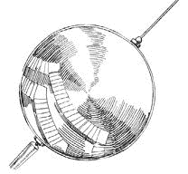

### 第十八章 镜中世界

#### 我的世界照料我。

#### 双面镜

现实的显现有两种形式：物质的，即可触摸的；以及形而上学的，即超越感知领域的。两种显现形式同时存在，每一种形式相互渗透、相互补充。二元性是我们世界不可或缺的一部分，许多事物由对立面组成。

当你站在镜子前时，你代表一个真实的、活着的物质对象。而你的倒影另一方面没有物质实体。它是形而上学的、想象的，却与被反射的物体一样真实。

整个世界可以被视为一面巨大的双面镜。镜的这一边是物质宇宙，镜的那一边是形而上学的变量空间。在双面镜中，与普通镜子不同，物质世界作为上帝的意图和思想，以及作为祂化身的所有生物的意图和思想的反映而存在。

变量空间就像一个矩阵或模板，用于所有物质的“剪裁”、“缝合”和“走秀”，即运动。变量空间包含有关物质世界中可能发生什么以及如何发生的信息。它包含的可能现实数量是无限的。每个变量代表场的一个扇区，由脚本和布景组成，即物质运动的轨迹。换句话说，扇区决定了在每种特定情况下会发生什么，以及看起来会是什么样子。

因此，镜子将世界分为两半：现实的和想象的。一切获得物质形式的事物位于现实的这一半，并按照自然科学定律发展。科学以及传统世界观仅适用于发生在“现实”中的事情。现实通常被理解为一切可被观察或直接影响的事物。

如果你去除了现实的形而上学一面，只考虑物质世界，那么所有生物（包括人）的活动就归结为在内在意图限制内的原始运动。正如我们所知，运用内在意图可以通过直接影响环境来达到目标。要以这种方式实现目标，你必须采取某些步骤，推推搡搡，排除万难，完成特定的工作。

物质现实是有形可触的。它对直接影响做出即时反应，从而造成一种错觉，仿佛这是取得结果的唯一途径。然而，在物质世界的领域内，现实可达成的目标范围显著缩小。你只能指望现有的东西。一切取决于通常匮乏的财力和严重受限的机会。

这个世界的绝对万物都浸透了竞争的精神。太多人想达到同一件事，而在内在意图的领域内，资源不足以分配给每个人，至少是不够分。那么，实现目标所必需的条件和环境从何而来？它们来自——变量空间。

在镜子的那一边，拥有一切，且没有竞争。商品没有实体，但妙处在于，你可以像从目录中一样挑选任何东西并下订单。迟早订单会被履行，你甚至不必付费。你只需遵守某些可控的条件，仅此而已。听起来像童话？

这绝非童话。它比现实更现实。思想能量从不无痕消失。它能将与所辐射的思想能量在质量上相对应的变量空间扇区物质化。似乎生活中的一切都是物质物体相互作用的结果。实际上，发生在微妙层面的过程，在虚拟维度中存在的变量的物质化身过程中，扮演着同样重要甚至更重要的角色。我们很少注意到微妙过程中因果关系的成分。尽管如此，它们构成了我们现实的大半。

通常情况下，变量空间扇区的物质化独立于个人意志，因为作为人类，我们不刻意、专注地使用思想能量，对不那么发达的生物来说更是如此。正如我们在《趋势冲浪》第一部分所展示的，心智图像对现实的影响主要表现为我们最坏的预期。

扎根于“现实生活”的人在空荡荡的货架间穿行，争相伸手去抢一个已经挂上“售罄”标签的产品。只留下质量较差的商品，但即使这些也很昂贵。人们不像翻阅目录下单那样简单，而是随机四处寻找想要的东西，在长队中等待，试图以某种方式挤过人群，结果却只能与售货员和其他买家发生争吵。这种方式依然得不到想要的东西，最后得到的麻烦比开始时更多。

这种黯淡的现实图景通常源于个体的头脑，并逐渐物质化，转化为物理现实。每个生物一方面用思想，另一方面用直接行动，创造出他们世界的层面。所有层面层层叠叠地排列在一起，每个生物都为现实的形成做出了贡献。

#### 现实合金

一个层面的特征在于一组特定的条件与境遇，它们构成了个体（从现在起我们特指人类）的生活方式。栖息地条件从优渥到匮乏、从舒适到恶劣、从友善到敌对不等。一个人出生时的环境自然起着重要作用，但其生活日后将如何发展，很大程度上取决于他们对自己和周围世界的态度。随后的生活方式变化，主要由该人的心智模式决定。被具象化的备选空间扇区，将在剧本和景致上与该人思想的性质和方向相对应。

因此，两个因素参与了个体现实层面的创造：镜子这边的**内在意图**，以及镜子那边的**外在意图**。一个人通过直接行动影响物质世界中的物体，而通过思想，他们将尚不存在的事物具象化于物理现实中。

如果一个人确信世间所有美好的事物早已售罄，那么现实中，货架上将为他们空空如也。如果他们认为必须在长队中等待数小时，然后支付一大笔钱，那便会如此发生。如果你的预期悲观且充满疑虑，它们会瞬间得到证实。如果你预期会遭遇敌对环境，你的预感将变为现实。然而，如果一个人允许“天地留存精华待我”这纯真念头渗透其存在，这同样会显化为现实。

那个不懂世事本无易得的古怪人，某天来到柜台前，货物刚好刚送到，仿佛专为他而来。结果发现第一位顾客免费拿走了一切，而在他身后，早已排起长龙，他们深信生活现实黑暗得多，古怪的傻瓜只是运气好罢了。

生活是一场游戏，世界不断向居民出同一个谜题：“去猜猜我是什么样的吧”。每个人按各自对世界的感知作答：“你很凶恶”，或“你很温馨”，或“欢愉、悲伤、友善、敌对、幸福、命运多舛”。

有趣的是，每个人都赢了猜谜。世界表示赞同，并以每位参与者订购的形象呈现在他们面前。如果那幸运的古怪人一旦遭遇“生活现实”便改变态度，他们的世界也会随之改变，将那“开悟的”傻瓜扔到队尾。

这就是个体如何用思想创造其世界层面的过程。只需几条简单原则即可解释。第一条镜子原则是：**世界如镜子，映照你对它的关系。**

世界字面意义上地赞同你对它的想法。那么为什么我们最坏的预期通常会成真，而希望与梦想却不成真？这是有原因的，且体现在第二条镜子原则中：**倒影形成于心意合一之中。**

只要心智不违背内心的愿望，反之亦然，一种深不可测的力量便会涌现——**外在意图**，它将具象化与思想形象相对应的备选空间扇区。在心意合一中，这一形象获得清晰轮廓，从而立即具象化于物理现实。

然而，生活中通常发生的是：灵魂渴望某事，心智却充满疑虑，不允许灵魂追随冲动；或者反过来，理智为某事提供令人信服的理由，内心却漠不关心。合一一旦破裂，形象便变得模糊。仿佛形象分裂了，因为内心渴望一物，理智却坚持另一物。只有两样东西能无条件地让心与意合一：**厌恶**与**恐惧**。

因为当一个人憎恨时，是全心全意的；当恐惧袭来，则充满其整个存在。在厌恶的合一中，生成了一个清晰形象，描绘你想避开之物。作为现实的两种显化——物质与形而上，心与意汇聚于同一点，思想形态具象化于物理现实。结果，你得到的正是你无法忍受之物。

与恐惧不同，欲望不易实现，因为这种情况下合一鲜有达成。内心抗拒理智，因屈从于**摆动器**的影响，追逐他人的目标。理智要么未觉察其最深层欲望，要么不信其能实现。

有人认为，要达成目标，必须清晰构想命令，而后将相应思想形态释放入宇宙，随后什么都不做，以免阻碍其实现。若真如此简单……

此技巧仅在满足第二条镜子原则时有效。然而，心意合一仅在罕见情况下达成，因为几乎不可能彻底摆脱狡诈的疑虑。那该如何是好？

这引出了第三条镜子原则：**双面镜的反应有延迟。** 若无法满足第二原则，必须以长期围攻攻克堡垒。

试想一个颇为奇特的场景。你站在镜前，镜中空空荡荡。稍过片刻，你的倒影才如照片显影般浮现。某一刻你微笑，倒影仍是严肃神情。你举起双臂，镜像依旧。你立刻放下双臂，镜中仍无变化。要看见举臂的倒影，你必须维持举臂更长时间。

双面镜运作方式完全相同，只是时间延迟长得多，以致镜中变化几乎难以察觉。物质实化惰滞如沥青。尽管如此，思想形态——即趋避术（Transurfing）中的**目标幻灯片**——依可物质化。只需一个基本条件：你必须在心中系统性地长时间播放该幻灯片。

可见奥秘简至如此，真的只需这些。很难相信会如此平凡无奇。无魔法，只需日复一日的努力，它真管用；只是多数人缺乏耐心坚持到底。他们被某想法点燃、鼓舞，却很快热情消退，将想法搁置待后。要物质化思想形态，必须采取具体步骤操作幻灯片。若不做功课，别指望奇迹。

实现幻灯片所需时间，取决于目标复杂度。当心智仍疑虑目标能否切实具象化，形象将保持朦胧；但迟早，某种表征将开始在镜中显现。随之你将亲见外在意图为你敞开必要之门、提供必要良机以达目标。这会让心智确信技巧见效、目标切实可行。渐次，心意走向合一，将思想能量辐射聚焦为更锐利的形象。结果形成倒影，创造出常被视为奇迹之事：看似不可能的梦想，转化为现实。

#### Transurfing：世界镜像与现实塑造

##### 幻灯片技术与背景层

借助 Transurfing 中前述的幻灯片技术，你可以成功创建一个图像，世界镜像会将其流入物理现实。除了具体图像之外，保持一个恒定不变的世界背景层也大有裨益，它能持续营造有利氛围。

##### 镜像的差异性

你可能注意到过，当你看不同的镜子时，倒影会有所不同。虽是同一张脸，但每面镜子都会凸显出倒影中不同的细微差别。这些极微小却切实可感的差异包括：情感色彩、情绪，甚至心理类型。取决于镜子，倒影可能显得慈善或愤怒、健康或病态、有吸引力或平庸、温暖或冰冷。

你可能会好奇这种差异的成因，因为每面镜子的反射表面客观上都应忠实呈现同一图像的精确副本。然而，一系列因素都能对图像传输产生实质影响。就像照片一样，光照、背景颜色和镜子本身都起着关键作用。

##### 威尼斯镜的秘密

早在中世纪，威尼斯镜就因其独特魅力而著称。威尼斯玻璃因其卓越品质闻名世界。但赋予镜子特殊品质的并非玻璃本身。人们发现，不知为何，在威尼斯镜中欣赏自己的倒影比在普通镜子中愉悦得多，因为它能让面容倒影看起来明显更迷人。

原来，威尼斯大师们有着独家秘方。他们会在汞锡齐（镜子背面的涂层成分）中加入黄金，这导致暖色调在反射光谱中占据主导。

##### 调配你的专属汞锡齐

你可以为自己完善双重镜像的一小部分。为了让你的世界层更舒适，你可以尝试调配自己的汞锡齐。你的世界层由无数不同的反应构成，涉及你与自我的关系，以及你与周围世界各种显现的关系。关键在于在这些关系的光谱中挑选出一条特定的主线，以确定主导背景。

例如，你可以选择以下公式作为主导：“我的世界照顾我”。当人们对某事不满时，会随时表达对生活的态度；而当好事发生时，却视作理所当然，近乎漠然。我们无意识地这样做，像牡蛎一样凭习惯做出反应。

##### 有意识地调整视角

现在你可以超越牡蛎层级，觉醒过来，利用你能有意识地表达对生活态度这一优势。刻意调整你的观点，使其与主导理念保持一致，然后你就会看到镜子如何做出反应。这将是你塑造现实之路上的第一步。

##### 童年的记忆与世界的关怀

还记得你小时候，世界确实照顾你，但你当时并未真正珍视，而是视若珍宝。回望过去。也许你在乡下看望祖母时体验过这种感觉。将心灵之眼投向遥远的过去，那些你感到安全宁静的日子。记忆片段可以异常清晰。仿佛神圣的香气从厨房飘来，祖母依然在烤蛋糕。又或者你坐在河边垂钓，或滑雪下山。那时是什么感觉？你还记得那种宁静感吗？

那时之所以如此，是因为世界确实照顾你，尽管你可能隐约怀疑这是真的，但从未赋予它特殊意义。话说回来，那时你也没有什么特别的抱怨。一切都很好。即使孩子淘气，也不会全心全意地不满。他们会尖叫跺脚、挥舞双手，但世界依然小心翼翼、关怀备至地抱着孩子，深情地重复：“怎么了，小宝贝？弄脏自己了？那我们去把它收拾干净好吗？”

随着人的成长发展，世界为他们留下最好的，赠予令人兴奋的新玩具，深情呵护。世界照顾它的小监护人、宠儿、心头肉。幸运的孩子发现各种新乐趣，万物皆新鲜，却未意识到自己正在享受当下的生活。只有多年后，当他们回忆起过去多美好、对比现在有多糟时，才会明白这一点。

##### 为何色彩褪去？

那么，为什么随着时间流逝，生活的色彩会褪去，轻盈的宁静会被焦虑的担忧取代？也许是因为随着年龄增长，我们要应对的问题增多了？不，是因为长大后我们养成了表达负面态度的倾向。不满比舒适和安宁带来的满足感更强烈。

我们未能理解尽管一切看似完好，我们当下其实是幸福的，却向世界索取越来越多。监护人的要求变得更大，监护人本身变得更娇惯忘恩。世界自然无法跟上监护人快速膨胀的需求，宠儿开始抱怨，改变对世界的态度：“你真坏！你不给我一切我想要的！你不照顾我！”此时，负面关系被未被满足的灵魂和任性的理智充注了全部力量。

##### 镜像的回应与恶性循环

世界是一面镜子，所以它别无选择，只能绝望地摊开双手回应：“随你便，我的甜心。成全你吧”。结果，作为人类思想反映的现实变得更糟。当事态发展到这一步，人有了更多理由感到不满，结果他们与生活的关系进一步破裂。于是，昔日的宠儿和心肝变成了脾气暴躁、命运亏待、不断抱怨世界欠他东西的怨妇。

这是一幅凄惨的图景。人们忘记了是他们自己毁了一切。在镜子倒影中发现某些不愉快的特征，他们将注意力聚焦其上，直到表达负面回应变成自动反射。结果一切比以前更糟。在倒影中，现实逐渐变得黯淡，形象也是如此。这就是为什么个体的世界层失去了原有的光彩，变得越来越沉闷不适。

##### 重拾美好：简单而有效

然而，你可以非常简单地找回一切：童年时那种冰淇淋的味道、平静的宁静、新鲜感、对更美好事物的希望以及生活的喜悦。你不会相信这有多容易。但你不必相信。去尝试！没人会想到，他们可以通过掌控自己与现实的关系来更新自己的世界层。你如何看待世界，你的世界就会变成什么样。这不应被理解为某种软弱无力的“乐观看待生活”的挑战，而应视为塑造你自己现实的真实步骤。

#### 追逐你的倒影

从这一刻起，无论发生什么，都要以有意识地掌控你的人生观为准则。此时此刻事情不如你意也无关紧要。实际上事情并没那么糟，当然也可能糟糕得多。天上不会掉下石头；你脚下的大地并非烈火焚身，也没有野兽在追赶你。确实，自从你对世界冷淡以来，世界已大变模样。你还记得它曾如何将你拥入怀中，喂你吃奶奶的蛋糕，给你讲故事吗？后来你长大了，你与外部世界之间竖起了一堵疏离之墙。温暖的自发性变成了疏离；信任被恐惧取代，友谊沦为冷酷的算计。然而世界并未发怒背弃你。它只是沉默了，像一位因冷遇而受伤的老友，陷入深思，默默陪伴在你身旁。

环顾四周。你的世界依然在照料你。它为你种下了这些花、这些树。你从不在意阳光、天空或云朵，但试想若它们不复存在，生活会成何模样。辛苦工作一天后，傍晚时分你能享受片刻放松与舒适，而窗外大雨倾盆、寒风凛冽。世界依然喂养你、让你安眠。世界注视着你，渴望着那些快乐时光的回归。可你却转过身去，沉沉睡去，深信世界已今非昔比，往昔再不可追。

世界并未改变，正如镜子从不改变。改变的是你与世界的关系，随之改变的还有作为你思想倒影的现实。

现在振作起来，睁开眼，坐起身，环顾四周：这依然是从前那个照料你、曾让你如此享受相处时光的世界。想象一下，当你终于从幻觉中醒来，世界会多么欣喜。

如今你们重聚了，一切将重归往昔。绝不能再以忘恩负义的态度冒犯这位忠诚的老仆人。最重要的是，切勿心急。因为根据第三面镜子原则，它需要时间恢复如初。起初你需要展现耐心与自控。你必须明白，这是你塑造现实的特定工作的一部分。

你要做的工作如下：在任何境遇下，哪怕最琐碎的小事，也要确认你的融合公式。发生什么无关紧要，无论是好事还是坏事。当幸运降临时，别忘了告诉自己世界真的在照料你。在生活的每一个细微之处引用这一确认。当你遭遇令你失望之事，务必即便如此也要告诉自己，一切都在按意图协调原则顺利展开。

无论境遇如何展开，你的反应必须坚定不移。世界时刻在照料你，无条件。若幸运降临，要格外留意正在发生的一切；若运气不佳，遵循意图协调原则，这样你将永远停留在成功的生命线上。你无需知晓世界在保护你免受何种危险，亦或以何种手段守护。请信任世界。

学会信任至关重要。当人身处困境，往往更倾向于依靠自己，而非指望柳暗花明。成年人总坚持“我自己能行！”于是世界将他们放下，给他们独自应对的机会：“好好好，我亲爱的。没我的帮助你也行。”

打破不信任的冰层。每当面对问题，哪怕相对微不足道，对自己说：“我让我的世界来照料我”。这不意味着你该两袖子一甩、什么都不做。而是采纳这样的念头：万事本会自行顺遂。镜子将完美折射你的认知：“既如此你认为，那就如此成全”。

养成让世界照料你的习惯，从日常琐事到人生大事。若你出门未带伞、天色看似要雨，别折回屋内。告诉自己：“我和我的世界要去散步”。对你的世界说：“你会照顾我的，对吧？”你的世界当然会回答：“当然，我亲爱的”。你可以大胆依赖你的世界。它不会下雨，即使下了，世界也会及时为你提供庇护所。

若事情不那么顺遂，别生气，别苦苦怀疑世界是否照料你。记住你正站在镜子前。镜子仅折射你的心态，仅此而已。生气毫无意义，与疑虑纠缠更是徒劳。留出犯错和挫折的空间。最重要的是坚守你的大方向。

若你允许，世界能为你承担各式各样的事。人无法解决所有自身问题。将它们交给世界处理，因为世界解决它们的能力远胜于你，不可估量。例如，你无法仅凭内在意图规避所有威胁，因为你的世界层与无数其他层相交。与其将意图指向自身安全，不如指向创造一个照料你、保护你的世界。届时你世界的意图将为你效力。

视你最关切何事，你可自选专属融合公式。例如，你可从中择一：“我的世界为我择优。当我随替代流而动，世界在中途与我相遇。我以意图创造我的世界层。我的世界保护我。我的世界消除我的问题。我的世界安排万事，使我生活轻松舒适。我下单，我的世界履约。我或许不知如何最好照顾自己，但我的世界知晓。发生的一切皆助成我的意图实现，一切皆按应有之义发生”。

你甚至可创造全新、独一无二的融合公式，甚至多个。但我必须强调，最重要的是保持耐心，不厌其烦地在每一个合适的时机陈述融合公式。持续努力仅在初期需要，直到它成习惯。此后便是一帆风顺。

这简单技巧是钥匙，开启远超你预期的力量。你通过掌控与世界的关系来掌控现实。双面镜将替代空间中世界照料你福祉的区域具象化为物质现实。时日久长，你将创造出极其惬意的现实。

准备好迎接一场壮丽的愉悦事件瀑布吧。我毫不夸张。你的世界层将在你眼前真实地蜕变。你会惊讶于事物变化之快，在这一刻你会意识到，你将永不再以相同方式注视世界之镜。你将体验变革之风的升起。那风会照料你。这一点你可以确信。

每个人以其心理视角构建自己世界的个体层，即自己的现实。其现实基于态度呈现特定基调。比喻而言，会设定某些“天气状况”：可能是阳光下的晨间清新，也可能是阴天伴随暴雨，甚或狂飙飓风和自然灾害。

在某种程度上，现实正如人们普遍认为的那样，源于个人的直接行动。然而，思想形式同样强大，只是其影响力不易察觉。无论哪种情况下，大多数问题的根源在于对生活的消极态度。在形而上层形成的混乱随后必须在物理层面进行梳理，这进一步使问题复杂化。

总体而言，一个人独立现实的图景取决于其在与周围一切事物关系中的定位方式。同时，一个人的心框架也受周围环境的制约。因此，我们面临的是一个封闭反馈循环：现实是个体思想形式的映射，而这些形式又在很大程度上由该映射本身决定。

当一个人站在镜子前时，会将全部注意力集中在镜子上，而不试图审视自己内在。结果发现，在反馈链中起主导作用的并非是形象，而是倒影。由于被自身倒影所迷住，人会发现自己处于镜子的支配之下。他们未曾意识到，自己其实可以改变原本。正是这种对倒影的痴迷关注，导致人们主动获取自己并不想要的东西。

通常，我们的负面情绪会完全俘获注意力。我们沉溺于对那些本希望改变之事的思考。我们思考自己不想要的东西，同时又不希望自己思考那些内容——这就是悖论。镜子不会考虑人的意愿或 reluctance，它仅忠实地复制形象的内容，不多不少。这实在荒谬。人们自愿随身携带自己无法忍受之物。那句格言应为“我的思想是我的敌人”，而非“我的舌头是我的敌人”。尽管此观点荒唐，但事实确实如此。

当一个人产生仇恨时，会将全部心血与心思倾注于此情感。锐利的形象会在镜中完美映射，充盈其世界层。你所憎恶的，必将在生活中大量出现。这会使人变得更易怒，进而强化该情感的强度。在心理层面，人会达到临界点，准备对所有人吼叫：“滚开！” 随后，镜子将此事件如飞镖般弹回——你让所有人滚开，他们也同样以此相待。这是否导致问题数量激增？必然会。如果你站在镜子前怒吼：“全体滚去地狱！”，镜中映出的将是你随同你的整个世界一同下地狱。

同样地，被谴责的对象也会穿透“控诉者”的那一层。设想这样一个典型场景：一位愤怒的老妇人以苦涩的指责对待整个世界。她当然是严格且 infallible 正义的完美化身——“在他人面前和自己灵魂前心无愧”。世界其余部分必须承担后果：它未能完全符合她的期望。一个极为精确、清晰锐利的图景由此绘就。当她以这样的态度凝视镜子时，就在她周围的世界中构建出等价的现实——即彻底的不公。世界又该如何回应？它既不评判她，也不为自己辩解。凭借其固有品质，世界恰好变成了她所想象的样子。

当人对某事持抗拒态度时，亦会出现完全相同的现象。例如，若一个女人对饮酒者持强烈厌恶，她将注定在每一个转角遇到饮酒场景。她将不断目睹醉酒的各种表现形式——极端情况下甚至可能嫁给一个酗酒者。她厌恶的程度越深，丈夫转向酒瓶的强度就越大。丈夫可能偶尔试图戒酒，但妻子对醉酒的憎恨达到如此程度，以至于她实际上在享受这一过程，并坚持 declare：“你永远戒不掉！” 除非丈夫拥有钢铁般的意志，否则妻子的执拗厌恶最终会将其思想形式灌入丈夫世界的层中。

悲观倾向是一种相当不讨喜的品质。“反正也不会好转” 的心态，就像一种施虐受虐倾向。悲观者在这种自怜中获得某种变态的快乐：“世界如此糟糕，已无法再坏下去。它正走向地狱，并将我一同拖下去。” 从 negativity 中获得快感的病态习惯，伴随对怨恨的执着而发展。“我是这样一个好人。你就是不重视我！这太不公平了！就是如此。我感到被冒犯。别试着劝我放弃。不久我就会死，到时候你才会后悔！” 而这究竟带你去了哪里？致命 misery 的图景不仅在镜中得到映照，而且被牢固巩固。苦涩的人下达失败的指令，然后庆幸地说：“你看，我早就说过！” 镜子所做的不过是执行命令：“遵从你的意愿！”

在这种注定毁灭的心情下，失败者陈述自己令人不羡的处境：“生命仅是隧道尽头毫无尽头的黑暗”。他们绝不愿为此命运付出任何代价，于是将全部思考能量用于抱怨和诉苦。如果意象仅仅是不满的表达，镜子还能映出什么？当意象为：“我不快乐”，“我不愿”时，反射必为：“这是事实，你不幸福且不愿”。同样，反射纯粹是事实的呈现，不多不少。

对自身的厌恶同样具有悖论性。它是自我生成的。可纳入“完全笨蛋教材”的一条金科玉律是：“如果我不喜欢自己，我就不喜欢自己”。尽管这听起来奇怪，但这句重言式蕴含了一条被大众所遵循的原则。

以外貌为例。你可能注意到，大多数小孩子都非常甜美且具有吸引力。那么，为何如此多的成年人对自己的外貌感到不满？根源在于那面镜子——它忠实地回传所有抱怨。那些长大后变得美丽的人，正是那些欣赏自己的人。这就是秘诀。这些人遵循这样的原则：“如果我喜欢自己，我就会有更多理由进一步喜欢自己”。

然而，当形象对其倒影说：“我似乎长了点体重。我需要减掉几磅”时，镜子会毫无感情地回答：“没错，你胖了。你需要去节食。” 或者：“我变得有点瘦，我应该增点肌肉”，得到的回应是：“没错，你太瘦了，去举重吧”。现实回应就像一个回声，确认它所听见的内容。

正是通过这种方式，自卑感得以生成。自尊心低下随之伴随一个相应的评判，而镜子将其具象为现实。“我认为我没有任何特殊天赋”。 “的确，你只是平庸”。“我认为我不配拥有最高层次的幸福”。“的确，你根本无所指望”。

此外，若一个人同时具备与生俱来的罪恶感，那么其结局已然注定。“我该负责吗？我必须履行我的职责吗？——是的，你该受到惩罚，并且你将会受到惩罚。” 否则又该如何？只要一个人即使在潜意识中感到内疚，某种形式的报复必定会在镜中如实反映出来！

#### 压力与恐惧的瞬间显化

压力和恐惧是否也会瞬间显化，这难道还需要多说吗？人们害怕许多事物，其中大部分并未发生，因为将它们具体化为现实需要消耗过多的能量。意外和灾难总是在选择流的平衡被打破时，表现为一种异常现象。然而，如果一个不幸事件处于流场的附近，它无疑会发生，因为人们用思想吸引了它。

##### 怀疑的反向效应

怀疑却产生相反的效果。与恐惧将人的注意力集中在某一事件可能实现不同，怀疑更关注于“不会发生什么”。显然，在许多情况下，仿佛是为了跟我们作对，我们的怀疑得到了证实。然而，为什么事情似乎总是跟我们作对地发生？现实中，镜子只是在反映我们的思想内容，仅此而已。

无论如何，想要避免某事的愿望会极大地增加遭遇它的可能性。随后一切似乎都在跟我们作对，这通常导致个体长期处于烦躁状态。烦躁完成了一个人心理面貌的整体图景。结果形成了一个整合的形象：“我感到不适”。个体的现实随之组织，并以一种维持或加剧这种不适感的方式被创造出来。

正是由于他们自己的消极态度，人们将自己世界的层层画成了黑色。任何由内心热情点燃、由思想信念支撑的态度，都会映照在现实中。此外，无论一个人试图表达的是吸引还是排斥，该态度都将被完美地复制。这里我们看到了第四条镜子法则：**镜子引述关系的内容，但忽略其取向。**

##### 面对不想要的显化时的反应

当人们看到不想要的事物正在显化时，会如何反应？他们不看像本身，而是将所有注意力集中在像的反射上，并试图改变它。反射是物质现实，在物质现实中，你的行动仅限于内在意图。这意味着，如果世界不听你的，你无法让它按你想要的方式运行，你就必须扼住它的喉咙，拼尽全力将其拖向你想要的方向；这至少是一项艰巨的任务，在某些情况下甚至完全不可能。站在镜子前试图抓住自己的倒影，指望有所作为，这是完全荒谬的。

内在意图试图通过直接行动，改变一个已经准备就绪并实现了的现实。房子已经建好，但不是你想要的样子。你不得不拆掉重建，但最终结果也不尽如人意。有时感觉就像驾驭一辆失控的汽车。刹车失灵，发动机要么熄火，要么在五挡位咆哮。驾驶员试图适应现实，但汽车完全不可预测。

似乎合乎逻辑的是，如果你想避开路径上的障碍，应该向侧面转向。然而，事实恰恰相反。从危险阻碍捕获你注意力的那一刻起，碰撞就变得不可避免。你向一个方向打方向盘，却被带向相反的方向。你踩得越用力，滑入侧滑的速度就越快。

原来，不是人统治现实，而是现实统治人。这就像你在遥远的童年记忆中可能体验过的感觉：你拼命奔跑、呐喊。世界不想听你说话。这太令人愤辱了！我记得有时我不想听、不想理解任何东西。我只是奔跑、尖叫，我的喊声伴随着脚踩在地面上的沉闷声响。你记得做过那样的事吗？我为什么那么愚蠢和迟钝？大人试图给我解释什么，但我绝对没有意愿去理解他们想说的话。一切都必须按我想要的方式，这就够了！

现在我自己也长大了，但没什么真正改变。我什么也没学到。我仍在跺脚，要求世界听我的。但世界处处跟我作对，所以我像过去一样奔跑、呐喊。我奔向现实，但内在意图的风迎面吹来，我的努力徒劳无功。现实控制着我，迫使我像牡蛎一样做出消极反应，这只会让一切变得更糟。

##### 如何驾驭这辆疯狂的车？

那么，如何控制这辆疯狂的车？人们该怎么做？人们在哪里出错了？我们犯的错误是盯着自己的倒影看。这就是全部问题。我们应该这样做：首先，我们必须结束对自己倒影的追逐，停下来片刻。这意味着将目光从镜子上移开，放弃将世界朝你想要的方向推动的内在意图。在这一刻，疯狂的车将原地停下，现实也将停下。然后，会发生一些不可思议的事情：**世界会走向你。**

#### 世界走向你

普通人的思维试图不成功地影响镜子中的倒影，而真正需要的是改变被反射的实际像。像是由一个人的思想本质和焦点产生的。问题在于，人们先看镜子，然后才对所见表达他们的关系。无论有意还是无意，这样做都会表达出一种加剧现实的意图。

消极倾向给镜子带来了更多消极特质。个体层被涂上了阴郁的色调，并充满了对其拥有者不愉快的事件。当一个人陷入绝望时，镜子里聚集了更多的乌云。如果你采取攻击性姿态，世界会瞬间竖起刺。你可能会注意到，当你与某人争吵并尖锐地表达不满时，紧接着就会发生另一些同样令人不快的事情。你越烦躁，新问题似乎越厚颜无耻地纠缠你。每个人都会用某事惹恼你。

人们通过重要性的丝线依附于镜子，因为镜子中发生的一切代表了我们的生活，因此具有重大的个人意义。人们要么喜欢所见，要么不喜欢。无论哪种方式，他们思想的内容都与倒影相符，从而继续强化既有局面。一个人对周围现实的依赖程度，取决于像被其倒影控制的程度。

你感受的强度越大，你对镜子的依附就越强。你怎么看待某事并不重要；重要的是你在想什么。无论你喜欢还是不喜欢倒影，你仍在关注它。只有思想的内容才有意义。排斥总是聚焦于外部：“别烦我！”或“我受够了这一切”。无论其本质如何，你的关系仍聚焦于你不满的对象。由心智合一产生的热烈感受，赋予了像清晰的轮廓，结果，倒影开始被所有与像内容相符的事物所主导。

#### 现实的镜子：思想如何塑造命运

##### 贫富差距的根源

这正是穷人越穷、富人越富的原因。人们在生命的镜子前自我欣赏，并各自主观地陈述他们的现实是什么样子。这种现实像沼泽一样将你吸入其中。它就像排队等待领取养老金的老妇人，或是在拥挤公交车上提着沉重袋子的疲惫妇女，又或是被从一家诊所转到另一家诊所的病人。是他们的思想将他们束缚在阴郁的现实中。与此同时，其他人却在享受生活：大海、游艇、旅行、豪华酒店、昂贵餐厅，随心所欲。在任何情况下，无论环境性质如何，都在陈述同一个事实：“我们就是这样生活的”，而事实本应是：“我们以我们思考存在的方式而生活”。镜子证实并持续强化我们思想形式的内容。

##### 起点与命运

对此解释的标准反对意见是，所谓每个人的起始条件不同：有人生于贫穷，有人继承巨额财富。当然，起点很重要，它决定了一个人生活形象最初如何定位以及后来如何发展。但这并不意味着一切完全取决于启动资金。有大量例子表明，出生在最底层贫困中的人最终进入了社会最高圈层，反之亦然。也许这些只是证明规律的罕见例外？这可能是真的，但如果存在例外，这条规律就不可能像你想象的那样不可改变。无论你发现自己身处多么黑暗的深渊，请知道这一点：你可以改变一切，而且你可以彻底改变。你完全不知道如何实现这种改变并不重要。你不必能看到具体的出路。解决方案会自行呈现。

##### 打破封闭的循环

你以为你受制于无法改变的环境。然而这只是幻觉，一场骗局，如果你愿意，可以轻易摧毁它。事实上，我们都在潜意识中在这个封闭的圆圈里徘徊：我们观察现实 —— 我们表达对它的态度 —— 镜子将我们态度的内容在现实中固化。要改变现实，我们只需打破这个圆圈。

你审视自己世界的现实，感觉改变是不可能的。在某种程度上确实如此，因为你试图用内在意图去影响倒影，而内在意图没有显著改变任何事物的力量。镜子这边的机会太少了。另一方面，你确实有能力控制你与现实的关系，然后外在意图可以接管一切。外在意图无所不能。在镜子的另一侧，存在着人类头脑甚至无法想象的事件发展替代方案。

##### 第五镜子原则

为了启动外在意图的机制，必须满足第五镜子原则：将注意力从倒影转移到形象上。换句话说，你必须控制你的思想。思考你想要并努力实现的东西，而不是你不想要或试图避免的东西。

再看一遍封闭圆圈公式。人们就像驴子追逐棍子上的胡萝卜一样，在镜子圆圈周围移动。驴子被其态度（对现实的原始反应）系在镜子上，同样毫不费力地试图在努力改变什么的过程中追上倒影。现在让我们看看如果我们反转镜子圆圈会发生什么：我们表达态度 —— 镜子将我们态度的内容在现实中固化 —— 我们观察现实。那么这能带我们到哪里？

关于倒影的原始且无力的陈述结束了，取而代之的是关于形象的有意识的、目标导向的陈述。我不是习惯性地对镜中所见表达不满，而是开始创造我想看到的形象。这是走出镜子迷宫的出路。世界停止了，然后出来迎接我。我不再奔跑。我站着不动，注视着现实向我走来，不同的风吹在我的脸上。现在是外在意图之风。

这一次我把一切都反过来做了：我停止了对自己倒影的徒劳追逐，放手让世界自行转动，顺应我的思想。镜子圆圈仍然是一个封闭的圆圈，只是现在我不再打转。圆圈由外在意图的力量自行旋转。外在意图取代了我的内在意图，因为我放弃了影响倒影的尝试。我只是在脑海中形成一个深思熟虑且渴望的形象，双重镜子将替代空间的相应区域实现为现实。

##### 改变思维模式的困难

唯一的困难在于情况会显得陌生。陌生之处在于“我们观察现实”这一要素被放在了圆圈的最末端。人们更习惯按照“我看到什么，我就抱怨什么”的规则行事。他们将态度发送到世界，世界返回一个稀释版本，如回声般：“我真希望别下雨” —— “下雨，下雨……”；“我不想学习！” —— “学习，学习……”；“我不想工作！” —— “工作，工作……”结果，态度的纯化内容被物质化为物理现实。

你可以想象镜子会进行怎样的独白，厌倦了所有的困惑。

> “你感觉不舒服。好吧，那么为了感觉好些你需要什么？”
>
> “你不想做现在正在做的事。那么你能否赏脸告诉我你想做什么？你不喜欢现在拥有的。那么告诉我，亲爱的，你想要什么？”

这非常简单。你必须将消极态度转变为积极态度。盘点你的思想，去掉所有“不”字。不满、抗拒、不赞同、仇恨、缺乏成功信念等，所有这些情绪都必须塞进垃圾袋，扔到垃圾场。你的思想应该调谐到你想要和喜欢的事物上。这样，镜子中只会反映愉悦的事物。

##### 耐心与觉知

需要理解的是，有利的现实不会瞬间创建。它需要耐心和觉知。再没有什么会是一样的了：现在你不再对生活的现实做出反应；你掌舵并有意识地将你选择的思想形式发送到世界。与可见的消极倒影相反，你表达的是积极态度。这有点奇怪，但什么更好：像普通人一样做环境力量的受害者，还是根据自己的意愿决定自己的命运？

##### 创造心境

一个人的心境通常是对展开的环境的反应，无论这些环境是否有利于你的成功。通常，消极倾向让一个人的精神处于低谷。你必须做相反的事，有意识地创造你的心境。即使知道你有能力塑造自己的现实，也能大大提振精神。凭借我的意图，我为我的现实选择色彩。无论我生活中的环境如何，我都做我需要做的事来保持振作。我有意识地这样做，而不是以原始方式对外部刺激做出反应。这必须成为一种习惯。幻灯片、视觉或音乐，无论你喜欢什么，都可以帮助创造正确的心境。理想情况下，它应该是一幅你目标已达成且你感觉极好的画面。

##### 应用层级

掌控现实的过程可以用不同程度的强度和应用来处理。使用混合体是最简单易行的方法。它能让你创造一个普遍的舒适和幸福背景，这在大多数情况下已经足够了。实现梦想需要更多的耐心和专注。任何人都可以根据自己的需求程度使用镜子技巧。

##### 具体技巧

我们的世界是思想的反映，这个观点并不新鲜。似乎每个人都隐性地理解这个想法，但同时它仍然模糊不清，因此这种知识没有多少实际益处。你应该做什么，怎么做？很少有人有时间致力于精神启蒙，理解自然力量的奥秘或开发自己的力量。

不过现在，你手头有了一个具体的技巧。你明白它如何运作以及如何使用它。停止在镜子循环中奔跑，你将看到世界会走向你。

##### 创造者的意图

所以，为了在世界之镜中看到你渴望的现实，你必须采取某些基本步骤：在心中有意识地塑造相应的形象，不理会延迟的倒影，只在寻找新出现的现实的任何显现时偷看一眼。

##### 克服根深蒂固的信念

问题是，即使你意识到了延迟，也很难习惯这个古怪的镜子。一个观念深深植根于我们的意识中：现实要么像我们拿着棍子驱赶它那样即时听话，要么完全无法控制。我们认为如果愿望此刻不实现，它就永远不可能实现。你做不到做不到的事。人们随后就认命了，认为他们能做的只有做梦，魔法是不可及或超验的东西。

我们都习惯认为魔法必定是与现实截然不同的东西。幻想世界在遥远的彼方或我们的想象中，而现实生活则在此处。无法逃避，也无法改变。魔术师和拥有超感官能力的人也生活在一个特殊的独立世界里，而我们这些有着普通烦恼的普通人，只能在这灰暗的现实中艰难跋涉。

事实上，不存在所谓的魔法。只有对**双面镜**原理的了解。这种知识并不难获取。事实上，它过于透明和朴素，以至于永远无法符合“魔法”的教条。然而，阿拉丁的神灯看起来像个旧罐头盒，圣杯也非黄金打造。一切伟大的事物都极其简单。它们不需要装饰或保密。相反，正是那些空洞无用的事物，隐藏在宏大和神秘的面纱之下。

一旦魔法融入平凡，褪去童话属性，它就不再与神秘和秘密领域联系在一起。当魔法在日常生活中占据一席之地时，它就失去了那迷人的神秘元素。这种转变奇妙之处在于，日常现实反过来也不再是日常，而是转变为一种可控的未知现实——一种**清醒梦**，只要遵循镜子原则。

你可能已经熟悉**Transurfing（穿越时空的冲浪/趋避之道）**方法，并知道如何操作**目标幻灯片**。时间流逝，却无事发生。这感觉就像寄出一封信，然后漫长地等待回复。心智因不耐烦而变得焦躁不安。你开始怀疑自己做得不对，或者这一切其实是一堆废话。

但世界不会停止，镜子中反射实现的过程仍在继续。只是这个过程微妙且难以察觉，所以看起来好像什么都没发生。在这个阶段，心智的天平在“镜子反应有延迟”这一认知与“观察到直接行动与后续结果几乎即时相关”的旧习惯之间摇摆。

当心智未感知到可见结果时，它在想什么？它认为采取的行动无效或错误。那么镜子反射什么？正是如此，它反射同样的内容。过程最终被拖慢或走向不同方向。你可以想象心智正在与世界进行这种对话。

——我要玩具！
——当然啦，宝贝。
——但你答应了！
——嗯，是的。你求了，我说你会有玩具。你看起来对拥有它很满意。
——你误解我了！我要马上、立刻、现在就要玩具！
——不，我明白得很：你现在就要。
——那它在哪呢？
——没错，它在哪呢？
——我们俩肯定有个傻瓜。
——无疑。
——见鬼！我完全忘了你只是个愚蠢的镜子。我怎么能跟你说话？然后我记起了：你正在给我玩具。
——好啦好啦，我的甜心。
——那我们去拿它吧？
——当然啦，亲爱的，过来，我带你去。

于是他们动身去取那渴望已久的礼物。现在只需稍加耐心，愉快地花时间准备迎接这件事。心中欢唱，心智摩拳擦掌。他们为何不满足呢？因为他们正和世界一起去买玩具！**Transurfer（冲浪者/实践者）**会明白，一个人做出的选择会转化为一条不可辩驳的法则，必将实现。只需将注意力集中在最终目标上。然而人们从不满足。

——你觉得我们走对路了吗？我这儿没看见玩具店啊？
——别担心亲爱的，马上就到。
——但什么时候？我觉得我们拐错弯了，进了后巷。
——你觉得呢？
——是的，当然，我们迷路了！
——随你便啦，宝贝，你知道我总赞同你。
——愚蠢的镜子！我就知道不该指望你！你把我带哪来了？
——我想顺路去公园，趁出来推你坐旋转木马。

当人们被蒙上眼睛领着走时，会感到不安。心智根本无法接受“毫无进展”或“事件未按预期展开”这一事实。心智就像一台**控制论机器**。当工作算法被打乱，红灯亮起。二者的唯一区别在于，心智创造自己的程序或脚本，天真地以为能预先核算所有未来变量。所谓常识的原始性在于，它不仅选择刻板的行动程序，还坚持照做。

在做出选择、设定最终**目标意象**的那一刻，世界之镜接收到指令，开始按特定计划实现它。只有镜子知道意象的反射将如何形成，因为手段对心智不可及。然而当心智看到事件按某种奇怪剧本展开时，它拉响警报，个人随即掐住世界的喉咙。非得做点什么不可！人认为事态发展不顺，从而开始扭曲**目标幻灯片**。除此之外，人还采取行动支持自认为更合适的剧本，结果又阻碍了另一个无法理解却能带来必然成功的计划的实现。这就像你用自己的球把自己斯诺克了，正如俄罗斯谚语所说：“装不进盒子，拿不出盒子，也不放过盒子”。

人死死抓住自己的剧本版本不放，自信这代表通往目标的路，结果阻止了目标永远实现。但这还不是全部。渴望尽快得到玩具的不可抑制的欲望，泵起了如此多的过剩势能，以至于镜子字面意义上被扭曲了，扭曲的镜子有什么用？

欲望本身是必要的，因为没有欲望就没有追求。若在此基础上加上行动的决心，你就拥有了实现目标的**意志**。但若加入怀疑与对失败的恐惧，你得到的就是**渴求**。这就是必须有意识地降低的**重要性**。欲望本身不产生实质性的过剩势能。只有当你的怀疑和恐惧让你抓住世界的后颈时，它才成为问题。

人们通常或多或少按这样的思路思考：我想要，但我怕行不通。背负着成功或失败的自我强加责任，是沉重的轭，导致人们给自己和周围世界设下苛刻条件。他们对自己要求过高，对生活期望过高。结果镜子被扭曲了三重：我要，我怕，我放不下。这是一面扭曲的三面镜。

如果你认为**意图**意味着坚定地要求世界欠你的东西，你想看到的结果将避而远之。如果你请求世界给你想要的，你依然一无所获。重要的是明白，你只需下单，允许世界为你执行。你之所以不允许世界这么做，是因为你的要求、请求、恐惧和怀疑。作为回应，世界也要求、请求、恐惧和怀疑，完美反映你的状态，因为世界只是一面镜子。

#### 感受与镜像的哲学

你必须捕捉到这种感觉。放下世俗烦恼，允许世界成为你此刻舒适栖身之所。这是一种微妙、转瞬即逝的感觉，它来得快去得也快，但必须紧紧抓住。试想片刻不可思议的景象：那个充满敌意、问题、困难与不便的世界，变得欢愉且舒适。你可以允许世界变成这样；是否这么做，全凭你自己。

这并非指默认就要快乐。而是关于允许快乐进入你的生活。我们之所以快乐，只因我们允许自己构想难以置信的好运降临的可能性。你无需强迫自己快乐；只需允许自己享有快乐的奢侈。信任世界。它最清楚如何达成目标，并会料理一切。你通常不会担心一面普通镜子怎么能呈现出如此完美的倒影，对吧？当你站在镜前，只会想着希望在倒影中看到什么。世界之镜恰好就是带着延迟运作的。

##### 镜像原则导入

以防你尚未确信真的可以依赖世界，这里还有两条镜像原则。或许有人觉得遵循一套指令行事更容易。不过，在进入第六和第七原则之前，让我们快速回顾一下第五条。

假设你已确定目标，并开始系统性地运用目标幻灯片。你明白结果不会立竿见影。然而你的思维却坐立难安。时间流逝，似乎毫无进展，或发生了意料之外的事。在这些思维充满疑虑的时刻，激活你的觉知意识。你忘了那条法则：“回头望，便成石”。

你的注意力必须聚焦于最终目标，仿佛它已实现。当你专注于意象时，世界会向你走来。一旦你转身盯着镜中的倒影——那里正发生着上帝知道什么（或什么也没发生），世界便停滞了，而你重陷在镜圈周围那场精疲力竭、徒劳无功的奔跑中。

##### 延迟与坚持

你必须时刻提醒自己：镜子带着延迟运作，需要一定的停顿来拼凑倒影，即意象物化为物质现实的过程。在停顿持续期间，你必须坚守阵地，哪怕万事似乎尽皆崩塌，也要相信既定条件与最终的成功。你最终收获什么，取决于你在不屈服于沮丧方面有多勇敢。这是真正的魔法，虽褪去了神秘色彩，却拥有实实在在的力量。

你只应回头看一眼镜子——即表达你对所发生之事的态度——以察觉积极的转变，并允许自己体验那份愉悦的惊喜。换言之，你的双眼要对一切证明世界正朝你目标迈进的迹象睁得大大的，而对伴随而来（且不可避免）的负面现象紧闭双眼。若你有“绝不回头”的韧性，结果通常会超出你最高的期待。你不仅会得到一个玩具；他们还会让你在旋转木马上飞旋，请你吃冰淇淋。

##### 使用镜像的原则

从总体上讲，使用镜子的法则可表述为：看镜子时，别试图移动倒影；而要尝试移动意象——你与它的关系——并聚焦你的思想。换言之，“移动你自己”。别像小猫玩耍时试图抓住自己的“分身”，却不明白那只是自己的倒影。著名音乐家兼哲学家鲍里斯·格列本希科夫的歌中唱道：“她懂得如何移动自己……挺起身来，高高站立。”

你绕着自己的轴旋转，会观察到世界在延迟后开始缓缓跟随你转动，但你不会急着抓住它强行带动。这就是内在意图与外在意图的区别。内在意图迫使你试图影响倒影。外在意图是将镜子置之不理，将注意力集中在你的思想形态上，从而掌握一种真正的力量——一种能够移动世界的力量。“她挺身而立，我们该怎么办，妈妈！”

##### 放手与内外意图

这份力量的秘诀在于松开手中的控制。人类思维对任何未预料到的境遇 *разум* 以及对其剧本的哪怕最细微的偏离，都会以敌意相对。随之而来的反应，正如其天然且原始——试图纠正局面、反对、拒绝、坚持己见、争辩、做出突发举动、主动出击，等等。基本上，思维抓住倒影不放，执意要按自己的意愿行事。

当然，当你的注意力粘在镜子上时，你会陷入一种错觉：只需伸出手，近在咫尺、触手可及的现实，就会瞬间屈服于你的意志。并无此理。愚蠢的小猫被骗去与普通镜子玩耍，而站在意识阶梯高一级的人类，却陷入了完全相同的陷阱。唯一的区别在于，双重镜像的幻觉更为精致。仅此而已。

至关重要的是，你要将双手从镜子上拿开，允许世界自行流动。在绝大多数情况下，无需任何主动作为。只要温和灵活，顺应发生的一切即可。你或许还记得，若不加阻碍，变体流会沿最优路径引导事件发展。原始思维倾向于在水中拍打、逆流而划，执意维护自己的想法。现在，为摆脱幻觉，你必须扭转思维的近视意图，使其动态修正剧本以纳入不可预知的因素。这对思维而言是个全新且陌生的任务，却是摆脱“小猫角色”的唯一出路。

##### 第六原则：释放控制

第六条镜像原则为：释放控制，允许世界随变体流流动。内在意图随之扭转，向相反方向运动，这带我们进入如下悖论：放弃控制的位置，你反而获得了对局面的真正控制。

试着以旁观者的眼光审视周围一切。你是戏剧的一部分，同时又超然演绎，记录着舞台上的任何移动。若有人给你什么，别急着拒绝。若有人给你建议，细细斟酌。当你听到不同观点，别急着争辩。若似乎有什么做错了，放手让它去。若环境变了，别大惊小怪，试着拥抱变化。无论你卷入何事，采取最简单的行动。若须做决定或选择，优先考虑最自然的选项。

##### 平衡与行动

这并不意味着你要全盘接受、毫无保留地同意。闭上眼任由激流裹挟，与有意识、有目的地随流而动，截然不同。你会感知何时该收紧缰绳，何处该有意识地放松缰绳。放行世界，再观察它如何运行。像一位睿智的导师注视年轻学子，给予他们选择的自由，仅在必要时轻轻推他们一把，朝正确的方向。你会看到世界如何开始围着你旋转。

#### 第七面镜子原则

现在到了要向你介绍最后一个、也是最重要、最强大的镜子原则的时候了。除了无懈可击的反射能力之外，镜子还有一种特质：在镜子中，右变左，远距延伸的空间似乎朝相反方向移动。人们早已习惯了这一特质，并在头脑中学会将幻觉转化为现实。然而，人类的头脑仍然没有克服双镜幻觉带来的挑战。

##### 否定主义的问题

问题在于我们倾向于看到好的事物中的坏处，把积极的事物转化为消极的事物，并将自己的好运视为厄运。实际上，世界并不打算针对其居民进行谋划。问题不是常态，因为它们需要更大的能量消耗，而大自然从不浪费能量。替代方案总是沿着阻力最小的路径前进。可以说，它遵循着幸运际遇的道路。大多数问题是由个体在水中拍打双手、逆流而行所造成的。然而，主要问题在于否定主义的倾向，这种倾向会生成一个对应的图像，而镜子则将其流入物理现实。

请记住：世界所做的只是以绝对的精确度反映你与现实的关系。然而，即使反射看来多么阴郁，如果你将其视为负面事物，它只会变得更暗。同样，负面也可以转化为正面，只要你如此宣称。任何情境或事件都蕴含着既不利又有利的潜在可能。通过在此十字路口表达你的态度，你决定事件将如何发展——是成功还是失败。

##### 将任何反射视为正面

从长远来看，如果你遵循第七面镜子原则：**将任何反射视为正面**，即使是在最不利的情况下，你最终也会取得胜利。无论你在镜子中看到什么，你无法确定它究竟是对你有利还是有害，但你可以选择为自己争取最好的结果！

此外，当事情真的变好时，不要视为理所当然或保持冷漠。要感到欣喜，表达你的愉悦，并增强你对一切进展顺利这一事实的觉察。无论发生什么，一切都应当如此发展。这正是之前在《特兰瑟芬》中详细描述过的**协调意图原则**。

##### 感知的十字路口：实际应用

例如，想象你正面临某种问题。当你第一次遇到问题时，就像你站在一个十字路口，只有你自己能决定是将问题宣告为复杂还是直接。否定主义的倾向以及生活负担带来的疲惫，使人们屈服于问题的枷锁，悲伤地说道：“哦，多么困难！这是个多么复杂的问题。”世界立刻回应：“正如你所愿，我爱人。”

世界总是顺从，因此，既然情况如此，那就相反地告诉自己：一切正在非常顺利地得到解决。即使你并不真的这么感觉，也要宣称问题很简单。让这成为你的 postulatum（ postulatum 应为“ postulatum” 但根据上下文译为“假设”或“前提”，此处译为“前提”更妥）。实际上，问题之所以复杂，只是因为一个微小的细节——其伴随环境。这个细节由你对问题的态度决定。无论发生什么，世界 nuevamente（应为“再次”，原文拼写错误，此处译为“再次”）会同意你的看法。

“一切都在毁灭吗？”——“一点也不会。一切都在顺利进行！”

尽管你可能在任何“理性”和清醒的人眼中看来是个彻头彻尾的傻瓜，但请满意地搓搓手（“一切都好！”），拍拍手或做一个小小的欢呼跳跃。然后你很快就会发现，之前看来有害的情况实际上是你手中的王牌。这种镜子的特质总是以突如其来、出乎意料的方式发挥影响，以至于你永远无法习惯它。每次在你眼中失败转为胜利，你都会体验到一种无与伦比的欣喜感，使你想大声喊出：“不，你不要这么说！这是魔法！”

以前，从“常识”的角度来看，你会以完全不同的方式推理，这本来就会解释你曾经必须经历的所有艰辛和剥夺。从此刻起，每当你遇到任何问题或不愉快的情境时，请记住：无论环境如何，世界都将顺从你对正在发生之事的关系：“无论你希望什么，我亲爱的。”

##### 你就是创造者

你看到你现在拥有什么了吗？你不再需要坐着等待蓝鸟幸福降临，也不需要等待好运之轮转向正确的方向。你就是你成功的主人。你运用意志来宣告任何事件或情境都有利于你、对你有益。

这种方法超越了仅仅依赖世界的善意来照顾你，因为它爱你。整个世界只是一个冷漠的镜子，如果它照顾某样东西，那只是因为你以这种方式注视着它。这也不是一种可能被环境随时动摇的自信。也不是来自对成功的盲目信仰的自我确信。甚至不是由天生乐观带来的乐观态度。它是**创造者的意图**。你塑造你世界的那一层；你是你自己现实的创造者。

只要你知道如何“不否认世界自身自由移动”的前提下“移动自己”，你就是你现实的创造者。移动自己意味着遵循最后三个镜子原则。创造者并不是那么一个积极的行动者，而更像是一个观察者。创造者的意志不同之处在于它不从属，而是允许。

现在你已经知道如何处理惊人的双镜了。你不再需要害怕世界中他人会视为敌对、有问题或难以解决的事物。世界属于你！拉着它的手，对自己说：“我的世界和我将一起散步。”

---

#### 镜子制造者联盟

在特兰瑟芬的语境中，命运的问题似乎已经被涵盖了。由于存在可以通过应用双镜原则来控制的替代空间，人们拥有自由选择自己未来的权利。尽管如此，还是值得稍作阐释这一主题。

观点各异。有些人认为命运掌握在其所有者手中。另一些人相信命运是注定的。还有人则更进一步，认为命运是一种个人宿命，我们注定要承受，来自上天，并根据我们前世的行为来决定。那么，哪种观点最接近真相？

它们都是。所有这些观点都是正确且同样有根据的。在一个代表镜子的世界里，真的还能有其他方式吗？所有站在镜子前的人，都会在他们的思想中得到他们形象的确认。没有必要问镜子，你的脸的反射是注定要幸福还是悲伤。一方面，镜子反映的是事物本来的样子；另一方面，我将变成我希望看到的自己。因此，命运的问题归结为一个选择：是选择注定的命运，还是倾向于自由的命运。这完全取决于信念。无论你选择什么，你就会得到什么。

如果一个人深信自己的命运早已注定且无法逃避，那么既定的剧本确实会成真。在变体空间里，毫无疑问存在着一条独立的流，如果你任由小船随波逐流，它就会沿着这条流漂流。这样注定的人会陷入幼稚的自怨自艾，虔诚地抬起头面对苍天，那里像松果从松树上掉落一样，箭一般的厄运倾泻而下：“哦，天意的力量！哦，命运的右手！”实际上，与其说这是写在星星上，不如说是盖在他们额头上的印记，证明他们是个傻瓜，只是陷入了一个潜意识里毫无意义的梦境，而这正是他们自己判给自己的刑罚。

当一个人掌握了缰绳，他们的生活就不再依赖于环境。小船可以驶向任何方向，远离所谓注定的“命运”。一切都很简单：生活就像一条河。如果你拿起桨划行，你可以选择方向；但如果你只是顺从水流，你就会被迫在托着你的那条流中漂流。如果你想要因果报应，你就会得到因果报应。相信你的一生取决于不可抗拒的环境或前世的错误，这就是你将其流变为现实的变体。这是你的意愿，因为你是上帝之子。然而，如果你渴望成为创造者，这也在你的掌控之中。双面镜会同意任何事。一切归根结底于你是否懂得如何与它打交道。

所有这些在 Transurfing（趋势冲浪）模型的语境下都讲得通。唯一未解之谜在于变体空间。是谁把变体空间里包含的一切“放”进去的？变体空间从何而来，为什么会存在？变体空间之前又存在什么？

坦白说，我不知道。我只能提出以下假设：没有人“创造”变体空间。它一直存在。人类思维的本性是假设这个世界上的一切都是由某人或某物创造的，并且有开始和结束。然而，看来并非一切皆是如此。我担心，即使人类的觉知水平提高到超越牡蛎，仍然不足以对这种事情进行哲学思考。这个世界上有些事情远远超出了思维的能力。思维虽然能进行抽象思考，但实际上只是一个逻辑装置。

我的抽象思维水平只允许我构建一个原始的数学模型。如果你把一个人的常规觉知水平提升到无穷大的级别，此时觉知水平仅代表一个点，那么我们提出的问题就会简化为：“为什么我，一个点，可以占据坐标平面上的任意位置？是谁创造了坐标网格？它是为了什么？谁存在于坐标网格之前？……这完全无法理解。”如果你再告诉这个小点，除了二维空间，还有三维空间和 n 维空间，你会彻底“炸开它的脑袋”。

与其相信某种无法理解的、包含绝对一切的变体空间的存在，不如相信命运是由更高力量预定的，并且可以被“计算”或“预言”。无论哪种方式，没人喜欢生活在不确定性中，所以人们试图从占星家、算命先生和祭司那里获得关于未来的某种暗示。这也是一个选择问题。我的意图是什么，是知道会有什么期待，还是共同创造我想要的？

如果你选择被动的立场，那么当然，你所能做的就是求助于另一个厚颜无耻地声称能读取“命运之书”的人。但这真的可能吗？真的有人能预言或“计算”未来吗？毫无疑问，他们能。而且，这得益于变体空间的存在。透视者还能从哪里获取我们过去和未来的片段？

毫无疑问，事件不可能随机发展。变体空间的各个扇区通过因果链、生命线联系在一起，这些都受特定法则支配。这些法则如何评估？显然通过某些外部现象，如天体位置、梦境、牌阵，甚至咖啡渣。没有巧合这回事。巧合的概念仅仅是在缺乏关于原因的详细信息时，感知结果的一种特殊方式。

然而，再次强调，正是由于变体空间的存在——这个过去和未来的胶卷档案——预言往往远非准确。存在无限多的变体，所以无法保证“从架子上取下的胶卷”注定会“进入放映机”。任何预言只能建立在一定概率之上。

最“准确”的一位是保加利亚透视者 Vangelia Dimitrova，世人皆称“Vanga”。她早年失明，获得了“看见”变体空间的天赋。然而即使凭借她独特的能力，关于过去和未来的准确“命中”率也只在 70% 到 80% 之间。

预言也可能因透视者个人的感知及其后续的解读而失真。诺查丹马斯的《诸世纪》至今仍有截然不同的解读。人们试图在预言中看到并不存在的东西，反之，却忽略了显而易见的东西。当 Vanga 预言“库尔斯克会沉没”时，没人能理解，因为库尔斯克离海洋很远。然而当同名潜艇沉没时，那些知道预言的人肯定起了一身鸡皮疙瘩。

所以，如果我们只能用概率来谈论透视者在变体空间中看到“正确”扇区的机会，那么如何解释准确率竟然相对较高？这与一个事实有关：一旦预言被印入一个人的记忆，无论他们是否愿意，那个预言就成了他们的意图。

个人对各种解读和星座运势的关系是非常私人的，因为它由信任与怀疑的平衡组成。一方面，人们通常不倾向于完全依赖这些东西；另一方面，在潜意识深处，有个念头在问：“万一……呢？”人们对待预言的重视程度很低，因为我们倾向于认为它可能成真，也可能不成真。这就像一个同时为娱乐和认真而玩的游戏。结果，一种内在的心智合一出现了，为创造一个敏锐但稍纵即逝的意象提供了条件，世界之镜乐意将其转化为现实。在不知不觉中，个人也开始显化他们被预言的东西，这解释了为什么在这种情况下概率水平高于平均值。

#### 万加的宿命与镜像制造者

万加的传记给人一种印象：她在童年时期便有意识地编程了自己未来的命运。她最喜爱的消遣是“治疗”邻居的孩子们——她的“病人”。她善于讲述各种想象出来的故事，听众仿佛着了魔一般听得入迷。除此之外，万加还喜欢另一个古怪的小游戏：她会把东西藏在隐蔽的地方，然后蒙上眼睛摸索着去寻找。正如你所见，她所创造的意象画面极其精准，以至于世界之镜将它们在物理现实中重现了出来。

万加在一次意外中失去了普通视力，年仅十二岁时被飓风卷走，后来在一片沙地上被发现。此后，她成了一名治疗师和通灵者。

值得注意的是，万加深信命运无法逃避，任何努力都无法改变注定之事。当她预见未来将发生事故时，她曾试图避免悲剧，但从未成功。有时万加明知死神在等候某人，便试图劝说对方不要踏上旅程或离开某地，却无济于事——人们不信她。这似乎与“趋势冲浪”模型相悖。难道命运真的是注定的吗？

实际上，此处并无真正的矛盾。任何个人都无法凭借自身意图影响他人的一生。人们被赋予的力量，仅能创造属于自己世界的那层“镜面”。即使从外部看，一位有影响力的政治家似乎掌握着整个民族的命运，实际上他们不过是执行了创造他们的那个结构的意志。

每个人都有能力掌控自己的命运，但前提是亲自握住方向盘。一切取决于你采取的立场——是主动还是被动。你可以随波逐流，阅读星座运势，接受仿佛来自上天赐予的命运；另一方面，如果你能真正投入其中，以愚人般的勤奋去经营，最终创造出的命运将是上天万万不敢赐予你的！因此，“主动立场”是指：不在水中徒劳挥舞双手、不逆流而行，以及依照镜像原则控制自己思想的意图。

这一立场赋予你对命运真正的掌控力，届时预言家的服务便变得无关紧要。我并非说所有预言都是假的。个别预言确实常被证实。关键在于，这些服务只被那些选择将生活作为潜意识梦境的人所需要，而这类人将永远占绝大多数。然而，如果你意图将生活转化为可控的清醒梦，你无疑将不再需要镜像制造者的服务。

占星师、祭司和预言家，若非镜像制造者又是谁？他们给你的预言不仅是无害的预判，更是你命运的一块替代品——一小块你将不得不面对的镜子。还能如何？你是否认真对待预言并无区别。一旦听闻，那个意象便会持续占据你潜意识的一个位置，编程你的命运。即使抛开金钱不谈，你真以为能白白获得一片未来吗？窥视《命运之书》是有代价的。这笔货款永远相同：你必须把它们带走，融入你的生活，无论你愿不愿意。

这种代价可能是致命的。过错——或称责任——不在于贩卖命运的商人，而在于购买者。当你对预言表现出兴趣，你便获得了一面镜子，并询问镜像制造者：今天对着它微笑合不合适？你本已拥有一面镜子——你世界的那层镜面，凭它你可以创造任何东西。就我的镜子而言，我是自由的。若我意愿，借助造物主的意志，我能将任何失败转化为胜利，事情便会如此发展，我根本不在乎灵媒的预言。

然而，如果你无意成为自己现实的造物主，你完全可以善用镜像制造者的服务。这也是一种选择，一种生存方式——更准确说，是随命运之流安稳前行的方式。预言可作为警示可能发生的不幸事件的迹象，也能注入成功的希望。在这个意义上，镜像制造者发挥了有益的作用，尽管或许并非所有人皆是如此。其中危害最大者，是那些预言全球性事件的人。通过预言即将到来的灾难和“世界末日”，他们将大量人群调谐至破坏性思维，换言之，他们编程了集体意识。这必将留下印记。

有趣的是，科学家也是镜像制造者联盟的一员，尽管他们不一定直接影响他人的命运。人类历史上，科学家一直致力于同一任务：试图解释世界如何运行。曾几何时，地球是平的，驼峰上驮着三头鲸、一头大象和一只乌龟，或类似的东西。かつて、恒星围绕地球旋转。多个世纪过去了，有些事情变得清晰了，但寻找契合模型的过程依旧如故。经典物理学被量子物理学取代。微观世界的对象先被宣布为粒子，结果发现它们是波，且不介意偶尔表现为粒子。随后又出现另一种理论，告诉我们这些晦涩的对象既非波也非粒子，而是十维时空中的弦。世界站在试衣间里，也同意这一模型。即便如此，仍有不合之处；仍有不对劲的地方。科学家被迫增加了一个维度——第十一维，从而诞生了超新星 M 理论，据此弦转化为膜。这不是很有趣吗？他们下一步还会想出什么？

毫无疑问，这一过程将无限持续下去。层出不穷的新模型将不断取代旧模型。如果你站在一面镜子前，手里拿着另一面镜子，你就会理解为何世界拥有无限数量的模型。你面前的镜子里，你看到自己手持一面镜子，其中映出的你手持一面镜子，其中又映出……你看到了吗？

或许，关于世界如何运行这个问题，根本没有答案。在人类心智的语境下，若有人攀至我们定义范围中最抽象的巅峰，会发现世界其实并不像任何东西。它只是我们观念的镜子。我们得到的是我们对世界的看法。我们能有把握确认的仅是：现实是多面的，以及陈述它的少数法则。

探究世界如何运行的科学研究过程，类似于上述镜子的例子。当你以一种自然现象为起点，你得到一个特定版本的模型，这就像拥有一块镜面碎片。手持那块碎片站在主镜子前，你会看到现实的一个新侧面被反射出来。若你取那个侧面的一个显现，我们再次得到另一个版本的现实。又从另一块微小的镜子中，将出现一个新的镜子，它已被映照在先前那面镜子的影像中。

那么世界究竟是什么样的？你可以试着想象一下世界的真实面貌，就像两面完全相同的镜子相对放置那样。每面镜子都反射着它面前放置的那面镜子。两面镜子都呈现出“无”的反射，且这种反射无限重复。这是一个黑色的无限影像，其中“无”从“无”中被反射。这种图景是否符合思维现有概念所能提供的任何描述？几乎不符合。

总之，应当理解镜子制造者的摆锤与你的命运无关。它们遵循自身的利益，即从“客户”身上获取持续的能量来源。人们渴望每天知道明天会发生什么，因此不断求助于那些“消息灵通者”，付出自己的能量，作为交换却得到一个替代品，一段被捏造的命运。如果一个人的注意力被贩卖命运的摆锤套住了，那么在他读完下一期星座运势或做完下一次解梦之前，都不会感到安心。他们对此上瘾，仿佛吸毒一样。他们必须不断获取“剂量”，以维持对明天虚幻的信心，而摆锤却在摇摆中绽放。

Transurfing（现实趋避/穿越平行空间）不需要同类的能量供给。了解其原则，然后随心所欲地运用它们。知识本身不是摆锤。只有当相应的结构形成时，摆锤才会被创造出来。Transurfing 也不解释世界是如何运作的。它仅仅提供一个功利主义模型，让你理解现实为何可被控制以及如何控制。这就像完全有能力开车，却丝毫不懂发动机是如何组装的。Transurfing 的使命在于颁发这张“驾照”。

镜子制造者试图让那个点相信，它必须在图表上沿着一条严格规定的线移动，任何其他形式的移动都是注定不可能的。事实上这将会成真，但前提是该点接受了这些条件。当你同意这个条件时，现实独立于你而存在。你永远无法改变整个世界，但你世界的个体层面完全由你掌控。你不必改变自己。只需行使你作为造物主的权利即可。

现在你拥有了一面双重之镜，有点像实现愿望的神灯精灵，只不过这不再是童话；它是现实的一个侧面，或许直到现在才在惯例的掩盖下被你发现。与童话里的精灵不同，你无法命令镜中精灵。向镜中精灵恳求或寻求它的怜悯毫无意义。然而，只要你宣布你的意图，魔镜就会心甘情愿地顺从：“好啦，好啦，我亲爱的”。如果你意图如此，你就是你命运真正的造物主。不要把你的命运交给镜子制造者！

##### 总结

##### 镜子原则：

世界如镜子般反映你对它的关系。

反射形成于心灵与理智的合一之中。

双重之镜的反应存在延迟。

镜子陈述关系的内容，而忽略关系的性质。

不要思考你不想要的东西；要思考你正在努力争取获得的东西。

放松掌控，允许世界随备选流动而移动。

任何反射都应被视为积极的。

你通过控制你的思维链来控制现实。

在一切方便的机会下引用融合公式。

你必须移动的是影像，而非反射，即改变你的心态和思维的性质。

你的注意力应专注于最终目标，仿佛它已经实现。

要物质化一帧幻灯片，你必须在心眼中有条不紊地反复推演它足够长的时间。

不要压抑你的情绪——改变你对问题的关系。

#### 现实之镜

##### 理解延迟

然而，请做好准备，会有一段时间你没有注意到世界层面的任何变化。或者可能发生相反的情况。会有变化，但问题会像从地板缝隙中钻出来专门跟你作对一样冒出来。为什么？这些只是与“搬迁”到与现实关系的新层面相关的暂时不便。你会回想起，镜子是有延迟因素的。无论发生什么，你只需坚持己见，静静地保持“暂停”，什么也不发生。这应该完全像童话里说的：“如果你回头看，你就会变成石头！”我任凭镜子里正在发生的一切保持原样，因为我知道镜子别无选择；迟早它必须开始反映我在思想中创造的形象。如果我不屈服于回头看的诱惑，并保持坚定，我的现实将在镜子中被创造出来。一切都将会如我所愿。

##### 打造你的心态

你的心态应当如同你已经拥有想要的东西，或即将收到它时的状态。记住，镜子会将你思想中包含的一切物质化。例如，如果你对自己的外貌不满意，你就不会从欣赏镜中的倒影中获得任何乐趣。你所有的注意力都集中在自己不喜欢的、不那么吸引人的特质上，并在脑海中陈述它们。你必须明白，世界之镜所反映的是你与自己的关系。

##### 新规则：一瞥，不凝视

定下一条新规则：不要凝视世界之镜，而是瞥一眼或偷看一眼。忽略负面事物，寻找好的一面，并让你感知到的一切通过这个过滤器。将注意力集中在你想要的东西上。你以前是怎么做的？你陈述一个事实：“我又胖又丑”。“我不喜欢现在的我”。镜子巩固了这个事实：“没错，你就是那些东西”。现在你有了不同的任务：只在自己身上寻找想要的特质，同时在思想中创造一个你渴望的形象。从这一刻起，这就是你要做的一切。你只寻找积极变化的持续确认：事情每天都在变好。如果你定期练习这项技巧，很快就会惊讶得合不拢嘴。

##### 先建立关系

基本上，你必须先建立关系，然后再瞥一眼镜子，而不是反过来。自然地，这需要一点时间来适应，但这游戏值得付出代价，值得做的事就值得做好。现在现实不会控制你。你将控制现实。即使考虑到物质显化的惰性，倒影也会非常逐渐地转变为积极的状态。你的世界层面将变得如此充满美好事物，以至于你不需要说服自己去快乐。镜子循环将轻松自发地转动。关键是先让它动起来，然后用你的意图让它加速。从那里开始一切都将一帆风顺。

##### 回应怀疑

“无稽之谈！我不信！”无聊的读者会说。“要是真那么简单就好了”。如果你不想信，就别信。如果你愿意，尽管回头去吧，祝你在镜子循环中追随倒影一路顺风。谁知道呢，也许有一天你会追上它。然而，如果你不信但想信，我只能说这里不需要信仰。你不需要相信。只需练习推荐的技巧，你就会亲眼看到后果。对于正常的意识状态，这些事情永远遥不可及，因为外在意图的运作是隐蔽且不起眼的。理智永远无法理解一个它认为无法实现的梦想如何能成真。直到亲身面对已成的事实，它永远不会相信这是可能的。让理智去吧。理智在怀疑的屋子里闲逛没关系，而你继续做你该做的事。

##### 回应不坚持

“是啊，对吧！没用！”懒惰的读者会说。确实，镜子技巧太简单了，简单到让我们不相信它的功效。我们习惯于寻找复杂的解决方案来解决困难的问题。人们很难相信他们的思想真的能影响现实的形状，所以这些事情很少被认真对待，结果也就不去尝试。这是没有可见结果的第一个原因。第二个原因是通常缺乏有条不紊的行动。通常人们会被某个想法瞬间激发灵感，但正如热情出现得快，失去得也快。这里没有奇迹！这需要做一定量的工作，只是这回工作要用脑子做，而不是用手。如果你只是站在镜子前转瞬即逝然后就跑开，这个有延迟因素的镜子真的有机会塑造你的倒影吗？

##### 将原则付诸实践

既然你已经熟悉了主要的镜子原则，剩下的就是将它们付诸实践。这真的非常简单直接。为了让一个思想形式确立为物理现实，你必须有条不紊地产生它。换句话说，你必须定期在脑海中播放目标幻灯片。不同于随机进入脑海的不切实际的白日梦，这是一项具体的任务。

##### 掌控带来自由

通过掌控那些将你系在倒影上的感觉，你从镜子中获得了解脱。这不是关于压抑你的情绪，因为这些只是关系的后果。你必须改变关系的本质，即你感知和回应现实的方式。一旦你获得了自由，你就获得了创造你希望看到的倒影类型的能力。换句话说，通过管理你的思维过程，你管理你的现实。如果你无法管理你的思维过程，现实就会控制你。

