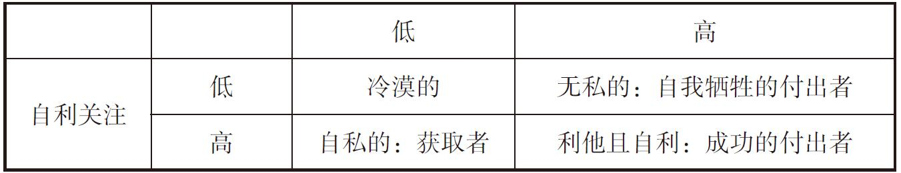

## 把钱浪费在庸才身上

因为付出者能够从周围所有人身上看到潜力，所以会花大量的时间鼓励他们，帮助他们实现潜力。这些投资并不总能获得回报；一些候选人确实缺乏天赋，另一些则不能保持他们的热情，或是维持足够的毅力。斯肯德曾经为一个在会计学领域之外申请研究生的学生写了上百封推荐信。她在第一年被所有的研究生项目拒绝了，决定再次申请，所以斯肯德忠实地重写了推荐信。当她再次被其他学校拒绝时，斯肯德连续第三年修改他的推荐信。终于，在三振出局之后，斯肯德鼓励她转向了其他的方向。

如果斯肯德是一个获取者或是互利者，他会不会更早放弃，为自己和这个学生省下时间？付出者会不会在那些满怀热情，但是天赋有限的人身上投入太多？他们如何能够将注意力放在那些有潜力的人身上，而在那些没潜力的人身上较少地投入注意力？要想找到答案，最好的办法莫过于看看职业篮球的世界，在每一年 NBA 选秀大会^( [\[1\]](text00024.html#note1n) ) 上，天赋专家的能力都要在国际舞台上受到检验。

斯图·英曼（Stu Inman）之所以被人记住，是因为在整个 NBA 历史上最糟糕的两次选秀。1972 年，波特兰开拓者队（Portland Trail Blazers）拥有优先选秀权。那时英曼是他们的球员事务总监，他为球队挑选了中锋拉鲁·马丁（LaRue Martin），结果后者被证明非常令人失望，在开拓者的 4 个赛季里，每场平均仅拿到 5 分，仅抢到 4 个篮板。因为选择了马丁，英曼错过了 NBA 历史上最伟大的两位球员。那一年的榜眼是鲍勃·麦卡杜（Bob McAdoo），他在第一个赛季得到的分数就超过了马丁在整个职业生涯中得到的分数。麦卡杜是那一年的最佳新秀，两年后当选了 NBA 最有价值球员。在他 14 年的 NBA 生涯中，麦卡杜赢得了两次联盟得分王，在两支冠军球队内打球，5 次入选全明星赛。在这次选秀中，英曼还错过了朱利叶斯·欧文（Julius Erving）——以“J 博士”的外号为人们所熟知——他在第 12 位被选中。欧文后来带领他的球队夺得了 3 次总冠军，他本人 4 次赢得最有价值球员称号，16 次入选全明星赛，并在整个职业篮球联赛历史上得分位居前五。麦卡杜和欧文都是篮球“名人堂”成员。

12 年后，斯图·英曼被提升为开拓者队的总经理，他拥有了一次自我救赎的机会。在 1984 年的选秀大会上，英曼手握着第二位的选秀权。英曼挑选了另一位中锋萨姆·鲍维（Sam Bowie），他身高超过 213 厘米，但富有运动天赋，动作协调。他能投篮，能传球，也能抢断，更不要提盖帽儿和抓篮板了。但是，鲍维从没有好好发挥他的潜力。当他退役时，ESPN（娱乐与体育节目电视网）称他是整个北美职业体育史上最糟糕的选秀人选。2003 年，当年盛赞鲍维的《体育画报》将他列为 NBA 历史上排名第二的失败选秀人选。最失败的一个是谁？拉鲁·马丁。

用第二位的选秀权选择了鲍维，这就意味着英曼错过了北卡罗来纳大学一位名叫迈克尔·乔丹（Michael Jordan）的得分后卫。芝加哥公牛队（Chicago Bulls）用第三位的选秀权选中了乔丹，剩下的故事已经成为历史。在当选年度新秀之后，乔丹拿下了 6 次总冠军、10 次得分王、11 次最有价值球员、14 次入选全明星，获得的分数超过了任何一名球员。他被 ESPN 评选为“20 世纪最伟大的北美运动员”。

英曼意识到了乔丹的潜力，但是开拓者已经拥有两个强力的后卫了。他们需要一个中锋，所以他选了萨姆·鲍维。由于这个选择，他不仅错过了迈克尔·乔丹，也错过了未来的篮球“名人堂”成员查尔斯·巴克利（Charles Barkley）（第 5 位被选中）和约翰·斯托克顿（John Stockton）（第 16 位被选中）。对于英曼来说，选了马丁而非麦卡杜或是欧文，选了鲍维而非乔丹、巴克利或是斯托克顿，这已经够糟糕的了。不过，挑选职业篮球运动员，充其量也只能算是一门不完美的科学，即使是伟大的总经理和教练也会犯错。

更糟糕的是，开拓者队让这两名球员待在队里的时间太长。他们把拉鲁·马丁留在队里 4 个赛季，当他们终于下定决心把他送走时，他已经一点儿价值都没有了。开拓者队甚至没法用他换来另一位球员——只是从西雅图超音速队（Seattle Sonics）换来了“未来的考虑人选”，而超音速队甚至在赛季开始之前就让马丁走人了。马丁的篮球生涯就此终结，对于英曼来说，这是一个尴尬的结果。“这是一个痛苦的话题。”杰克·拉姆齐（Jack Ramsay）说，英曼在开拓者队最后一年时，拉姆齐是球队的教练，现在则是 ESPN 的分析员，“因为拉鲁根本没法比赛。我到那里的时候，他想要打球，但是我们无法给他安排位置。他没有进攻能力，也抢不了篮板，无法助攻，虽然他有 211 厘米高……总之他什么本领都没有。”萨姆·鲍维在开拓者队的经历也差不多。1989 年，经过 5 个令人失望的赛季之后，开拓者队终于将鲍维换到了新泽西网队。为什么开拓者队会让萨姆·鲍维和拉鲁·马丁在队里待这么长时间？

斯图·英曼是一位广为人知的付出者。他打过学校篮球联赛，在高中执教了几年，然后一跃成为大学的教练，后来成了母校圣何塞州立大学球队的主教练。在这个位置上，英曼似乎将球员的利益置于自己的成功之上。英曼的明星队员之一是汤米·史密斯（Tommie Smith），他是一位杰出的运动员，在圣何塞州立大学练习田径，同时也在橄榄球队和篮球队打球。在新生篮球队中，史密斯是得分王和篮板王，因此到了大二的时候，他开始跟着校队在英曼的指导下训练。有一天，史密斯来到英曼的办公室，宣布他要退出篮球队，专注于田径。“我以为他会大发雷霆，”史密斯写道，“但是他没有。英曼说：‘好的，汤姆，我明白了。’他和我握手，告诉我说任何时候只要我想见他，就来找他，如果我改变主意了，永远欢迎我回来。对我来说，这是世界上最美妙的事情。”

对于英曼来说就不是这样了。史密斯的速度本来可以为圣何塞州立大学篮球队贡献良多，但是英曼希望史密斯能有最好的未来。几年之后，在 1968 年，史密斯赢得了奥运会 200 米短跑的金牌，打破了世界纪录。放走了顶尖的人才，英曼为那些有毅力的队员留下了空间，即使他们缺乏天赋也没关系。有一位名叫特里·莫非（Terry Murphy）的瘦弱的白人球员想为校队打球，英曼敬佩他的工作态度，邀请他加入。莫非回忆当年的经历，说自己是英曼教过的最糟糕的球员之一：“我一年一共才得了 4 分。”

尽管表现如此糟糕，英曼告诉莫非：“我永远不会赶你走。你充满了热情，打球非常努力，人也很好。”“英曼持续不断地给任何寻求帮助的篮球爱好者提供建议。”韦恩·汤普森（Wayne Thompson）写道。他是一位体育记者，英曼在开拓者队时，他一直负责追踪报道球队的新闻。英曼情不自禁地告诉汤普森说：“无论水平如何，用心教导是你能做的回报最丰厚的事情之一。我就是喜欢看到那些首次取得突破的学生脸上的表情。仅仅是看着学习过程开花结果就令我兴奋不已。”

一旦英曼形成了关于队员的积极印象，他会不会非常投入地指导和培养他们，以至于在那些动机强烈，但是缺乏天赋的人身上花费心力？在课堂上，C.J.斯肯德可以把时间花在那些表现出了兴趣和动机的学生身上，因为他每个学期都可以指导许多学生。与此相反的是，在职业篮球领域和大多数工作组织中，我们都面临着限制：把赌注押在一个人的潜力上，就意味着错过另一些人。

英曼认为自己有责任培养拉鲁·马丁和萨姆·鲍维。如果英曼更倾向于是一名获取者，会不会自然而然地尽早避免损失，转向其他球员？对于获取者来说，一旦意识到了马丁和鲍维不会为球队带来成功，他们便会感觉自己不需要对这两名队员负有任何责任。如果英曼更倾向于是一名互利者，会不会更愿意放他们走？对于互利者来说，他们肯定会因为在马丁和鲍维身上的投资得不到回报或奖励，而变得非常失望。

看起来付出者似乎更难放弃他们。但是，真实的情况恰恰相反。付出者实际上最不容易犯下在别人身上过度投资的错误——而且，正是因为因曼是一名付出者，所以才避免了更糟糕的错误。

[\[1\]](text00024.html#note1) NBA 联盟的制度之一，各支球队轮流挑选新加入联盟的球员。——译者注

## 面对镜子：看上去很好，还是做得很好？

巴里·斯塔乌（Barry Staw）是加州大学伯克利分校一位世界知名的组织行为学教授，他在整个学术生涯中都在试图弄清楚，为什么人们在组织中会做出糟糕的决定。在一项有创意的研究中，斯塔乌和哈晃（Ha Hoang）收集了 1980 年到 1986 年之间，240 多位在 NBA 选秀大会的前两轮被选中的球员的数据，希望看看选秀顺位对于球员的生涯会有怎样的影响。他们通过一系列不同的指标，评估了球员的表现：得分（每分钟得分率、命中率和罚球命中率），强硬程度（每分钟篮板和盖帽儿率），以及速度（每分钟助攻和抢断率）。斯塔乌和哈晃掌控了每个球员在所有这些指标上的表现，以及球员的伤病，他们打的位置是后卫、前锋还是中锋，并根据球队的输赢纪录，掌握了球队的质量。接下来，他们检验了球员们得到的上场时间，以及球队把他们换走之前在队里所待的时间，以此来分析球队会不会因为较早地选中了球员，而在他们身上犯下过度投资的错误。

研究结果得出了一个毁灭性的结论：球队不会放走那些他们下了重注的球员。他们会留着早早选中的球员，给他们更多的上场时间，即使他们打得不好，也拒绝将其换出去。排除场上表现，较早被选中的球员依然会在场上打更长时间，更不可能被换走。选秀顺位每提高一位，球员在第二个赛季平均会多获得 22 分钟的上场时间，而到了第 5 年，球队依然会继续在他们身上投资，此时选秀顺位每提高一位，球员依然能多打 11 分钟。此外，顺位每提高一位，球员被换的概率会下降 3%。

这个研究是一个经典的例子，斯塔乌将这种现象称为对于失败行动的承诺升级（escalation of commitment）。在过去 40 年中，斯塔乌开展的大量研究表明，一旦人们在最开始投入了时间、精力或资源，那么当情况变糟时，他们就更有可能继续加大投入。赌徒相信，如果他们再多玩儿一把扑克，就能弥补损失，甚至赢大钱。挣扎中的创业者认为，如果在创业中再多付出一些汗水，就能力挽狂澜。当一项投资得不到回报时，即使期望价值是负数，我们依然会继续投资。

经济学家使用“沉没成本”（sunk cost）的概念来解释这种行为：在估计未来投资的价值时，我们很难忽视过去已经投入进去的东西。“沉没成本”是一个因素，但是新研究表明，其他因素的影响更大。为了弄清楚承诺升级发生的原因和时间，密歇根大学的研究者分析了 166 个不同研究的数据。“沉没成本”确实有一点儿效果，决策者会偏向于坚持他们过去的投资，但是其他三个因素更加强大。一个是预期的后悔：如果我没有再给一次机会，将来会不会感到后悔？第二个是项目的完成：如果我继续投入，就可以完成项目。但是，最强大的因素是自我威胁：如果不继续投入，我无论是看起来，还是感觉上，都像是一个傻瓜。面对自我威胁，人们选择投入更多，希望让项目变得成功，这样他们就可以向别人以及自己证明，他们当初是对的。

在斯塔乌的一项研究中，当加利福尼亚州的银行客户拖欠贷款时，当初批准贷款的经理更不愿意选择放弃，注销损失。“那些当初批准问题贷款的银行人员，在承认这些贷款的后续风险以及拖欠的可能性方面，表现出了最大的抵制。”斯塔乌和同事写道。这项研究表明，当初批准问题贷款的经理离开银行之后，新来的经理更有可能注销贷款。新经理对于问题贷款并没有个人的责任，因为他们的自我没有受到威胁；他们并不需要去证明当初的决策是明智的。

研究表明，获取者更容易受到自我威胁的影响，所以比付出者更容易犯下承诺升级的错误。想象一下，你正在经营一家航空公司，需要决定是否投资 100 万美元开发一种隐形飞机。你发现这个项目在财务方面的状况并不好，而且一个竞争者已经完成了一个更好的模型。但是你已经投入了大量的资源：项目完成了一半，你已经花费了 500 万美元和 18 个月的时间。你有多大的可能性会再投资 100 万美元？

在伦敦商学院的亨利·穆恩（Henry Moon）开展的一项研究中，360 名参与者在做出投资决定之前，首先完成了一份问卷，里面包括一些与付出者相关的句子，如“我会信守诺言”，还有一些与获取者相关的句子，如“我会试图让别人做我该做的事情”。与付出者相比，获取者更有可能再投入 100 万美元。他们觉得自己对于一项糟糕的投资负有责任，所以会投入更多，以挽回自己的自尊和脸面。正如南加州大学管理学教授布鲁斯·梅格里诺（Bruce Meglino）和奥黛丽·科斯嘉德（Audrey Korsgaard）所解释的：“尽管对于组织来说，放弃可能是更好的选择，但是这种做法会让决策者蒙受巨大的个人损失（如损失职业流动性、损失声誉）。决策者通过让他或她的承诺不断升级，掩盖了失败的可能性，这种行为从个人角度来看也是理性的。”

在另一方面，付出者主要关心的是保护其他人和其所在的组织，所以他们更愿意承认当初的错误，不再升级承诺。其他一些研究显示，人们在选择为了别人而非为自己做事时，实际上会做出更准确、更有创意的决策。当人们在以自我为中心的心态下做决策时，他们更容易受到自我威胁的影响，经常会苦苦地寻找一个在所有方面都最为理想的选项。当人们把注意力放在他人身上时，就像付出者自然而然所做的那样，他们不太会担心自我以及琐碎的细节，他们会总揽全局，将那些对于别人来说最重要的东西放在首位。

理解了这些，我们可以再来看看斯图·英曼的故事。作为一个付出者，尽管他觉得应该在自己选中的球员身上投资，但是他对于球队也有强烈的责任感。“斯图是一个友善的人，关心别人的感受，”韦恩·汤普森告诉我，“但是他从来不会让这一点影响他的选择。如果他认为一个球员打不了，就会拍拍他的肩，祝他好运。”将萨姆·鲍维留在队中的决定并不是英曼做出的。1986 年，在选择鲍维两年之后，他就离开了开拓者队。一个获取者可能会继续为自己糟糕的决策辩护，但英曼承认了自己选择鲍维而没选择乔丹的错误。“我们所有的球探都认为，鲍维是球队面临的主要问题的根源，我也是这么认为，”英曼说，“但这是一个错误。”^( [\[1\]](text00025.html#note1n) ) 

英曼也没有让自己对拉鲁·马丁的承诺升级。尽管开拓者队让马丁留了 4 个赛季，英曼和他的同事面对马丁糟糕的表现，很早就采取了行动。在马丁的新秀年，他表现出了明显的挣扎迹象，这时一个获取者可能会给他更多的上场时间来证明自己选择他而非鲍勃·麦卡杜或朱利叶斯·欧文，是正确的。但是，实际情况并非如此。开拓者队将首发中锋的位置交给了努力的劳埃德·尼尔（Lloyd Neal），他身高只有 201 厘米，马丁则打替补。在新秀年，马丁每场平均只打了不到 13 分钟，麦卡杜则有 32 分钟，欧文更是有 42 分钟。在第二个赛季，马丁的表现依然糟糕，而开拓者队没有承诺升级，给他更多的上场时间，而是再度缩减了他的上场时间——每场比赛不到 11 分钟，而麦卡杜这一年每场平均打了 43 分钟，欧文也打了 40 分钟以上。英曼和他的同事成功地抵制住了诱惑，没有继续在马丁身上下注。

付出者与获取者相比，更不容易犯下承诺升级的错误，原因之一在于他们对于反馈信息的回应方式；奥黛丽·科斯嘉德、布鲁斯·梅格里诺和斯考特·莱斯特（Scott Lester）的研究揭示了付出者和获取者对于与自身表现相关的信息的反应方式。在一项研究中，人们填写了一份问卷，以检验他们是付出者还是获取者，然后完成了 10 项问题决策。接下来，所有的受试者得到了一个表现分数，并被建议今后应更多地把决策权授予别人。实际上，分数是随机分配的，一半受试者被告知他们的表现高于平均水平，另一半则被告知他们的表现低于平均水平。接下来，所有受试者又完成了 10 项决策任务。他们会不会遵从建议，更多地授权给别人？

获取者如果相信自己高于平均水平，那么就会遵从建议，授权的比率提高了 30%。但是，如果他们相信自己低于平均水平，那么授权的比率仅提高了 15%。他们一旦感觉受到了批评，就更不愿意接受改进的建议。他们会保护自己的自尊心，拒绝相信自己做了错误的决策，选择忽视负面的反馈信息。另一方面，付出者则会接受批评，采纳建议。即使收到了负面的反馈信息，被告知自己低于平均水平，他们的授权比率还是会提高 30%。

在逐步升级的情境中，获取者经常难以面对当初的决定已经变糟的现实。获取者倾向于“忽略那些与他们的自我印象不一致的社会信息和表现反馈”，梅格里诺和科斯嘉德写道，而付出者则“更善于接受社会信息，并以此为基础采取行动，而不会仔细考虑个人的后果”。付出者更关注他们的决策带来的人际之间和组织层面的后果，愿意接受自己的自尊和声望在短期内受到打击，以便做出从长期来看更有益的决策。

这种对于负面信息的接受能力让斯图·英曼能够意识到自己做出了一个错误的投资。因为对于批评意见的开放态度，英曼在整个联盟中备受尊重。许多教练“会对我的煽动性批评提出异议”，记者史蒂夫·杜因（Steve Duin）写道，但是“这些批评从不会给英曼带来困扰”，他“既有耐心又有雅量”，是“所有与 NBA 有关的人中最亲切的人之一”。当拉鲁·马丁表现糟糕时，当时开拓者队的教练杰克·麦克克劳斯基（Jack McCloskey）向因曼表达了他的担忧：“他非常努力，是个很好的年轻人，但球技不行。这很简单，我试过培养他的投篮技巧，但他打不了外线。他没有状元秀应有的能力。”一个获取者可能会拒绝接受这些负面反馈，但英曼愿意聆听。

1974 年，在马丁的第二个赛季之后，开拓者队又获得了第一顺位的选秀权。因为对马丁的承诺已经不复存在，他们需要另外一个中锋来取代他，于是英曼选了一位来自加州大学洛杉矶分校的年轻人，他叫比尔·沃尔顿（Bill Walton）。在他的新秀赛季，沃尔顿就是首发中锋，平均每场打 33 分钟，差不多是替补席上的马丁的两倍。这种安排又延续了一年，之后英曼换走了马丁。

接下来是 1976—1977 赛季，沃尔顿带领开拓者队战胜了朱利叶斯·欧文带领的费城 76 人队（Philadelphia 76ers），赢得了 NBA 总冠军。沃尔顿当选了总决赛最有价值球员，第二年他再次被评选为联盟最有价值球员。退役之后，他入选了篮球“名人堂”，并被提名为 NBA 历史上最伟大的 50 位巨星之一。英曼是 1977 年那支冠军队的缔造者，而这支队伍在前一年的排名还是分区垫底，这也是开拓者队 40 年历史中获得的唯一一次冠军。根据当时的球队教练杰克·拉姆齐（Jack Ramsay）所说，英曼“从没有站到聚光灯下，也从没有因为组建了这支球队而得到应有的认可”。

[\[1\]](text00025.html#note1) 公平地讲，鲍维的职业生涯受困于伤病。在大学里，他因为胫骨受伤错过了整整两个赛季。在选秀之前，为了确保鲍维完全康复，英曼让他接受了 7 个小时的体检。鲍维第一年打得不错，但是伤病让他错过了接下来 4 年中 81%的比赛，包括接近两个完整的赛季。此外，英曼和他的球探也不是仅有的将赌注押在鲍维而非乔丹身上的人。1984 年 6 月，选秀大会之后《芝加哥论坛报》的头条是“满怀歉意的公牛队只能‘守着’乔丹了”。当时公牛队的总经理罗德·索恩（Rod Thorn）看起来也非常失望。“我们希望他有 7 英尺（约 2.1 米）高，但是他没有，”索恩叹息说，“当时没有中锋可供选择了。你能做什么呢？乔丹不会让这个球队发生质的变化……他是一名非常好的进攻型球员，但并没有压倒性的进攻实力。”即使是乔丹本人看起来也支持选择鲍维：“鲍维会比我适应得更好。”他在新秀年说，因为波特兰已经有了“一批高大的后卫和小前锋”。也许雷·帕特森（Ray Patterson）为英曼的选择提供了最佳辩护，1984 年他是休斯敦火箭队的经理，在选秀第一位选择了哈基姆·奥拉朱旺（Hakeem Olajuwon）：“所有说他们会选择乔丹而非鲍维的人都是在说大话。乔丹没有那么好。”

## 黑暗中的曙光

作为一名付出者，英曼组建这支冠军球队的方式很像 C.J.斯肯德：从球员身上看到别人看不到的潜力。“英曼希望全面了解他感兴趣的每一个人，”韦恩·汤普森写道，“无怪乎他在发现璞玉方面如此成功。”这支冠军队伍中得分前六名的选手有 3 位、得分前九名的选手有 5 位，都是英曼在第二轮或第三轮选秀中选中的。“他在发现球员潜力方面走在别人的前面。”史蒂夫·杜因记述道。“斯图在篮球专家的亚文化圈子里，几乎处于最顶端的位置。他被认为是一个天才。”达拉斯小牛队（Dallas Mavericks）的主席诺姆·桑丘（Norm Sonju）说。在一部关于 1984 年选秀的纪录片中，福利普·邦迪（Flip Bondy）写道，英曼被许多人看作“联盟中最棒的人事专家。他如此优秀，如此受人尊敬，其他的俱乐部会追踪他的‘球探安排’，并认真参考他可能对某个球员感兴趣的小道消息”。

在 20 世纪 70 年代，大多数篮球队主要关注那些可见的身体天赋，比如速度、力量、协调性、灵活性和弹跳能力。英曼则认为，关注球员的内在也是很重要的，所以他决定开始评估他们的心理特性。在选秀之前，除了分析一位球员的技术数据和观看他的比赛之外，英曼还想了解他是一个什么样的人。他会仔细观察球员赛前热身的表现，看看他们努力的程度如何，并且会采访他们的教练、家人、朋友和老师，了解其动机、心态和品性方面的情况。据《俄勒冈州报》（The Oregonian ）报道：“英曼因为发掘高性价比的球员而闻名……他对于天才的敏锐度就像他对人的感觉一样。他想找到那些人格和智力与弹跳能力一样优秀的球员。”

1970 年，英曼作为首席球探，加入了当时的 NBA 新军开拓者队。在那个夏天，他组织了一次公开试训，检验球员们的篮球技术。这在一定程度上是一个公关噱头，用来点燃当地人对于篮球的激情，但英曼也希望能找到那些被其他球队忽视的球员。参加这次试训的人最终都没能进入球队，但是英曼对于发掘那些看似不太可能成功的候选人的热情，在几年后获得了回报。1975 年，英曼用第二轮的第 25 顺位选秀权，选择了一个默默无闻的犹太人前锋鲍勃·格罗斯（Bob Gross）。教练和球迷都认为这是一个错误。格罗斯大学时期在西雅图打球，每场平均得 10 分，后来转学到了加州州立大学长滩分校，大三那年每场平均仅得 6.5 分。“对于鲍勃·格罗斯大学时期和职业篮球生涯的总结就是，没有人注意过他，”弗兰克·科菲（Frank Coffey）在一本关于开拓者队的书中写道，“直到他们开始凝神细视。”

英曼凑巧观看了一场加州州立大学长滩分校和密歇根州立大学的比赛，比赛中密歇根州立大学有一次快攻机会，本可以非常轻松地上篮，但是格罗斯奋不顾身地封盖了对手，这勾起了英曼的兴趣。英曼更加仔细地观察，看到了格罗斯工作态度上的更多表现：在大三至大四的一年里，他的得分翻倍，每场平均能拿下超过 16 分。英曼“发现了一颗宝石，一个稳定、努力、非常高效的篮球运动员”，科菲写道。格罗斯的一位大学教练称赞他“对球队有着无私的奉献”。在他的第三个 NBA 赛季，开拓者队打入总决赛，格罗斯表现出色，每场平均得到 17 分。在关键的第五场和第六场比赛中，他负责防守朱利叶斯·欧文，并凭借着 25 分和 24 分的数据领衔开拓者队的得分榜。据比尔·沃尔顿说，“鲍勃·格罗斯是那支球队的‘润滑剂’。他让这个球队流动起来……鲍勃会永不停息地奔跑和防守……没有鲍勃……波特兰不会赢得总冠军。”

英曼认识到，许多球队都会低估付出者的价值，因为他们不会成为焦点，也不会运用浮夸的技术。他的理念是，“决定球员成长的……不是他现在的水平，而是他的潜力。”当英曼看到一个球员充满毅力地练球，用付出者的方式打球时，他就将这个球员划分为“璞玉”这个类别。实际上，毅力和付出之间存在着紧密的联系。在我的研究中，我发现由于付出者专注于为他人奉献，他们比获取者和互利者更愿意长时间地努力工作。即使练习已经变得枯燥乏味，付出者也会出于对球队的责任感，继续努力奋斗。

这种模式在其他许多行业中也能看到。比如拉塞尔·西蒙斯（Russell Simmons），他是嘻哈音乐界德福·詹姆唱片公司（Def Jam Records）的共同创始人。埃勒·酷（LL Cool J）^( [\[1\]](text00026.html#note1n) ) 和野兽男孩（The Beastie Boys）的演艺生涯就是从这家公司开始的。西蒙斯通常被称为嘻哈音乐教父，早在 1978 年就开始提供免费音乐，比大多数唱片公司要早得多。当我向他请教成功的秘诀时，他将其归结为发掘和提拔付出者。“付出者是很好的行动者；他们让周围的人变得更好。”西蒙斯解释说。他最喜欢的付出者之一是凯文·利尔斯（Kevin Liles），他最早作为实习生免费工作，后来一路升迁，成为德福·詹姆的董事长。做实习生的时候，利尔斯每天第一个来，最后一个走。做营销总监的时候，利尔斯负责一个区域，但他还努力协助其他区域工作。“每个人都开始将凯文视作领袖，因为他们都向他寻求指引。他不断地付出，直到人们都离不开他。”在挑选和提拔天才方面，西蒙斯写道，“你能展示给我的最重要的特质，就是愿意付出。”

斯图·英曼知道，有毅力的球员愿意将球队的利益置于自身之上，他们会努力工作，完成自己需要扮演的角色。1984 年的选秀中，在挑选了萨姆·鲍维之后，英曼在第二轮总第 46 顺位上，又选择了一位名叫杰罗姆·科尔西（Jerome Kersey）的前锋。科尔西来自长木学院，这是弗吉尼亚州一家不知名的二级联盟学校，当时他还没有发展成一名出色的 NBA 球员。长木学院的一位体育主管说，科尔西“拥有无可匹敌的工作态度”，这让英曼认识到了他的潜力，而其他 NBA 圈内人士很少能认识到这一点。第二年，1985 年，英曼在第 24 顺位上找到了另外一块璞玉，一个控球后卫——特里·波特（Terry Porter），他是一位坚毅的付出者，因为拼抢和无私而闻名。他在开拓者队期间两次入选全明星，一共在 NBA 打了 17 个赛季，到了 1993 年，他赢得了 J.沃尔特·肯尼迪公民奖（J.Walter Kennedy Citizenship Award），这个奖项每年被授予一位球员、教练或训练师，表彰他们“出色的服务和对于社区的奉献”。除了给残疾儿童提供球票，以及为毕业聚会提供免费的药品和酒水之外，波特还与前队友杰罗姆·科尔西一起，为男孩儿和女孩儿俱乐部付出了很多。

也许英曼最棒的投资出现在 1983 年的选秀中，当时开拓者手握第 14 顺位的选秀权。英曼选择了得分后卫克莱德·德雷克斯勒（Clyde Drexler），他当时并未被其他队伍挑中，因为他们认为他不是一个非常强有力的投球手。尽管他是当年第五个被选中的得分后卫，现在公众都认为，能在 1983 年选秀大会上挑中德雷克斯勒简直像捡了一个大便宜。他的得分超过了这次选秀中的所有其他球员，职业生涯中每场平均能拿到 20 多分，他也是这次选秀中仅有的一个曾入选 NBA 第一阵容、至少参加了一次全明星赛（他一共参加了 10 次）、参加了奥运会，并入选了篮球“名人堂”的球员。到退役的时候，德雷克斯勒加入了传奇球星奥斯卡·罗伯逊（Oscar Robertson）和约翰·哈夫利切克（John Havlicek）的行列，成为 NBA 历史上第三位拿到 20000 分、抢到 6000 个篮板和实现 3000 次助攻的球员。就像沃尔顿一样，德雷克斯勒也入选了 50 大巨星的行列。在如此多的球队错过了他的时候，为什么英曼能知道他会成为一位巨星？

获取者喜欢独立做出决策，但英曼作为一名付出者，对于其他人的建议持更加开放的心态。在圣何塞州立大学的时候，英曼遇到了布鲁斯·奥格尔维（Bruce Ogilvie），他是运动心理学的一位先驱人物。“在他进入体育领域的时候，心理学家被错误地认为是‘精神病学家’，任何球员如果去见了一位心理学家，会被认为哪里出了问题。”大多数总经理和教练都会回避像奥格尔维这样的心理学家，对于所谓的科学持怀疑态度。一些人认为心理测评没什么用；另一些人则担心，这会威胁到他们自己的专业和地位。

获取者总是希望能成为所在领域内最聪明的人，付出者却更愿意接受别人的专业技能，即使这会对他们自己的观念构成挑战。英曼张开双臂，接纳奥格尔维和他的方法，要求球员在选秀之前接受几个小时的评估。英曼与奥格尔维一起，测评球员的无私程度，其是否渴望成功、是否坚持不懈、是否愿意接受教导，以及对于运动的奉献程度。通过这些测评，英曼可以更好地理解一个球员在毅力和付出方面的倾向。“其他 NBA 球队也会考察待选球员的心理状况，但没有人会像我们这样使用心理测评，并且信任心理测评，”英曼说，“你需要首先欣赏一个球员的天赋，才会对他进行评估。但是，这些评估确实提供了一种清晰的指标，告诉我们这个人能否发挥潜力。”

当奥格尔维评估德雷克斯勒时，英曼被他的心智状况所折服。英曼采访了观看过德雷克斯勒在休斯敦大学打球的教练，得到了相同的回应：德雷克斯勒用付出者的方式打球。“克莱德是那支球队的黏合剂。我被教练们完全一致的反应惊呆了，”英曼解释道，“他们说，他会做所有能够帮助队伍赢得比赛的事情。他的自我从不会干扰到他对于胜利的渴望。”根据当时的球探布基·巴克沃尔特（Bucky Buckwalter）所说，“一些球队不愿意选他……他不是一个好的投手。”但是英曼和他的团队决定，德雷克斯勒可以“学会从中距离投篮，或者用其他的天赋来弥补这个缺陷”。英曼是正确的，德雷克斯勒“变成了一个更有技巧的球员……超过了我的预期”，巴克沃尔特说。

英曼在篮球场上那些失败的赌注，在其他领域也取得了成功；他一旦看到一个付出者，就能把他认出来。拉鲁·马丁在 UPS（美国联合包裹速递服务公司）工作了 25 年，最近成为伊利诺伊州的社区服务主管。2008 年，他出乎意料地收到了一封信，这封信来自开拓者队前所有人拉里·温伯格（Larry Weinberg）：“毫无疑问，你在为 UPS 工作时是一位杰出的职业楷模。”马丁曾与奥巴马总统打过篮球，在 2011 年，他被选入了退役球员联合会的管理委员会。“我非常愿意做出回馈。”马丁说。

此外，你还记不记得特里·莫非，英曼在圣何塞州立大学执教时手下那位最糟糕的球员？英曼给了莫非机会，但认为他在篮球领域不会有前途，于是鼓励他去打排球。英曼对于莫非工作态度的判断是完全正确的，莫非后来入选了美国排球国家队，但莫非并没有完全离开篮球。1986 年，为了给残奥会筹钱，他在达拉斯发起了一项三对三的街头篮球锦标赛。到了 1992 年，这项名为“箍起来”（Hoop It Up）的赛事已经拥有 15 万名运动员和 100 万名粉丝。5 年以后，“箍起来”在 27 个不同的国家或地区举办了 302 场赛事，筹集到了几百万美元的慈善捐款。

对于英曼的成功，最好的解释可能是，尽管他错过了迈克尔·乔丹这样的出色球员，但是作为天才的评估者，他胜过了乔丹。作为一名篮球管理者，乔丹的名声更多的是一个获取者，而非付出者。这种状况在球场上已经有所预示，乔丹在场上是出了名的以自我为中心和自尊自大的。正如乔丹自己曾说：“为了取得成功，你必须自私。”教练不得不如履薄冰地向他提出建设性的反馈意见，他在入选“名人堂”时发表的演讲，因为没有感谢几个人，却攻击了那些质疑过他的人，而受到了广泛的批评。回到他的球员时代，他曾大力提倡球队应将更大的收入份额分给球员。现在，作为球队的拥有者，他却呼吁把更大的份额分给持有人——实际上就是把更多的钱揣进自己的腰包。^( [\[2\]](text00026.html#note2n) ) 

在天才身上持久下注这个问题上，乔丹作为球队管理者的表现，与英曼形成了鲜明的对比。当乔丹成为华盛顿奇才队（Washington Wizards）的篮球事务总裁时，他使用 2001 年的第一顺位选秀权，挑选了中锋夸梅·布朗（Kwame Brown）。布朗是从高中直接参加选秀的，富有天赋，但是似乎缺乏毅力，从没有发挥出自己的潜能。后来，他被认为是 10 年来的第二大选秀失败，也是运动史上最糟糕的 100 个选秀之一。在布朗之后，榜眼和探花也是中锋，他们的表现就好多了。榜眼秀是泰森·钱德勒（Tyson Chandler），他入选了 2012 年的梦之队。探花秀是保罗·加索尔（Paul Gasol），另外一位年轻的中锋，只比布朗大一岁半。加索尔赢得了最佳新秀奖，在接下来的 10 年里 4 次入选全明星队，两次赢得总冠军，并赢得了 J.沃尔特·肯尼迪公民奖。钱德勒和加索尔在得分、篮板和盖帽儿方面的表现，都远远超过了布朗。

布朗令人失望的表现，看起来威胁到了乔丹的自我。当他复出与布朗一起为奇才队打球时，他经常会训斥和贬低布朗，说布朗糟糕的表现伤害了球队，并且让他的选秀选择看上去非常愚蠢。在第一个赛季，布朗的统计数字微不足道，每场平均只能得到 5 分，抢下 5 个篮板。在第二个赛季，布朗的上场时间却翻倍了。

乔丹在赛季结束后被奇才队解雇，但是他并不准备放弃布朗。10 年之后，在 2010 年，布朗与夏洛特山猫队（Charlotte Hornets）^( [\[3\]](text00026.html#note3n) ) 签约。这支球队的拥有者不是别人，正是迈克尔·乔丹。“迈克尔在这次签约中扮演了很重要的角色，”布朗的经纪人说，“他想要让这成为现实。”

到这个时候，布朗已经为 4 支球队打了 10 个赛季，在超过 500 场比赛里平均得分不到 7 分，抢下了 6 个篮板。在前一个赛季里，他每场只打了 13 分钟。当布朗加入乔丹的山猫队时，他的上场时间翻了一倍，达到了每场 26 分钟。山猫队给布朗的上场时间超过了他前两个赛季的总和，但是他在场上继续挣扎，平均得到 8 分和 7 个篮板。“乔丹想给夸梅另一次机会，”布朗的经纪人说，“许多人都写过，布朗是乔丹的第一个选秀对象，而当结果不好时，他们两个人都受到了众多的批评。”一个付出者可能会承认错误，继续前行，但乔丹仍然希望扭转糟糕的投资。“我爱乔丹，但是他所做的工作并不好，”他的朋友——前梦之队队友查尔斯·巴克利说，“我不认为乔丹缺少向他提出反对意见的雇员。”在乔丹的引领下，2012 年山猫队创下了 NBA 历史上最低的胜率纪录。

与此相反的是，英曼的球队取得的成就令人惊讶。除了组建起 1977 年那支球队，凭借大量陌生的面孔，仅仅时隔一年就从垫底一跃成为冠军之外，英曼的选秀策略也让开拓者队在之后的多年里，成为一支令人敬畏的球队。1986 年他离开开拓者队之后，球队在德雷克斯勒、波特和科尔西的带领之下，继续繁荣发展。这三颗隐藏的宝石，被英曼在连续三年中发掘出来，带领开拓者队两次打入总决赛。英曼仍然没有包揽功劳。在一般球迷眼中，英曼似乎是一个失败者，篮球业内人士却将他视为篮球史上最伟大的天才评估者之一。英曼的经历，结合研究证据，揭示出付出者不仅善于识别和培养天才，还善于在事情不遂人意时，放下包袱，继续前行，这令人不可思议。

斯图·英曼在自己生命中最后的 4 年时光，志愿担任俄勒冈州奥斯威戈湖高中篮球队的助理教练。“他对这些球员都很好，”奥斯威戈湖高中篮球队的主教练说，“他不仅将他们培养成了篮球运动员，也培养了他们的品格。他不会浪费时间提前判定一个人的资质，而是以球员潜在的能力去对待他们。”在奥斯威戈湖高中，斯图·英曼帮助培养了一位名叫凯文·洛夫（Kevin Love）的年轻球员，他后来实现了萨姆·鲍维和拉鲁·马丁从未能实现的梦想：成为一个能够投篮的大个子。作为一名 208 厘米的中锋，洛夫在他的前 4 个赛季里入选了梦之队，并两次入选全明星队，被提名为 NBA 最有潜力球员，并且赢得了三分球大赛的冠军。

“如果你选择培养伟大的天才，你就需要秉持利他主义，为他人着想，”乔治·安德斯写道，“虽然在某段时间内，那些只顾眼前利益行事的人能够挣更多的钱，赢得更多的认可，至少暂时如此。但是，随着时间的推移，情况便截然相反。”

[\[1\]](text00026.html#note1) LL Cool J，原名詹姆斯·托德·史密斯，美国说唱歌手。1984 年与 Def Jam 唱片签约。

[\[2\]](text00026.html#note2) 有趣的是，乔丹在北卡罗来纳大学的篮球教练，传奇人物迪恩·史密斯（Dean Smith），却更多的是一位付出者。不顾自己的利益，并且顶住了助手的强烈抗议，史密斯建议乔丹在大四之前就早点参加 NBA 选秀。史密斯有一条规则：“我们会在赛季之外尽可能为球员着想，在赛季之内尽可能为球队着想。”随着 NBA 的球员薪水一飞冲天，史密斯鼓励每一个有机会在前 5~10 位被选中的球员提早离开大学，赚取更多的收益，只要他们承诺以后会回到学校，完成学业。在他作为主教练的 36 年间，史密斯让 9 位球员提早参加选秀，其中的 7 位兑现了他们的承诺。尽管史密斯鼓励最好的队员离队，但是他把队员的利益放到第一位，似乎帮助他招募到顶级的天才，培养出球员的信任和忠诚。史密斯退休时获得了 879 场胜利，超过了美国大学体育总会历史上任何一位教练；他的球队 11 次打入全美四强，两次赢得全美冠军。正像 NBA 的执行副总裁克里斯·格兰杰（Chris Granger）解释的，“有天赋的人会被那些关心他们的人所吸引。你为了帮助某人获得提升，使其离开你的球队，这在短期上是一种损失，但是长期来看肯定是一种收益。这让你更容易吸引别人，因为人们会传递你助人为乐的哲学。”

[\[3\]](text00026.html#note3) Charlotte Hornets，位于美国北卡罗来纳州夏洛特的职业篮球队。2010 年，乔丹以 2.75 亿美元入主该球队的交易。2014 年 5 月 21 日，球队更名为夏洛特黄蜂队。

# 第五章 无力的沟通风格的力量 怎样保持谦虚，同时影响别人

温柔地讲话，但带上一根大棒。

——西奥多·罗斯福，美国总统

戴夫·沃尔顿（Dave Walton）做了一个深呼吸。他是一位就业法律专家，专精于商业机密和雇员竞争的案例。作为柯岑·奥康纳（Cozen O’Connor）公司的合伙人，戴夫是被选为股东的最年轻的几个律师之一；除此之外，几年来他还获得宾夕法尼亚州超级律师——“新星奖”（Pennsylvania Super Lawyer—Rising Star）的提名。此时此刻，他即将站起身来，对着陪审团发表自己的第一份结案陈词。

2008 年，戴夫曾为一家公司做过代理，这家公司旗下有阿克米–哈代斯蒂（Acme-Hardesty）子公司。这是一家宾夕法尼亚州的蓖麻油零售商，它的供货商是印度孟买的杰雅特油品和衍生物公司（Jayant Oils and Derivatives）。在 2006 年 12 月，阿克米母公司的 CEO 被告知，杰雅特准备在美国设立办公室和销售组织，不会再向阿克米供应蓖麻油。接下来的一个月里，阿克米的管理层了解到，杰雅特准备与阿克米开展商业竞争，直接向美国市场的消费者出售蓖麻油。

在 2006 年夏天，两位阿克米的员工跳槽到了杰雅特，帮助他们建立对手公司。阿克米的母公司起诉了杰雅特和这两位雇员，指控他们盗窃商业机密和保密信息。

戴夫认真地做了准备，充满热情地进行辩护。他呈交的证据显示，2006 年 3 月，这两名员工在为阿克米工作时，就已经接受了帮助杰雅特建立竞争经销商的财务条款。6 月，他们分别收到了 5 万美元，作为为杰雅特提供咨询服务的初始报酬。

这两名员工声明自己将离职，但并没有告知阿克米他们的新职位，就直接前往印度。戴夫陈述道，在印度的时候，他们把有关阿克米的知识纳入了杰雅特的商业计划中。一名员工给杰雅特提供了一份美国客户的关系清单；戴夫称，这个清单本来是阿克米出资让该名员工制作的，而杰雅特的总裁也承认，他们使用了阿克米的文件来准备那些向投资者做展示的材料。戴夫进一步指出，当这两名员工在印度帮助杰雅特制订计划时，他们使用了虚假的邮箱别名，让自己可以继续跟进阿克米的订单。

代理被告的是三家著名的法律公司，戴夫的对手在法庭辩论中的表现非常流畅。他有 25 年的经验，拥有哥伦比亚大学的法律学位，本科毕业于康奈尔大学，获得过许多奖项，包括宾夕法尼亚州的百强律师，以及全美的周度诉讼律师。有人将他描述为“熟练的、渊博的、久经考验的律师，在法庭上的表现令人惊异”。

被告代理人的口才很好，表现完美，他告诉法官说，杰雅特开展的是合法的竞争，它有权这样做。这位律师承认，阿克米确实损失了一些客户，但这不是因为那两名员工做了任何错事。阿克米是将杰雅特的蓖麻油产品分销给客户的中间商。通过取消中间商，杰雅特可以更便宜地出售自己的产品，这正是公平竞争的要点所在。这两名员工在阿克米的待遇很差：一位将公司描述为“藏污纳垢之所”，声称这是他有生以来做过的最差的工作。被告代理人把握住了他的主要论点，质疑戴夫的主要证人的可信度。戴夫被对方展现出的技巧所折服，“他真的很棒。他的辩论超过了我们的预期。”

戴夫知道，此时审判可能倒向任何一边。一方面，他描绘了一幅令人信服的图景，证明杰雅特和两名员工是有罪的；另一方面，这是一个充满压力的高端案例。这是戴夫第一次主导法庭辩论；他是在场的律师中最年轻的一个。在一次查问中，他的老毛病又犯了：戴夫开始结结巴巴。这种情况后来又出现了几次，这可能会传递出危险的信号，表明他缺乏自信。

戴夫特别担心的是一位陪审员的影响。在审判中，这位陪审员声明，他更偏向于支持被告：他觉得杰雅特和两名员工没做错什么。陪审员非常热情地回应被告代理人，在被告代理人陈词的过程中频频肯定地点头，并为他的笑话放声大笑。相反的是，当戴夫发言时，这个陪审员避免和他的目光接触，面带着假笑，并表现出了轻蔑的姿态。在整个审判过程中，这位陪审员都穿着蓝色牛仔裤出席法庭庭审。但是在结案陈词这一天，他穿上了正装，打着领带。当戴夫看着他悠然地走进来时，不禁心头一沉。这个陪审员想要成为陪审团主席，很明显，他想要说服其他的陪审员反对戴夫。

戴夫完成了结案陈词，陪审团开始商议。当他们走出来时，那位持有反对意见的陪审员走在最前面。他被选为陪审团主席，由他宣读裁决。

陪审团一致裁定，支持戴夫的客户，将赔款数额定为 700 万美元。戴夫的胜利刷新了宾夕法尼亚州商业机密审判的纪录。毫无疑问，戴夫的表现非常精彩，作为这个领域真正的专家，他在发言时充满自信。但是，还有另外一个因素给他带来了微弱的优势。

有一些因素将戴夫和对面那位杰出的律师区别开来——在这一点上，他与通用电气的前任 CEO 杰克·韦尔奇（Jack Welch）、副总统乔·拜登（Joe Biden）、歌手卡莉·西蒙（Carly Simon）、《20/20》节目的主持人约翰·斯托塞尔（John Stossel）、演员詹姆斯·厄尔·琼斯（James Earl Jones），以及波特兰开拓者队的球星、现任篮球解说员比尔·沃尔顿（Bill Walton）都存在共同之处。

他们都有口吃。

口吃是一种言语障碍，大约有 1%的人有这种问题。从小到大，戴夫·沃尔顿一直因为口吃而受到嘲笑和捉弄。大学毕业后，他申请了一个销售的岗位，但是被拒绝了。“面试官告诉他，因为他有口吃的毛病，他永远不可能做销售。”他的妻子玛丽说。当戴夫决定申请法学院时，他的许多朋友和家人都表示怀疑，希望他不要做任何公开演讲。在法学院里，看起来亲友们的担心是正确的。戴夫回忆起他的第一次模拟法庭辩论，法官在他发言的时候哭了：“她为我感到难过。”

大多数人将口吃视为一种残疾，我们会为杰克·韦尔奇和詹姆斯·厄尔·琼斯这样的人折服，因为他们自信的风度掩盖了其言语障碍。但是，真相其实比这更加有趣和复杂。许多有口吃的人最后变得很成功，而这并不一定是因为他们克服了自己口吃的缺陷。在商业机密审判中，当戴夫在一些辩论中表现得磕磕巴巴时，有一些奇怪的事情发生了。

陪审员们都喜欢他。

在审判结束后，几位陪审员走到他面前。“他们告诉我说，他们真的非常尊敬我，因为他们知道我有口吃，”戴夫说，“他们强调说，我的口吃不严重，但是他们注意到了，并且谈论了这件事。陪审员们说，他们佩服我做为一名法庭律师的勇气。”

戴夫赢得这场审判，不是因为他的口吃。但是，口吃可能确实帮助了他，让他与陪审团建立起了更强的联系，让胜利的天平倒向他这一边。当陪审员们称赞他的时候，戴夫“感到惊讶，还有一点尴尬……我的第一个念头是：‘我不记得我口吃了这么多次。’当陪审员走远时，我意识到，我有一些先天的天赋。我忽然顿悟到——我的口吃反而可能是一种优势”。

在这一章里，我将要探究的问题是，通过戴夫·沃尔顿的经历，我们可以知道，在影响他人方面，有哪些至关重要但不合常理的因素——此外，我们还将探究付出者在发挥影响时采取的不同做法。在《每个人都在推销》（To Sell Is Human ）一书中，丹尼尔·平克（Daniel Pink）提出，我们的成功在很大程度上取决于影响他人的技巧。为了说服别人购买我们的产品、使用我们的服务、接受我们的想法，并给我们投资，我们需要用劝服和激励的方式与他们交流。但是，影响他人的最佳方法可能并不是一下子就能想到的。

研究表明，影响他人有两种基本的方法：确立支配性地位和获得声望。当我们确立支配性地位时，我们获得了影响力，因为别人认为我们是强大、有力、权威的。当我们获得声望时，我们变得更有影响力，因为别人尊敬和欣赏我们。

这两种影响他人的方法与我们的人际交往风格紧密相连。获取者更愿意，也更善于确立支配性地位。为了占有尽可能多的价值，他们会努力让自己高人一等。为了确立支配性地位，获取者非常善于做出强有力的沟通：他们说话强硬，提高音量以强调自己的权威，表达确定性以传递出自信，炫耀自己取得的成就，并通过肯定和骄傲的方式推销自己。他们会通过伸展胳膊来显示力量，摆出支配性的姿势，挑起眉毛做出挑衅的表情，占据尽可能多的空间，并在必要的时候表现出愤怒，发出威胁。在寻求影响力的过程中，获取者通过发出权力性的言语和非言语信号来定下基调，控制谈话的走向。结果就是，获取者在取得支配性方面，要比付出者有效得多。但是，这种方法是否能够维持影响力？

当我们的听众心存怀疑时，我们越是试图支配他们，他们就会越抗拒。即使听众愿意接受，支配性也是一场零和游戏：我拥有越多的权力和权威，你拥有的就越少。当获取者遇到更有支配性的人时，他们会面临失去影响力的风险。与此相反，声望并不是零和游戏，我们可以给出的尊敬和欣赏并不存在上限。这意味着，声望通常拥有更持久的价值，我们应该检视一下人们是如何获得声望的。

与获取者强有力的沟通方式相反的，就是所谓的无力的沟通（powerless communication）。无力的沟通者倾向于用不那么肯定的方式讲话，表达出更多的疑惑，并非常依赖别人给出的建议。他们使用示弱的方式交谈，显示出自己的弱点，并会做出免责声明^( [\[1\]](text00027.html#note1n) ) 、避免正面答复和表示迟疑。苏珊·凯恩在《安静》（Quiet ）一书中写道，在西方社会里，人们期望我们用强有力的方式交流。我们被告知，伟大的领导者会使用“强势演讲”和“强势话语”来有力地传递出他们的信息。如果使用无力的沟通，人们在获得影响力方面肯定会处于劣势。

嗯，不完全是这样。

我是这样认为的。

在这一章里，我的目标是挑战传统的观念，这些观念认为，果断和自信对于获取影响力至关重要。实际上，这种风格并不一定总能给我们带来好处，付出者会本能地采取一种无力的沟通风格。令人惊讶的是，这种风格被证明在建立名声方面是非常有效的。我想要追溯付出者是如何通过建立声望，在展示、销售、说服和谈判 4 个领域获取影响力。因为付出者更看重别人的观点和利益，他们更愿意提出问题，而非给出回答；更愿意谨慎而非大胆地讲话；更愿意承认自己的弱点，而非显示自己的长处；更愿意寻求别人的建议，而非将自己的观点强加给别人。这些无力的沟通方式，有没有可能产生影响力？

[\[1\]](text00027.html#note1) 免责声明：一些特定类型的免责声明比其他形式的无力的沟通更危险。例如，人们经常用“我不想让你觉得我很自私，但是……”这样的句子开头。心理学家发现，这类免责声明会起到反面的效果，它会让听众更加预期讲话者会说一些自私的东西，这会导致他们寻找——并且找到——确认讲话者的自私的信息。

## 展示：示弱的价值

我 26 岁的时候，已经获得组织心理学博士学位两年了，有人找我向高级军官讲授激励士兵的办法。军队希望改变以命令和控制为主的模式，转向合作模式，而我的研究领域恰好与此相关。我的第一项任务，是给 23 位空军上校上一堂 4 个小时的课。他们都当过战斗机飞行员，平均飞行时间超过 3500 小时，战斗时间超过 300 小时。他们驾驶的飞机是：装载着导弹和精确制导武器的 F–16 战机。就像电影《壮志凌云》（Top Gun ）里一样，他们每个人都有很酷的外号。

“打击者”负责管理超过 53000 名军官，以及 3 亿美元的预算。“沙丘”是一名航天工程师，在“沙漠风暴”（Desert Storm）、“自由伊拉克”（Iraqi Freedom）和“不朽自由”（Enduring Freedom）行动中执行过飞行任务。“炸弹狂”管理的项目开销超过 150 亿美元，包括能够远程控制从新墨西哥州飞到阿富汗的无人驾驶飞机。

这些上校四五十岁——年龄比我大一轮。他们在整个职业生涯中都待在一个强调资历的组织里，而我在这方面一片空白。尽管我具有一些相关的知识，还拥有一个博士学位，但我还是和他们相去甚远，而且这一点明显地表现了出来。在这一天结束之后，上校们填写了课程反馈表。有两条评论特别能说明问题：

“隐形”：“台下的人比台上的人拥有更多高质量的信息。”

“炮手”：“讲课的人知识丰富，但经验不足……没有很好地把握听众的需求。讲课的材料非常学术……我没有任何收获。我相信讲课的人确实学到了一些有用的东西。”

其他的人更温和些，不过传递的信息仍然是响亮而清晰的。“轰炸机”说，“现在的教授越来越年轻了。”而“黄貂鱼”补充说，“我希望教授比我年纪大，否则我会相信自己已经趋近中年，而我们都知道这并不符合事实……是不是？”

面对这些上校，我使用了强有力的交流方式开场：我满怀自信地谈论自己的资历。这并不是我在课堂里常用的开场方式。作为一名教授，我总是感到一种强烈的责任感，为我的学生付出，所以我更关心的是如何与学生建立联系，而非确立自己的权威。给本科生上课时，在第一堂课上，我会以自己人生最大的失败经历开场。但是，面对着空军上校们，我担心自己在他们眼中的可信度，而且我只有 4 个小时的时间——而不是我习惯的 4 个月——来建立可信度。因此，我没有采取常用的示弱风格，而是使用支配性的口吻来描述自己的资历。但是，我越是想要支配，上校们就越抗拒。我没能赢得他们的尊重，我对此感到失望和尴尬。

后来，我又给空军上校上了另一堂课，这一次我尝试了不同的开场白。我没有谈论自己的资历，而是用更加无力的、自嘲的方式开场：

“我知道你们中的某些人正在想什么：‘我能从这个 12 岁的教授身上学到什么？’”

刹那间，现场陷入了令人尴尬的沉默。我屏住了呼吸。

然后房间里爆发出了笑声。一位名叫“老鹰”的上校说：“嗨，这也太荒唐了。我很确定你有 13 岁。”从这里开始，我完全重复了上一次讲课的内容——不管怎样，我所讲授的关于激励的信息并没有变化。但是，当我在课后查看他们的反馈时，发现与上一次课有着天壤之别：

“用个人经历说话。他的年龄正合适！充满能量；很显然这已经很成功了。”

“亚当很明显对于讲课的主题非常了解，这让他对主题充满热情和兴趣。这让他非常有效率。三个字——棒极了！”

“尽管经历有限，但是他用有趣的方式介绍了各种研究。干得非常好。充满了能量和活力。”

“我不敢相信亚当只有 12 岁！他做得非常棒。”

无力的沟通方式，是造成这种反差的唯一原因。我没有试图建立起自己的可信度，而是展示了自己的弱点，把显而易见的事实清楚地说出来。后来，我采用同样的方式给陆军将军和海军军官讲课，效果同样很好。我采用了对自己来说最自然的沟通风格，它帮助我与心存疑虑的听众建立起联系。

获取者通常会担心，如果暴露自己的弱点，可能会削弱自己的支配性和权威。付出者能够更轻松地表现出自己的弱点：他们感兴趣的是帮助别人，而不是从他们那里获得权力，因此不害怕暴露盔甲中的破绽。通过显示出自己的弱点，付出者实际上可以更容易地建立起名声。

但是这里还有更复杂的情况：只有当听众能够接受其他的信息，证实讲话者的能力时，示弱才是有效的做法。在心理学家埃利奥特·阿伦森（Elliot Aronson）开展的一项经典实验中，大学生听了 4 盘磁带中的一盘，磁带的内容关于一位参加急智问答面试的候选人。一半内容涉及的候选人是一名专家，他答对了 92%的问题；另一半内容涉及的候选人具有一般的知识水平，只答对了 30%。

正如预期的那样，听众更偏爱专家。但是，当磁带里加入了候选人的一个笨拙行为时，有趣的情况出现了。盘子摔碎了，候选人说，“哦，天哪——我把咖啡洒到新买的正装上了。”

当平庸的候选人表现出笨拙时，听众更不喜欢他了。

当专家表现出笨拙时，听众却更喜欢他了。

心理学家将这种现象称为“失态效应”（pratfall effect）。洒了一杯咖啡会损害平庸候选人的形象：这只是听众不喜欢他的另外一个原因。但是，同样的事故让专家显得更加人性化、更容易接近——而非高高在上、遥不可及。^( [\[1\]](text00028.html#note1n) ) 这解释了戴夫·沃尔顿的口吃为什么会给陪审团留下积极的印象。戴夫愿意展示自己的弱点，让他的口吃被全世界知道，这个事实为他赢得了别人的尊重和欣赏。陪审员们喜欢他、信任他，所以会更仔细地聆听他讲的内容。这为戴夫提供了舞台，用他的辩论说服陪审团。

展示弱点对于像戴夫·沃尔顿这样的律师来说特别重要。戴夫有付出者的倾向：他花很多时间指导年轻的同事，并充满热情地为客户争取公平，为了正义的事业奋斗。但是，这些并不是陪审团首先看到的特质：他的外表并不能传达出温暖。“我是个大个子，看起来像军人。”戴夫解释说：

而且我线条硬朗。在商业机密审判中，我不能说口吃是我胜利的原因，但它确实帮我建立起了可信度：它让我看起来是一个真实的人。它让陪审团能够了解我的性格，看到他们喜欢的东西。这让我显得更加人性化：这是一个我们可以支持的家伙。它让我看上去不那么精雕细琢，使我作为倡议者显得更加可信。人们可能以为，你必须表现为一个精雕细琢的、完美的人。实际上，你不会想要一个过于光鲜的律师。优秀的庭审律师的目标是，既做一个专家，同时也做一个普通人。

当戴夫不顾自己的口吃，站到陪审团面前时，人们可以看到，他确实深深地关心着自己的客户——他足够信任自己的客户，宁愿暴露自己的弱点来支持他们。这向他的听众传递了一种强大的信息，帮助他提高了自己的声望，并弱化了他的外表中与生俱来的支配性，从而为他赢得了陪审员的支持。

[\[1\]](text00028.html#note1) 值得注意的是，失态效应取决于听众的自尊。无力的沟通让说话的人更加人性化，因此应该对于那些将他们视为平常人的听众最为有效：也就是那些自尊处于平均水平的听众。的确，阿伦森和同事发现，当有能力的人犯错误时，自尊处于平均水平的听众与处于高水平和低水平的听众相比，会做出更具偏好的回应。

## 销售：将骗子和好人区分开

在与能力无关的方面展示自己的弱点，可以帮助我们建立起名声，但是对于付出者来说，这只是施加影响力的开始。为了有效率地影响他人，我们需要将赢得的尊敬转化成听众改变态度和行为的理由。这一点在销售领域显而易见，这项工作完全取决于说服人们购买你的东西，并且继续购买。我们经常刻板地认为，销售人员都喜欢操纵别人，都是马基雅维利式的，认为金牌销售员具有威胁性、对抗性、自私自利，有时甚至善于欺骗。丹尼尔·平克发现，我们一想到销售员时，进入头脑的第一个词是“纠缠不休”（pushy）、“呸”（ugh）和“啐”（yuck）。在一项研究中，人们依据社会责任感水平，对 44 种与 MBA 相关的职业进行排序。在社会责任感的排行榜中，销售人员排名第 43 位，仅高于垫底的股票交易员。这让人们普遍预期，最顶尖的销售人员一定是获取者，但是在第一章中，我们已经看到了一些初步的证据，表明高效的销售人员是付出者。为什么付出者在销售方面如此高效？

比尔·格兰博斯（Bill Grumbles）是一位富有权势的高管，但是如果你见到他，大概不会意识到这一点。他说话如此温柔，以至于你可能发现自己会下意识地靠近他，以便听清他说什么。在 HBO 电视网步步高升成为副总裁之后，他成为了 TBS（东京广播公司）在世界范围内的营销总裁。在他的职业生涯中，格兰博斯一直努力帮助和指导他人。如今，他把时间花在培养商学院学生的领导力上，并志愿给他们提供职业建议。早些时候，无力的沟通方式实际上帮助他占据了 HBO 电视网销售业绩排行榜的榜首。

1977 年，HBO 仍然是一个默默无闻的品牌：大多数美国人甚至都没有有线电视。格兰博斯那时将近 30 岁，他被派到堪萨斯城设立 HBO 的销售办公室。他并没有销售经验，于是就做了作为付出者最擅长的事：提问题。他的问题很真诚，客户会给出回应。“我会拜访客户，看看墙上挂着什么，在办公室里走走，并了解他们的兴趣。我会询问他们孙辈的情况，或是他们最喜欢的体育队。我问出一个问题，客户会谈上 20 分钟。”其他的销售人员每个月可以谈成一笔订单。格兰博斯的效率是他们的 4 倍：他每周都可以谈成一笔订单。

通过提问和倾听，格兰博斯向客户展示出他关心他们的利益。这可以建立起名声：客户尊重并欣赏他表现出来的关心。在一次销售拜访之后，一位客户把他拉到一边告诉他，说他是一个“伟大的谈话家”。格兰博斯笑着说：“我几乎没说什么！”

提问可以为客户打开道路，让他们体验到心理学家詹姆斯·彭尼贝克（James Pennebaker）所说的“谈话的乐趣”。几年前，彭尼贝克将一些陌生人分成小组。请想象一下，你刚刚加入了其中一个小组，并且有 15 分钟的时间，可以就一个自己选择的话题，与这些陌生人交谈。你可能会聊一聊你的家乡、你在哪里上大学，或者你的事业发展情况。

15 分钟之后，你评定一下自己有多么喜欢这个小组。结果显示，你谈的越多，你就越喜欢这个小组。这并不令人惊讶，因为人们喜欢谈论自己。但是，我问你另一个问题：你对于这个小组了解了多少？

逻辑上讲，要想了解身边的人，你需要用心倾听。你谈得越少，你对于小组的了解就应该越多。但是彭尼贝克发现了相反的结果：你谈得越多，你会认为自己越了解这个小组。通过像获取者一样交谈，主导对话，你相信自己实际上了解了周围的人，尽管他们很少发言。在《开场白》（Opening Up ）中，彭尼贝克反思道：“我们大多数人都发现，表达自己的想法是一种令人惊讶、非常愉悦的学习体验。”

正是因为那些付出者有兴趣了解我们，向我们询问问题，我们才能体验到了解自己的快感。而且，通过把舞台交给我们，付出者实际上从我们这里获得了更多关于我们的信息，这可以帮助他们想出办法，向我们推销那些我们已经非常看重的东西。

为了弄清楚付出者是如何取得销售方面的成功的，我要带你去一趟北卡罗来纳州的罗利市，在那里我会扮演一位神秘的购物者。我为一家名叫“护眼联合会”（Eye Care Associates）的创新型眼科公司工作，希望找出那些明星销售人员。每个公司的雇员都按要求填写了一份问卷，用来测量他们是付出者、获取者还是互利者，现在让我们看看他们实际的做法吧。

我进入一家护眼中心，向他们表达了意向，希望更换一副破损的太阳镜，这副眼镜之前是从亮视点购买的。我走向一个展柜，第一位销售人员走过来迎接我。他给我看了一副时髦的眼镜，很快就使用强有力的沟通方式，开始了一段咄咄逼人的宣传。这些镜片是为开车人士特制的，镜框的轮廓非常贴合我的脸，颜色与我的肤色搭配。从没有人说我酷，但是我很快地幻想了一下，这些墨镜可以将我变成詹姆斯·邦德——或者至少是詹姆斯·伍兹（James Woods）。当我表达了对于价格的犹疑时，销售员自信地向我保证，它值这个价，而且看起来非常合适，他说，设计师在创造这些墨镜时，脑海中想的一定是像我这样的胜利者的脸孔。我私下开始有些怀疑，他是在拍我的马屁，为的是卖出东西。这是获取者？

在另一家护眼中心，销售员表示愿意帮我一个忙。如果我转到他的办公室做眼科检查，他会免费帮我换镜架。这是互利者……而且我有问卷数据，足以支持我的判断。哪一个是最成功的销售员：获取者还是互利者？

都不是。二者的业绩都处于平均水平。

第三家护眼中心位于北卡罗来纳州的骑士谷，在那里我遇到了基尔代尔·埃斯科托（Kildare Escoto）。基尔代尔身材高大，有着浓密的眉毛和细细的山羊胡。他的臂力强劲，如果你提出要求，他可以当场趴下来做 100 个俯卧撑，不流一滴汗。他的父母来自多米尼加共和国，自己则在乱糟糟的纽约市长大。他的职位与我在前两家护眼中心遇到的销售人员相同，风格却与他们截然不同。

我们年龄完全相同，但基尔代尔管我叫“先生”，而我可以感到他是真诚的。他说话温柔，在从柜子里拿出一盒太阳眼镜之前，首先问了我一些基本问题。我以前来过这里吗？我有需要拿药的处方吗？我的生活方式是什么样的——我平时做运动吗？他仔细地聆听我的答案，并给了我一些空间来思考。

我的视力是 20/20（正常视力），但是基尔代尔人这么好，我忽然感到一阵冲动，想买一副墨镜。我撕下了自己的伪装。我告诉他，我正在研究出色的销售人员的技能——问他是否愿意谈谈自己的方法。基尔代尔提出了反对意见。“我并不认为这是销售，”他解释说，“我将自己视为一个眼镜师。我们首先进入医学领域，然后是零售领域，推销可能排在第三位。我的任务是接待患者，问他们问题，看看他们需要什么。我的心态并不是销售。我的工作是帮助人。我的主要目的是教育患者，让他们知晓重要的东西。我真正关心的，是从长远来看患者能够看清楚东西。”

数据显示了关于基尔代尔·埃斯科托的两点令人惊讶的事实。首先，在我的调查中，他的付出者分数比公司里任何一位雇员都要高；其次，他也是整个公司销售业绩最好的眼镜师，销售额超过了平均水平一倍以上。

这不是一个巧合。排名第二的销售员，其销售额也超过了平均水平一倍以上，而她也是一名付出者。她的名字是南希·菲尔普斯（Nancy Phelps），她的工作理念与基尔代尔相同。“我与患者打交道，问他们在哪儿工作，他们的爱好是什么，在假期喜欢做什么。都是关于患者及其需求的问题。”结果就是，当患者走进门时，他们会主动找南希。“我真心地相信，通过给患者一副新眼镜，他们可以看到自己的最佳利益所在。”她说。

为了弄清楚基尔代尔和南希是不是例外，戴恩·巴恩斯（Dane Barnes）和我要求几百名眼镜师完成了一项调查，测量了他们是获取者、互利者还是付出者。我们还让他们接受了智力测验，测评了他们解决复杂问题的能力。接下来，我们追踪了他们在一整年间的销售业绩。

即使在排除了智力因素之后，付出者的销售业绩依然超过了互利者和获取者。付出者的年度销售额平均要比互利者高 30%，比获取者高 68%。尽管互利者和获取者加起来涵盖了 70%的销售员，但顶级销售员一般都是付出者。如果所有的眼镜师都是付出者，那么公司的平均年收入将会从接近 1150 万美元蹿升至超过 1510 万美元。付出者之所以能够成为顶级的销售员，一个关键的原因在于无力的沟通方式。

询问是一种无力的沟通，付出者自然而然地掌握了这种技术。当听众本身已经对于你的影响力心存疑虑，或者你的可信度或地位不够高，抑或是你处在一个高度竞争的谈判情境中时，提问题特别有效。尼尔·拉克姆（Neil Rackham）花了 9 年的时间研究谈判专家和平庸的谈判者。他将那些富有成效的，并且有着辉煌的胜利纪录，很少遭遇失败的谈判者鉴定为谈判专家。他记录了超过 100 次谈判的情况，仔细梳理它们，以此分析谈判专家和普通谈判员之间的区别。谈判专家会花更多的时间理解对方的视角：提问占了谈判专家发表意见的 21%，对于平庸的谈判者来说却只有 10%。

如果基尔代尔是一名获取者，他会更愿意给出自己的回答，而非询问问题。但是，他没有告诉患者他们应该要什么，而是询问他们需要什么。有一次，琼斯太太结束了一次眼科检查，基尔代尔走上前，想了解她是否有兴趣买一副新眼镜。琼斯太太一只眼睛近视，另一只眼睛则远视。她的医生让她配一副多焦点镜片，但她对此显然持怀疑态度。因此，她接受了眼科检查，并且不准备花大钱买眼镜。她告诉基尔代尔说，她不想试新眼镜。

基尔代尔没有进行肯定语气的推销，而是开始问她问题。“你做什么工作？”他了解到，她在电脑前工作，并且注意到，当她想要读东西的时候，她会转动脑袋，让近视的眼睛靠前。当她看远处的东西时，比如开车的时候，她会把头转向另一边，依靠她的远视的眼睛。基尔代尔问她，为什么医生让她配一副新镜片。她说自己在距离判断、电脑工作和阅读方面都有困难。他能看出她为此感到沮丧，于是宽慰她：“如果你觉得自己不需要戴矫正眼镜，我不会浪费你的时间。让我再问你一个问题：你什么时候戴这些眼镜？”她说这些眼镜真的只是在她工作时才有用，如果她只在一天中的一段时间戴它们，那这价格就太贵了。

在聆听她的回答的时候，基尔代尔意识到，他的客户对于多焦点眼镜的使用方式存在误区。他温柔地解释道，她不仅在工作时可以用到多焦点眼镜，也可以在开车时和家里使用。她被说服了，开始试眼镜。几分钟之后，她决定花费 725 美元，买下她的第一副多焦点眼镜。如果是一位获取者，可能已经失去了这次销售机会。通过提问题，基尔代尔得以理解她的担忧，并解决这些担忧。

但是，也许我们是在暗中偏向付出者。不管怎样，眼镜师是在医疗领域做销售，容易让人相信产品的功效。此外，他们还关心患者的需求。付出者能否在客户更加容易生疑的地方，比如保险领域取得成功？在一项研究中，经理们评定了超过 1000 名保险销售人员的付出行为。即使是在保险领域，付出者的销售人员分数越高，则销售业绩，推销出去的条款、应用，完成的销售配额和挣得的佣金都会越高。

通过询问问题，了解他们的客户，付出者可以提高自身的可信度，获得关于客户需求的知识。随着时间的推移，这让他们越来越擅长销售。在一项实验中，研究人员向制药销售人员分配一项没有客户基础的新产品。在每个季度，即使销售员能收取佣金，付出者也领先于其他人。^( [\[1\]](text00029.html#note1n) ) 此外，付出是预测业绩的唯一特性：销售人员是否负责任、外向还是内向、情绪稳定还是焦虑、观念开放还是传统，都不重要。顶级药剂销售人员的决定性特征就是做一名付出者。以提问为主的无力的沟通方式是付出者销售的决定性特征。

好奇地问一句，你是否准备在下次总统大选中投票？

我问你这个问题，只是想让你做出投票的概率提高 41%。

这是无力的沟通带来的另一个好处。许多人认为，说服技能的关键是给出自信、肯定的宣传。但是在日常生活中，我们已经遇到了太多试图说服我们购买产品、订阅服务、支持某项事业的广告人员、电视营销人员、销售人员、募捐者和政治家。当我们听到一个强有力的说服信息时，我们会心生疑虑。在一些情况下，我们会担心自己被一名获取者欺骗、愚弄或操纵。在其他情况下，我们只是想做出自己的自由选择，而不是让我们的选择被其他人控制。因此，如果我要求你去投票，你可能会抗拒。但是，如果我问你是不是准备投票，你不会认为我在试图影响你。这是一个无害的询问，所以你不会抗拒我的影响，而是会思考这个问题。“嗯，我确实想要做一个好公民，而且我想支持我的候选人。”这感觉上不像是我在说服你。正如阿伦森所解释的，你被一个你已经喜欢和信任的人劝服了。

这个人就是你自己。

戴夫·沃尔顿知道为什么提问是有效的说服方式。他将一流的律师视为销售人员，而且，重点在于他们不会像获取者那样，过于肯定地兜售他们的观点。“宣传的艺术在于，我能够引导你，让你自己得出我的结论。我想要让你形成自己的结论：你会加倍坚定地守护它们。我试图把陪审员们领到那里，然后离开，让他们自己决定。”深思熟虑的问题为陪审员们打开了道路，让他们被自己说服。据阿伦森所说，“在直接的说服中，听众会持续地意识到，他们正在被另一个人说服。当他们开始自我说服时，他们相信改变的动机来自于自己的内心。”

通过询问人们的计划和意向，我们提高了他们实际依据这些计划和意向行事的概率。研究显示，如果我问你，你是不是计划在接下来的 6 个月内买一台新电脑，你实际去买的概率会提高 18%。但是，这种办法只有在你认为我的问题没有恶意时才有效。研究显示，通过询问你使用牙线清洁牙齿以及避免食用高脂肪食物的计划，可以显著地提高你实际使用牙线和吃健康食品的概率。这些都是好的行为，因此这些问题为你开启了道路，让你可以劝说自己做出这些行为。^( [\[2\]](text00029.html#note2n) ) 但是，如果我问的是一些你不想做的事，那么问题并不会奏效。比如，你是否计划在这个月吃一些裹着巧克力的蚂蚱？

仔细思量过后，你可能会更不愿意这样做了。在我们讲到的例子中，付出者都是在向感兴趣的客户销售理想的产品。当比尔·格兰博斯推销 HBO 时，他的客户愿意得到更好的有线电视产品。当基尔代尔·埃斯科托和南希·菲尔普斯卖眼镜时，他们的患者确实需要新的镜框或镜片。如果听众不太配合，付出者如何改变他们的想法？

[\[1\]](text00029.html#note1) 另一项研究也发现了同样的趋势。对超过 600 名女性用品的销售人员完成了一份问卷调查，测试他们是否是付出者：他们是不是根据客户的需求，推荐最适合的产品？当研究者追踪他们的销售业绩时，付出者最初并没有优势。随着他们理解了客户，付出者越来越领先。到了第三和第四季度，付出者已经取得了更多的销售收入。付出者收集了更多关于客户需求的信息，并且在回应客户方面更加灵活。

[\[2\]](text00029.html#note2) 意图问题之所以有效，一部分原因在于它们可以激发承诺：一旦人们给出了肯定的回答，他们就感到是在被迫遵守。但是研究显示，有趣的是即使人们开始的回答是否定的，意图问题仍然可以起作用。问题会触发思考，如果行为本身确实有吸引力，那么一些人会改变想法，决定采取行动。

## 说服：试探性谈话的技术

2004 年，大众汽车的销售主题是“驾驶它，你会得到它。”（Drive it.You’ll get it.）消费者会联想到双重的意思。这条宣传语传达了这样的信息，为了完全了解大众汽车的性能特点，你必须要坐在方向盘后亲自去感受。它也传达了另一层信息：如果你试开一下，你会立刻爱上它，最后买下它。这只是大众汽车的代理公司——阿诺德环球广告公司发起的一系列令人印象深刻的宣传语之一。但是唐·莱恩（Don Lane），这位想出“驾驶它，你会得到它”这句妙语的人，从来没有出现在致谢名单中。

莱恩是一位高级会计经理，并不是创意团队的成员。他的任务是包装和销售创意团队的点子。有一天，在与创意团队开展战略会议时，一个点子跳进了他的脑海。他没有写下战略计划，而是写了一个简单的脚本，最后用一句话收尾，“驾驶它，你会得到它。”

一位会计人员没有为创意团队呈现一个问题，却提供了一个解决方案，这并不是常见的做法。实际上，会计人员不允许参与创意过程。因此莱恩面临着一个抉择：他如何能够让创意团队采纳他的想法？如果他是一个获取者，他可能会冲进创意总监的办公室，开始宣传那句台词，强有力地游说对方接受，并向对方邀功。如果他是一个互利者，他可能会提出帮创意团队一个忙，希望获得回报，或者是偿还之前欠下的人情。但是，莱恩更偏向于付出者的风格。他并不关心功劳，他只是希望帮助创意团队想出一句好的台词。“在我们这个领域中，创意人员都是才华横溢的，理应将大多数的功劳归于他们，即使不是全部的功劳。一些会计管理人员对此感到愤恨，”莱恩说，“我知道，我的工作是帮助创意人员，提供给他们空间，让他们想出点子。我并不真的关心是不是有人知道这是我想出的点子，点子从哪里来的不重要。如果它有效，我们所有人都能分享到成功。”

莱恩走进了创意总监的办公室。他没有使用强有力的沟通方式——“我想出了一句很棒的台词，你应该用它”——而是采取了更温和的方式。他播放了一段录音脚本样例，来展示它是如何发挥作用的。接下来，他对创意总监说，“我知道这违反了规定，但我想让你知道一下我说的是什么。你觉得这句台词如何？‘驾驶它，你会得到它。’”

创意总监理解了。他抬起头看着莱恩，面带微笑地说：“这就是我们要用的宣传方案。”这次宣传卖掉了相当多的汽车，并且赢得了几个广告奖项。

艾利森·弗拉格尔（Alison Fragale）是北加州大学的教授，他对于唐·莱恩有效运用的这种无力的沟通风格很有研究。弗拉格尔发现，说话风格可以传递出信号，告诉我们谁是付出者，谁是获取者。获取者倾向于使用强有力的讲话方式：他们的表达肯定而直接。付出者则倾向于使用更为无力的讲话方式，使用诸如下面的试探性标记：

• 迟疑：“哦”（well）、“嗯”（um）、“呃”（uh）、“你知道”（you know）

• 回避：“也许”（kinda）、“没准”（sorta）、“可能”（maybe）、“大概”（probably）、“我认为”（I think）

• 免责声明：“这也许是一个坏主意，不过”（this may be a bad idea, but）

• 标记问题：“这很有趣，是不是？”（that’s interesting, isn’t it?）或“这是个好主意，对不对？”（that’s a good idea,right?）

• 强化：“真的”（really）、“非常”（very）、“十分”（quite）

这些标记向听众传达出了清晰的信息：讲话者缺乏自信和权威。缺乏自信是一件坏事，对不对？

如果我们分析一下唐·莱恩是如何宣传他的想法的，我们可以看到两种无力讲话方式的标记：一个“免责声明”和一个“标记问题”。他的免责声明是“我知道这违反了规定，但是”，而他的标记问题则是“你觉得怎么样？”弗拉格尔通过研究发现，当人们一起紧密地工作，比如处在团队中或是服务关系中时，无力的讲话实际上要比有力的讲话更有影响力。

为解释他的一项研究，请想象一下你的飞机刚刚在沙漠中坠落，你和你的同事詹姆在一起，你必须给 12 样东西排序，包括一个手电筒和一张地图，来确定它们对于生存的重要性。你把自己的排序方案和詹姆分享，他不同意。你并不喜欢手电筒，但是詹姆认为这非常关键，并决定传达出强迫性的信息：

手电筒必须排得更靠前，这是唯一可靠的夜间信号设备；此外，反射镜和棱镜可以用来生火，这是另外一种发出信号的方法。把它们排得靠前一些。

詹姆听上去像是一个获取者——可能确实是，因为获取者更愿意像这样发号施令。你是否愿意听詹姆的？

如果你像大多数人一样，那么回答会是否定的。你们本来应该合作，你不想被指挥应该做什么，所以你会抗拒詹姆的影响。在试图确立支配性地位的过程中，詹姆丢掉了声望。但是，如果詹姆给出了同样的建议，但是采用更具试探性的方式来表达，加入一些问题和限定字眼，又会怎样呢？

你是否觉得手电筒可能应该排得更靠前一些？它可能是一个非常稳定的夜间信号装置。此外，也许反射镜和棱镜可以用来生火，这也许是另一种发出求救信号的办法。

在弗拉格尔的研究中，人们更愿意接受这个版本。无力的讲话表明詹姆是一个付出者。通过试探性的谈话，詹姆表现出顺从你的意愿，或者至少会考虑你的意见。弗拉格尔发现，即使詹姆两次使用相同的语气传达相同的信息，只要加入了诸如限定、标记问题和强化之类的标记或是试探性的话语，也能赢得更大的尊重和影响力。这就是为什么创意总监对于唐·莱恩的点子持如此开放的态度：莱恩表明他并不想威胁总监的权威。创意总监心里清楚，莱恩只是试图分享一个好点子，而当总监看到好点子时，他就意识到了它的价值。

随着时间的推移，试探性的谈话给莱恩带来了好处。他温柔地提出想法，不求功劳。“创意人员对这种做法反馈良好。它在我拥有一个值得分享的创意点子时，使我具有可信性。”莱恩解释说。他的许多同事都与创意人员存在冲突，他却建立起了一种名声：一个很少见的、创意人员喜欢与之一起工作的会计人员。创意人员没有将他视为外来的绊脚石，而是将他视为有帮助的贡献者。他们经常邀请他参加项目，经常会说：“他帮了我们。他不是一个一般的会计工作者。我们继续邀请他，给他更多的机会吧。”因为知道他是慷慨而开放的，创意人员愿意与他分享想法，欢迎他发表意见，而非紧守自己的地盘。

莱恩为创意团队做出贡献的能力引起了高级管理层的注意。在职业生涯非同寻常的早期阶段，莱恩受邀在大众公司世界知名的“征集司机”宣传活动中扮演了一个关键的角色。“付出者害怕被人忽视，”莱恩说，“但我见过一些付出者取得成功，因为人们喜欢和他们工作，信任他们。意识到这一点对于我早期的职业生涯起了巨大的推动作用。”莱恩的升迁速度超过了他的许多同事，现在他已经是阿诺德公司的管理副总裁和执行总监。据一位创意副总裁说：“唐是一位全面的团队型选手……如果我有机会与他一起工作——我会毫不犹豫地抓住这个机会。”

一项关于试探性谈话的分析也指出了另一个原因，告诉我们为什么戴夫·沃尔顿的口吃可能帮助了他在商业机密庭审中与陪审团建立起联系。迟疑、回避和强化正是口吃的内在特征。当陪审团听到戴夫·沃尔顿口吃时，他听上去就不再有支配性或是咄咄逼人之感。他们并不觉得他在试图说服他们，所以降低了防御心理。他们就更容易被他说服。

付出者采用的无力的沟通方式表明他们将我们的利益置于心间。但是，有这样一个角色，倾向于避免试探性的谈话：领导者。不久之前，一位名叫巴顿·希尔（Barton Hill）的市场经理终于弄清楚了背后的原因。他正在领导一家财务公司的一个商业部门，并被邀请参加职位升迁面试，其职能是领导多个商业部门。面试官开始抛出了一个简单的问题：给我们讲讲你的成功史。希尔开始讲述他的团队取得的成就，这些成就令人印象深刻。

尽管希尔在这个职位的竞争中处于领先地位，但他最后落选了。面试官告诉他，他听上去不像是一个领袖。“我一直使用‘我们’、‘我们的’这样的词，”希尔说，“我没有使用足够的第一人称单数代词，比如‘我’和‘我的’。我后来才发现，我看上去不像是一个领导。他认为我没有能力领导团队取得成功，希望找到能做到这一点的人。”面试官期望希尔更加肯定地讲话，无力的沟通方式让他失去了这个职位。

获取者通过提高语速和音量，更加肯定和果断地说话，让我们相信他们确实知道自己在讲什么。加利福尼亚州的心理学家开展的一项研究中，团队成员认为获取者“更有能力”，但实际上，他们的能力并不比别人更强。这项研究的作者报告说，获取者“获得影响力是因为他们的言语举止让他们看上去有能力——即使他们实际上缺乏能力”。

巴顿·希尔没能在面试中使用有力的谈话方式，导致他没能给人留下支配性的印象。同样的无力沟通方式，虽然让他没能得到升迁，却为他赢得了名声，让他的团队更加成功。尽管强有力的沟通方式在一次工作面试中可能是有效的，但是在一个团队中或是一段服务关系里，它会让你失去别人的尊重和欣赏。阿姆斯特丹的心理学家发现，尽管团队成员将获取者视为更加高效的领导者，但获取者实际上会阻碍团队有更好的表现。他们用支配性的方式说话，这让团队成员相信他们是强势有力的，但它影响了信息的分享，阻碍团队成员交流好的想法。“如果领导者将工作产品作为集体努力的成果来展示，团队成员会感到更加开心，这会激励他们继续做出贡献，”希尔反思说，“矛盾在于，人们认为一位包容的领导者不够强势，不能领导一个团队，但实际上这样的领导者是更加强大的，因为他能激发团队成员的支持情绪。人们就像磁铁一样，被付出者所吸引。”后来，希尔跳槽到了另一家公司，他之前的三位雇员也加入了他的新团队。这种类型的忠诚在长远来看取得了回报：希尔的团队取得了巨大的成功。他现在是花旗交易服务公司的管理总监和全球领导人，其领导的部门员工超过两万名。

当然，确实有一些时间和场合，适合让领导者使用强力的沟通方式。在一项关于比萨巨头的研究中，弗朗西丝卡·吉诺（Francesca Gino）、戴夫·霍夫曼和我发现，如果一家店面里大多数雇员都是忠实的追随者，那么经理用强有力的方式讲话效果会更好。但是，如果大多数雇员都是积极主动的，能够想出更高效的烹调和配送比萨的方法，那么强力的讲话方式就会产生负面影响。当雇员积极主动时，那些使用强有力的方式讲话的经理，与那些更少用肯定性，而是用更具试探性的方式讲话的经理相比，会让他们的店面收益下降 14%。通过传递出支配性的信息，强有力的讲话者限制那些积极主动的雇员做出贡献。当人们使用强有力的沟通方式时，其他的人会认为他们“更偏好和追求个人的成功”，弗拉格尔写道，“甚至以团队的成功为代价”。通过试探性的谈话，无力的讲话者可以赢得声望：他们对于积极主动的想法表现出了开放性的态度，这会令整个团队受益。

为了研究这种效果在一个更加受控的环境中是否依然存在，我的同事和我让一些人组成团队来折叠 T 恤衫。我们让一半团队领导用强有力的方式讲话，另一半则采用更具试探性的方式讲话。事实再一次证明，如果团队成员是被动的追随者，那么强有力的讲话者不会遇到问题。但是，如果团队成员是高度积极主动的，能主动提出更快速的折叠 T 恤的方法，那么无力的讲话者就有效率得多。积极主动的团队在无力的讲话者领导下，与由强力的领导者领导相比，产出会提高 22%。团队成员认为强有力的讲话者会因为别人的新想法而感到威胁，而无力的讲话者更愿意接受建议。试探性地讲话不会建立起支配性，但是可以赢得较高的声望。如果试探性的讲话者对于建议持开放态度，那么团队成员会更有效率地工作。

对于获取者来说，接受建议的意愿听上去可能像是一个缺点。通过聆听他人的建议，付出者最后可能会过度地被同事影响。但是，如果寻求建议实际上是一种影响他人的策略呢？如果付出者坐在谈判桌前，他们会出其不意地从建议中受益。

## 谈判：心怀疑虑地寻求建议

2007 年，某家《财富》杂志 500 强公司关闭了位于美国中西部的工厂。在丢掉职位的人中，有一位性格活泼的研究科学家，名叫安妮。公司提议将安妮调到东岸，但是这就需要她放弃自己的教育计划。在全职工作的同时，安妮还参加了一个夜间的 MBA 课程。她的财务状况使她没法承受辞去工作的后果，可如果她真的辞职了，公司就不会继续资助她的教育计划。但是，如果她接受调动，就没法继续学习了。她面临着一个困境——既没有多少时间，也没有多少选择。

两周以后，一些非同寻常的事情发生了：她得到了公司私有飞机上的一个座位，可以无限次地使用，直到完成 MBA 课程，而通常只有公司高管才有这样的待遇。她接受了调动，接下来的 9 个月里，每两周坐公司的飞机往返一次，最终得到了学位。公司还替她支付了租车的费用，如果公司的飞机没有飞行安排，公司还会替她支付商务飞机的机票。她是如何让公司对她做出如此大的投资的？

安妮并不是经过谈判协商得到这些额外的福利。相反，她使用了一种无力的沟通方式，这对于付出者来说是非常熟悉的。

谈判开始后，获取者通常会努力建立起一种支配性的地位。如果安妮是一位获取者，她可能会列出自己所有的功劳和吸引对手公司的提案，以此来强化自己的地位。互利者更愿意将谈判视为等价交换的机会。如果安妮是一位互利者，她可能会找到一个欠她人情的高管，要求得到回报。但是，安妮是一位付出者：她指导了几十位同事，自愿参加联合之路公益基金，并去小学讲课，提高学生对于科学的兴趣。当她的同事犯了错误时，她经常把责任揽到自己身上，以自己的绩效为代价，保护他们不受责备。有一次，她放弃了一个工作申请，因为她听说一个朋友也在申请相同的职位。

作为一名付出者，安妮并不习惯于像获取者或互利者那样谈判，所以她选择了一种完全不同的策略。她找到一位人力资源经理，向她征求建议：“如果你处在我的位置上，你会怎么做？”

这位经理成为安妮的支持者。她找到安妮所在的部门和工作地的领导，开始帮助安妮进行游说。于是，部门领导给安妮打电话，想知道自己能做点什么来留住她。安妮提到，她想要完成 MBA 课程，但是付不起往返的机票。作为回应，部门领导给她提供了公司飞机上的一个位置。

最新的研究表明，寻求建议是一种令人惊讶、非常有效的策略，可以让我们在缺乏权威时对人施加影响。在一项实验中，研究者凯蒂·李简奎斯特（Katie Liljenquist）让人们谈判交易商业地产。如果卖方关注获得最高的价格，那么只有 8%的谈判能够成功达成协议。如果卖方询问买方的建议，看看如何能够达成双方的目标，那么有 42%的谈判能够达成协议。寻求建议可以激发更多的合作和信息分享，将潜在的竞争性谈判变成双赢的局面。研究显示，无论是制造业、金融服务、保险业还是制药业，寻求建议都是影响同事、上级和下级最有效的方法之一。与获取者喜欢采用的打压下级、谄媚上级的策略相比，寻求建议在说服方面的效果更加显著。此外，与互利者默认采取的交易方式相比，寻求建议的影响力也更加稳定。

即使是在大公司的高层也适用。最近，战略学教授以太·斯特恩（Ithai Stern）和詹姆斯·韦斯特法尔（James Westphal）研究了美国 350 家大工业公司和服务业公司的经理，希望发现他们坐上董事会位置所选取的途径。董事会的席位是经理们梦寐以求的，因为到这个位置能有 6 位数的薪水，可以发出清晰的地位信号，而且可以通过与企业高层建立联系，拓展自己的人际网络。

获取者假设，取得董事会席位的最佳路径就是讨好上级。他们会恭维一位董事，或是找到他的朋友，让他们间接地夸奖自己。但是，斯特恩和韦斯特法尔发现，奉承只有在和寻求建议搭配到一起时才有效果。得到了董事会席位的经理，所做的不仅仅是恭维一位董事，而是更有可能在恭维的同时也寻求建议。在称赞一位董事的技能的时候，寻求建议的经理会询问对方是如何掌握这种技能的。在吹捧一位董事在某项任务上的成功时，这些经理会向对方寻求建议，询问如何能复制他的成功。当经理用这种方式向董事寻求建议时，这位董事就更有可能在董事会任命中推荐他——结果就是，他们更有可能得到董事会席位。

寻求建议是一种无力沟通的形式，它将展示弱点、寻求问题和试探性地讲话结合在了一起。当我们向其他人寻求建议时，我们提出的问题会传达出不确定性，让我们暴露出弱点。我们没有充满自信地表现出我们知道所有问题的答案，而是承认其他人可能拥有更多的知识。而获取者和互利者更倾向于避免寻求建议。在获取者的眼中，寻求建议意味着承认你并不知道所有问题的答案，还可能会担心，寻求建议让他们看起来软弱、有依赖性或是无能。但他们错了，研究表明，经常向知识渊博的同事寻求建议和帮助的人，与那些从来不寻求建议和帮助的人相比，实际上更讨上级的喜欢。

展现弱点并不会让付出者感到困扰，因为他们不会过度地关心自我，也不会一定要表达出确定性。付出者如果寻求建议，那是因为他们真的想向别人学习。互利者会出于不同的原因避免寻求建议。他们担心会欠下别人的人情，需要用某种方式来回报。

根据李简奎斯特的观点，寻求建议有 4 项好处：学习、换位思考、承诺和奉承。当安妮寻求建议时，她发现了一些以前不知道的东西：公司的飞机有额外的座位，而且恰好在她关键的两个地点往返飞行。如果她用更加肯定的方式游说，而非寻求建议，她可能永远也不会获得这种信息。实际上，安妮与上司之间的几次对话都没有提到飞机。

这为我们带来了寻求建议的第二个好处：鼓励其他人从我们的角度看问题。在安妮之前的对话中，她没有寻求建议，而部门领导关注的是她的调动为公司带来的利益，同时尽可能多地省钱。寻求建议的请求改变了对话。当我们寻求建议时，为了给我们做出推荐，提出建议的人需要从我们的角度出发看待问题，并体会我们面临的抉择。只有当安妮向部门领导寻求指引后，领导才开始从她的角度看问题，于是想到了以公司的飞机作为解决方案。

一旦部门领导提出了这个方案，第三项寻求建议的好处就开始发挥作用：承诺。部门领导在提出用公司飞机作为解决方案上发挥了关键的作用。因为这是他的点子，而且他已经花了一些时间和精力试图帮助安妮，所以继续帮助她的动机很强烈。结果就是，他愿意支付她在中西部租车的花费，并同意在公司飞机不飞行的情况下，资助商用飞机的花销。

毫无疑问，安妮能够赢得这些特权，是因为努力工作、天赋和慷慨大方的综合影响。但是，一项卓越的研究进一步表明了，部门领导为什么如此愿意为安妮提供公司飞机之外的帮助。半个世纪之前，心理学家乔恩·杰克尔（Jon Jecker）和戴维·兰迪（David Landy）让人们参加一项几何任务，并为成功者支付报酬。在对照组，参加者可以留下报酬，并到系里秘书处完成最终的问卷。但是，当另一组受试者离开时，研究者会向他们寻求帮助。“我在想你能不能帮我一个忙。这项实验的经费用完了，我需要自己垫钱完成实验。为了帮助我，你能不能把赢的钱还给我？”

几乎所有的参加者都把钱还了回来。当他们被问起有多喜欢研究者时，那些帮助过他的人与没帮过的人相比，明显更喜欢他。为什么会这样？

当我们付出自己的时间、精力、知识或资源帮助别人的时候，我们会努力维持一种信念，相信他们值得和应该得到我们的帮助。寻求建议是邀请别人对我们做出承诺的一种微妙的方式。一旦部门领导花时间为安妮提出建议，他就增加了对她的投入。帮助安妮找到解决办法强化了部门领导对她的承诺：她肯定值得部门领导为其花费时间。如果她对他不重要，为什么他要帮她呢？正如本杰明·富兰克林在自传中写到的：“帮助过你的人，比起那些你帮助过的人，更愿意继续帮你。”

当我们向别人寻求建议时，我们赋予了他们声望，显示出我们尊敬和欣赏他们的洞察力和专业技能。大多数人是互利者，他们倾向于积极地做出回应，感到有动力通过支持我们的方式，给我们回报。当安妮向人力资源经理寻求建议时，经理站了出来帮她说话。据传记作家沃尔特·艾萨克森（Walter Isaacson）说，本杰明·富兰克林将寻求建议视为一种奉承。富兰克林“有一条赢得朋友的基本原则”，艾萨克森写道，诉诸“他们的自尊心和虚荣心，持续地向他们寻求建议，他们就会因为你的判断力和智慧而欣赏你”。

无论人们的人际交往风格是什么，他们都喜欢有人向他们寻求建议。给出建议可以让获取者感觉自己很重要，并且让付出者感觉自己对别人有帮助。互利者喜欢给出建议的原因通常有所不同：这是一种以低成本的方式来赢得功劳的方式，之后可以获得回报。结果就是，当我们向别人寻求建议时，他们会积极地回应我们。

但重点在于：只有发自真心的寻求建议，才会有效。李简奎斯特在关于寻求建议的研究中发现，成功“取决于人们是否将寻求建议视为一种真诚和发自真心的表示”。当他直接鼓励人们将寻求建议作为一种影响策略时，结果却不尽如人意。同伴看破了他们的伪装：他们能够分辨出寻求建议是一种奉承的手段，背后隐藏着不可告人的动机。“那些刻意操纵印象的人，更容易被视为自私的、冷漠的、爱操纵别人的和不可信的人。”李简奎斯特写道。出于本能而自发地寻求建议才是最有效的。因为付出者比获取者和互利者更愿意寻求建议，因此在他的研究中，许多自发寻求建议的人可能都是付出者。他们实际上对别人的观点和推荐很感兴趣，而且被认为是更好的聆听者。

我相信，这一点也可以应用到其他的无力沟通方式上：它们对于付出者是有效的，是因为他们拥有真诚的意图，以别人的最大利益为目标采取行动。在展示的时候，付出者会清楚地表明，他们展示自己的弱点不只是为了赢得声望，而且也是为了与听众建立起真诚的联系。在推销的时候，付出者提问题的方式会传达出帮助客户，而非利用客户的渴望。在说服和谈判的时候，付出者试探性地讲话并寻求建议，因为他们真的很看重别人的想法和视角。

无力的沟通方式对于许多付出者来说，是一种先天的语言，也是他们成功背后最大的助推器之一。展示弱点、询问问题、试探性地讲话，以及寻求建议，这些做法可以帮助我们获得影响力；但是，我们发挥影响力的方式也会对我们的职场生活产生影响，其中有些方式我们已经讨论过，比如建立人际网络和与同事合作。正如你将在后面看到的，并不是每个付出者都使用无力的沟通方式，但是那些经常这样做的人会发现，在我们需要建立默契和信任的情境中，这种做法是非常有效的。这一点不容易伪装，但是如果你伪装的时间足够长，它可能会变得比你想象得更真诚。正如戴夫·沃尔顿所发现的，无力的沟通可能远比听到的更加强大和有效。

# 第六章 维持动机的艺术 为什么一些付出者熄火了，另一些却开足马力

聪明的利他者，尽管利他性比不聪明的利他者低一些，却要比不聪明的利他者和自私的人适应得更好。

——赫伯特·西蒙，诺贝尔经济学奖得主

截至目前，我们一直关注付出者在构建人际网络、合作、沟通、影响和帮助别人实现潜力方面，如何运用他们独特的方式，攀升到成功阶梯的顶端。但是，正如你在第一章中看到的，付出者也更有可能跌至成功阶梯的底端。成功不仅仅需要利用付出的优势，也需要避免付出带来的问题。如果人们付出了太多的时间，最后会牺牲自己的合作者和网络关系，并耗尽自己的精力。如果人们做出了太多的贡献，使用了太多的无力沟通方式，这会让他们很容易变成失败者和垫脚石，无法推进自己的利益。结果就是：付出者变得精疲力竭，缺乏效率。

因为帮助付出者登顶的策略和让他们垫底的策略非常不同，我们应该弄清楚成功的付出者和失败的付出者之间的区别。接下来的三章考察了为什么一些付出者会精疲力竭，另一些则大获成功；付出者应如何避免被获取者利用；以及个人、团体和组织可以做些什么来保护付出者，传递他们的成功。

最近，加拿大心理学家杰里米·弗莱莫（Jeremy Frimer）和拉里·沃克（Larry Walker）开展了一项雄心勃勃的研究，旨在找出高度成功的付出者背后的动机。研究的参与者是加拿大关爱奖（Caring Canadian Award）的得主，这是加拿大关于付出行为的最高荣誉奖项，授予那些多年帮助社区或是投身于促进人道主义事业的人。许多得主为了实现改变，做出了超常的付出行为，并坚持了许多年。

为了揭示他们行为背后的动机，所有的参加者填写了一份问卷，让他们用“我经常试图……”开头的句子，列出自己的 10 个目标。接下来，沃克对 25 位加拿大关爱奖得主以及 25 个对照组进行了深度访谈，这些对照组在性别、年龄、种族和教育程度上与那 25 位获奖者相匹配，但没有维持同样持久或同样强度的付出行为。沃克花了 100 个小时，访谈了全部 50 个人，询问了他们的生活情况，包括关键的时期，以及童年、青少年和成年时期的关键事件。以此为基础，独立的评定者阅读了目标列表，聆听了访谈磁带，并评定了每位参加者在多大程度上表现出了两种关键的动机：自利和利他。自利涉及追求权力和成功，而利他则关注于慷慨大方和帮助他人。加拿大关爱奖的得主在哪一种动机上比对照组更高？

直觉的答案是利他动机，这是正确的。在他们的生活故事中，关爱奖得主提到付出和帮助的次数要比对照组多三倍。在列出目标时，关爱奖得主列出的与利他相关的目标是对照组的两倍。关爱奖得主强调的目标包括“为年轻人担当积极的职业模范”以及“为低收入阶层的女性呐喊”。对照组的参加者则更有可能提到诸如“让我的高尔夫成绩进步到一位数”、“对别人有吸引力”和“狩猎到最大的鹿，抓到大鱼”这样的目标。

但是，令人震惊的是：关爱奖得主在自利上的分数也更高。在他们的故事中，这些高度成功的付出者提到寻求权力和成就的次数，是对照组的两倍。在他们的目标中，关爱奖得主提到获得影响力、赢得认可和追求个人卓越的次数，要多出 20%。与同辈相比，成功的付出者不仅看重利他，同时也更加关注自我。结果显示，成功的付出者与获取者和互利者一样雄心勃勃。

这些结果对于我们理解为什么一些付出者取得了成功，另一些却失败了，有着非常有趣的意义。到此为止，我们一直在探究获取和付出的交互风格：你最关心的是自己的利益，还是别人的利益？现在，为了让你们深入理解，我们不妨看一看自利和利他之间的交互作用。获取者在自利方面得分较高，在利他方面得分较低：他们的目标是让自己的成功最大化，而不关心其他人。与此相反，付出者总是在利他上得分很高，但是他们的自利水平各有不同。有两种付出者，他们的成功率存在巨大的差异。

无私的付出者利他程度较高，自利程度较低。他们会付出自己的时间和精力，而不顾自己的需求，并会因此付出代价。无私的付出是一种病态性的利他主义，研究者芭芭拉·奥克利（Barbara Oakley）将它定义为“一种对于他人的不健康的关注，会损害自己的需求”，这样的付出者在努力帮助别人的过程中，伤害了自己。在一项研究中，在无私付出项目得分较高的大学生，在学期内成绩下降。这些无私的付出者承认他们“缺课和不学习是因为处理朋友的问题”。

大多数人认为自利和利他是相反的两极。但是，在我关于工作人群动机的研究中，我持续地发现，自利和利他是各自独立的动机：你可以同时拥有这两种动机。正如比尔·盖茨在世界经济论坛（World Economic Forum）上提出的：“世界上有两种伟大的人性力量：关心自己和关心他人。”那些被这两种“混合动机引擎”驱动的人，最容易取得成功。如果说获取者是自私的，失败的付出者是无私的，那么成功的付出者可以说是“利他且自利”的：他们关心他人的利益，但同时也有雄心勃勃的目标，努力推进自己的利益。

利他关注

缺乏自我保护本能的无私付出很容易变得令人难以承受。利他且自利则意味着，愿意付出比你得到的更多的东西，但是仍然把握着你自己的利益，使用它们作为指引，来选择何时、何地、如何和对谁付出。加拿大的关爱奖得主没有将自利和利他视为相互竞争的关系，而是找到了把它们整合到一起的办法，这样他们就可以通过行善来让自己过得更好。正如你将看到的，当对于他人的关心与适量的自我关心搭配在一起时，付出者就更不容易精疲力竭，或是被人伤害——而且他们将处于更有利的位置，繁荣发展。

“我在费城西部出生和成长，我把大部分时间花在操场上……我打了一小架，我的妈妈感到害怕……”

当威尔·史密斯为将他演艺生涯送上正轨的情景喜剧《新鲜王子妙事多》写下这段著名的歌词时，他刚刚从费城的欧弗布鲁克高中（Overbrook High School）毕业。欧弗布鲁克高中有着宏伟的外观，一座五层的楼房像城堡一样矗立在小山顶上。待在城堡里的时候，史密斯受到皇室成员般的礼遇，因为他凭借着魅力摆脱麻烦的本事，从老师那里赢得了“王子”的外号。多年以后，他创办了一家制作公司，将它起名为欧弗布鲁克娱乐公司（Overbrook Entertainment）。史密斯不是唯一一位从欧弗布鲁克走出来的成功者，还有他的校友——第一位登上太空的黑人航天员小盖恩·布卢福德（Guion Bluford Jr.）以及奥运会赛跑金牌得主乔恩·德拉蒙德（Jon Drummond）。欧弗布鲁克是全美仅有的 6 所拥有超过 10 位毕业生在 NBA 打球的高中之一，其中一位是传奇球星威尔特·张伯伦（Wilt Chamberlain）。

但是对于大多数学生来说，欧弗布鲁克并不是童话。

欧弗布鲁克坐落在 59 号公路一角、费城西部心脏地带的兰卡斯特，与美国十大毒品中心之一只隔几个街区。在学校里闲逛一下，经常能看到路过的汽车司机摇上玻璃，锁上车门。2006 年，基于犯罪统计数据，欧弗布鲁克被认定为具有“持久的危险性”的全美 28 所学校之一。2011 年，有大约 1200 名学生在欧弗布鲁克上学，其中有将近 500 人在学年的某个阶段被迫停课，并且发生了接近 50 起袭击和 20 起武器或毒品案件。学生的教育前景也非常渺茫。在 SAT（学术能力评估测试）考试中，欧弗布鲁克的平均成绩大约比全美平均分低 300 分，超过 3/4 的学生排名位于全美的后 25%。将近一半在欧弗布鲁克上高中的学生没能完成学业：毕业率只有 54%。

为了改变这种悲剧性的局面，一群富有天赋和热情的年轻教育者通过“美国援教”（Teach For America，TFA）（一家著名的非营利组织，将大学毕业生送到美国最落后的学校当两年老师，以此来对抗教育不平等现象）来到了欧弗布鲁克。TFA 里遍布付出者，研究表明，大多数老师加入组织，都是为了改变学生的生活。许多人有显赫的背景，他们立志于帮助那些不那么幸运的学生。正如一位匿名的教师所说：

在我的生命中我一直知道，我想要在自己能帮上忙的地方，做一些事情……社会公正问题令我煎熬，如此多的学生因为我们国家的教育系统，遭受了如此糟糕的失败，这个事实让我生气，同时也给了我干劲儿。我希望每个成长中的孩子都能做出选择……教育可以成为一种平衡器……这是一个关于公正的问题，通过加入 TFA，我发现了一种办法，让它也能够成为我要解决的问题。

在过去的 20 年中，有超过两万名教师为 TFA 工作，在促进教育平等方面做出了巨大的贡献。但是，郊区社区和妇女联合会中受保护的生活，让许多老师完全没有做好准备，应对内城区学校的考验和折磨。

在欧弗布鲁克的走廊中，学校最大的难题全部落到了 24 岁的 TFA 新人康利·卡拉汉（Conrey Callahan）的肩上。康利拥有白皮肤和金发，在走廊中非常引人注目：欧弗布鲁克 97%的学生是黑人。康利喜欢小狗，与她救下的混血狗路易生活在一起，她从小成长在马里兰一个温馨的郊区社区，读的是全美最好的高中之一。说她是一个“能量球”并不过分：她能跑半程马拉松，在高中足球队和曲棍球队担任队长，连续参加了 6 年跳绳比赛，入选了青少年奥林匹克运动会。她聪慧机智，范德堡大学的教授鼓励她学历史，但康利将眼光放到了更加实际的事务上：“我希望带来改变，改善低收入社区儿童的教育。”

但是，康利激励下一代学生的理想主义梦想很快就被严酷的现实碾得粉碎，她早上 6 点 45 分就要来学校，晚上批作业和准备西班牙语课程要到凌晨 1 点，白天则要劝架、与犯罪作斗争，还要找到那些旷课的学生，他们一年只来上两天课。康利有一位潜力非凡的学生，生活在孤儿院，但这名学生不得不辍学，因为她生下了一个发育有问题的孩子。

康利一直向她最好的朋友抱怨。这个朋友是一位投资银行家，每周工作 100 个小时，无法理解为什么在欧弗布鲁克工作会有如此大的压力。在绝望之中，康利邀请这位朋友一起去学校考察了一趟。这位朋友终于明白了。“她无法相信在一天结束之后，自己会感到如此疲惫。”康利回忆说。终于，康利达到了极限。“太糟糕了。我整个人都精疲力竭了，感到难以应付，准备放弃了。我再也不想走进这所学校了。学校、学生还有我自己，都让我厌恶。”

康利表现出的是经典的枯竭（burnout）症状，她不是唯一一个有此症状的人。加州大学伯克利分校的心理学家克里斯蒂娜·马斯拉齐（Christina Maslach）是工作枯竭研究的先驱。她报告说，在各种职业中，教师有着最高的情绪枯竭率。一位 TFA 教师欣赏组织的目标，但是说它“太关注于努力工作和奉献，几乎达到了错误的程度……你结束训练时，会怀有这样的心态，认为如果自己不把每天的每个小时投入到工作中，那么就是在虐待孩子”。在所有的 TFA 教师中，超过一半的人在两年合同结束后离开，而三年后离开的人超过了 80%。大约有 1/3 的 TFA 教师干脆彻底离开了教育领域。

因为付出者倾向于将别人的利益置于自己之上，他们经常以自己的利益为代价，帮助别人，让自己面临精疲力竭的危险。40 年的大量研究表明，当人们精疲力竭时，他们的工作表现会下降。疲惫的员工很难专注，也没有足够的能量去努力、持久且明智地投入工作当中，因此他们工作的数量和质量都会急速下降。他们也会遭受更差的情绪和生理健康状况的困扰。有充分的证据表明，精疲力竭的员工面临着更高的抑郁、生理疲劳、睡眠障碍、免疫系统受阻、酒精滥用，甚至是心血管疾病的风险。

当康利在欧弗布鲁克高中达到身心疲惫极限时，她感到自己付出了太多。她早早来上班，待到很晚，周末也工作，实在坚持不下去了。在这种情况下，看起来最自然的恢复和充电的方法，就是减少她的付出行为。但她并没有这么做，与此相反，康利付出了更多。

在维持她那令人难以应付的教学任务的同时，康利开始作为 TFA 的导师提供志愿服务。作为内容支持专家，每隔一周她都会帮助 10 位不同的教师编写试题，设计新的教学计划。接下来，在她有限的空余时间里，她建立了一个指导项目。她与两个朋友一起，在费城创立了“益善心智”（Minds Matter）的分会，这是一个全国性的非营利组织，旨在帮助成就大但收入低的学生为读大学做好准备。康利利用夜晚和周末为组织的非营利状态建档，寻找免费的法律公司和会计，申请国家许可。一年之后，她终于可以开始招募学生和导师，并制订了每周课程的计划。由此开始，康利为高中生增加了每周 5 小时的指导。

把所有这些加起来，康利每周多花了 10 个小时用于付出。这意味着，她的日程表上留给放松和休息的时间更少了，对别人承担的责任更多了。尽管如此，当她开始付出更多时，她精疲力竭的症状却消退了，能量也恢复了。实际上，突然之间，她好像重新在欧弗布鲁克找回了能量，找到了力量来为有天赋的学生服务，做他们的协调人，并从零开始创立了西班牙语三级课程。与她的许多同事不同，她没有退出。有 5 位老师与她一起从 TFA 加入欧弗布鲁克，4 年之后康利是唯一留下来的人。在她加入的 3 年内，一共有 12 位教师加入，她是留下的两个人之一。她成为 TFA 中非常少见的、连续教学超过 4 年的教师，并获得了一个全国性的教学奖项提名。为什么更多的付出没有榨干她，却让她恢复了活力？

## 影响力的缺失：没有目标的付出者

10 年前，霍华德·席福纳（Howard Heevner）——一位大学呼叫中心的执行主管——邀请我帮助他找到激励手下话务员的方法。这些话务员负责与大学的校友联系，请求校友捐款。他们需要在挂机之前，三次请求对方捐款。即便如此，他们仍然面临超过 90%的拒绝率。即使是最有经验、最成功的话务员也会精疲力竭。正如一位经验丰富的话务员所说的：“我发现打电话非常困难。许多人在我说了几句话之后就打断我，告诉我他们没有兴趣捐款。”

我假设获取者会纷纷放弃：他们不像付出者那样坚持不懈。因此在培训期间，我测验了每一位话务员究竟是付出者、互利者，还是获取者。在他们工作的第一个月中，获取者每星期平均能获得超过 30 笔捐款。与我的期望相反，付出者的效率更低：他们很难维持自己的积极性，打的电话更少，每周获得的捐款不到 10 笔。我感到很迷惑：为什么这些想要带来改变的话务员，实际上做出的改变最少？

一次造访呼叫中心的时候，我找到了答案。我注意到，一位话务员在自己的桌子上贴着一个标签：

在这里工作时表现得优秀

就像穿着黑裤子尿裤子

你感到一阵温暖

但是没人会注意到

根据我的数据显示，骄傲地贴上这个标签的话务员是一位纯粹的付出者。为什么这位付出者会感到不被认可？在反思这个标签的时候，我开始意识到，我最初的假设是正确的：基于这项工作的动机结构，付出者应该比获取者的效率更高。问题在于，付出者被剥夺了他们认为最具激励作用的奖赏。

获取者的动机是，他们从事着整个学校薪水最高的工作。但是，付出者没能获得那些对他们来说最重要的回报。获取者主要关注于个人从工作中的收益，付出者则非常在意工作给别人带来的好处。当话务员获得捐助时，大多数的钱会直接用做学生奖学金，但是话务员对此并不知情：他们不知道谁收到了钱，以及这些钱如何影响了那些人的生活。

在下一次训练课程中，我邀请一位新话务员阅读了一些信件，这些信来自因为话务员们的工作而获得奖学金资助的学生。一位名叫威尔的学生这样写道：

到了作决定的时候，我发现州外的学费非常贵。但是，我真的非常热爱这所大学。我的祖父母就是在这里相遇的。我的父亲和他的 4 个兄弟都在这里上学。甚至我的弟弟也属于这所学校——他是我妈妈在我们赢得美国大学体育联赛（NCAA）冠军的那个夜晚怀上的。在我的生命中，我一直梦想着能来到这里。获得奖学金令我欣喜若狂，我来到学校，准备好充分利用它带给我的机会。这所学校在许多方面改善了我的生活……

读了这些信之后，付出者只花了一周时间，工作效率就赶上了获取者。获取者确实表现出了一些改进，但是付出者的反应最为强烈，其每周打出的电话和获得的捐款几乎翻了三倍。现在，他们对于自己带来的影响，在情感上有了更强大的认识：如果他们能引入更多的捐款，就能帮助更多的像威尔这样的学生。仅仅花 5 分钟的时间阅读一下他们的工作如何帮助了别人，付出者就充满了积极性，取得与获取者同样高的效率。

但是，付出者仍然没有看到他们的工作带来的全部影响。如果他们没有阅读信件，而是与奖学金的得主见面，又会怎样呢？当话务员与一位奖学金得主见面时，他们备受激励。话务员平均每小时打电话的数量和每周的通话时间都翻倍了。通过更加努力地工作，话务员联系了更多的校友，使每周捐款的校友增加了 144%。更令人惊讶的是，捐款收入是原来的 5 倍：话务员在与奖学金得主见面之前，平均收到 412 美元的捐款，见面之后捐款额则超过了 2000 美元。一位话务员的成绩从每班打 5 个电话、获得 100 美元，蹿升到了打 19 个电话、获得 2615 美元。在对照组中的几位话务员，没有和奖学金获得者见面，他们拨打电话的数量、通话时间、获得的捐款次数和捐款收入都没有变化。总体来看，仅仅与奖学金获得者交流 5 分钟，就激励了 23 位话务员，让他们每个星期为大学多筹集到 38451 美元的捐款。^( [\[1\]](text00033.html#note1n) ) 尽管付出者、获取者和互利者都会因为与奖学金获得者的会面而受到激励，但在努力程度和收入方面，付出者表现出了最明显的改善。

这种反转体现了付出者精疲力竭的一个重要原则：这种精疲力竭与付出行为的数量关系不大，却与这些付出行为的反馈数量息息相关。健康护理领域的研究者也得出了相同的结论，他们经常将精疲力竭描述为一种同情心的损耗，是“照顾他人带来的压力、紧张和损耗”。一开始，专家们认为同情心的损耗是因为他们表达了太多的同情心。但是，新的研究对这个结论提出了质疑。正如研究者奥尔佳·科里梅基（Olga Klimecki）和塔妮娅·辛格（Tania Singer）总结的：“导致照料者抑郁的因素，是他们感知到被照料者的痛苦，这个因素的影响超过了其他所有因素，包括……用于照料的时间。”付出者不会因为付出太多的时间和精力而精疲力竭。他们精疲力竭是因为，他们为需要帮助的人做事，却没法有效地解决他们的问题。

教师特别容易遭遇付出者的精疲力竭的状况，这与教育相关的特殊时间体验有关。即使教师能够每天与学生沟通，但他们的影响需要多年之后才能显现。到那个时候，学生已经离开，教师则会感到疑惑：我的工作是不是真的起了作用？对于自己的付出行为能带来什么好处缺少清晰的确认，这让他们的工作变得越来越疲劳，越来越难以为继。在像欧弗布鲁克这样的环境中，这些挑战是普遍存在的，教师在这里需要与许多分心之事和不利条件对抗，才能集中学生的注意力——更不要说出勤率了。康利·卡拉汉在情绪上感到疲惫，不是因为她付出得太多，而是因为她感觉不到自己的付出带来了改变。“通过教学，我是否带来了影响？我并不确定，”康利告诉我说，“我经常觉得，自己做的事好像没有任何效果，我在浪费时间，没有带来任何改变。”

当康利启动费城“益善心智”项目时，她有可能把自己的日程表弄得过于庞大了，但是带来的净收益是，这填补了她在欧弗布鲁克教学工作中体验到的影响力缺失。“在我的教导项目中，这是毋庸置疑的；我知道我带来了更直接的影响。”她说。通过指导那些收入低但表现出色的学生，她感到自己带来的改变超过了在欧弗布鲁克的课堂，因为那里每个学生都带来了独特的挑战。在指导那些表现出色的学生时，她很快就能收到积极的反馈，证实她的努力确实产生了效果。她目睹了一位自己指导的学生戴维从一位羞涩的、沉默的孤独者，变成了一位开朗的年轻人，有了一群亲密的伙伴。就像募集捐款的话务员与因他们的工作而获益的奖学金获得者会面一样，看到自己的项目带来的影响，让康利备受鼓舞。

而且，这种效果不限于指导项目。由于能量提升，康利重新燃起了希望，相信自己可以在欧弗布鲁克的工作中发挥影响。目睹了自己指导的高成就学生取得的进步，这使她信心大增，她开始相信自己可以帮助在她的课堂上挣扎的那些学生。“我知道，我发起的活动真的给这些孩子带来了改变。在三个月的时间内，我从他们身上看到了巨大的变化，他们让我意识到，孩子们有能力取得如此大的成就。”她花费更多的时间在“益善心智”教导学生的同时，也会更加充满热情地走入欧弗布鲁克的课堂，重新获得的责任感让她充满活力。

在一项与两位同事一起开展的研究中，我发现对于影响力的感知，可以成为压力的缓冲器，让员工可以避免精疲力竭，维持他们的积极性和表现。在一项研究中，一位学生和我发现，那些在工作中备感压力的高中教师，报告的精疲力竭水平明显较高。但是进一步的检验表明，只有那些认为自己没有带来改变的教师，工作压力才会给他们带来更高水平的精疲力竭。能够感知到持久的影响力，可以保护我们免受压力的影响，避免疲劳。

在课堂上，有的时候老师讲授的课程，需要花许多年的时间，才能对学生产生影响。到了那时，许多老师已经和教过的学生失去了联系。但是至少在一段时期内，老师有机会在与学生进行面对面交流时，看到自己带来的短期影响。在许多其他的工作中，我们根本没有机会联络到因为自己的工作而受益的人。例如，在健康护理领域，许多医疗专业人士甚至不会与患者碰面，只是根据测试结果给出关键的诊断。在以色列，一组放射学家评估了将近 100 位患者的 CT 检查^( [\[2\]](text00033.html#note2n) ) 结果。三个月之后，这些放射学家已经忘记了当初的检查结果，又重新评估了一遍。一些放射学家在发现与检查目的无关的异常状况方面表现出了 53%的改善。其他放射学家则做得很差：面对同样的 CT 检查结果，时间仅仅过了三个月，他们的准确率下降了 28%。为什么一些放射学家做得更好，另一些则做得更差？

在接受检查之前，他们给患者拍了照片。有一半放射学家在第一次 CT 检查之前，没有看到患者的照片，当他们在三个月之后再次进行 CT 检查时，他们查看了照片，正是这些放射学家的表现改善了 53%。另一半放射学家在第一次为患者检查时就看了照片，三个月后为患者第二次检查时则没有看照片，这些放射学家的表现下降了 28%。

将患者的照片附在 CT 检查结果上，可以使诊断准确率提高 46%。而且大约有 80%的关键诊断，是在放射学家看到患者的照片时才做出的。没有照片时，放射学家就错过了一些重要的发现——即使他们在三个月之前就已经发现了迹象。当放射学家看到患者的照片时，他们有了更多的怜悯，这种怜悯激励放射学家更加仔细地做出诊断。当 CT 的检查结果附有患者照片时，他们的报告篇幅比原来长了 29%。当放射学家看到了患者的照片时，他们更强烈地感受到了自己的工作给人类带来的影响。患者的照片让“每一份 CT 扫描变得更加独特”，一位放射学家说。

在近期的一项研究中，研究者妮古拉·贝勒（Nicola Bellé）也发现了类似的趋势。这项研究邀请了 90 位意大利护士组装手术器具。随机安排了一些护士，先与将要使用这些设备的医护工作者见面，结果显示这些护士组装手术器具的效率更高也更准确。对于那些在问卷调查中表现出强烈付出者倾向的护士，这种效果尤其明显。有趣的是，在与能从这些手术设备中获益的医护工作者见面一周之后，所有的护士实际上都更倾向于付出。除了降低付出者的疲劳程度之外，获得关于影响力的第一手经验还能让所有交互风格的人向付出的方向倾斜。如果人们知道自己的工作会带来怎样的改变，他们就会感到能量充沛，愿意做出更多贡献。

付出者看到自己带来的影响，可以降低自身的精疲力竭程度，并激励他人付出更多。基于这种认识，有的组织设计了一些做法，以便让员工和他们的产品及服务的影响力建立联系。在富国银行（Wells Fargo），一位名叫本·索克希（Ben Soccorsy）的副总裁制作了一些视频，让客户讲述低息贷款如何帮助他们减少和消除不必要的负债。“在许多案例中，客户感到他们肩头的重担被卸下了：他们现在有了一个计划来偿还债务。”索克希说。当银行的工作人员观看这些视频时，“就好像有一束光被点亮了。他们意识到自己的工作能够带来怎样的影响——这种贷款真的能为客户的生活带来改变。这是一种非常强有力的激励”。美敦力（Medtronic）医疗仪器公司会让每位员工——从工程师到销售人员——造访医院，看到他们的医疗仪器为患者带来的好处。“当他们感到疲惫时，”美敦力前任 CEO 比尔·乔治（Bill George）告诉我，“非常重要的一点是让他们去那里，观看整个过程。他们可以看到自己对患者产生的影响，这提醒了他们，他们之所以在这里，是为了帮助人们重拾健康和完整的生活。”美敦力每年还会为全公司超过三万名员工举办一次年度聚会，邀请 6 位患者在会上分享他们的故事，讲述公司的产品如何改变了他们的生活。第一次看到自己的工作有多么重要时，许多员工流下了眼泪。

尽管听上去似乎不合常理，影响力的产生确实可以帮助付出者避免疲惫，但这不是全部原因。还有第二个原因，它决定了康利额外的付出为什么会让她充满活力，这与她在哪里付出和对谁付出有关。大约一个世纪之前，心理学家安妮特拉·卡斯滕（Anitra Karsten）邀请人们来完成一些重复性的任务，只要人们愿意就可以一直做，如果累了就停下。在很长的一段时间里，参加者努力完成画图或大声朗诵诗歌的任务，直到他们再也没法应付为止。有一个人的任务是一遍又一遍地写“ababab”。正如哈佛大学的心理学家埃伦·兰格（Ellen Langer）回忆的：“他一直做下去，直到心理上和生理上都精疲力竭了。他的手麻木了，好像哪怕再多写一笔都不行了。这个时候，研究者让他为了另外的目的写下自己的名字和地址，他很容易就做到了。”

同样奇怪的事也发生在其他受试者身上。一位女性说，她太累了，没法举起胳膊再写一笔，但是她接下来就举起胳膊，调整了自己的头发，很显然没有任何困难或不适。当受试者大声朗读诗歌，直到声音嘶哑时，他们可以毫不费力地抱怨这个任务——在他们抱怨的时候，他们的声音听上去就不嘶哑了。据兰格所说，他们并不是在伪装，而是“情境的改变让能量得以更新。”

康利志愿担任 TFA 教师的导师时带来的情境改变，让付出行为充满活力。“与成年人一起工作，做一些教学方面的事，这并不会让我精疲力竭，这让我充满了活力。”康利说。额外的付出行为如果是出现在相同的领域，可能会让人疲惫。她没有一遍又一遍地用相同的方式付出，而是将她的贡献拓展到了一组不同的人身上。当她开始在“益善心智”指导高中生时，同样的事情发生了：她有了一个新的环境，有一组陌生的人需要她的帮助。通过将她的付出行为转移到一个新的领域，她得以重新补充自己的能量。

[\[1\]](text00033.html#note1) 有趣的是，如果相同的信息由领导和经理传达，就起不到效果。奖学金获得者能够从第一手的经历出发，说明话务员的工作有多重要，以及对于他们个人的意义。尽管我们经常指望领导和经理激励员工，但是在应对付出者的精疲力竭方面，那些能够证明付出者工作影响的外部来源，比如客户、顾客、学生和其他终端用户的激励，可能更有效果。

[\[2\]](text00033.html#note2) CT 检查，电子计算机线断层扫描技术，在医学上广泛用于影像检查。——译者注

# 读累了记得休息一会哦~

 

**公众号：古德猫宁李**

*   电子书搜索下载
*   书单分享
*   书友学习交流

 

**网站：**[沉金书屋 https://www.chenjin5.com](https://www.chenjin5.com)

*   电子书搜索下载
*   电子书打包资源分享
*   学习资源分享

## 利他且自利的选择：集中、分散，以及志愿服务的 100 小时规则

我们在本章开始讨论过利他且自利的行为，无论是在康利的例子中，还是在募集捐款的话务员例子中，无私付出者和利他且自利的付出者之间的区别开始显现。在这些情境中，以何种方式、在哪里、做出多大程度的付出，这些决策会导致精疲力竭或是火力全开。看起来，康利更多的付出，是一种无私的表现。但是，她实际上为自己创造了一个机会，让付出行为同样也能带来个人收益，从其贡献带来的可见影响中获取能量。在这个例子中，如果想要更加无私，就意味着在学校付出更多，那里需要无穷无尽的帮助，但是她感觉自己的能力不足以带来变化。与此相反，康利更多地考虑了个人的福祉，找到了一种办法，通过用新的方式付出，来让自己的福祉得到改善。

这种选择会给付出者带来真实的后果。在许多研究中，卡内基梅隆大学的心理学家维基·赫尔格森（Vicki Helgeson）发现，当人们奋不顾身地持续无私付出时，他们就面临着使心理和生理健康状况欠佳的风险。^( [\[1\]](text00034.html#note1n) ) 但是，当他们用一种更加利他且自利的方式付出，对于自己和他人都表现出了极大的关注时，就不用付出损害健康的代价。研究表明，如果人们在让自己获益和让他人获益之间维持平衡，就可以在 6 个月的时间中，提升幸福感和生活满意度。^( [\[2\]](text00034.html#note2n) ) 

为深入理解利他且自利的付出者和无私的付出者，我们应该更加仔细地检视一下其付出的时间和方式。康利的付出行为帮助她避免精疲力竭，不仅是因为付出方式的变化，还与她对付出行为的计划有关。

请想象一下，你这个星期准备做出 5 种随机的善举。你可能会帮助朋友完成一个项目、给以前的老师写一封感谢信、献血，或者拜访一位年长的亲戚。你可以选择两种方式之一来组织你的付出行为：集中或是分散。如果你是一个集中者，你会将 5 种付出行为安排到每周的同一天。如果你是一个分散者，你会将付出行为平均分配到 5 天，这样每天你只需要付出一点点。你觉得哪种安排会让你更快乐：集中还是分散？

在心理学家索尼娅·柳博米尔斯基（Sonja Lyubomirsky）开展的一项研究中，需要人们在 6 个星期的时间里，每周完成 5 种随机的善举。他们被随机分成两组：一组把他们的付出行为集中到每周中的同一天，另一组则将付出行为分散到一周的 5 天。在 6 周结束之后，尽管完成了同样数量的善举，但只有一组人感到更加快乐。

集中者获得了更多的快乐，分散者则没有。当人们将所有 5 种付出行为集中到同一天施行时，与每天做一种善举相比，快乐程度会上升。柳博米尔斯基和同事推测：“将善举分散到一周里，可能会削弱它们的突显性或效力，或者使它们更不容易与受试者的习惯性行为区别开。”

就像那些变得更快乐的受试者一样，康利也是一位集中者。在做“益善心智”项目时，康利将她的志愿服务集中到了一周中的同一天，在周六花 5 个小时指导高中生。通过将她的付出行为集中到每周一次的区块中，她能够更加生动地体验到自己带来的影响，让她的努力感觉上“不只是沧海一粟”。

集中的付出行为是一种利他且自利的策略。康利没有在课后精疲力竭的时候指导学生，而是把付出行为留到了周末，那个时候她的能量已经得到了补充，日程安排也更加方便。与此相反，无私的付出者更愿意把他们的付出行为分散到不同的日子里，只要人们需要，就会提供帮助。这很容易让无私的付出者分心和疲惫，消磨掉他们的注意力和能量，而这些东西对于完成他们自己的工作是必需的。

某年 9 月，一家《财富》杂志 500 强企业的 17 位软件工程师奉命为一个重要的新品编写代码。这是一款彩色激光打印机，成本只有市场上其他产品的 1/10。如果它取得了成功，这家公司将成为市场上的主角，并可以随后发布整个系列的相关产品。这个部门为这个项目投入了大量资金，如果这款打印机不能按时上市，整个部门将倒闭关门。为了完成这个项目，工程师没日没夜地工作，周末也不休息，但是仍然赶不上进度。情况对他们很不利，在这个部门的历史上，只有一个产品按时完工。他们感到“压力”和“疲惫”。

哈佛大学的心理学家莱斯利·珀洛（Leslie Perlow）写道，“没有足够的时间满足所有的要求。”这些工程师陷入了一种无私付出的模式：他们总是帮助同事解决问题。一位工程师报告说，“我工作中最令人沮丧的地方，就是总要帮助别人，没法完成自己的工作。”另一个人抱怨说，“我的工作风格的问题在于，回应别人会催生出更多的需求，这样我就忙于回应，没法完成自己的工作。”在典型的一天中，一位名叫安迪的工程师会从早上 8 点工作到晚上 8 点 15 分。直到下午 5 点之后，安迪才腾出来了一段 20 分钟以上的完整时间，可以专注于自己的核心任务。为了挤出时间来完成自己的工作，像安迪这样的工程师很早就来上班，待到夜里才回去。这是一种短期的解决方案，随着更多的工程师开始熬夜，自己的工作被打断的情况也蔓延到了晚上的时间。工程师们付出了更多的时间，却没有取得更多进展，而且这个过程让人疲惫不堪。

珀洛想出了一个办法，将这些无私的付出者转变成利他且自利的付出者。她建议他们不要把付出行为分散进行，而是集中到一起。她与工程师们一起制订了详细的计划，设定了安静时间和交流时间的范围。尝试过几种不同的方案之后，珀洛决定将每周的安静时间设定为三天，从早上持续到中午。在安静时间，工程师们独自工作，他们的同事被告知不要打断他们。在剩下的时间，同事们可以自由地寻求帮助和建议。

当珀洛在工程师中调查安静时间的情况时，有 2/3 的人报告说达到了高出平均水平的工作效率。在一个月的时间里，珀洛后退一步，让工程师们自己安排自己的安静时间，结果有 47%的人维持了超过平均水平的工作效率。通过将他们的帮助时间集中到一起，工程师们得以节省下时间和能量，来完成自己的工作，并从无私的付出转向了利他且自利的付出。用一位工程师的话说，安静时间让“我可以在白天做一些平时要拖到晚上的事情”。三个月之后，工程师们按时发布了激光打印机，这是该部门历史上第二次按时完工。部门副总裁将成功归结于通过安静时间建立起来的付出界线：“如果没有这个方案，我不认为我们可以赶上截止期限。”

因为面临着紧迫的需求，要按时完成产品，所以工程师们有足够强大的理由，让自己的付出转向利他且自利的“模式”。但是在许多情况下，付出时间的适宜界线更加模糊。肖恩·哈格蒂（Sean Hagerty）是先锋集团（Vanguard）（一家专精于互助基金的金融服务公司）的投资管理主管。肖恩是一位奉献型的导师，一直以来他对教育满怀热情，并且养成了一个习惯，每年至少要把一周的时间贡献出来，教导先锋集团企业大学的员工。当先锋集团的首席学习官计算他的时间时，首席学习官注意到，肖恩把大量时间花在了课堂里。首席学习官担心肖恩会精疲力竭，而肖恩也承认自己面临着风险：“考虑到我有一整天的工作，这是一种非常重大的承诺。”但是，肖恩没有缩减他的时间，而是要求更多：“这是我所做的最有价值的事情之一。”志愿教学的时间越长，他的精力就越充沛，甚至教学时间增加到了接近两个星期，他每年有 100 个小时会花在志愿教学活动上。

在付出方面，100 似乎是一个神奇的数字。有一项研究调查了超过两千名 60 多岁的澳大利亚人，在他们当中，那些每年志愿服务 100~800 小时的人，其快乐和生活满意度超过了志愿服务少于 100 小时和多于 800 小时的人。在另一项研究中，1998 年至少参加了 100 小时志愿服务的美国成年人，在 2000 年时更有可能仍然在世。志愿服务超过 100 小时没有任何好处。这就是志愿服务的 100 小时原则（100–hour rule）。似乎在这个范围内，付出行为能带给人最大限度的活力，同时消耗最少。

每年 100 小时，分开计算每周只有两个小时。研究表明，如果人们开始每周志愿服务两个小时，他们的快乐度、满意度和自尊心在一年后都会提升。每周花两个小时在新的领域，似乎是最佳的时间长度，可以给人们带来有意义的改变，同时又不会让人感到难以应付或是牺牲其他的优先事物。此外，在这个时间范围内的志愿服务也更容易达成一种健康的平衡，对于志愿者和接受者都有好处。^( [\[3\]](text00034.html#note3n) ) 在一项全国性的研究中，几千名加拿大人报告了每年投入志愿服务的小时数，以及他们是否从志愿服务中获得了新的技术性、社会性或组织性的知识和技能。在每周的最初几个小时中，志愿者以稳定的速率获取知识和技能。到了一周 5 个小时后，志愿服务的边际效益出现了下降趋势：每增加一个小时，人们学到的东西越来越少。超过一周 11 个小时之后，额外的志愿服务时间就不会再带来新的知识和技能了。

当康利开始志愿担当 TFA 的学员导师时，她每年会付出大约 75 个小时。当她启动了“益善心智”项目（针对高中生的非营利教育项目）时，她的时间突破了 100 小时大关。也许并非巧合，她的能量正是在这个点左右得到了恢复。但是，重要的不只是时间的多少：在康利的付出行为中还有另外一种形式的集中，也出现于肖恩·哈格蒂的付出行为中，这种形式为我们揭示了无私和利他且自利付出的一个重要区别。

当肖恩·哈格蒂把更多的时间花在先锋集团的课堂上时，他开始为付出创造更多的机会。“我希望用我自己的方式，让这个地方在我离开的时候，变得比我刚来的时候更好。”他说。他开始询问自己，怎样可以为世界带来影响。在思考不同形式的付出时，他注意到了自己花费空余时间的一种模式。“我发现自己会越来越多地阅读与教育相关的内容。我对它有一种先天的热情。”肖恩决定领导和发起两个与教育有关的新项目。一个项目叫作“课堂经济学”（The Classroom Economy），它的关注范围涉及全美：肖恩和他的同事为美国各地的幼儿园孩子讲授金钱管理的基本知识；另一个项目“先锋小组”（TeamVanguard）则是本地性的：肖恩与费城一家特许学校合作，开展了为期 4 年的指导项目，员工们会将他们的晚间、周末和午休时间贡献出来，自愿参加。尽管需要投入大量时间，但肖恩发现这两个项目“对于我的能量水平有着巨大而积极的影响。这正是我向高级职员宣传的卖点，他们担心志愿服务需要占用一天中的大部分时间。有时确实如此，但我的观点是，它可以创造出更加专心的员工，包括我。这项工作为我的博爱动机提供了一个出口，这让我非常开心”。

如果肖恩是一个纯粹的无私付出者，他可能会出于责任感和义务感，将自己的能量分散到许多不同的事情上，不考虑自己对它们是否有兴趣和热情。与此相反，他采取了一种利他且自利的方式，选择将他的付出行为集中到教育领域，这正是他的热情所在。“我用这种方式回馈社区，从中获得了极大的满足。”肖恩说。

心理学家妮塔·温斯坦（Netta Weinstein）和理查德·瑞安（Richard Ryan）发现，只有当付出行为是一种令人愉悦的、有意义的选择，而非出于责任和义务时，付出行为才拥有激发活力的效果。在一项研究中，人们在两周的时间里，每天报告他们的付出情况，说明他们是否帮助了某人、出于善意做了什么事，以及付出的原因。在一些日子里，人们的付出是出于愉悦感和意义——他们认为关心别人很重要，并感到自己乐在其中。在另一些日子里，他们的付出是出于责任和义务——他们认为自己必须这样做，如果不这样做就会感觉很糟。每一天，他们都报告自己感受到的能量水平。

温斯坦和瑞安追踪测量了每天的能量变化。付出行为本身并不会影响能量：人们在帮助了别人的日子里，与没有帮助别人的日子相比，并没有显著地表现出更快乐的情绪。但是，付出的原因对能量会有巨大的影响：在那些出于愉悦感和使命感帮助别人的日子里，人们显著地感受到了能量的提升。^( [\[4\]](text00034.html#note4n) ) 出于这些原因而付出，可以带来更大的独立感、掌控感，并能增加与别人的联系，这激发了他们的能量。在研究消防员和募捐话务员时，我发现了相同的趋势：如果他们付出自己的能量和时间是出于愉悦感和使命感，而非责任感和义务感，就可以更努力地工作，投入更长的时间。对于康利来说，这也是在欧弗布鲁克教书与在“益善心智”项目及 TFA 提供志愿服务的一个主要区别。

在欧弗布鲁克的课堂上，付出是一种责任。她的工作需要她劝架、维持秩序，这些任务（尽管重要）与吸引她投身教学的热情并不一致。在她的志愿服务中，付出是令人愉悦的选择：她喜欢帮助出身贫苦但表现出色的学生，并喜欢指导青涩的 TFA 教师。这是另一种方式的利他且自利的付出：康利注重让学生和教师受益，但是她采取的做法结合了她的核心价值观，点燃了她的热情。这些能量也被带到了她的课堂上，帮助她保持积极性。

但是在欧弗布鲁克，康利并没有逃避责任，依然会为她的学生付出，尽管这些付出方式并不会令她感到兴奋，或是令她感觉有激励作用。她是怎样做到在保持责任感的前提下保持积极性的？

在压力特别大的一周中，康利感到很难和学生接触。“我感到非常可悲，孩子们也很糟糕。”她找到一位名叫萨拉的老师，向她寻求帮助。萨拉推荐了一项在她的班级里非常受欢迎的活动：让孩子自己设计游荡在费城的怪兽。他们会画一幅怪兽的图片，写上一段故事，并制作一张“通缉”海报，这样人们就可以密切地关注。这正是康利需要的激励。“我们 10 分钟的交谈，让我为课堂而感到兴奋。我与孩子们一起玩耍，这让我愿意为自己教的课程投入更多的时间和精力。”

尽管康利向另一位教师寻求帮助的决定听上去并不奇怪，但有研究表明，这种做法在无私的付出者当中是很少见的。无私的付出者“不习惯于接受支持”，赫尔格森和同事海迪·弗里茨（Heidi Fritz）写道。无私的付出者下定决心要扮演帮助者的角色，因此他们不愿意麻烦或拖累别人。赫尔格森和弗里茨发现，与利他且自利的付出者相比，无私的付出者获得的支持要少得多，这导致了其心理上和生理上的成本亏损。正如精疲力竭问题专家克里斯蒂娜·马斯拉齐及其同事总结的，“极具说服力的证据表明，缺乏支持和精疲力竭之间存在着联系。”

与此相反，利他且自利的付出者意识到了保护自己福祉的重要性。在濒临精疲力竭时，利他且自利的付出者会寻求帮助，这让他们可以获取建议、帮助和资源，这些对于保持动机和能量是非常必要的。30 年的研究显示，接受同事的支持是对抗精疲力竭的一种可靠办法。“拥有一个教师间的支持网络，这真的意义巨大。”康利说。

但是，欧弗布鲁克并没有一个正式的教师间的支持网络，康利是从哪里得到自己的支持网络的？她通过付出帮助行为，在欧弗布鲁克建立起了一个这样的网络。

在许多年里，专家们一直相信，压力反应的选择是：战斗或逃跑（fight or flight）。因为精疲力竭意味着我们缺乏战斗能量，因此很自然地选择逃跑，通过逃避压力的来源来应对压力。研究职业疲惫问题的专家乔纳森·哈尔贝斯勒本（Jonathon Halbesleben）和马修·鲍勒（Matthew Bowler）花了两年的时间研究了专业消防员。毫无疑问，当消防员开始精疲力竭时，他们的绩效评估水平也下降了。精疲力竭的状态使他们忽视成就和地位。结果就是，他们在工作中投入的精力更少，效率受到了影响。

但令人惊讶的是，在这项研究中，精疲力竭并没有降低所有领域的努力程度。在某一个方面，消防员在感到精疲力竭后，在帮助他人这方面却加大了投入。当消防员体验到了精疲力竭时，他们更有可能努力帮助那些工作负担沉重的同事、与上级分享新知识、给新同事提供建议，甚至倾听同事遇到的问题。为什么精疲力竭会促使他们加倍付出？

加利福尼亚大学洛杉矶分校的心理学家谢利·泰勒（Shelley Taylor）发现了战斗或逃跑之外的另一种压力反应，她称之为趋近和交友。“人类压力反应最令人惊讶的一个方面，就是一种归属的倾向——也就是说，在遇到威胁时，投向团体的怀抱，彼此提供和获取保护。”泰勒的神经科学研究发现，当我们感到压力时，大脑的自然反应是释放驱使我们相互联结的化学物质。这就是消防员们做的事：当他们开始感到精疲力竭时，他们将自己有限的能量投入到了帮助同事中。他们本能地认识到，付出会强化他们的关系，互相支持（至少对于互利者和付出者来说是这样）。尽管大多数付出者都意识到了这种机会，但似乎只有利他且自利的付出者才能真正利用它。

康利·卡拉汉通过趋近和交友的方法，在压力中建立起了自己的支持网络。当她处在疲惫的顶峰时，她开始指导 TFA 的教师和自己学校的一些年轻老师。萨拉是康利指导过的老师之一。在指导的过程中，康利教给萨拉的一项练习就是怪兽游戏。康利已经把它忘掉了，而当她寻求帮助时，萨拉提醒了她。这个建议本身很有帮助，同时也强化了康利的影响：她教给了萨拉一项活动，这在她的学生中大受欢迎。

利他且自利的付出者建立起一个支持网络，让他们在需要的时候可以寻求帮助。这种做法，结合集中付出行为以便激活能量的做法，让利他且自利的付出者与无私的付出者相比，更不容易感到精疲力竭。但是，利他且自利的付出者如何与获取者和互利者相较量呢？

[\[1\]](text00034.html#note1) 研究显示，在工作中，那些无私付出的人最后会感到负荷超重、压力重重，同时体验到工作和家庭之间的冲突。这甚至在婚姻中也适用：一项关于已婚夫妇的研究表明，那些没能在个人需求和伴侣的需求之间维持平衡的人，在之后的 6 个月中变得更加抑郁。通过将别人的利益置于优先位置，忽视自己的利益，无私的付出者会让自己精疲力竭。

[\[2\]](text00034.html#note2) 利他且自利带来的好处，在我们的作品中就能看到，心理学詹姆斯·彭尼贝克观察了健康增长和人们在日记中的用词之间的关系。“那些健康状况得到改善的人，在一些情况下使用‘我’的频率较高，在另一些情况下使用‘我们’的频率较高，并在这两种风格之间切换，”彭尼贝克在《代词的秘密生活》（The Secret Life of Pronouns）中解释说，“健康的人在一些情况下谈论自己的想法和感受，然后探索在别人身上发生了什么，之后再重新回到自己身上。”另一方面，那些日记用词完全自私或完全无私的人，不可能出现健康状况的改善。

[\[3\]](text00034.html#note3) 随着人们年龄的增长，每年最佳的志愿服务小时数可能会降到 100 小时以下。在一项针对 65 岁以上的美国人的研究中，那些在 1986 年提供了 1~40 小时的志愿服务者，比那些不做志愿服务或志愿服务时间超过 40 小时的人，在 1994 年更有可能活着。即使是在控制了健康状况、身体活动、宗教、收入和一大批其他可能影响生存的因素之后，这种趋势依然存在。

[\[4\]](text00034.html#note4) 有趣的是，付出对于情绪的促进作用并不总是能立刻生效。心理学家萨拜因·桑恩塔格（Sabine Sonnentag）和我调查了欧洲的消防员和营救人员，发现在他们对别人产生了显著积极影响的那些日子里，他们下班回到家后感觉能量充沛，在工作期间却没有这种感觉。亲眼看到自己产生的影响使他们体验到了更大的价值感和掌控感，但是只有在反思了自己行动的影响之后，他们才能从付出行为中体验到完全的恢复效果。

## 付出者的疲惫谜题

多年以前，荷兰的心理学家研究了几百位健康领域的专业人士。研究者追踪了他们在患者身上投入的时间和能量，并让他们报告了感受到的疲惫水平。一年之后，心理学家再一次测量了付出和精疲力竭之间的关联程度。毫无疑问，这些健康专业人士付出得越多，他们在接下来的一年里感受到的疲惫程度也就越高。那些无私付出的人有着最高的疲惫率：他们贡献的远远超过了自己得到的，这让他们精疲力竭。那些用互利者或获取者的方式行事的人，精疲力竭的状况要好得多。

但奇怪的是，在另一项研究中，荷兰心理学家发现有证据表明，一些健康护理专业人员似乎不知疲倦，即使他们付出了大量的时间和精力，也没有让自己筋疲力尽。这些坚韧的健康护理专业人员都是利他且自利的付出者，他们报告说自己喜欢帮助别人，而且经常会努力这样做，但是在需要的时候，并不害怕向别人寻求帮助。利他且自利的付出者的疲惫程度显著地低于互利者和获取者，后两者没有精力持久地做贡献。这项研究指出了一种意想不到的可能性：尽管互利者和获取者看上去要比无私的付出者更不容易精疲力竭，但最坚韧的情况出现在利他且自利的付出者身上。

西北大学的心理学家伊丽莎白·西利（Elizabeth Seeley）和温蒂·加德纳（Wendi Gardner）开展了一项引人注目的研究，可以说明这种现象背后的部分原因。他们要求人们完成一个困难的任务，消磨其意志力。例如，想象一下你非常饿，你的面前摆着一盘非常好吃的巧克力饼干，但你必须抵御住它的诱惑。在类似这样的任务中消耗了意志力之后，受试者紧握一个握力器，坚持尽可能长的时间。一般的受试者能够握 25 秒，但是有一组人握的时间延长了 40%，达到了 35 秒。

这组拥有非同寻常耐力的受试者，在一个测试“他人导向”的问卷上得分很高。这些“他人导向”的人以付出者的方式行事，通过持续地克服自己的自私冲动，帮助别人，他们强化了自己的心理肌肉，使得他们在不会筋疲力尽的情况下，运用意志力完成痛苦的任务。与这种理论一致，其他的研究显示，付出者在控制自己的想法、情绪和行为方面，具有一种优势。随着时间的推移，付出行为可以像举重锻炼肌肉那样，让意志力得到锻炼。当然，我们都知道，过度使用肌肉时，它们会疲劳，甚至撕裂——这正是发生在无私的付出者身上的情况。

在犹他州，一位 75 岁的老人能够体现出利他且自利的付出者身上的坚韧。他是老乔恩·亨茨曼，在第二章我们曾提到，他的照片出现在公司的年报上，与肯尼思·莱的大幅照片形成了鲜明的对比（你可能也会认出，他是前任犹他州州长、2012 年共和党总统候选人小乔恩·亨茨曼的父亲）。回到 1990 年，老亨茨曼正在与查尔斯·米勒·史密斯（Charles Miller Smith）商谈一桩收购，后者是一家化学公司的董事长和 CEO。其间，史密斯的妻子去世了。亨茨曼很同情史密斯，于是决定不再向前推进：“我决定接受 20%点数的提案。我也许可以从交易中再多获得两亿美元，但这会以史密斯的情绪状态作为代价。现在的协议已经足够好了。”

对于亨茨曼来说，一位 CEO 的情绪状态真的值两亿美元吗？不管你信不信，这不是亨茨曼第一次在谈判中放弃一笔财富了。在 4 年前，即 1986 年，他与一位名叫埃默森·坎普恩（Emerson Kampen）的 CEO 达成了口头协议。亨茨曼会将自己公司一个部门以 5400 万美元的价格卖给坎普恩。因为法律事务的延迟，这份合同直到 6 个月之后才签订。在那个时候，亨茨曼的盈利已经一飞冲天：这个部门值 2.5 亿美元。坎普恩给出了一个互利者的提案，建议平均分担这个价格差，表示愿意支付 1.25 亿美元，而非当初商定的 5400 万美元。亨茨曼可以轻松地赚到接近原有协议三倍的钱，但是他拒绝了，5400 万美元足够了。坎普恩感到难以置信：“这对你不公平。”

亨茨曼坚信自己应该遵守对坎普恩的承诺。即使律师当初没有把收购协议写成文书，但他们在 6 个月之前已经达成了口头协议。他签署了 5400 万美元，放走了另外的 7100 万美元。什么样的生意人会做出这样的非理性决策？

1970 年，亨茨曼成立了一家化学公司，后来该公司曾达到了全世界最大的规模。他被提名为年度创业者，并被世界各地的大学授予十几个荣誉博士学位。他是一位亿万富翁，曾被《福布斯》杂志评选为全世界最富有的 1000 人之一。

正如他的谈判决策所展示的，亨茨曼也是一位付出者，而且他的给予行为不仅限于商业领域。从 1985 年，他就开始认真地参与慈善事业。他曾经至少捐出 10 亿美元，这是当时全世界仅有的 19 人之一。亨茨曼捐出 3.5 亿美元，建立了世界级的亨茨曼癌症中心，他还捐出大笔资金帮助亚美尼亚地震受害者、支持教育事业、解决家庭暴力和无家可归的问题。因为这些事迹，他赢得了许多重要的人道主义奖项。当然，许多富人都捐过一大笔钱，但是亨茨曼表现出的力度是少见的，这让他与众不同。2001 年，化工行业不景气，他损失了一大笔钱。大多数人在这种情况下会选择停止付出，直到恢复元气。但亨茨曼做出了一个非同寻常的决定。他申请了一笔个人贷款，借了几百万美元，在接下来的三年里补贴他的慈善事业。

亨茨曼的事迹听上去是一个先赚钱后回馈的典型案例。但是，我们也可以从另外一个角度来看，如果没有他的个人经历和对科学研究的支持，我们很难相信亨茨曼的成功。也许他并非因为富有才成为一位付出者。或许我们弄反了原因和结果？

亨茨曼相信，做一名付出者，实际上让他更富有了。在他的付出许诺中，亨茨曼写道：“从最早的童年记忆开始，有一点对我来说非常明确：我存在的原因就是为了帮助他人。正是付出的渴望，驱使我接受商业方面的教育，应用这些知识建立了一家成功的容器公司，并利用这段经历，来发展我们不同种类的化学公司。”早在 1962 年，亨茨曼就告诉他的妻子，他“想要经商，这样就能为那些身患癌症的人带来改变”。亨茨曼的双亲都死于癌症，他自己也经历过三次抗癌过程并幸存了下来。治愈癌症的想法在亨茨曼的头脑中如此根深蒂固，他甚至将它放到了自己的政治观念之前的优先位置。尽管他曾在尼克松时期的白宫工作，并且是共和党的长期支持者，但众所周知的是，如果一位民主党候选人对于治愈癌症做出了更强有力的承诺，亨茨曼就会转向支持他。

毫无疑问，亨茨曼是一位技巧娴熟的商人。但是他提出，正是施财的做法，帮助他变得富有。他在《成为事业与生活的双重赢家》（Winners Never Cheat ）一书中写道：“在金钱方面，我生命中最令人满足的时刻，不是通过敲定一笔大买卖或是从中获利而产生的兴奋感。最令人满意的时刻是我能够帮助有需要的人……我不否认自己沉迷于做生意，但我也有一种付出的瘾。一个人付出越多，感觉就越好；而一个人感觉越好，付出也就变得更容易。”

这拓展了我们之前提到的一种观点，即利他且自利的付出者可以磨炼自己的意志力，让付出变得更容易，但是亨茨曼是否真的可以通过付出来赚钱？显然，确实有研究证据支持这种说法。经济学家阿瑟·布鲁克斯（Arthur Brooks）检验了收入和慈善付出之间的关系。通过 2000 年大约三万名美国人的数据，他掌握了所有能想到的影响收入和付出的因素。他掌握了教育、年龄、种族、宗教信仰、政治信念和婚姻状况。他也掌握了人们志愿服务的次数。与预期一致，更高的收入导致了更多的付出。每多收入 1 美元，慈善捐款的数量将增加 0.14 美元。^( [\[1\]](text00035.html#note1n) ) 

但是，一些更有趣的事情发生了。慈善捐款每增加 1 美元，收入则增加 3.75 美元。似乎付出实际上会让人更富有。例如，想象一下，你和我每年都挣 60000 美元，我捐出 1600 美元给慈善机构，你捐出 2500 美元给慈善机构。尽管你捐出的数额比我多 900 美元，但是根据研究结果，你在明年会比我多赚 3375 美元。尽管看似令人惊讶，但付出更多的人确实后来挣得也更多。

老乔恩·亨茨曼可能确实把握住了一些重要的东西。研究显示，付出可以提升幸福感和价值感，激励人们更加努力地工作，挣更多的钱，即使收益没有达到亨茨曼这个级别。由心理学家伊丽莎白·邓恩（Elizabeth Dunn）、劳拉·阿克宁（Lara Aknin）和迈克尔·诺顿（Michael Norton）开展的一项研究中，早上，人们评定了他们的幸福感，接下来，他们接受了一笔意外之财，得到一个装着 20 美元的信封，他们必须在下午 5 点之前花掉它，然后再一次评定他们的幸福感。究竟是把钱花在自己身上还是花在别人身上会令他们更幸福？

大多数人认为，把钱花在自己身上更幸福，但事实并非如此。如果你把钱花在自己身上，你的幸福感并不会改变。但如果你把钱花在别人身上，你实际会报告自己更加幸福。这就是利他且自利的付出：你自己选择想要帮助的对象，这可以改善你的情绪，让你从中获益。经济学家将这种效果称为“付出的温暖光辉”，心理学家则称之为“助人者的兴奋”。近期的神经科学研究表明，付出实际上会激活我们大脑中负责奖赏和意义的中枢，当我们为了他人的利益行事时，它们会给我们传递愉悦和目标的信号。

这些好处并不限于金钱上的付出，付出时间也会给人们带去幸福感。有一项研究调查了超过 2800 名 24 岁以上的美国人，发现志愿服务可以预测一年后幸福感、生活满意度的提升程度，并可以预测抑郁的下降程度。对于 65 岁以上的人来说，那些参加志愿服务的人，在 8 年的时间中会出现抑郁程度降低的情况。其他研究显示，那些参加志愿服务或是为别人提供帮助的老年人，实际上寿命会更长。即使在掌握了他们的健康状况，以及从他人那里得到的支持数量之后，这种趋势依然存在。在一项实验中，成年人或者给婴儿按摩，或者自己接受按摩，在按摩之后，那些为别人按摩的人与接受按摩的人相比，压力荷尔蒙（如皮质醇和肾上腺素）的水平会降低。看起来，付出行为可以使我们的生活更有意义，将我们的注意力从自己的问题上转移，并让我们感到自己被他人所珍视。正如研究者罗伊·鲍迈斯特（Roy Baumeister）、凯瑟琳·沃斯（Kathleen Vohs）、珍妮弗·阿克尔（Jennifer Aaker）和埃米莉·加宾斯基（Emily Garbinsky）在一项关于美国人的全国调查中总结的，“价值感与付出者的联系超过了获取者”。

有大量的研究证据表明，幸福感可以激励人们工作得更努力、更长久、更高明，也更高效。幸福感可以让人们觉得高强度的努力和长时间的工作不那么痛苦，并且更加愉悦，使人们设立更有挑战性的目标，更敏捷、灵活而全面地思考问题。一项研究甚至显示，如果医生收到一份作为小礼物的糖果，情绪会变得更快乐，能做出更加快速和准确的诊断。总体来看，更快乐的人平均可以挣到更多的钱，获得更高的绩效评定，做出更好的决策，商谈更有利的交易，并为自己的组织做出更多的贡献。幸福感本身可以解释员工之间在工作绩效上大约 10%的变动。付出有助于提升幸福感，激励亨茨曼更加努力、机智地工作，帮助他积累了财富。

亨茨曼不是唯一一个将付出视为能量来源的有影响力的商人。2003 年，维珍集团（Virgin）的大亨理查德·布兰森（Richard Branson）建立了长老会，来对抗地区冲突，促进和平。他邀请纳尔逊·曼德拉（Nelson Mandela）、吉米·卡特（Jimmy Carter）、科菲·安南（Kofi Annan）、戴斯蒙德·图图^( [\[2\]](text00035.html#note2n) ) 和其他领袖一起，缓解苏丹、塞浦路斯和肯尼亚地区人们的痛苦。2004 年，戴斯蒙德启动了维珍联合会，这是一个非营利性的组织，通过调动人员和资源，来对抗艾滋病和疟疾这样的致命疾病，促进和平和正义，预防气候变化，并用小额贷款和增加工作岗位的方式，支持发展中国家的创业者。2006 年，他承诺捐出维珍航空和火车业务在未来 10 年的全部 30 亿美元收益，来对抗全球变暖。2007 年，他设立了 2500 万美元的奖金，用以奖励在对抗气候变化方面的创新。这一系列事件是不是由中年危机引起的？

实际上，布兰森早在变得富有和出名之前，就已经在付出了。17 岁时，在创立了《学生》（Student ）杂志一年后，启动维京唱片公司 5 年前，布兰森开展了他的第一项慈善事业——“学生建议中心”（Student Advisory Centre），这是一家非营利组织，为面临风险的年轻人提供一系列服务。他列出了年轻人面临的问题，从意外怀孕到罹患性病，并说服医生提供免费或廉价的服务。有很多个夜晚，他在凌晨三点打电话，安慰那些想要自杀的人。回首往事，他注意到，在自己职业生涯的早期，他“之所以有兴趣地赚钱，只是为了保证《学生》杂志继续成功，并资助学生建议中心”。在今天，付出行为继续为他提供着能量。“让我每天早起的，是想要做出改变的信念，”布兰森写道，“共同保护我们在这个星球上的未来。这是否让我变得成功？这确实让我快乐。”

这些激励人心的效果帮助我们解释了为什么利他且自利的付出者能够免于精疲力竭：通过付出行为，他们积累了快乐和价值，而获取者和互利者就不那么容易获得这些。无私的付出者用完了这些储备，让自己精疲力竭，经常会跌落至成功阶梯的底部。通过以激励人心的，而非令人精疲力竭的方式付出，利他且自利的付出者更有可能登上顶峰。在两项针对各种工作和组织中的雇员进行的研究中，心理学家戴维·迈耶（David Mayer）和我发现，利他且自利的员工做出的贡献超过了无私的付出者、获取者或是互利者。那些报告说自己强烈关注于令他人获益，以及为自己建立积极形象的人，被上级评定为最乐于助人和最主动的员工。

值得回味的是，因为关注自身的利益维持了他们的能量，利他且自利的付出者实际上比无私的付出者付出得更多。这呼应了诺贝尔经济学奖得主赫伯特·西蒙在本章开篇的引语中所说的话。利他且自利的付出者看上去可能没有无私的付出者那么利他，但是他们面对疲惫时的坚韧，促使他们可以做出更多的贡献。

[\[1\]](text00035.html#note1) 有一点需要注意的是：当人们变得富有时，他们付出的金钱总数增多了，但是付出的数量占年收入的比例变小了。在一项研究中，心理学家发现，仅仅是考虑社会经济地位，就能改变我们认为适宜的慈善捐款数量。当人们认为自己在财富阶梯上处于中等位置时，他们感到应该捐出自己年收入的 4.65%用于慈善。当他们想象自己处于阶梯的顶端时，却感觉应该捐出自己年收入的 2.9%。相似的趋势在现实世界中也能观察到：在美国，年收入低于 2.5 万美元的家庭，捐出了 4.2%的收入用于慈善。年收入高于 10 万美元的家庭，则只捐出了 2.7%用于慈善。

[\[2\]](text00035.html#note2) 戴斯蒙德·图图（Desmomd Tutu），是南非大主教，因与种族歧视作斗争而赢得巨大声誉，1984 年获诺贝尔和平奖。——译者注

# 第七章 不再当笨蛋 超越垫脚石效应

没有不受惩罚的善行。

——克莱尔·布斯·卢斯，编辑、剧作家，美国国会女议员

莉莉安·鲍尔（Lillian Bauer）是一位才华横溢、努力工作的经理，在一家精英咨询公司工作。她刚从哈佛大学毕业就来到这家公司上班，后来离开公司攻读 MBA，之后公司又把她请了回来。她被许多人视为一颗明日之星，很可能提早获得合伙人的身份，直到出现了一些流言，说她太慷慨了。她晋升到合伙人的进程延后了 6 个月，并且收到了非常直接的反馈，说她需要更经常地对客户和同事说“不”。一年之后，她仍然没能做到这一点。

鲍尔非常热心于带来改变。她把几年的时间投入到一个非营利组织上，帮助女性创立和发展公司。在那里，她引入了一个小额贷款项目，为低收入女性打通了道路，让她们可以创建自己的生意。有一次，一位妇女需要一笔贷款来开一家沙龙，但是先后有两家银行都拒绝了她。鲍尔帮助她改进了她的商业计划和财务报表，最后那两家银行都向她提供了贷款，并给出了极具竞争性的利率。作为一位咨询师，鲍尔花了无数个小时指导新员工，给同事提供职业上的建议，甚至帮助年轻的同事改进他们的商学院申请资料。“我真的想帮忙。如果我可以用自己的一个小时为别人节省 10 个小时，或者给他们一个在别处得不到的机会，那就很容易做出权衡，再多付出一个小时的时间。”

鲍尔非常有天赋，而且很努力，但是她付出得太多，以至于影响到了自己的名声和效率。“她从没有拒绝过任何事情，”一位咨询同事解释说，“她如此慷慨，愿意付出自己的时间，以至于落入了陷阱，变得容易被人控制和利用。这确实阻碍了她晋升为合伙人。”在一次绩效评估中，鲍尔被告知，她需要更加自私。她缺少果断的棱角，而这是一位咨询合伙人本应该具有的特质。她花了太多的时间来培养身边的人，而且她专注于帮助客户，拼命地满足他们的请求。大家都知道，鲍尔“在那些关键的时刻，如果需要向客户传达严酷的信息，或者客户正在将一项议程推向错误的方向，她不会强硬地逼迫客户；人们认为她需要做到这一点才能跨过合伙人的门槛”。对于鲍尔来说，做一名付出者，她的职业发展受到了限制。

有一项研究能够反映鲍尔的经历，在这项研究中，管理学教授黛安娜·伯杰龙（Diane Bergeron）、阿比·希普（Abbie Shipp）、本·罗森（Ben Rosen）和斯塔西·弗斯特（Stacie Furst）研究了一家大型专业服务公司中超过 3600 名的咨询师。公司记录了每位咨询师每周花在付出行为上的时间，包括帮助新同事、指导更年轻的咨询师，以及与同事分享知识或专业技能。研究者据此进行了编码。在一年的时间里，他们追踪记录了每周的这些付出行为，并取得了每位咨询师的薪水、升迁速度和晋升方面的数据。

付出者在这三个指标上都处于落后水平。他们薪水的上涨速度较慢，职位升迁的速度较慢，晋升率也更低。付出者平均薪水增加了 9%，相比之下，获取者和互利者的增幅分别是 10.5%和 11.5%。不到 65%的付出者晋升到了经理的岗位，相比之下，获取者和互利者获得晋升的比例分别是 83%和 82%。此外，那些确实得到了晋升的付出者，也要等待更长的时间；他们平均需要 26 个月才能晋升，相比之下，获取者和互利者只需要不到 24 个月。这种模式对于鲍尔来说非常熟悉：“如果我犯过什么错误，那可能就是太慷慨了，把别人放在了第一位，放到自己之前。”

向东几百公里，在纽约市的德勤咨询公司^( [\[1\]](text00036.html#note1n) ) ，贾森·盖勒（Jason Geller）也处在晋升合伙人的快速通道上。当他刚开始投身咨询业时，德勤刚刚采用电子邮件系统，还没有一个成形的知识管理流程——对于咨询师收集的针对特定行业和客户的信息，还没有一个存储和提取系统。盖勒主动开始收集和分享信息。当他听说了一个项目时，他可能会向负责团队询问结果。他把一叠文章放在床头柜上，在床上阅读它们。而当他读到一篇有趣的文章时，就把它归档起来。他调研了德勤的竞争对手在干什么。“我当时有一点儿像极客。”

贾森·盖勒的大脑，以及他的硬盘，变成了德勤的知识管理系统。他的同事开始叫它 J–Net（贾森网络）。当他们有问题，或者需要信息时，就会找他解决。与自己搜寻信息相比，向贾森询问更加容易，而且他总是愿意分享自己头脑里，或是不断增长的数据库里的信息。没有人要求他建立 J–Net，他做这件事只是因为，这件事似乎是应该做的。

从康奈尔大学毕业后，盖勒整个职业生涯都在德勤度过，其间在哥伦比亚大学攻读了一个 MBA 学位。他非常感谢导师们为自己提供的支持。互利者会希望做出回馈，寻找方法回报他的导师们。但是作为付出者，就像莉莉安·鲍尔一样，盖勒想要将它传递下去。“这变成了自然的做事方式。你可以看到，那些成功的人，正是那些帮助别人的人。我很自然地开始帮助别人。我明白其他人为我创造了那些机会，现在我也努力为别人创造机会。”盖勒为每位新员工提出了一个长期有效的提议：他愿意用任何力所能及的方式，帮助和指导他们。

在德勤，通向合伙人的道路通常需要 12~15 年来完成。盖勒只用了 9 年时间，就提前完成了目标。年仅 30 岁，他就成为德勤历史上最年轻的合伙人之一。今天，盖勒是德勤的人力资本咨询实务的合伙人，他在全球范围和在美国管理的业务，在市场中排名第一。尽管如此，一位同事将他描述成这样一个人：“他经常回避聚光灯，来让同事获得好处。”作为德勤的人力资源改进实务的全球和美国领导者，盖勒将 J–Net 带上了一个新的台阶，并且坚决拥护德勤正式的全球知识管理体系和技术。一位分析师同事既欣赏又不可置信地说道：“尽管他非常忙，他还是会经常与分析师举行会谈，这样他就可以帮他们解决那段时间遇到的任何问题。”盖勒不愿意宣扬自己的成就，但是在追问之下，他承认说“慷慨大方是我在这里成功的原因”。

尽管莉莉安·鲍尔和贾森·盖勒都是付出者，但他们发现自己处于完全不同的轨迹上。为什么付出阻碍了鲍尔的事业，却推动盖勒走向成功？

直觉告诉我们，这与性别有关，但这不是关键的区别——至少在传统意义上不是如此。莉莉安·鲍尔陷入了三种主要的陷阱，许多付出者，无论男女，在与他人打交道方面都存在这些问题：太过于信任他人、太容易同情别人，以及太胆怯。在这一章里，我的目标是向你说明，像贾森·盖勒这样的成功者如何避免这些危险，而像莉莉安这样的付出者如何能够通过较少的无私以及较多的利己且利他来克服危险。变成垫脚石是付出者最害怕的梦魇，我将通过事实证明，利他且自利的方法可以改变付出者的人际交往风格，让他们变得更具灵活性和适应性，从而避免掉入过度信任他人的陷阱。我还会提出，利他且自利的风格可以调整付出者先天拥有的一些技能，从而帮助他们躲开过度同情别人和过度胆怯的地雷。

[\[1\]](text00036.html#note1) 德勤咨询公司（Deloitte Consulting），德勤集团的子公司，世界著名的管理咨询公司之一。——译者注

## 真诚性的筛选：在大多数的时候相信大多数人

在第一章中，我们介绍过一位名叫皮特·奥代特的澳大利亚理财顾问，他的付出者风格让他驱车拜访一位废旧金属客户，并因此获得了回报。但是在此之前很久，在他搞懂了如何做到利他且自利而非无私之前，他曾被几位获取者欺骗。22 岁的时候，他进入了一家公司，开始了财务顾问的职业生涯。他的职责是为一项主要面向老年人的业务积极地创建一个保险部门。皮特在周末也继续工作，为部门赢得了 6 位数的年收入，但自己只拿到了其中很小的一部分，每周只挣 400 美元的最低工资。他在那里待了三年，这是他人生中最悲惨的时期。“我的老板很贪婪。他从来看不到你做的事情，只关注自己能从你这里得到什么。”为了感谢皮特的服务，皮特的一位保险客户送给他一个漂亮的圣诞花篮。他的老板是一位开奔驰上班的富人，看到了这个篮子，并立刻拿回了自己家：“我是老板，这东西是我的。”

皮特感觉好像要窒息了，于是决定辞职单干，成为一名独立的理财顾问。在单打独斗的第一年，他的薪水翻了 4 倍。但是 5 年后，他被另一个获取者利用了。他的一位友好的同事布拉德，当时工作不顺利，布拉德找到了另一份工作，第二周入职。他请求皮特帮自己一个忙，问皮特能不能提前两天买下自己的客户，这样他就可以准备离开了。作为一名付出者，皮特信任布拉德，立刻就答应下来。他购买了布拉德的客户，开始培养和他们的关系，帮助他们解决财务问题。

几年之后，皮特开始失去一些客户。奇怪的是，他们都是布拉德以前的客户。原来，布拉德重新回来当理财顾问了，他给每个当初卖给皮特的客户打了电话。他只想让客户知道，自己已经回来了，欢迎他们重新选择他的服务。布拉德悄悄地偷回了许多客户，没有付给皮特一分钱。皮特的生意大概损失了 10000 美元。

如果皮特在一开始就能发现布拉德是一个获取者，他可能根本不会这样做。信任是付出者如此容易成为垫脚石的重要原因：他们习惯于从每个人身上看到最好的一面，因此会错误地认为每个人都是值得信任的，并依此行事。在一项研究中，研究者记录了美国人是否成为犯罪的受害者，比如欺骗、诈骗和身份盗用。与获取者相比，付出者成为受害者的可能性提高了一倍，这通常是信任获取者造成的直接后果。一位付出者慷慨地为一个朋友的汽车贷款签署担保；接下来在 5 年的时间里，朋友盗用他的身份申请了 3 张信用卡，偷走了超过 2000 美元。

为了避免被人欺骗或利用，辨别真诚的付出者，将其和获取者以及骗子区别开来，这一点至关重要。成功的付出者需要知道，谁更有可能利用他们，这样他们就可以保护自己。我们在看到获取者的时候，能否把他们认出来？许多人相信，他们用一眨眼的工夫就可以判断出付出者和获取者。但实际上，他们的判断是非常不准确的。再眨一下眼吧！

我并不想暗示说，短暂的印象没法帮助我们把握全局。正如马尔科姆·格拉德威尔在《眨眼之间》（Blink ）一书中所揭示的，我们对他人做出的许多快速判断，经常能够达到令人惊讶的准确度。只看一眼，我们经常就能找出有热情的老师、外向的销售人员，或是闹冷战的夫妇。但是在猜测谁是真诚的付出者方面，我们遇到了非常大的困难。

在一项研究中，经济学家要求一组哈佛大学的学生预测好朋友和陌生人的付出和获取行为。朋友和陌生人都收到了 50 个筹码，每个价值 10~30 美分，他们被要求在自己和哈佛大学的学生之间分配这些筹码。哈佛大学的学生在预测朋友会给自己多少筹码方面，并不比预测陌生人的情况更准确。“他们正确地预期到了，与陌生人相比，朋友会给他们更多的筹码，”研究者写道，“但是他们并没有预期到，慷慨的朋友给他们的筹码要多于自私的朋友。”这是一个关键的错误，因为那些愿意付出的朋友最后做出的贡献要比那些获取者大一些。

当我们试图准确把握某人的交互风格信号时，很容易被大量的噪声弄得晕头转向。为了判断出谁是付出者，我们通常会依赖于性格线索，但这些线索实际上可能会误导我们。在半个世纪的研究中，心理学家已经找到了一种基本的性格特质，能够区分出人们在社交情境中的表现差别。这种特质被称为亲和性，而这正是皮特·奥代特会被布拉德愚弄的原因所在。就像布拉德一样，亲和力强的人看上去更加愿意合作、礼貌待人——他们希望与他人保持和谐的关系，给人留下温暖、和蔼和热情的印象。亲和力弱的人更有竞争性、挑剔和强硬——他们更习惯于制造冲突，给人留下多疑和挑衅的印象。^( [\[1\]](text00037.html#note1n) ) 

我们倾向于刻板地认为，亲和力强的人是付出者，而亲和力弱的人是获取者。如果我们刚认识的某个人表现得和蔼可亲，我们会很自然地得出结论，认为他有良好的意图。如果他表现出冷漠或是对抗性，这似乎就传递了一种信号，表明他不会关心我们的利益。^( [\[2\]](text00037.html#note2n) ) 在做出这些判断时，我们太过于关注这个人行为举止的外壳，却忽视了壳里装的究竟是珍珠，还是蛤蜊。付出和获取行为是基于我们的动机和价值观而做出的个人选择，与我们的性格是否具有亲和力没有关系。正如我们在第一章中介绍过的那位最初拒绝了戴维·霍尼克开出的合同条款的连续创业者丹尼·夏德尔所解释的：“你是不是一个和蔼可亲的人，这和你究竟关注自己还是关注他人是两码事。它们是相互独立的，不是相反的两极。”如果你把外在的表现和内在的动机结合起来，亲和力强的付出者和亲和力弱的获取者只是世界上存在的四种组合中的两种。

我们经常会忽略亲和力弱的付出者：他们的行为举止粗野而强硬，但实际上他们更愿意付出自己的时间、专业技能和人脉。例如，夏德尔提到了麦克·霍默（Mike Homer），他在网景公司负责市场营销。“从表面上看，他脾气非常暴躁，但是他的内心却如金子一般。在紧要关头，他总能做出正确的事，而且他非常忠诚。”格雷格·桑兹（Greg Sands）是霍默的学徒，在一家私募公司做常务董事，他也同意这种说法。“你最关心的是，人们究竟是付出者还是获取者，但是你能看到的是另一面，那就是他们的和蔼程度——他们基本的言谈举止是否受到他人的欢迎？霍默是个非常有棱角的人。如果他锁定了一条道路，那么阻碍他实现这个目标的事物都会被他一扫而光。但是他胸怀宽广，乐于助人。他看上去一点儿也不亲和，但是他付出的比谁都多。”霍默的另一位前雇员说，他“看上去像是一个获取者，因为他有非常高的期望和要求。但是到了最后，他真的非常关心别人。前一分钟，他会让我非常难受，因为我没达到他的期望。但是第二天，他会帮助我弄清楚，我在接下来的职业生涯中想做什么，对我来说下一份正确的工作是什么”。

另一种反直觉的外表和动机的组合，是亲和力强的获取者，也就是所谓的伪装者。就像安然公司的肯尼思·莱一样，这些人的交往表现令人愉悦，魅力四射，但是他们的目标通常是得到超过自己付出的东西。拥有识破亲和力强的获取者伪装的能力，可以保护付出者免于受到他们的利用。

付出者确实在真诚性的筛选中有一种本能的优势，尽管他们不一定总能很好地运用这种本领。研究显示，整体来看，付出者与互利者、获取者相比，更能准确地判断他人。付出者更加注意别人的行为，体会他们的想法和感受，这让他们有可能获得更多的线索——比如在描述成功时使用第一人称单数代词，用“我”而非“我们”。付出者也可以通过习惯性地信任别人，获得真诚特质的优势。这为他们创造了机会，可以看到其他人的能力范围。在一些时候，付出者会被获取者利用。在另一些情况下，付出者会发现，他们的慷慨可以得到回报，甚至超过了自己的付出。随着时间的推移，付出者对于个体的差异，以及亲和性强弱中间的灰色地带，变得更加敏感。

但是，如果付出者不能运用这种对于外表和动机之间差异精细把握的技能，就会成为别人的垫脚石。先付出后提问的倾向经常会影响到他们的真诚性筛选。在咨询领域，莉莉安·鲍尔（Lyllian Bauer）习惯于只要有任何人提出要求，就会清空自己的日程安排——不管对方是谁。当一个顾客要求做一些补充性的分析时，即使这不属于项目的技术环节，她也会照做，以此来取悦客户。当一位低级分析师需要建议时，她会立刻腾出日程，牺牲掉自己的个人时间。

在德勤，贾森·盖勒（Jason Geller）直觉地采取了与真诚性筛选类似的方法。盖勒在开始时会向每位新员工提供帮助，但是在最初的谈话中，他会注意辨别付出者和获取者。“在实践中，我不可能主动为每个人花时间，所以我会试图感受谁是真诚的，谁是不真诚的。一些人与我谈话是抱着学习的目的，另一些则会进来说：‘我想要被提升为高级咨询师，我应该做什么？’”盖勒认为这样的咨询师就是获取者。“他们关注的是要告诉我自己在做的事情，花 30 分钟的时间谈论他们想让我了解的东西，因为他们想让我知晓这些。他们并没有真的询问深刻的问题，他们问的问题都非常肤浅。我们谈得不深，没办法真正对他们有所帮助。”

随着时间的推移，莉莉安·鲍尔不断地牺牲自己的利益，她开始意识到，一些人是在用获取者的方式行事：“他们太以自我为中心，会拿走自己想要的东西，然后继续向前；有了这种认识，我帮助他人的方式开始变得更加系统。”她开始注意请求的人是谁，以及他们对待她的方式，并列出了一组拒绝的理由。为了持续且高效地付出，她把给项目经理和合作伙伴的建议写在纸上，这样就不需要再向获取者重复它们。“我发现，这是一种更有策略的做付出者的方式。”鲍尔说。^( [\[3\]](text00037.html#note3n) ) 

一旦付出者开始运用他们在真诚性筛选方面的技能，鉴别潜在的获取者，他们就知道应该在何时提高警惕。但是有时候，这种意识来得太晚了：付出者已经忠诚于一位获取者。如果付出者已经陷入了一种交换关系，关心一个获取者的利益，此时他们应该如何保护自己，免于成为垫脚石？

[\[1\]](text00037.html#note1) 最新的研究显示，这些倾向深刻地受到生物学因素的影响。在一项研究中，心理学家使用核磁共振成像技术扫描了人们的大脑，这些人通过问卷报告了自己的亲和倾向。加工他人的思维、感受和动机相关的脑区，比如后扣带回在亲和力强的人中体积更大。根据行为基因学家的研究成果，亲和性至少有 1/3，甚至可能超过一半来自遗传——可以归结到基因上。人们是否拥有亲和的性格，看上去至少有一部分是先天决定的。

[\[2\]](text00037.html#note2) 心理学家最初也犯了相同的错误，将诸如利他这样的特征包括在亲和性的宽泛特质里。近期的研究则表明：（1）同情和礼貌是亲和性的两个独立方面；（2）同情维度更多地与诚实和谦卑相关，而非亲和性；（3）亲和性可以与付出者的价值观区分开。贯穿本书始终，我主要关注那些直接调查付出、获取和互利行为的研究。但是，在少数几个地方，我引用了关于亲和性的研究，这些研究中问卷题目直接涉及了付出行为，如“我喜欢帮助他人”。

[\[3\]](text00037.html#note3) 在这一章，依据受访者的请求，我隐藏了几位主要人物的真实身份。莉莉安·鲍尔是一个假名，皮特·奥代特故事中的布拉德和里奇也是，还有萨米尔·贾恩，后面将提到这个人。

## 慷慨地针锋相对：适应性的付出者

在布拉德偷走了皮特·奥代特的钱和客户的几年后，皮特与一位名叫里奇的商业伙伴一起工作。当他们刚刚开始搭档时，里奇表现得非常有亲和力，他非常热情和友善。但是一位同事反思说：“虽然一系列的支持举动让里奇看上去像是一个付出者，但他实际上是一个获取者。皮特是一个付出者，里奇从他身上榨取了每一分价值。”里奇享受着很高的工资待遇——年收入超过 30 万美元，但他对于公司的收入没做出任何贡献。他住在澳大利亚的黄金海岸，早上待在海滩，上午 10 点才到办公室，中午又去酒吧。“布拉德让我强烈地体会到了获取者是什么样子，所以我意识到里奇是一个绝对的获取者，”皮特叹息说，“我总是做额外的工作，里奇却完全是在榨取公司的钱。他根本不关心员工，也不为客户服务，他开始污染公司的文化。他在占我的便宜，利用我对他的忠诚，因为我们从零开始建起了这个公司。”

皮特一直隐忍，直到某个周一，里奇宣布他买下了黄金海岸一栋几百万美元的房子，他需要 10 万美元，于是直接从公司的账户里拿走了这笔钱。在这一天的董事会议上，里奇提早离开，去酒吧见朋友。对于皮特来说，这是压垮骆驼的最后一根稻草。他知道不能再信任里奇，于是向董事会保证说，他会让里奇负责任。但他还没有一个具体的计划——而且他感到愧疚和难受：“里奇对我来说，就像大哥一样。”一位同事说，“对于每个人来说，这都很困难，但是我认为这对于皮特尤其困难，因为他是一个付出者。他知道等待着里奇的是什么，他想要帮助他避免这样的结果。”

皮特是共情的受害者，这是一种强大的情绪，我们在想象另一个人的痛苦时，会体验到这种情绪。共情是渗透在付出行为背后的力量，也是一种主要的弱点来源。当布拉德工作不顺利，跳槽到新职位时，皮特感受到了他的痛苦，于是毫不迟疑地买下了他的客户。当皮特想到里奇被夺权会有怎样的感受时，他为里奇感到难过，不想将他扫地出门。

皮特落入了一种共情的陷阱，这种陷阱体现在一个经典的谈判研究中。研究者将人们分成小组，让他们开展谈判，交易电视机之类的电子产品。一半的谈判小组是陌生人，另一半则是约会的情侣。在每一组中，一位谈判者是卖家，另一位则是买家。一般来说，你觉得哪一组能达成更大的共同获益：陌生人还是情侣？

我的假设是，情侣的表现更好，因为他们更加信任彼此，分享更多的信息，并且更容易发现共同获益的机会。

但实际上，情侣的表现要比陌生人差得多，得到的共同收益更少。

在谈判之前，研究者询问了情侣们的爱有多深。结果是，爱得越深，他们的表现越差。

情侣（特别是处于热恋中的情侣）的表现就像无私的付出者。他们的默认做法是，为他们的伴侣需求而产生同情，并立刻做出让步，不顾自己的利益。对于搭档的关心带来的后果是，“不去努力找出综合性的解决方案，而是偏好那些更易达成，但是对两个人来说不那么令人满意的结果。”研究者写道，这导致了一种“温和的”问题解决方式。当研究者考察无私的付出者在谈判桌前的表现时，观察到了同样的模式。那些同意诸如“我总是将他人的需要置于自己的需要之前”这种句子的人，更担心将人际关系置于压力之中，所以会通过放弃价值的方式，顺从他们的谈判对手。

就像热恋中的情侣一样，共情让皮特变成了垫脚石——直到他发现了一种替代的做法，与共情一样，也符合他作为付出者的先天优势。皮特没有考虑里奇的感受，而是考虑了里奇的思维方式，这带来了一种深刻的洞见：里奇看上去喜欢应对新的挑战，因此皮特可以巧妙应用里奇的自私自利。“很明显，你不喜欢公司的日常运行工作，”皮特告诉里奇，“你何不让我来处理这些呢？我觉得我已经足够成熟了，可以承担起这些重任。”里奇同意了，并表达出了渴望，希望参与创业空间的一些特别项目，来为公司获得新的收益。皮特支持这个决定，开始召开董事会议。

皮特之所以能够完成策略，是因为他进入了里奇的头脑，而不是内心。哥伦比亚大学的心理学家亚当·加林斯基（Adam Galinsky）开展的一系列研究表明，当我们在谈判桌前产生共鸣时，过于关注我们对手的情绪和感受，会让我们面临着过度付出的风险。但是，如果我们换位思考，考虑对手的想法和利益，那么就更有可能找到办法满足对手，而不必牺牲自己的利益。皮特如果继续同情里奇，那么他就永远也不会找到这个解决方案。通过将他的注意力从里奇的感受转移到想法上，皮特得以从获取者的眼中看待问题，并据此调整自己的策略。

尽管他成功地让里奇进入了一个危害性较小的新角色，但皮特仍然没法放弃对于里奇的支持，以及帮助他成功的愿望。与此同时他也知道，里奇仍然有很大的空间来继续他的获取行为。皮特决定信任他，但以核实作为前提：他允许里奇自主开展特别项目，但是需要为自己的结果负责，每 90 天报告一次他的进展。“我给了他机会，让他衡量自己的贡献，同时让我们也可以这样做。”6 个月之后，里奇没做出什么成果。皮特开展了正式的分析，并撰写了一份董事会报告。“里奇最后没有做出任何贡献，而且不可否认的是，这都是他自己的责任。我们呈现了一些初步的证据，证明了他的获取行为多于付出行为。事实的真相最终令他离开，也让我不再受到他的困扰。”里奇被投票驱逐，带着他的股权离开了公司。

皮特不再是一块垫脚石，他扳倒了一位获取者。后来他了解到，里奇的获取者倾向超过任何人的预料：他从公司贷了一大笔钱，还欠了银行的钱。皮特不得不开支票结账，因为里奇没钱还债。皮特当上总经理一年之后，里奇离开了公司。15 个月之后，皮特的公司盈利一跃达到了 7 位数，员工的士气一飞冲天，支出骤然下降，而且他们正在为了经销商团体的年度公司奖项而努力运作。

一旦成功的付出者看到了真诚性筛选的价值，开始将那些亲和力强的获取者断定为潜在的伪装者，他们就可以通过调整自己的行为来保护自己。皮特的经历提供了一条线索，告诉我们付出者如何避免被利用，即在与获取者的交往中变成互利者。在开始的时候做一位付出者是明智的，因为有研究显示，信任很难建立，但很容易被摧毁。但是，一旦对方明显地表现出了获取者的行为，那么付出者就应该调整他们的互动风格，转向一种互利的策略——正如皮特所做的那样，他要求里奇通过为公司创造价值来获得回报。“不要给获取者太多时间，也不要把自己的时间浪费在他们身上，这已经成为我的本能。”皮特说。

在一项实验中，心理学家让人们有机会与搭档合作，这些搭档可能是竞争性的，也可能是合作性的。无论搭档是谁，获取者都会是竞争性地行事。付出者则会适应他们的搭档：当面对合作性的搭档时，他们也会合作；当面对竞争性的搭档时，付出者就会匹配他们的行为，用更具竞争性的方式做出回应。博弈论研究者称之为针锋相对（tit for tat），这是一种纯粹的互利者策略：开始时采取合作，并继续保持合作，直到你的对手表现出竞争态势。在你的对手做出竞争行为之后，用竞争来匹配这种行为。这是一种非常有效的匹配策略，赢得了许多博弈论的锦标赛。但是，针锋相对有一个“致命的缺陷”，哈佛大学的数学生物学家马丁·诺瓦克（Martin Novak）写道：“它不够宽容，没法处理偶尔出现的事故。”

诺瓦克发现，更好的办法可能是在付出和互利之间切换。在慷慨的针锋相对（generous tit for tat）策略中，规则是“从不忘记一个好的回合，但有时要忘记一个不好的回合”。你以合作作为开始，并继续合作，直到对手表现出竞争态势。当对方竞争时，慷慨的针锋相对一般不会总是用竞争来回应，而是仅在 2/3 的情况下竞争，剩下 1/3 的情况则用合作来回应背叛。“慷慨的针锋相对策略可以轻松战胜一般的针锋相对策略，并防止自己被叛徒利用。”诺瓦克写道。慷慨的针锋相对策略可以达到一种强大的平衡，奖励付出行为，挫败获取行为，但不会惩罚过度。它的确有风险，慷慨的针锋相对策略鼓励大多数人像付出者一样行事，但是为获取者留下了机会，让他们可以在其他人都合作的时候，凭借着竞争的做法“东山再起”。但是，在一个人际关系和声望愈加透明的世界里，获取者再想利用付出者，也越来越难了。据诺瓦克说，“慷慨的策略占据了长久的优势”。

慷慨的针锋相对是一种利他且自利的策略。无私的付出者会犯下总是相信他人的错误；利他且自利的付出者也会将信任作为默认的假设和出发点，但是当对方的行为或声望表明他是一个获取者时，他们愿意调整自己的互动风格。利他且自利意味着，付出者通过后视镜关注自己的利益，注意将核实作为信任的前提。与获取者打交道时，转入互利者的模式是一种自我保护的策略。但是每三次之中最好留出一次回到付出者模式，给所谓的获取者救赎自己的机会。这正是皮特·奥代特对里奇做的事，他给了里奇保住自己饭碗的机会。利他且自利的付出者持有乐观主义的信念，正如兰迪·波许（Randy Pausch）在《最后一课》（The Last Lecture ）中表达的：“等待足够长的时间，人们会给你惊喜，令你折服。”

慷慨的针锋相对作为一种利他且自利策略的价值也体现在第一章中桑普森的故事里，体现在亚伯拉罕·林肯身上。林肯在伊利诺伊州参议员选举中主动放弃，这样莱曼·特朗布尔就可以击败詹姆斯·希尔兹。在此之后，特朗布尔因为试图妨碍林肯的事业，而遭到了众人的谴责。林肯的妻子玛丽·特德（Mary Todd）说，特朗布尔做出了“自私的背叛”行为，并与其妻子断绝了关系，她本是玛丽最亲密的朋友之一，玛丽曾在特朗布尔的婚礼上担任伴娘。但是，林肯更愿意宽恕。他表达了对于特朗布尔的信任：“任何离间你我关系的努力都是无用的。”与此同时，为了保护自己免受背叛，林肯警告特朗布尔不要惹他：“尽管我对于你的怀疑，并不多于我对世上最好朋友的怀疑，但我还是需要不停地与这类流言蜚语做斗争。”特朗布尔回报了林肯，在下一次参议员选举中支持了他。

1859 年，芝加哥市长约翰·温特沃思（John Wentworth）指责诺曼·贾德密谋反对林肯，来支持特朗布尔，并推进自己的政治生涯。尽管林肯的妻子从未原谅贾德（林肯提醒贾德“你确实通过给特朗布尔投票尔来反对我”），但林肯用一种宽宏大量的方式解读贾德的决定：“我认为，并且表达过一千次，这对于我没有什么不公平的。”林肯帮助贾德调解了与温特沃思的冲突，但是也要求得到回报：“对我来说，如果得不到伊利诺伊州代表团的支持，将会非常痛苦，”林肯写道，“在这件事上，你能否在你的后花园里帮我个小忙？”贾德满足了他的请求，在接下来的一周里，他在《芝加哥邮报》上刊登了一篇重要的社论支持林肯，确保共和党代表大会在芝加哥召开——那里有林肯的支持者，并把诋毁林肯的人安排在后排，限制他们的影响力。虽然林肯的默认做法符合付出者的风格，但是他也意识到了偶尔做出互利行为的价值，并从慷慨的针锋相对中获益。“林肯对于他人观点的敏锐洞察，让他在预测对手的行动方面有着不可思议的准确性”，他秘书的女儿解释说，“并且林肯可以使用这种预测来挫败对手。”

自从贾森·盖勒开始指导德勤的新员工，他就采取了一种慷慨的针锋相对策略。在与新员工首次会面之后，盖勒会给出一个提议：“如果这次谈话很有帮助，我愿意每月做一次。”如果这个人同意，盖勒就在他的日程表上安排每月一次的会面，没有终止日期。每月的会面除了为盖勒创造付出的机会外，也提供了额外的好处，帮助他弄清楚谁可能是获取者。“持续的对话有一部分价值在于，你可以很快分辨出谁在伪装，因为良好的谈话和良好的关系彼此互为基础，”盖勒解释说，“每 6 个月伪装一次很容易，但经常这样做就不容易了。这正是我鼓励人们安排这样的会面的部分原因。这可以让你分辨出谁是真诚的，同时产生最大的影响。”如果盖勒将一个同事鉴别为获取者，他会继续付出，但会越来越小心谨慎。“我不会减少对他们的帮助，但是帮助的方式会有所不同。我会倾听并保持专注，但我们不会进行对话；这里不会涉及多少指导和教诲。我并不会有意地减少对他们的支持，但是人性会让你将时间投入到回报最大的地方——对于我们双方来说都是如此。”

一开始，莉莉安·鲍尔并没有依据请求者的交互风格调整自己的付出行为。在开始筛选真诚性之前，她对于每个人都非常慷慨。她的改变发生在一位家族朋友向她寻求建议之后。这位朋友想要在一家顶级咨询公司获得职位。鲍尔用她代表性的慷慨风格做出了回应：她花了超过 50 个小时，在夜晚和周末指导这位候选人，并帮助她在自己的公司和几家竞争者的公司之间建立关系。候选人最终收到了鲍尔的公司和一家竞争者的入职通知，并加入了鲍尔的公司。接下来，尽管鲍尔和同事在雇用她的过程中投入了大量的时间和精力，但这位候选人请求调到位于另一个国家的分公司——这直接违反了公司的雇佣规则。鲍尔被一个亲和力强的获取者欺骗了。“所有的讨论都是关于她自己的利益。从她谈论这个决定的方式可以很明显地看出，这完全是关于她自己的；很明显，她会自取所需。”被人利用之后，鲍尔学会了小心地与获取者打交道。“在此之后，我对于她的感觉完全改变了，而且我不再愿意那么慷慨了。”

## 果敢性与辩护的困境

男性和女性能力相当，但是男性赚的钱明显更多。卡内基梅隆大学的经济学家琳达·巴布科克（Linda Babcock）面对着数据心怀沮丧。尽管已经进入了 21 世纪，但是她们学校男性 MBA 毕业生的薪水要比女性高出 7.6%。卡内基梅隆大学是世界上最棒的科研机构之一，培养出了 18 位诺贝尔奖得主，其中经济学奖得主就有 7 位。当商学院的学生来到卡内基梅隆大学攻读 MBA 时，她们面临着一系列数量方面的挑战。卡内基梅隆大学提供了计算金融学、计量金融学和软件工程学的学位，而他们的 MBA 学生中超过 40%的人接受了金融领域的工作。在这样一个强调数量的环境中，薪水统计表明，女性依然面临着“玻璃天花板”^( [\[1\]](text00039.html#note1n) ) 。巴布科克通过计算发现，在一段 35 年的职业生涯中，这种差异意味着每位女性平均会损失超过 100 万美元。

但是，事实证明，性别差距并不是由“玻璃天花板”造成的。男性和女性收到了相似的初始提议，但是在他们签署最终录用协议的时候，差距就出现了。通过仔细检视，巴布科克发现男性和女性在要求更高薪水的意愿方面，存在着巨大的差异。超过一半的男性（57%）会试图协商他们的起薪，相比之下，只有 7%的女性愿意这样做。愿意协商的男性数量是女性的 8 倍。那些确实协商了的学生（基本上是男性），薪水平均提高了 7.4%，这足以解释性别的差异。

谈判意愿的差异并不限于卡内基梅隆大学 MBA 学生的量化世界。在另一项研究中，巴布科克和同事雇用了一些人来玩四轮拼字游戏，报酬在 3~10 美元之间。当他们完成游戏时，研究者以获取者的方式行事，只给他们最低限额的 3 美元，并问他们：“3 美元够不够？”结果再次表明，要求获得更多报酬的男性是女性的 8 倍。另一个研究结果与此类似，但研究者交给他们 3 美元时，没有询问他们是否足够。在这种情况下，没有女性提出要求获取更多的钱，而 13%的男性主动要求获得更多的钱。在另一组受试者中，研究者交出 3 美元，并说“具体的报酬是可以商量的”。大多数男性（59%）抓住了这个机会，要求得到更多的报酬，而只有 17%的女性这样做。总之，男性要求更多报酬的可能性是女性的 8.3 倍。在每种情况里，女性都成了垫脚石，让获取者可以任意欺负她们。研究显示，女性不会像男性那样果断地谈判，一个主要的原因在于，她们担心这会违反社会的期望，这些期望要求她们表现得温暖而和善。^( [\[2\]](text00039.html#note2n) ) 

但是，女性并不是唯一在谈判桌上容易受控制的人。垫脚石效应是一种诅咒，对于两种性别的付出者都会产生影响。在几项实验中，男性和女性付出者都愿意做出很大的让步，仅仅为了达成协议来取悦谈判对象，即使他们有更好的选择。在圣母大学的蒂莫西·贾奇（Timothy Judge）教授开展的一系列研究中，将近 4000 名美国人填写了付出者问卷，表明他们倾向于帮助、照顾和信任他人的程度。平均来讲，付出者与那些不那么倾向于付出的人相比，收入要低 14%，年收入会减少将近 7000 美元。针对性别差异进行统计时，男性的收入损失是女性的 3 倍。女性付出者比其他人少挣 5.47%，差异的数额为 1828 美元。男性的付出者平均少挣 18.31%，差异达到 9772 美元。

正如我们在“无力的沟通”那一章所看到的，付出者倾向于表现得谦卑，不习惯于直接肯定地表达自己的意见。在更加受控的条件下开展的研究显示，在零和的情境中，付出者经常会羞于争取自己的利益：在商谈自己的工资时，他们发出的请求要比互利者和获取者更温和，最终会接受不太有利的结果。这种对于果敢的不情愿，特别容易影响到亲和力强的付出者，让他们付出金钱的代价。^( [\[3\]](text00039.html#note3n) ) 

在一家专业服务公司，有一位付出者，我管他叫萨米尔·贾因（Sameer Jain），他总是成为垫脚石效应的受害者。萨米尔在同级的员工中排名第一，在整个公司美国东北部的全部雇员中排名前 10%，并且奉献出许多时间，帮助同事和指导年轻的员工。尽管他是一位明星员工，却眼睁睁地看着其他公司的朋友比自己更快得到升迁，赚到更多的钱，而他从没有为了自己的薪水谈判，或是要求晋升。有几次，他目睹果敢的同事，尽管表现得并不比自己好，却通过谈判赢得了加薪和升迁，在组织的阶梯中超过了自己。“我没有努力地推动这件事，让这样的事也发生在我身上。我不想让别人不舒服，或是超出我的限度。”

萨米尔在印度长大，从小就很容易被人影响，这让他成为家里的笑柄。他的父亲由于出身贫寒，学会了成为一个精明的谈判者，为所有的东西讨价还价，使他的家庭达到中产阶级水平。萨米尔在家庭的保护中长大，这让他不需要坚持自己的意见。他的服从性让他的妻子感到烦扰，她是一位强硬的谈判者。当他们刚开始约会时，萨米尔正准备租一个公寓。他的妻子插手干涉，代表他谈判，让年租金减少了 600 美元。他感到折服，但同时也感到尴尬。由此开始，每当他们买一样东西时，他都必须找妻子去谈判，因为他知道如果自己去，就会成为垫脚石。“实话实说，我因此而羞愧了很长时间。”他承认道。

在离开他的专业服务公司之后，萨米尔攻读了 MBA 学位，并收到了一家《财富》杂志 500 强医疗技术公司的工作邀请，这是他的理想雇主。他对于对方提议的条款并不完全满意，但是像往常一样，他不愿意谈判。“我感到尴尬。我喜欢我的老板，我不想让他不舒服。”让萨米尔更加处于弱势地位的是，经济危机爆发了，他的同事都没有谈判就签约了。

但是这一次有些不一样了。几个月之后，萨米尔通过谈判，让他的报酬提高了 7 万多美元。他经历了一段转变，从习惯性的垫脚石状态，变成了一个更加果敢、更加成功的谈判者。“我的太太震惊了，她称赞我作为谈判者的坚持和效率，”他说，“对于她来说，看到我作为一个成功的谈判者，是一种最终的见证。”是什么促使萨米尔开始行动？

我们可以从琳达·巴布科克和同事开展的一项巧妙的实验中找到这个问题的答案。这个实验的受试者是来自私营和公共组织的 176 位高管，头衔包括 CEO、COO（首席运营官）、总裁、总经理和主席。这些高管开始都得到了相同的信息：一家软件公司的一位员工即将晋升，他们在谈判协商新职位的薪水。扮演员工的男性高管平均得到了 146000 美元的薪水，比女性的平均薪水 141000 美元高出 3%。但是，仅仅通过一句话，巴布科克和同事就让女性高管的薪水平均值提升到了 167000 美元，比男性高出 14%。

所有的区别在于——告诉她们现在扮演着不同的角色。女性高管不再想象自己是这位员工，而是根据要求将自己想象成这位员工的导师。现在，这些女性变成了为别人辩护的代理人。有趣的是，她们并没有设立更高的目标，而是更愿意通过努力推进来实现自己的目标，这为她们带来了更好的结果。在一项相似的研究中，研究者埃米莉·阿曼纳图拉（Emily Amanatullah）和迈克尔·莫里斯（Michael Morris）要求男性和女性商谈一个诱人的工作邀请条款。一半的人根据要求想象自己收到了邀请并开展谈判，另一半则想象自己正在为一位朋友推荐工作，现在代表这个朋友谈判。再一次地，所有的受试者都设定了相似的目标，无论是男还是女，无论是为了自己还是朋友去谈判。

但是，他们在谈判中的实际行为表现出了令人震惊的差异。无论是为自己还是为别人谈判，男性要求的起薪平均为 49000 美元。女性则采取了不同的路径。当为自己谈判时，她们要求的起薪平均只有 42000 美元——比男性低 16.7%；当代表朋友谈判时，这种差异消失了。作为代言人，女性的表现和男性一样好，要求的起薪平均也是 49000 美元。

在另一项研究中，阿曼纳图拉和莫里斯在经验丰富的管理者身上也发现了同样的结果：男性管理者无论是为自己还是替别人谈判，都得到了相同的薪水，而女性管理者在替别人谈判时，表现得要比替自己谈判时好得多。范德堡大学的布鲁斯·巴里（Bruce Barry）和雷·弗里德曼（Ray Friedman）则发现，在短期的、一次性的谈判中，付出者的表现比获取者差，因为他们愿意把更大的一块蛋糕分给对手。但是，当付出者设定较高的目标，并坚持达成目标时，这种劣势就消失了——对于付出者来说，为别人代言时更容易做到这一点。

为别人代言是萨米尔成功转变的关键因素。当他羞于与最初的雇主谈判时，他是在考虑自己的利益。在《财富》杂志 500 强的医药技术公司中，他让自己进入了一种不同的思维框架：他代表的是家庭的利益。尽管在为自己负责时，他可能是一个垫脚石，但是做一名付出者，这意味着他不想让其他人失望。“我用这种思路作为对抗自己的心理武器，激励我自己，”萨米尔说，“解决办法就是，将我自己看成一个代理人，为了我的家庭代言。作为一名付出者，逼得太紧会让我感到愧疚，但是一旦我开始思考‘我在伤害自己的家庭，他们在这件事上依赖着我’时，我就不会再因为紧逼而感到愧疚。”

通过将自己视为代表家人的代理人，萨米尔有勇气要求更高的薪水和学费补助。这是一种利他且自利的策略。一方面，他做的事情对于付出者来说理所当然：为了别人的利益代言。另一方面，他有意地为自己的家人代言，他们的利益与自己的利益是高度一致的。与此同时，他并没有因为逼得太紧而成为一个获取者：他希望在满足家人的利益和公司的利益之间达到一种平衡。“我的价值体系意味着我不会做任何错误或不公平的事，”萨米尔解释说，“我不会尝试欺骗任何人，但我会努力推进到正确和公平的那个点。”

当萨米尔初次与他的新老板谈判时，他要求公司加薪，并报销他的 MBA 学费。这与其他公司的提议相当，但是老板从人力资源部带回了令人失望的信息：他们不能满足萨米尔任何一个要求。这个时候，萨米尔产生了退缩的冲动。他想要以付出者的方式对待他的老板，担心得到更多的钱会影响老板的绩效，或影响他的预算。但是，萨米尔欠了一大笔学生贷款，而且他首先感到要为家庭负责。他再一次提出要求，说服老板为他向人力资源部游说，提高薪水和签约奖励。他最后多拿到了 5000 美元的薪水和 5000 美元的签约奖励。到这个时候，他的 10000 美元签约奖励已经过期了。萨米尔仍然向公司索要了这笔奖励，并得到了它。萨米尔的老板向他保证，这是自己所能做的一切。

萨米尔在第一年已经多拿了 20000 美元，更不要说提高基本薪水能够产生的奖金，但是他没有就此止步。公司仍然没有为他报销学费，所以他决心找到另一种方法来赡养他的家人。在学校的最后一个学期，他有许多自由的时间，于是与公司商谈了一份咨询协议，为公司兼职工作。公司同意每小时支付他 135 美元，这为萨米尔在几个月的时间里带来了另外 5 万美元的收益。此时，他签署了合同，让他的总报酬提高了 7 万多美元。“我之所以能够保持推进，很大一部分原因在于‘代理人’的身份，”萨米尔说，“如果我现在不推进，在得到另外一次晋升时又会怎样呢？我会变成那样的家伙，作为三个孩子的家长仍被人呼来喝去。将自己想象为代理人，这激励我始终保持前进。它让我多了一份胆量。”

尽管为家人代言帮助他取得了成功，但萨米尔依然担心，这会不会影响到他在公司的名声，或是影响他和老板的关系。谈判结束后，他的老板与他分享了一种令他非常惊讶的感受：老板欣赏萨米尔的果敢。“这正是老板想要我的部分原因，”萨米尔说，“我不会再任人随意摆布，这一点令他敬重。”付出者，特别是亲和力强的付出者，经常会高估果敢性可能让人不快的程度。但是，萨米尔并不只是靠谈判赢得了尊敬；他谈判的方式给老板留下了深刻的印象。当人力资源部最初拒绝了萨米尔的要求时，他解释了他的家庭面临的情况。“我现在担心的不只是付房租，我有一个家庭要养活，还有贷款要还。你能不能让这些变得轻松点？”通过以家庭的名义，而非以自己的名义提出要求，萨米尔维持了付出者的形象。他表现出自己愿意为了他人代言，这传递出了一种积极的信号，表明他在代表公司的利益时也会同样努力去争取。

巴布科克和同事称之为关系性解释（relational account）—在解释一个请求背后的原因时，强调对于他人利益，而非自己利益的关注。当女性要求更高的薪水时，她们面临着违反期望的风险，这些期望要求她们“关心他人、体贴，在性格上付出而非获取”，巴布科克与汉娜·赖利·鲍尔斯（Hannah Riley Bowles）写道。对于果敢性会违反性别规范的担心可能是女性所独有的，而两种性别的付出者都会担心违反自己的交互偏好。如果推进的力度太大，他们就会感觉自己像是获取者，而非付出者。但是，当付出者为了别人代言时，推进就与保护和促进他人利益的价值观相一致了：付出者可以把它归结为对于他人的关心。而且，通过提供关系性解释，付出者不仅将自己视为为他人代言的代理人，他们也把这一点表现了出来，这是一种非常有效的方式，可以维持他们作为付出者的自我形象和社会形象。

当莉莉安·鲍尔决定不再被客户当作垫脚石来对待时，这样的思路也发挥了作用。“我想要做一个慷慨的人，与客户建立信任，但是这并不意味着他们可以随便欺负我。”鲍尔解释说。为了拒绝客户提出的项目范围之外的请求，她将代言和关系性解释组合起来。一开始，她采用代言的策略，将自己视为她的咨询师团队的代理人。“付出者都有保护性的一面。在与客户谈判时，我感到自己对于我的团队负有很多的责任，这让我更愿意强硬地划清界限。”接下来，她养成了一种习惯，向客户解释这种责任：“当客户提出了一个不合理的请求时，我会解释说这会让我的团队很难办，或是会让我的团队花费太多的时间工作。客户知道，我会拼命为他们谋福利，所以当我反推回去时，确实能够产生更多的影响。这是一个很好的理由。”

[\[1\]](text00039.html#note1) “玻璃天花板”（glass ceiling），是指女性在职场中遇到的发展瓶颈。——编者注

[\[2\]](text00039.html#note2) 这引发了一个更宽泛的问题：女性是不是比男性更容易成为付出者？西北大学的心理学家艾丽斯·易格丽（Alice Eagly）和同事系统性地分析了几百项关于帮助、分享、安慰、指引、援救和保护他人的研究。结果显示，在行为研究方面，男性和女性有同样的可能成为付出者。只是他们付出的方式有所不同。一方面，在亲密关系中，女性倾向于比男性付出更多。平均来讲，女性比男性更愿意为家庭成员捐献器官，更愿意帮助同事和指导下属，而女医生与男医生相比，倾向于给患者更大的情感支持。另一方面，在面对陌生人时，男性更有可能表现为付出者。平均来讲，男性比女性更有可能在紧急状况中提供帮助，冒着自身生命的风险拯救陌生人。

[\[3\]](text00039.html#note3) 尽管持续的研究证据表明，缺乏果敢性是付出者面临薪酬劣势的一个原因，但还有另一个因素也在起作用。付出者经常会选择报酬低的职业：他们愿意为了带来更多的改变而选择底薪工作。近期的一项研究重复了基本的发现，即使在控制了职业因素之后，付出者依然挣得更少，但这确实减少了劣势——表明部分差异是由于付出者接受了报酬更低的职业。作为说明，康奈尔大学的经济学家罗伯特·弗兰克（Robert Frank）发现，要求较高的社会责任感的职位，其雇员的年薪比中等社会责任感的职位雇员年薪低 30%，比较低社会责任感的职位雇员低 44%。私企雇员的年薪平均比政府雇员高 21%，而后者又要比非营利组织的雇员高 32%。猜一猜谁更容易进入政府和非营利组织工作？付出者。在一项有趣的研究中，弗兰克要求经济学专业的学生考虑在两个不同的组织中做一份相同的工作：其中一个有着很强的付出者价值，另一个……就差一些。学生报告说，他们愿意接受低一半的薪水，在美国癌症协会而非骆驼香烟公司做广告文案；愿意接受低 17%的薪水，在一家艺术博物馆而非一家石化公司做会计，或是在和平工作团而非埃克森美孚做招聘人员；愿意接受低 33%的薪水，为塞拉俱乐部而非美国步枪协会做律师。有趣的是，男性与女性相比，更不愿意牺牲他们的薪水。当然，受试者在真实的行为中是不是也会表现出这种倾向，这是另一个问题——但是我敢打赌，无私的付出者比利他且自利的付出者更愿意这样做。

## 不再做“软蛋”

莉莉安的进步引起了我的共鸣。刚进入大学的时候，我找到了一份工作，为旅行指南《我们出发吧》（Let’s Go ）出售广告位。《我们出发吧》完全由哈佛大学的学生撰稿和制作，据说这是一本穷游旅行者的“圣经”，能够与旅行指南系列丛书《孤独的星球》（The Lonely Planet ）以及弗洛莫（Frommer）和里克·史蒂夫（Rick Steves）的旅行系列指南相匹敌，是去外国游玩必备的资料。第一天，经理交给我一份客户列表，对我说，“这些人去年花了大概 30 万美元在《我们出发吧》上登广告。给他们打个电话，说服他们再来登广告吧。”然后他就转身走开了。

当我意识到自己不会接受任何训练时，我开始感到害怕。我没有相关的产品知识，也没有相关的经验，而且我从没离开过北美。我当时只有 18 岁，从没向国际化大公司的高级副总裁做过推销。^( [\[1\]](text00040.html#note1n) ) 

我鼓足了勇气，给一位《我们出发吧》的长期广告客户打电话。他叫史蒂夫，经营一家旅行社。他一开始说话，就明显带着怒气。“开始的时候，我很高兴地看到，除了我的广告之外，书里也提到了我的旅行社，”他咆哮着说，“但后来我发现，上面给出的是失效的联系方式。所以，为了让你们的读者能够联系上我，我必须花几百美元，来保留旧的邮件地址和电子邮件账户。”我温柔地解释说，广告和编辑是不同的部门；我可以确保广告的准确性，但是没法影响到书的内容本身。史蒂夫并不关心这一点。他要求我给予他广告上的折扣，以此来补偿编辑的错误，并威胁说如果我不答应，就不会续签广告合同。由于同情他的遭遇，我给了他一个 10%的折扣。这种做法违反了我的劳务合同中的一条规定，这条规定禁止我给出任何没有出现在我们的媒体资料包中的折扣，而这只是更多错误的开始。

与几十位客户联系之后，我给出了另外三项折扣，只签订了几份合同，后来我才知道《我们出发吧》的客户续签率是 95%，对此我感到懊悔不已。除了没有带来任何盈利之外，当一个客户要求为去年的广告退款时，我屈服了，于是成为第一位在书中已经刊登广告的情况下给客户退款的员工。出于对客户的怜悯，我努力用任何可能的方法满足他们的需求，为了帮助他们而付出了自己的代价——更不要提公司了。我是一个灾难，我准备好了离职。

这不是我作为付出者第一次犯下错误。14 岁的时候，我决定成为一名跳板跳水运动员。我决心掌握这门艺术，跃向空中，扭曲翻转，优雅地入水，不溅起一丝水花。但是，我几乎没有弹跳、翻腾和扭曲的能力，不敢尝试新动作；我的队友因为我的身体不灵活，给我起了个外号叫“弗兰肯斯坦”^( [\[2\]](text00040.html#note2n) ) 。有一天，我的教练拿来一个节拍器，希望帮我改进对于时间的掌握。努力几个小时之后，他断言我完全没有节奏感。

接下来的 4 年里，我每天训练 6 个小时。最终，我两次入围州锦标赛决赛，两次参加青年奥林匹克运动会，并入选了全美最佳跳水运动员。我本可以继续留在哈佛大学校队，参加美国大学体育总会大学代表队的比赛。但是在此过程中，我牺牲了自己的成功。在我人生最重大的一次比赛之前的几个月，我自愿指导了两位竞争者。我教给他们新的动作，帮助他们改善姿势，并教给他们压水花的秘籍，向他们展示了如何在完成一套动作后悄然入水。

他们给我的回报是，在州锦标赛中以区区几分的优势击败了我。

在《我们出发吧》，我再一次为了让他人获益，而付出了个人的代价。尽管我帮客户省了钱，但是太过软弱，让公司遭受了损失，同时也损失了自己的佣金。但是，在第二周，我遇到了《我们出发吧》的一位新助理经理，他的职位之所以能够存在，正是由于我的前任创造的广告收益。这个职位让我的前任可以负担得起学费。这正是我所需要的激励：我意识到了，我的同事们在依靠着我。作为一名学生，我还没有妻子和孩子，但我可以将自己视为一个代理人，代表着那些找工作的大学生，他们希望通过工作来赚取学费，或是得到有意义的工作经历。当完全为了自己的利益游说时，我可能会成为一块垫脚石，但是当我代表了学生们的利益时，我愿意努力奋斗，保护他们。

在与一位冷酷无情，讨要折扣的法国老板展开激烈的谈判之前，我思考了这些广告收益如何能够支撑新的工作岗位，这给了我勇气来坚持自己的立场。我还加入了关系性的解释：如果我给了他折扣，为了公平起见，就不得不给予其他客户相同的折扣，但我有责任一视同仁。他最终同意全额付款。

4 个月之后，我打破了公司的纪录，为公司创造了 60 万美元的收益，这几乎是前任的两倍，而且其中有 23 万美元来自完全陌生的新客户。我卖出了公司历史上最大的广告套餐，我们的总裁在一次宴会上宣布，说我是公司“最好的广告助理之一”。在 19 岁时，我被提升为广告营销主管，掌管着超过 100 万美元的预算，并负责雇用、培训和激励我的员工。

就在我被提升之后，互联网的泡沫破裂了。十多名客户在我们的广告季开始之前就破产了，而我们 10 位大客户中的 6 位告诉我说，因为广告预算被削减，他们不会续约了。当所有这一切结束之后，《我们出发吧》损失了 22 位忠实的客户，总预算比前一年缩水了 43%。最大的打击来自我们最大的客户。学生旅行社的副总裁迈克尔给我们打来了电话，正是他们在前一年购买了创纪录的广告套餐。“我很抱歉告诉你们这个消息，因为我们喜欢你们的产品，很看重这段合作关系。”迈克尔深吸了一口气说，“但是，由于预算的限制和旅游市场的衰退，我不确定我们今年还有没有钱登广告了。我们需要一笔很大的折扣，才会开始考虑这件事。”

我知道，许多职位都依赖于迈克尔公司的收益，于是我成为一个代言人，试图打消他这个念头。我告诉迈克尔，因为他们的对手正在撤下广告，所以这是一个好机会，可以在竞争中拔得头筹——而且，还有什么时间要比萧条时期更适合投资呢？他说他会和自己的老板确认，然后再和我联系。下周，他打电话过来，告诉了我一个坏消息：他无权在我们的书中刊登广告，除非他能以三折的价格获得与去年相同的广告套餐。这会将他的开支从接近 12 万美元缩减到 4 万美元以下。

当我试图计算出我们可以承受多大的折扣力度时，我担任了一次跳水练习的教练。坐在游泳池边，我渐渐意识到，跳水和《我们出发吧》之间有一个巨大的差别。单人的运动项目涉及零和竞争，帮助竞争者获胜，就意味着我更有可能失败。但是，在商业领域，双赢确实是可能的。客户的利益并不与我的利益相违背。当我开始思考迈克尔的利益时，我意识到，他可能会看重那些在他的店中免费发放的产品。我从同事那里了解到，我们的出版合同授予《我们出发吧》权利，可以销售或者授权不超过 20 页的任何内容。于是，我向他建议了一个新产品的赞助权——20 页的《我们出发吧》小册子，可以发放给他的客户。客户会喜欢免费的旅行小贴士，可能因此在店里待得更久，或是更愿意当回头客。因为这笔经费来自他的发行预算而非广告预算，所以他能够考虑这种可能性。当我进一步思考迈克尔的利益时，我意识到，如果他能够独家赞助这些小册子，上面不出现其他公司的广告，那么这些小册子对他会更有价值。我们就独家赞助权达成了一份双赢的协议，他最后花费了超过 14 万美元，打破了我之前的纪录，这成为公司历史上最大的广告套餐。

代理身份和关系性解释让我在零和谈判中变得更果断；而换位思考，则帮助我在双赢的谈判中把蛋糕做大。最终，尽管互联网泡沫破灭了，这种做法却使得超过一半的续约客户增加了广告套餐的投入。我们的团队获得了超过 55 万美元的收益，让我们可以扩大员工的规模，开展新的营销活动。在花了几个月的时间追讨客户的欠款之后，我成为近年来仅有的一位让全部客户交清了款项的经理，没有留下一笔坏账。我被选入了公司董事会，因为领导力、组织认同感和商业敏锐度，当选了年度经理。在《我们出发吧》学到的东西一直伴随着我，我决定将余下的职业生涯用来指导其他的付出者，向他们传授我发现的克服“垫脚石效应”的方法。

多年来，研究者已经清楚，成功的谈判者倾向于用利他且自利的方式行事。荷兰心理学家卡斯滕·德·卓依（Carsten De Dreu）对 28 项不同的研究进行了综合性的分析，发现最佳的谈判者不是获取者，也不是无私的付出者。获取者关注于攫取价值，他们将谈判视为零和游戏和输赢的竞赛，不信任他们的对手，因此咄咄逼人地进行谈判，忽视了通过理解对手的利益所在来创造价值的机会。无私的付出者则做出了太多的让步，为了让对手获益，付出了个人的代价。效率最高的是利他且自利的谈判者，他们对于自己和对手的利益，都表现出了较高的关注。通过寻找让他人和自己共同获益的机会，利他且自利的付出者能够进行更加复杂的思考，找到获取者和无私的付出者都错过的双赢解决方案。利他且自利的付出者没有像无私的付出者那样拱手送出价值，而是首先创造价值。当他们开始分馅饼时，整个饼已经足够大了，能够给自己留下很大一部分，他们可以付出更多，同时获取更多。

这种把蛋糕做大的概念，也可以概括莉莉安·鲍尔的事业转折点。尽管她学会了拒绝客户，限制了花在教导和帮助获取者的时间，但是她并不愿意放弃帮助付出者和互利者。如果年轻的同事需要帮助，而他们看上去不是获取者，那么她会更加无私地付出，不顾自己的日程安排和需求，牺牲过多的个人时间。

贾森·盖勒采取了一种更加利他且自利的做法：他找到了一个办法来尽可能地多付出，同时又不多占用他的时间。盖勒会找别人一起分担工作量，创造机会让他们也成为付出者，同时避免自己超负荷。作为一位高级经理，当初级的分析师向他寻求帮助时，盖勒会提议一起吃午餐，并邀请两位新入职的经理加入。这种方式为这些经理创造了机会，让他们也可以找到他，同时也让他们可以为初级分析师提供指导。“这是一种很棒的方法，让他们可以赢得下级人员的支持。”他说。他没有让自己完成所有的付出行为，而是让初级分析师和几位导师建立了联系，他们可以提供更广泛的知识基础和建议。

在被告知她太过慷慨之后，鲍尔采取了一种与盖勒类似的做法。她发起了团体而非一对一的指导环节：

我问自己，“我是否真的是唯一能在这种情况下提供帮助的人？”我努力不把自己看成是唯一的资源，开始让人们相互联系，彼此提供帮助。现在，我对于接受我指导的人非常直接。我告诉他们，“人们为我做了这些事，你也需要为别人做这些事。我们期望你收到来自别人的善意之后，把它传递下去，以此作为回报。”

通过不独自承担重担，鲍尔把蛋糕做大，让自己的付出行为拥有了更大的影响力，同时也保护了自己的时间。“如果你的公司里一开始就混杂着付出者、获取者和互利者，”鲍尔说，“你可以做许多事情，来放大付出者的倾向，压制更有侵略性的获取者倾向，并让互利者转向付出。这会带给你能量和满足感。这件事本身就非常让人上瘾。”

成功的付出者没有假设自己注定会做垫脚石，而是意识到他们每天做出的选择，会影响他们在竞争性、对抗性的环境中得到的结果。付出行为本身就存在风险，而在所有的人际交往和关系中都坚守着单一的互动风格，就会遇到更大的风险。正如心理学家布赖恩·利特尔（Brian Little）所说的，尽管我们的第一本能是付出，但我们是否有能力取得成功，则取决于我们能否习惯于采取互利者的做法，让它成为我们的第二本能。尽管许多成功的付出者开始都默认相信别人的好意，他们也会非常小心地检索周围的环境，排查潜在的获取者，总是做好准备，从感受获取者的情绪转向分析获取者的思路，并从无条件地付出转向一种更加审慎的做法，采取慷慨的针锋相对策略。当他们想要做出让步时，成功的付出者做好了准备，从自己对那些重要的人的承诺中汲取力量，让自己变得更加果敢。

对于莉莉安·鲍尔来说，这些策略的转变让她不再做一个笨蛋。鲍尔学会了通过为他人代言，以及解读他人的动机，来调节自己的先天优势。她调整了自己的行为，在那些能产生最大影响力的人身上付出，并鼓励他们也做出付出行为。这些效果积累起来，让她从一块垫脚石转变成了一个成功的付出者。尽管她的慷慨最初阻碍了她成为合伙人的脚步，但她最后还是提前达成了目标。莉莉安是他们这一届同学中最早成为合伙人的咨询师之一。

[\[1\]](text00040.html#note1) 后来我才知道，经理雇用我，是因为我的前任只工作了三个星期就辞职了，她急于找人来代替他。这个职位公开招聘了 22 天，我是唯一的应聘者。

[\[2\]](text00040.html#note2) 弗兰肯斯坦（Frankenstein），科幻小说中的人物，这个词后来用以指代“顽固的人”或“脱离控制的创造物”等。——编者注

# 第八章 守财奴的转变 为什么一支足球队、一个指纹和一个名字就可以让我们转向利他

无论一个人有多么自私，很显然，他的天性中有一些原则，让他对别人的命运产生兴趣，并把他们的福祉当成自己的必需品，即使自己从中得不到任何东西，除了见证的喜悦。

——亚当·斯密，经济学之父

1993 年，克雷格·纽马克（Craig Newmark）在 IBM（国际商业机器公司）工作了 17 年之后，跳槽到了位于旧金山的嘉信理财公司，担任电脑安全方面的职务。作为一个刚刚搬到湾区的单身汉，他想找到一些办法丰富自己的社交生活。1995 年早期，他开始给朋友发电子邮件，分享本地的艺术和科技活动信息。经过口口相传，人们开始将信息发布的范围扩大，包括招聘会、公寓和杂物的拍卖。到了 6 月份，邮件列表已经增长到了 240 人。这个规模太大了，不方便直接发邮件，于是克雷格将它转到了一个列表服务器上。1996 年，一个名叫“克雷格列表”（Craiglist）的网站诞生了。2011 年年底，全世界 700 多个地方都拥有了克雷格列表的站点。仅仅在美国，每个月大约有 5000 万人访问克雷格列表，它成为全美最受欢迎的十大网站之一，也是全球访问量最大的 40 个网站之一。

克雷格列表之所以取得成功，是因为它诉诸了我们的互利者本能。它可以促成交换，让买方和卖方商量出一个公平的价格，依据物品和服务的价值进行交易。从根本上讲，克雷格列表所做的，就是让人们彼此直接地交易价值，创造出一种付出和获取的平衡。这种平衡正是互利者所偏好的。“我们不是利他主义的，”纽马克写道，“从某种角度来看，我们就像是一个跳蚤市场。”

像这样的一个系统，能否完全基于付出而非匹配来运作？

2003 年，俄亥俄州一位名叫德隆·比尔（Deron Beal）的本地人决定试一试。就像克雷格·纽马克一样，比尔新来到一座城市，缺少相关的信息，于是他在朋友间建起了一个邮件列表。以克雷格列表为指导，比尔的目标是建立一个本地的网络社区，让所有的访问者可以在上面相互交流，将那些需要某样东西的人和那些愿意给出这样东西的人联系起来。但是，与典型的克雷格列表完全不同的是，比尔设立了一个非同寻常的基本规则：不允许涉及金钱或交易。这个网络被命名为“Freecycle”（免费循环），上面所有的物品必须免费送出。

比尔想出 Freecycle 的点子时，正在为亚利桑那州一家名叫“图森崛起”（Rise in Tucson）的非营利性组织工作，负责开发和运行一个回收项目。当地的企业给比尔送来了一些二手物品，比如电脑和桌子，这些物品状况良好，却是不可回收的。比尔希望将这些物品送给有需要的人，于是他花了很多时间打电话，将它们捐给慈善组织，但是进展甚微。与此同时，他有一张床，也想送出去，但是旧货商店不愿意接收。他意识到，如果建立一个在线社区，让捐赠者和接受者更有效率地匹配起来，他也许可以同时解决这两个问题。

比尔发出了第一封邮件，向 40 位朋友宣传 Freecycle，邀请他们加入并将信息传递给别人。当一些最早的 Freecycle 成员开始在上面发布准备送出的物品时，比尔感到猝不及防。一位女性发布了一瓶用了一半的染发剂，还有几个小时就要过期了，“得尽快用掉它，”她写道，“如果谁有染成黑发的冲动，今晚就动手吧。”一位来自得州的男子发布的东西稍微靠谱儿一些——一套渔具——但是还有一个附加条款：他只愿意把它送给渔具被偷的人。“34 年前，我还是个小孩子的时候，偷走了一套渔具。现在我没法再找到这个人来弥补我的过失，所以我希望能做一件可以弥补的正确事情。”一些人在寻找匹配系统中的漏洞，另一些人则试图送出垃圾，看上去 Freecycle 注定要失败了。

但是比尔相信，“一个人的垃圾是另一个人的宝贝”。一些人在 Freecycle 上送出了真正的宝贝，这些东西本来可以很容易地在克雷格列表上出售。一个人捐了一部状况良好的相机，至少值 200 美元；其他人则捐出了电脑、平板电视、儿童汽车座椅、钢琴、真空吸尘器和健身器材。Freecycle 在 2003 年 5 月启动时，拥有 30 名会员。一年之内，Freecycle 以惊人的速度成长，在全世界 360 个城市中拥有超过 10 万名会员。到了 2005 年 3 月，Freecycle 的会员是原来的 10 倍，达到了 100 万名。

最近，社会科学家罗伯·怀尔、弗兰克·弗林和索尼娅·扎克（Sonya Zak）决定研究驱使人们加入交易系统的原因。社会科学家们展开了激烈的辩论，他们希望找到答案。许多人认为，发生在克雷格列表上的这种直接交易，是最理想的资源交易方式。这种交易系统利用了大多数人都是互利者这一事实，允许人们自由地来回交易价值。但是，另一些专家则预期，类似 Freecycle 这样的系统会出现快速的增长，人们在这里送东西给一个人，又从另一个人那里收到东西，从不与同一个人相互交易价值。这些研究者相信，尽管这样一个普通的互惠系统依赖于大多数人的付出者倾向，并且可能被获取者利用，但是在促进物品和服务的交换方面，它与直接的匹配一样有效。

直觉的解释是，这两种系统吸引了不同类型的人。也许互利者会被吸引到克雷格列表上，而付出者则会集中到 Freecycle 上。^( [\[1\]](text00041.html#note1n) ) 正如德隆·比尔告诉我的，“如果世上只有获取者，Freecycle 就不会存在。”但是，怀尔的团队发现，事实并非如此。

尽管 Freecycle 的发展在一定程度上是因为它吸引了那些已经拥有强烈付出倾向的人，但它还取得了其他一些更令人赞叹的成就。通过某种办法，Freecycle 成功地鼓励了互利者和获取者以付出者的方式行事。为了弄清楚 Freecycle 是怎样运作的，怀尔的团队从同时是克雷格列表和 Freecycle 的成员中随机抽取了一些样本，接受问卷调查。他们从这两个交易组织的成员中收集了 1000 多份问卷，这些成员来自美国各地的十几个社区。问卷调查了这些成员在总体上究竟是偏好于最大化自己的利益，还是最大化对别人的贡献；通过一系列的问题，测量了他们的互动风格。付出者在 Freecycle 上平均捐出了 21 件物品。获取者本可以什么也不捐，但是他们在 Freecycle 上也平均捐出了 9 件物品。

有趣的是，人们加入 Freecycle 实际上是为了获取，而非付出。“人们听说的 Freecycle 经常被认为是一个可以得到免费东西的渠道”一半的人加入时会这样想。“我不用付出，就可以得到点什么，”比尔说，“但是后来就出现了范式的转移。我们有一大波新晋父母处在困难之中，需要帮助。他们收到了婴儿车、婴儿汽车座椅、婴儿床和高脚凳。后来，他们没有把这些东西放到克雷格列表上卖，而是把它们捐了出去。”

是什么原因让人们怀着获取的目的加入组织，最后却做出了付出行为？

这个问题的答案为付出者提供了另外一条途径，让他们可以在成功的阶梯上免于垫底。在与人打交道时，付出者进行真诚性筛选，在与获取者交易时采取互利者的方式，通过这些做法来保护自己，这是完全合理的。但是，在群体当中，还有另外一种做法，可以让付出者确保自己不被人利用：让群体中的每个人都用付出者的方式行事。这种策略在贾森·盖勒和莉莉安·鲍尔的故事中已经有所预示，他们直接要求接受过他们指导的人，将这种做法传递下去，继续指导更加年轻的同事，以此来作为回报。在前面的章节里，那位被《财富》杂志评为最佳网络构建者的硅谷付出者亚当·里夫金，在他的整个人际网络里做了相同的事情。他邀请那些从他的付出行为中获益的人去帮助关系网络中的其他人，由此形成了一种付出的规范。正如我在第一章中所说的，人们很少会只将一种单一的交互风格应用在生活的每个领域。如果一个群体发展出了一种付出的常规模式，成员就会遵守这种常规模式，做出付出行为，即使他们在其他地方更倾向于做获取者，或是互利者。这减少了付出的风险：当每个人都做出贡献时，蛋糕就更大了，而付出者做出的贡献，也不会总是远远大于他们得到的回报。

群体究竟有什么样的力量，能够让它的成员向付出者的方向转变？在本章的末尾，我会向你介绍一种极具影响力的活动，一些世界领先的公司和商学院已经开始用它来激发获取者、互利者以及付出者的付出行为。但是，首先通过观察 Freecycle 在激励互利者和获取者付出方面取得的成功，我们可以更深刻地理解个人和组织可以通过做哪些事来激发出更高水平的付出。首先，我们从一个疑问入手，为什么人们在一开始会付出？

[\[1\]](text00041.html#note1) 许多克雷格列表的网页确实有一个专门的版块，主要针对免费送出的物品，但是它的受欢迎程度远远不及那些交易版块。

## 利他主义的争论

在接近 40 年的时间里，世界上最杰出的两位心理学家针锋相对，争论付出的决定是出于纯粹的利他主义，还是出于自私的本质。他们没有开展哲学辩论，而是挥舞着更加致命的武器——心理学实验——投入了战斗。

纯粹利他的辩护者是 C.丹尼尔·巴特森（C. Daniel Batson）。他相信，当我们为另一个人的需求感到共情时，就会做出真正无私的付出行为。对方的需求越强烈，我们感到与对方关系越紧密，我们体验到的共情也就越多。当我们同情对方的遭遇时，就会集中自己的能量和注意力，来帮助他或她摆脱困境——这不是因为助人为乐，而是因为我们真的关心他们。巴特森认为，尽管一些人的怜悯心要比别人更强、更频繁，但几乎所有人都有共情的能力——即使是那些亲和力弱的获取者。正如亚当·斯密在几个世纪前所说的：“我们因为他人的痛苦而感受到的情绪……并不限于有德之人，也不限于仁慈之人，尽管他们对于痛苦的感受也许最敏锐。即使是最残忍的暴徒，社会法律最公然的违反者，也会有共情的体验。”

魔鬼的代言人是罗伯特·西亚迪尼（Robert Cialdini）。他争辩说，没有所谓的纯粹利他主义。他相信，人类经常会做出慷慨、付出和关心的行为。但是他不认为这些行为完全起源于利他主义。他相信，当其他人痛苦时，我们也会痛苦——这激励了我们帮助他人。西亚迪尼对于巴特森的观点的第一个质疑是，共情引导我们伸出援手的原因并不是想让他人最终获益。他提出，当他人深陷困境时，我们感到痛苦、悲伤或愧疚。为了减轻自己的负面感受，我们会伸出援手。西亚迪尼收集了大量的研究证据，表明当人们因为另一位处于困苦中的人而感到痛苦、愧疚或是悲伤时，他们就会提供帮助。

巴特森的反击是：有时，一些人为别人提供帮助，确实是为了减轻自己的负面感受，但这不是唯一的原因。此外，负面感受并不总是激发助人行为。当我们感到痛苦、悲伤或愧疚时，我们最终的目标是减轻这些负面感受。在一些例子中，助人是我们的策略。但是在许多例子中，我们可以用其他的方式降低自己的负面感受，比如分散注意力或是干脆逃离悲伤境遇。巴特森想出了一个聪明的办法，来区分出共情驱使我们助人，究竟是为了减轻另一个人的痛苦，还是减轻自己的痛苦。如果目标是减轻我们自己的痛苦，那么我们应该会选择任何一种办法来舒缓我们的感受；如果目标是减轻另一个人的痛苦，那么即使代价很大，我们也应该会提供帮助，而且也有其他的办法可以让我们感觉良好。

在一个实验中，巴特森和同事给了人们选择的机会：观看一个女性遭受电击，或是退出实验来避免痛苦。不出意料，75%的人选择了退出。但是，当他们感受到了这位女性的痛苦时，只有 14%的人选择离开，剩下的 86%留了下来，表示愿意替她接受电击。在这些留下来的人中，那些共情感强烈的人与共情感不强的人相比，愿意承受 4 倍强度的电击。巴特森和同事在十多个实验中得出了相同的趋势。即使人们可以通过逃离情境来减轻自己的负面情绪，但如果他们感到共情，就会留下来提供帮助，不惜以个人的时间和痛苦为代价。基于这项研究，巴特森总结说，减轻负面感受并不是人们助人的唯一原因，并且相关的 85 项不同研究的综合性分析也支持了他的观点。

作为我们这个时代最伟大的社会思想者之一，西亚迪尼并没有被击败。他承认，共情确实可以激发出助人行为。关心和同情确实可以激励我们不惜付出个人代价为了他人的利益行事。但是，他并不认为这反映的是纯粹的利他主义。他争辩说，当我们为了一位窘困的受难者感到共情时，我们会产生情感上的依附，能够体验到与对方一致的感受。我们将受难者融入了自我感觉当中，在他们身上看到了更多的自己，这就是我们伸出援手的原因，即我们实际上是在帮助自己。再一次引用亚当·斯密的话：“通过换位思考的假想，我们想象自己经历了全部相同的痛苦，好像自己进入了他的身体，在某种程度上变成了一个人，由此形成了对于他的感觉，甚至是感受的一些认识。”

西亚迪尼和同事开展了许多实验来支持这种观点。共情导致了一种同一性，或是自我和他人的重叠，这进一步激发了更多的助人行为。巴特森的团队提出了另一项反驳：这就是利他主义。如果我们的共情太过强大，以至于将自我认同和他们整合到一起，那么我们就会像关心自己一样关心他们。因为我们不再将自己的利益置于他们之上，因此帮助他们的行为就是出于纯粹的利他主义。

此事陷入僵局。

两个阵营都同意，共情引发助人行为。两个阵营都同意，同一性是背后的一个关键原因。但是，他们根本性的分歧在于，同一性究竟是自私的还是利他的。我相信，这里存在一种折中的解决办法，这正是德隆·比尔很早就发现的。当他建立 Freecycle 时，他不想将二手的物品送进垃圾堆，而是送给那些想要它们的人。但是，他也有一些个人利益牵涉其中。在他的回收项目中，他有满满一仓库不可回收的废弃物品，而他的老板想要清空这个库房。此外，比尔也想处理掉他的一张旧床垫。他的朋友都不需要它，而且体积太大了，不方便扔掉。为了扔掉它，他需要借一辆卡车，把床垫运到垃圾场，在那里他需要缴纳处理费。比尔意识到，如果能够在 Freecycle 上把它送出去，会更加省事，也更加划算。

这就是获取者和互利者也开始在 Freecycle 上送出东西的原因。这是一种有效的方式，可以处理他们既不想要又没法在克雷格列表上出售的东西。但是很快，比尔从个人的经验了解到，那些最初怀着私心送出东西的人，也开始关心起他们帮助的人。和接受者商量好了交接床垫之后，比尔感到非常激动。“我原以为，通过给出这个床垫，我会是从中受益的人，”他说，“但是当他出现在我家门口，对我表示感谢时，我的感觉非常好。这种行为只有一部分是自私的，我在帮助另一个人，这令我感到开心。我的感觉如此之好，于是开始送出其他的东西。”

经过 10 年的研究，我得出了一个结论，比尔的经历不是一个例外，而是一种普遍的现象。同一性是利他且自利的。在大多数情况下，我们的付出行为背后都混合了让他人和自己受益的动机。当感觉可以同时促进他人和自己的利益时，获取者和互利者最有可能做出付出行为。正如灵长类动物学家弗朗斯·德·瓦尔（Frans de Waal）在《共情的时代》（The Age of Empathy ）一书中写道：“自私和无私的区分可能是不必要的。为什么我们要试图把自我从他人中剥离出来，或是把他人从自我中剥离出来？其实将二者混合在一起，才是我们合作天赋背后的秘密。”

比如维基百科，这部在线百科全书是由 300 万名志愿者免费撰写的，其中超过 10 万人经常做出贡献。当被问到为什么为维基百科撰稿时，很少有志愿者会报告自利的原因，例如建立新的人际关系、建立名声、减少孤独感，或是寻求自我价值和被需要的感觉。但是，相对利他的助人动机，也不是他们强调的唯一因素。维基百科的作者并不一定在生活的所有领域都是付出者，却自愿投入了大把的时间，来详尽地总结和交叉引用维基百科的词条。这是为什么？在一项调查中，有两个最主要的原因：他们认为这很有趣，并且相信信息应该被免费分享。对于许多志愿者来说，撰写维基百科词条是一种利他且自利的行为：它可以令个人感到愉悦，同时令他人受益。

比尔相信，Freecycle 的利他且自利架构，是它能够如此快速成长的主要原因之一。送出我们不需要的东西，在此过程中令他人获益，这是一种馈赠经济，等同于亚当·里夫金的 5 分钟帮忙：较低的个人成本与可能很高的他人受益结合在一起。值得注意的是，Freecycle 的官方宗旨是“发起一个全球性的馈赠运动，减少浪费，节省珍贵的资源，减轻垃圾场的负担，同时使得我们的成员从一个更大的社区优势中获益”。这一宗旨强调了两类收益：会员们可以为别人做出贡献，自己同时获得收益。

除了这种利他且自利的架构之外，Freecycle 社区还有一个核心的机制，激励着人们开始付出。关于这种机制的一些线索，体现在一位法国咨询师的故事里，他为了赢得一位潜在客户的信任而挣扎多年——直到他意识到了社区感的力量。

## 从敌人到盟友

在 2008 年的全球经济危机中，有一家遭遇困难的法国公司，我称之为纽沃尔（Nouveau）。纽沃尔的总部坐落在法国中部的一个小城市，这座城市有一支受人热爱的足球队。创始人选择这座城市作为总部所在地，是希望重塑这座城市的辉煌；但是，城市的人口正在缩减，公司盈利也在下降，他们面临着搬迁到更大城市的压力。纽沃尔的高管们决定通过大规模重组来挽救这个总部。CFO（首席财务官）向咨询公司发出邀请，寻求外部的援助。纽沃尔愿意与任何一家提出最佳方案的公司合作，只有一个例外：有一家特别的咨询公司不被信任。这家公司已经与纽沃尔的主要竞争对手合作了多年。纽沃尔的管理层担心，内部信息可能会被不小心泄露出去，甚至可能被一个获取者偷走。

这家受到质疑的咨询公司的首席合伙人——我称他为菲利普——希望为公司赢得这笔生意，他意识到了纽沃尔高管并不信任他们公司。菲利普的公司曾经给纽沃尔提交过提案，但是都被拒绝了。咨询师们反复解释过公司严格的保密政策，但是纽沃尔的高管并不买账。最终，咨询师们得出结论，继续提交提案纯粹是浪费时间。但是，菲利普确实想帮助纽沃尔取得成功，于是带领自己的团队，准备并提交了一份重组议案。之后他们坐在一起，开始进行头脑风暴：我们怎样才能向纽沃尔证明自己是可信的？

菲利普的公司并不是唯一一家向纽沃尔推销的公司。菲利普带着 5 位咨询师一起到达纽沃尔的总部参加推介会议。他们被领入一间大房子，在那里 10 位纽沃尔的高管与他们面对面坐着。菲利普的团队展示了议案，而纽沃尔的高管们并没有被打动。“我们喜欢你们的议案，”一位高管说，“但是我们不信任你们。为什么我们要和你们展开合作关系？我们如何能确信，你们会把我们的利益置于首位？”菲利普重申了公司的保密政策和荣誉守则，并补充说，公司的声望取决于为客户坚持最高标准。但是他的承诺没有效果。

菲利普说不出什么别的道理了，于是打出了自己的最后一张王牌。他打开手提箱，从里面掏出了这座城市著名足球队的蓝色围巾。以这条围巾作为家乡荣誉感的象征，他做出了请求：“多年来，我们一直试图说服你们，可以信任我们的保密政策。既然没法用语言表达这一点，我们想要用另一种方式表明我们的承诺。”菲利普团队的其他 5 位成员跟随他一起将足球围巾系在了脖子上。

纽沃尔的高管们感到惊讶。他们问哪一位合伙人会负责这个项目。菲利普站了出来：“我会负责，我们会在 8 月的假期开始工作。我可以全身心投入这项工作，因为你们的总部就在我家旁边。”

几个小时之后，菲利普的公司拿下了这个项目。

纽沃尔的高管之前并不知道菲利普来自本地。“这是一个重组任务，”菲利普解释说，“让一个关心这座城市和市民的人加入，对于员工和公司来说都是一种优势。这里有一些共同的基础。”

共同的基础在付出行为中是一种主要的影响因素。在一项实验中，英国的心理学家招募了曼联球队的球迷参加实验。这些球迷在从一栋建筑走向另一栋建筑的时候，看到一个跑步的人滑倒在草地上，捂着膝盖痛苦地尖叫。他们会帮助他吗？

这取决于他穿着什么。当他穿着一件普通 T 恤时，只有 33%的人会帮忙；当他穿着一件曼联球队的 T 恤时，92%的人会帮忙。耶鲁大学的心理学家杰克·多维迪奥（Jack Dovidio）称之为“激活共同的身份认同”。当人们与他人共享了一种身份认同时，为这个人付出就有了一种利他且自利的属性。如果我们帮助了自己所在群体的成员，我们也是在帮助自己，因为我们让整个群体变得更好。^( [\[1\]](text00043.html#note1n) ) 

共同的身份认同，正是 Freecycle 快速成长，以及高水平付出行为背后的关键因素。加州大学伯克利分校的教授罗伯·怀尔比较了克雷格列表和 Freecycle 的会员，考察了每个群体体验到的认同感和凝聚力程度。成员的认同感越强，他们就越多地将克雷格列表或 Freecycle 视作自我形象中重要的一部分，认为它们体现了自己的核心价值观。成员报告的凝聚力越强，就越能从克雷格列表或是 Freecycle 的社区中感受到价值。成员从克雷格列表和 Freecycle 中感受到的认同感和凝聚力，哪一个更强？

答案取决于成员从网站中收到的物品数量。对于那些收到或是买下了几件物品的会员来说，他们对于克雷格列表和 Freecycle 的认同感和凝聚力没有差异。这两个网站对于人们有着同等的吸引力和联系程度。但是，对于那些收到或是买下了许多物品的成员来说，存在着明显的差别：成员对于 Freecycle 的认同感和凝聚力显著高于克雷格列表。即使是在掌握了成员的付出倾向之后，这种差异依然存在：无论是不是付出者，那些经常参与的成员对于 Freecycle 都拥有更强的依附感。为什么人们会对一个在其中免费付出的社区，而非一个公平匹配的社区，有更强烈的认同感和联系呢？

怀尔的团队提出，广义的付出系统与直接的匹配系统之间的接收体验主要有两个区别。第一个区别在于交换的规则。在直接的匹配中，交换就是直接的经济交易。当成员在克雷格列表上购买一样东西时，他们知道，卖家通常会试图最大化自己的收益，很少关注买家的利益。与此相反，在广义的付出系统中，付出者并没有从接受者那里得到任何有形的回报。当成员从 Freecycle 上接收一样物品时，他们是在接受一位付出者的馈赠，没有附加条款。根据怀尔研究团队的研究结果，这“意味着付出者会为了接受者的利益，而非自己的利益行事”，这“向接受者传达了一种关照，超过了物品本身的利用价值”。与经济交易相比，馈赠饱含着价值。

第二个区别是，你获得的好处究竟与谁有关。当你在克雷格列表上买东西时，如果你以便宜的价格得到了一样东西，你可以将它归结为自己谈判者的本事，或是一位个体卖家的慷慨（也许是淳朴）。你是在与另一个人做交易。你没有从克雷格列表的社区中得到任何东西。“结果就是，参与直接交易的人更不容易对团体产生认同，因为他们不太可能从团体成员身份中获得情绪体验。”怀尔的团队写道。在广义的付出中，社区是你接受馈赠的来源。一个有效的广义付出系统，通常涉及交易的轮转：A 为 B 付出，B 则为 C 付出。当 Freecycle 的成员从不同的人那里收到不同的物品时，他们将收益归功于整个群体，而非单独的成员。

这两种力量综合在一起，使成员们建立起了一种对于 Freecycle 的情感联结。人们不是从另一个人那里购买一样东西，而是感觉自己接受了来自社区的馈赠。这种感激和好意会让他们对社区产生认同感，将自己视为 Freecycle 的成员。一旦这种认同感培养起来了，人们就更愿意免费为那些同样有 Freecycle 身份认同的人付出，这激励了社区成员给出自己不需要的物品来回应他人的请求。由于给出的东西是自己不需要的，获取者不会感觉自己损失了任何价值，但是仍然维持了付出的规范，这样他们仍然可以在想要的时候得到免费的东西。对于互利者来说，因为没有回报的方法，所以将付出行为传递下去是最好的选择——何况他们帮助的人与自己相似。这正是家长们送出婴儿用品的原因：他们通过向其他处于相似情况的家长捐赠自己不需要的东西，维持了一种交互甚至交易的感觉。

如果人们认为自己属于社区的一员，那么就会更愿意为他人付出。但是，并不是所有的个人和群体都同样容易形成这种认同感。Freecycle 的社区还有其他一些特点，帮助培养了认同感——这个因素我们在亚当·里夫金的故事中已经有了透彻的了解。

[\[1\]](text00043.html#note1) 当跑步者穿着敌对球队——利物浦足球俱乐部的 T 恤时，有 30%的人提供了帮助。这个结果向心理学家提出了疑问，是否有可能让人们帮助竞争对手。在遭遇这个紧急场景之前，球迷们首先写下了喜爱曼联球队的原因、支持球队的时间、观看球队比赛的频率，以及球队胜利和失败时的感受。这些球迷将自己视为曼联球队的支持者，所以大多数人并不愿意帮助自己的敌人。但是，心理学家玩了一个花招儿。在另一个版本的研究中，球迷们没有写下他们为什么热爱曼联球队，而是写下了他们为什么喜欢足球、这对他们来说意味着什么，以及他们与其他球队的球迷有哪些共同点。当跑步者扭伤膝盖时，如果他穿着曼联球队的 T 恤，球迷们仍然有可能伸出援手（80%），可能性大于跑步者穿着普通 T 恤的情况（22%）。但是当他们穿着敌对的利物浦球队的 T 恤时，也有 70%的人愿意帮忙。当我们将对手视为与我们相同的足球迷，而非敌人时，我们可以感受到对于他们的认同。许多时候，我们没有对别人产生认同，因为我们思考他们——或是自己——的方式太过具体，或是太过狭隘。如果我们更宽泛地看一看彼此之间的共同点，就更容易将付出行为视作利他且自利的。

## 寻找最优的独特性

当我第一次与亚当·里夫金见面时，我请求他给我介绍他的人际网络中最有趣的人。“我最喜欢的一个人，”他回答说，“是亚当·里夫金。”

他说的并不是他自己。亚当·里夫金与另一个名叫亚当·里夫金的人建立起了深厚的联系，这位里夫金是一位好莱坞编剧、导演、制片人和演员，在诸如《摇滚城市底特律》（Detroit Rock City ）、《希曼》（He-Man ）这样的电影中做出了重要的贡献。为了避免混淆，我将他称为好莱坞亚当，而将他令人喜爱的同伴称为熊猫亚当。

1992 年，好莱坞亚当刚刚开始他的事业，而熊猫亚当也搬到了洛杉矶，开始在加州理工学院攻读博士学位。人们和好莱坞亚当联络时，可能会意外地拨打熊猫亚当的电话。熊猫亚当希望联系上好莱坞亚当来澄清这种混乱，于是将自己的电话号码放到了网上。在 3 年的时间里，没有人给他打电话。1996 年，好莱坞亚当在纽约时，一位朋友向他展示了熊猫亚当的网站。“我对于互联网一无所知，他创造的东西让我印象深刻。我也有好几次被误认成他，所以我立刻给他打了电话。”

此时是东岸的早晨，西岸则处在黎明过后。电话铃声惊醒了睡梦中的熊猫亚当。

熊猫亚当（迷迷糊糊地）：“喂？”

好莱坞亚当：“亚当·里夫金，我是亚当·里夫金。”

熊猫亚当：“这个电话我等了一辈子。”

从表面上看，他们没有什么共同点。在他俩所知的范围内，他们没有什么血缘关系。熊猫亚当在纽约长大，好莱坞亚当则在芝加哥长大。熊猫亚当是一个软件工程师，好莱坞亚当则在电影行业工作。但是，当他们第一次见面时，他们立刻感到了一种联结。“好莱坞亚当是一个非常有吸引力的人，”熊猫亚当说，“他在好莱坞的事业和我在硅谷的相似之处比我想象得还要多。任何时候，如果有人问我有没有认识好莱坞的人，我通常会首先找到他。好莱坞亚当为了帮助我认识的人，做了无数次引荐。许多在好莱坞的人都是自恋和以自我为中心的，但是好莱坞亚当却和蔼可亲。我们有着相同的人生哲学。”

“熊猫亚当是一个很棒的家伙，”好莱坞亚当说，“我们有着相似的幽默感。我们彼此帮助，从不计较。我们两个人都没有想过要求回报，我们只是在帮忙。”熊猫亚当向好莱坞亚当介绍了社交网站推特（Twitter）。当好莱坞亚当为 Showtime 频道制作了一部名为《张望》（Look ）的电视剧时，熊猫亚当邀请他来到加州北部，在 YouTube 和推特上试播。为什么这两位亚当对于彼此有如此强烈的认同感？

如果你认为这是姓名相同的结果，有数据表明你是正确的——至少在一定程度上是这样的。布雷特·佩勒姆（Brett Pelham）是布法罗大学的心理学家，他注意到，我们似乎更喜欢那些与自己有关的人物、地点和物品。因为我们如此强烈地将自己的名字和身份认同联系在一起，我们可能会被那些让我们想起自己名字的重大决定所吸引。为了说明这一点，佩勒姆和同事开展了一系列不可思议的、充满争议的研究。

在 5 项不同的研究中，他们发现，人们更可能生活在与他们的名字相同的地方。在一项研究中，佩勒姆的团队在美国最大的 40 个城市中进行了检索，查询了前 100 个头 3 个字母与城市名相同的常用名。接下来，他们调查了这些名字在不同年龄群体中的受欢迎程度。结果显示，名叫杰克（Jack）的人与名叫菲利普（Philip）的人相比，尽管他们名字的普遍程度相同，但前者生活在杰克韦尔（Jackville）的可能性是后者的 4 倍（“菲利普”们则更倾向于搬到费城（Philadelphia），他们在那里的人数超过了“杰克”们）。而且，这些地名不是因为他们来命名的，只是人们更有可能搬到与自己的名字类似的地方，如“佐治亚”（Georgia）搬到佐治亚州的概率是随机水平的两倍）。

对于职业来说也是如此。1990 年，丹尼斯（Dennis）在美国男性常用名中排名第 40 位，杰里（Jerry）排在第 39 位，沃尔特（Walter）则排名第 41 位。

在美国有 270 位名叫杰里的牙医。

在美国有 257 位名叫沃尔特的牙医。

猜一猜有多少位名叫丹尼斯的牙医？

从统计上讲，这个数字应该在 257~270 之间。

实际数字是 482 位。

如果你的名字是丹尼斯，与同样普遍的杰里和沃尔特相比，你成为牙医的概率会提高一倍。其他的研究表明，姓劳耶（Lawyer）的人更有可能成为律师（lawyer）而非医生（doctor），比偶然概率提高了 44%；对于姓道克特（Doctor）的人来说情况则正好相反，他们有 38%的可能性成为医生。在与我们建立起联系的产品和人方面，这种吸引力也同样存在。佩勒姆和同事发现，人们更喜欢带有自己名字字母的巧克力、饼干和茶叶，并且更喜欢拥有相同首字母的潜在约会对象，即使他们坚持说这种相似性不会影响到他们的喜好。此外，研究证据显示，相似性可以影响到我们的帮助对象。研究者杰夫·加拉克（Jeff Galak）、德博拉·斯莫尔（Deborah Small）和安德鲁·史蒂芬（Andrew Stephen）研究了在线小额贷款机构 Kiva.org 上超过 23000 名借款人收到的超过 289000 笔贷款。这是一家小额贷款网站，人们可以给出最低 25 美元的贷款，帮助发展中国家的人脱离贫困，创立企业。人们更愿意借钱给那些与自己的名字首字母或是职业相同的人。^( [\[1\]](text00044.html#note1n) ) 

看起来，自我相似性可以促进吸引，当人们遇到能让他们联想到自己的人时，热情、友善和心态开放的程度都会提高一些。这就是两位亚当·里夫金首次见面时的情况。他们因为一种表面的相似性而相遇，这让他们有机会基于真正的相似性建立起联系并开始相互帮助。

但是，两位亚当·里夫金之间的联结不只限于相同的名字。为了说明这一点，想象一下你与一位大学生一起参加了一项研究。研究的目的据说是考察指纹和性格之间的关系，于是研究者提取了你们的指纹。你们都填写了一份性格问卷。准备离开的时候，大学生从背包里抽出了一张纸，说：“我选修的英语课要求我找一个不认识的人，帮我批改论文。我想知道你是否愿意读一下这份 8 页纸的论文，帮我写一页的评语，说明我的论述是否有说服力，以及背后的理由是什么。我需要在明天这个时候之前获得反馈。”你愿意帮助她吗？

你属于心理学家杰里·伯格（Jerry Burger）开展的一项研究的对照组，在你这组里有 48%的人愿意帮忙。在另一组里，研究人员引导受试者相信，他们与做出请求的大学生存在一些共同之处。在填写问卷之后，研究者看了一下指纹评测表，评论说，“很有意思，你们两个人都有 E 型指纹。”

现在，你是不是更愿意提供帮助？

这取决于相似性是如何表述的。在一半的情况下，研究者提到，E 型指纹是非常普遍的，大约 80%的人都有这类指纹。在另一半情况下，研究者提到，E 型指纹非常稀有，只有 2%的人拥有这类指纹。

当相似性非常常见时，55%的受试者提供了帮助——比对照组高不了多少。但是当相似性非常稀有时，82%的受试者提供了帮助。并不是任何相似性都会驱使人们成为付出者，只有非同寻常的相似性才有这样的效果。在佩勒姆的研究中，姓名相似性会影响到我们在哪里生活、选择什么职业，以及与谁结婚，但是这些效应在那些名字少见的人身上，要比在名字常见的人身上更强。我们被那些与自己有着非同寻常相似性的人、地点和产品所吸引。这正是两位亚当·里夫金首次见面时的感受。亚当·里夫金是一个稀有的名字，这种非同寻常的相似性可能促进了吸引的过程。确实，佩勒姆的研究显示，你的名字越独特，你就越会认同与你名字相同的地点。

为了解释为什么非同寻常的相似性有这种影响力，心理学家玛丽莲·布鲁尔（Marilynn Brewer）提出了一套有影响力的理论。一方面，我们想要融入人群，我们寻求关系、凝聚力、社区、归属感、包容感，以及与他人的亲密关系；另一方面，我们又想要与众不同，我们寻求独特性、区别性和个体性。当我们在社会中探索时，这两种动机经常会发生冲突。我们对于一个团体的归属感越强，失去独特性的风险就越大。我们越是努力地将自己与别人区别开，失去归属感的风险就越大。

我们如何能调和这种矛盾？解决方案就是，既追求一致，同时保留差异。布鲁尔将这种原则称为最优的独特性（optimal distinctive）：我们寻找融入的方法，同时保持与众不同。要想追求最优的独特性，普遍的方法就是加入一个独特的群体。加入一个拥有共同兴趣、身份认同、目标、价值、技能、性格或经验的团体给了我们一种联系感和归属感。与此同时，加入一个与其他群体明显不同的群体，也可以给我们一种独特感。研究显示，人们对于那些享有独特相似点的人和群体，有着更强烈的认同感。越罕见的群体、价值观、兴趣、技能或经历，其联结的形成就越容易。此外，研究还表明，人们在提供最优相似性的群体中更加快乐，这可以同时给他们一种包容感和独特感。正是这些群体，让我们感到最骄傲，感受到了最多的凝聚力和价值。

Freecycle 最初通过它对于环境保护的强调，提供了一种最优独特性的感觉。它的核心目标与大部分回收运动不同：不是将旧材料重新加工成新材料，而是让成员找到接受者。他们需要的物品不能被重新回收利用，所以没法送到垃圾场。这个共同的目标在 Freecycle 社区中创造了一种共享的身份认同感，在多元的意识形态中建立了一种联系感。在图森，最初的一批 Freecycle 志愿者中包括一位对于环境可持续发展充满热情的自由派民主党人，以及一位想要赋予人民权利，而非依赖于政府支持的自由主义者。随着时间的推移，会员数量不断增长，并且变得更加多元化，每个 Freecycle 社区都提供了一个渠道，让人们可以依据自己的兴趣，调整付出的形式。例如，在纽约，一个本地团体养成了一个习惯，关闭某个城市街区，举行 Freecycle 馈赠活动。

通过培养一种共同的身份认同，并提供独特的自我表达机会，Freecycle 得以组建起一种基于广义互惠的付出系统：你向社区里的其他人提供帮助，你知道社区中的某些人也会为你付出。但是，怀尔的团队发现了一个微妙之处：这样的系统依赖于达到一个“收益交换的关键数量”，这“可以创造出对于群体的积极情绪，这种情绪促使人们继续做出贡献”。换句话说，人们只有在得到了足够的好处，感到全体在帮助他们后，才会对一个广义付出群体产生认同。对于 Freecycle 来说，这不是必然的结果，如果网站中的付出者被搭便车的获取者淹没，整个网站就不可能成功运行。那么，Freecycle 是怎样积累起最初的关键数量的付出，并阻止搭便车行为的？

[\[1\]](text00044.html#note1) 对于这些研究结果，还有许多其他的解释。沃顿商学院的教授尤里·西蒙逊（Uri Simonsohn）仔细观察了数据，尽管他相信姓名的相似性可以影响到我们的决策，但他给出了令人信服的理由，说明这些令人激动的研究发现受到了其他因素的影响。例如，他发现名叫丹尼斯的人不仅当牙医，在律师中同样具有较高的比例。但是，这不能解释为什么随机、受控的实验中人们会帮助那些名字相似的人购买与自己的名字首字母相匹配的产品，并且他们会受到名字首字母相同的人的吸引，这也不能解释近期的一些关于名字如何妨碍成功的研究。心理学家发现，平均来讲，名字首字母是 A 或 B 的人与首字母是 C 或 D 的人相比，取得的成绩更高，进入了排名更高的法学院；而名字首字母是 K——代表三振出局——的职业棒球运动员，比队友三振出局的比例高出 9%。这里的推测是，如果负面结果与自己有微妙的关系，那么他们会更容易接受这样的结果。其他的研究在一定程度上支持了这种想法：首字母是 D 的运动员、医生和律师，要比首字母是其他字母的人死得更早。拥有积极首字母（A.C.E、J.O.Y、W.O.W）的棒球运动员，要比拥有消极首字母（B.U.M、P.I.G、D.U.D）的人平均多活 13 年。在加利福尼亚州 1969—1995 年的统计中，与中性首字母相比，拥有积极首字母的女性平均多活 3.4 年，拥有积极首字母的男性则平均多活 4.5 年，而拥有消极首字母的男性平均早死 2.8 年。有一种观点认为，首字母还会影响到我们关心照顾自己的方式，与此相一致地，拥有积极首字母的人有更低的事故率和自杀率，拥有消极首字母的人这两项的指标则更高。

# 读累了记得休息一会哦~

 

**公众号：古德猫宁李**

*   电子书搜索下载
*   书单分享
*   书友学习交流

 

**网站：**[沉金书屋 https://www.chenjin5.com](https://www.chenjin5.com)

*   电子书搜索下载
*   电子书打包资源分享
*   学习资源分享

## 为什么超人会带来负面影响，为什么人们会节约电能

当 Freecycle 刚刚启动时，有一位早期的成员，他是一位 98 岁的老人。他收集了自行车的修理零件，把它们送给当地的孩子们。他是一位“不可思议的榜样”，德隆·比尔回忆说。图森的市民将这位老人认同为本地的居民。当他们看到他付出时，由于他属于他们独特社区的一员，因此他们感到更有义务以他为榜样。纽约大学的心理学家乔纳森·海特（Jonathan Haidt）称之为仰视（elevation），这是我们被他人的付出行为打动时体验到的温暖感受，它“似乎可以触发心灵上的‘重置按钮’，将我们的讥诮感受一扫而空，将它们替换成……一种道德启示感”。当我们仰视时，海特和心理学家萨拉·阿尔戈（Sara Algoe）写道，“我们感觉自己（在此刻）变得更加无私，并且想要有所行动”。

但是，这位老人之所以成为一位令人仰视的模范，不只是因为共同的身份认同。请参考一下心理学家利夫·尼尔森（Leif Nelson）和迈克尔·诺顿（Michael Norton）开展的一项实验，他们将人们随机分组，一组列出一位超级英雄的 10 个特点，另一组则列出超人的 10 个特点。当被邀请登记加入社区服务志愿者队伍时，列出超级英雄特点的那组受试者，答应成为志愿者的可能性要比超人组高一倍。三个月之后，尼尔森和诺顿邀请两组受试者参加一次会面，启动他们的志愿服务。超级英雄组的受试者出席的可能性是超人组的 4 倍。人们三个月前思考一位超级英雄，支持了他们三个月之后的付出行为。与此相比，思考超人则阻碍了付出。为什么会这样？

当人们思考超级英雄的一般特质时，他们列出了一些令人欣赏的特点，这些特点可以与自己联系到一起。例如，在这项研究中，人们会写出超级英雄会如何帮助他人和承担责任，而他们希望亲自表达出这些付出者的价值观，于是同意参加志愿服务。但是，当人们具体思考超人时，他们想到的就是一系列不可能达成的标准，比如大受欢迎的电视剧《超人的冒险》（The Adventures of Superman ）中表现的：“比高速子弹更快，比火车头更有力，可一跃跳上高楼。”没有人能够达到这样的强壮或勇敢程度，因此为什么要尝试呢？

在 Freecycle，付出者设立了一个看起来可以达到的标准。当成员们看到一位 98 岁的老人为孩子们修理自行车时，他们知道自己也可以做些什么。当成员们看到有人捐出衣服或旧电子产品之类的东西时，他们感觉自己也很容易就能做出相同的行为。Freecycle 上发起的这些微小的付出行为，让其他人更容易也更愿意付出少量的东西。确实，西亚迪尼发现，如果在请求后面加上一句“即使是一分钱也会派上用场”，人们就更愿意为慈善事业捐钱。有趣的是，这句话增加了捐钱的人数，却没有减少他们捐钱的数额。认可微小的贡献，这会吸引获取者加入，让他们更难拒绝。如果拒绝了，他们会感到更尴尬。同时这样做也不会让付出者捐献的数量出现显著下降。

尽管大多数人加入 Freecycle 是为了获得免费的东西，但这并不意味着获取就是他们主要的交互风格。当人们加入一个群体时，他们会寻找线索，找出什么是合适的行为。在 Freecycle，当新成员看到与自己相似的人也做出了低成本的付出行为时，对于他们来说，效仿这些行为是自然而然的事情。通过让付出行为变得可见，Freecycle 让人们更容易看到付出的规范。

这是非常重要的一课，当我们意识到付出行为的可见性可以影响到交互风格时，尤其如此。在生活的许多领域，因为不知道他人的一举一动，人们往往变成了获取者。Freecycle 启动几个月之后，西亚迪尼与一组心理学家一起调查了超过 800 位加利福尼亚人，询问了他们的能源使用情况。他们询问这些加州人下列因素对于他们节约能源的重要性：

省钱

保护环境

有益于社会

许多人都这样做

这些加州人持续地报告说，最重要的因素是“保护环境”。“造福社会”处在第二位，排第三位的是“省钱”，最后一位则是“效仿他人的行为”。西亚迪尼的团队想要弄清楚，人们对于自己动机的判断是否准确，于是设计了一个实验。他们造访了加州圣马科斯将近 400 个家庭，并随机发给他们挂在门上的标语。这些标语可能是下列 4 种中的一种：

节约能源，节省金钱：加州圣马科斯的研究者发现，在夏天使用电扇而非空调制冷，你可以每月节省 54 美元。

节约能源，保护环境：加州圣马科斯的研究者发现，在夏天使用电扇而非空调制冷，你可以每月少排放 262 磅^( [\[1\]](text00045.html#note1n) ) 温室气体。

节约能源，造福后代：加州圣马科斯的研究者发现，在夏天使用电扇而非空调制冷，你每月的用电量可以减少 29%。

节约能源，邻里同行：近期在你所在的社区开展的一项调查中，加州圣马科斯的研究者发现，77%的圣马科斯居民在夏天经常会使用电扇而非空调制冷。

在不知道他们拥有哪种门挂标语的情况下，西亚迪尼的团队对每家进行了入户访谈。当问起这些标语有多大的激励作用时，那些得到了“节约能源，邻里同行”标语的居民报告了最低的动机。他们报告的节约能源意愿，要比拥有“保护环境”标语的居民低 18%，比拥有“造福后代”标语的居民低 13%，比拥有“节省金钱”标语的居民低 6%。

但是，当西亚迪尼的团队检视居民的能源账单，观察人们实际的行为时，他们发现了一些令人惊讶的结果：居民对于自己动机的判断是错误的。在两个月的时间里，那些拥有“邻里同行”标语的居民，实际上节约了最多的能源。平均来讲，“邻里同行”标语让每日的用电量下降了 5%~9%，其他的三种标语都没什么效果。知道别人都在节约能源是一种最好的办法，可以让居民们相继效仿。

但是，也许这是因为社区中已经在节约电能的居民做出了最显著的回应，弥补了电能获取者的不作为。为了考察分享邻居的节能信息是否会激励那些电力消费较高者的节能行为，西亚迪尼的团队开展了另一项研究，调查了加州地区超过 300 户的居民。这一次，他们发给居民的门挂标语上含有反馈信息，表明这些居民过去两周中的电力消费情况与社区中相似家庭的电费比较情况。这些门挂标语表明了这些居民消耗的电力是比邻居少（付出）还是比邻居多（获取）。

在接下来的几个星期中，电力获取者的能源消费出现了显著的下降，平均每天减少了 1.22 千瓦时。了解到自己的获取行为高于社区的平均水平，这激励了他们减少自己的能源消费，努力赶上平均水平。^( [\[2\]](text00045.html#note2n) ) 但是，只有在人们与邻居比较时，这种做法才有效果。正如西亚迪尼的团队解释的：

关键的因素在于他人是谁——其他的加州人，同一座城市里的其他人，还是他们自己社区里的人。人们最容易受到相似的他人的影响。与此一致的是，参照群体与居民的联系越紧密、越相似，那么社会规范的影响力也就越强。那些与决策者最相似的人——他们自己所在社区的居民——对于节约能源的决策有着最强的影响。

受到这项研究的启发，能源行业服务公司欧宝（Opower）向 60 万户居民寄去了家庭能源报告，其中随机选择了一半人，让他们看到了自己的能源使用和社区居民的比较情况。再一次地，获取者——那些消耗能源最多的人——在看到自己获取的数量之后，节省了最多的能源。总体来看，仅仅是向人们呈现其与本地标准的比较，就会在能源节约方面带来巨大的改善。这种反馈信息带来的能源节约数量，与电价提高 28%的效果相当。

人们经常会做出获取行为，因为他们不知道自己偏离了常规。在这种情况下，向他们展示规范就能激励他们转向付出——尤其是当他们具备互利者的倾向时。Freecycle 的部分美妙之处就在于，成员可以持续地了解到规范的内容。某位成员每次主动送出什么东西，其消息是透明的，大家都能看见。其他人可以看到付出行为的频率，于是想要效仿。因为 Freecycle 的组织是基于本地的社区，所以成员们可以看到社区成员的付出情况，这可以为他们提供反馈信息，让他们了解到自己的付出行为相对于本地常规的情况。无论人们是付出者、获取者还是互利者，他们都不想违反社区成员设立的标准，于是他们会匹配常规的行为。

据雅虎统计，如今只有两个与环境有关的术语搜索量超过了 Freecycle：全球变暖和回收。截止到 2012 年的夏天，Freecycle 已经在 110 个国家和地区拥有了超过 900 万名会员，每周增加 8000 名，许多人仍然怀着获取者的心态加入，希望得到尽可能多的免费东西。但是，从一组本地的居民那里得到好处——这些居民在微小的善行方面树立了榜样——这继续为 Freecycle 的社区建立起了一种共同的身份认同，推动许多成员向付出者的方向倾斜。Freecycle 的成员每天总计会捐出超过 3 万件物品，重量接近 1000 吨。如果你把去年捐出去的物品叠起来，总高度是珠穆朗玛峰的 14 倍。正如查尔斯·达尔文曾写到的，如果一个部落中有许多人以付出者的方式行事，他们“总是准备好彼此帮助，并愿意为了共同的利益牺牲自己，那么这样的部落就能够战胜其他大多数部落；这就是自然选择的过程”。

了解到 Freecycle 成功的秘密后，我开始好奇，这些原则能不能在我们的日常生活中，在一个与环保无关的组织里发挥作用。应该怎样做才能在一家公司里或一所学校里维持这种付出系统？

[\[1\]](text00045.html#note1) 1 磅≈0.454 千克。——编者注

[\[2\]](text00045.html#note2) 讽刺的是，这些信息对于那些以付出者的方式节约能源的人，却出现了反面效果。一旦他们知道自己的电能使用量低于平均水平，他们感到自己应该获取更多，于是每日使用量平均提高了 0.89 千瓦时。心理学家通过在这些家庭的反馈信息旁边画上一个笑脸，成功地避免了这种影响。很显然，这样微小的一个社会认可的信号，就足以激励人们继续以付出者的方式行事。

## 互惠之环

当我刚刚加入沃顿商学院（世界上历史最悠久的大学商学院）时，我决定在课堂上尝试一个付出实验。我宣布说我们将要进行一项练习，名叫“互惠之环”（reciprocity ring），是由密歇根大学的社会学家韦恩·贝克和他在 Humax 工作的妻子谢丽尔一起开发出来的。每个学生会在课堂上提出一个请求，其余的学生将努力运用他们的知识、资源和人际关系来满足这个请求。这个请求可以是关于他们的职业或者个人生活的任何有意义的事情，比如求职线索或旅行建议。

几分钟之后，我面对着一排学生——一些人持怀疑态度，另一些人则感到焦虑。一位学生说，这项练习不会成功，因为沃顿商学院没有付出者。付出者会去学习医学或是社会工作，不会来学商科。另一个人承认说，他愿意从经验更丰富的同学那里获得建议，来增强自己作为咨询工作候选人的实力，但是他知道，他们是不会帮自己的，因为他们会和他竞争这些职位。

这些学生心怀疑虑，眼睁睁地看着他们的同学开始运用自己的关系网络互相帮助。一位名叫阿里克谢的低年级学生说，他喜欢游乐园，他来到沃顿商学院是希望将来有一天能够管理六旗游乐园^( [\[1\]](text00046.html#note1n) ) 。他不知道应该从哪里开始，有没有谁能帮助他进入这个行业？一位名叫安德鲁的同学举起了手，说他与六旗的前任 CEO 保持着微弱关系。安德鲁冒着风险和他联系，几周之后，阿里克谢收到了来自前 CEO 的宝贵建议。一位名叫米歇尔的高年级学生说，她有一位朋友因为健康问题而发育不良，找不到合适的衣服穿。另一位学生杰西卡有一个叔叔从事时尚产业，她向叔叔寻求帮助。三个月之后，一套特制的衣服被送到了米歇尔朋友的家门口。

从通用电气到百时美施贵宝^( [\[2\]](text00046.html#note2n) ) ，韦恩·贝克在许多家公司开展了互惠之环练习。很多时候，他会将同一行业内相互竞争公司的领导者和经理召集到一起，邀请他们提出请求并彼此帮助。有一次，一位制药公司的高管准备向一家外部的供应商支付 5 万美元，来合成 PCS 型生物碱的菌株。这位高管询问有没有人能帮他找到更便宜的来源。团体中的一个成员恰好在实验室里有一些空闲的时间，于是免费帮他合成了出来。

互惠之环可以成为一种非常强大的体验。巴德·埃亨（Bud Ahearn）是美国建筑和工程咨询公司 CH2M HILL 的集团主席，他注意到自己公司里的领导者“都肩负着重担，不仅因为几十万美元的年产值，还因为在改善我们‘整体’生活方面的巨大潜力”。贝克让他们估计一下参加互惠之环的两个半小时可以为他们节省多少金钱和时间。30 位来自建筑和工程咨询公司的人估计，节省的数额超过了 25 万美元，节省的时间为 50 天。15 位来自某家全球性制药公司的工作人员估计，节省的数额超过了 9 万美元，节省的时间为 67 天。

从个人来讲，在组织来自 IBM、花旗集团、雅诗兰黛、UPS（美国联合包裹服务公司）、诺华和波音这类公司的领导者、经理和员工开展互惠之环之后，我被完成的请求震惊了——这些请求包括在谷歌公司获得一份令人艳羡的工作、找到一位导师以及获得一份有童年时代最喜欢的职业橄榄球选手签名的大事记，等等。在此之前，就像我在沃顿商学院的学生一样，许多参加者会提出疑问，认为其他人不会真的给出他们需要的帮助。每一次作为回应，我都会问他们，是不是低估了他们中的付出者。

在研究者弗兰克·弗林和瓦妮莎·伯恩斯（Vanessa Bohns）开展的一项研究中，人们被要求接近纽约市里的陌生人，请求他们填写一份问卷。参加者估计每 4 个人中只有 1 个陌生人会答应。实际上，当他们真的做出请求时，每 2 个人中就有 1 个答应了。另一项在纽约市开展的研究中，当参加者接近陌生人，并向他们借手机时，参加者估计有 30%的人会答应，结果 48%的人回应了请求。当人们接近陌生人，说他们迷路了，希望对方把自己带到附近的一个体育馆时，他们预期会有 14%的人会这样做，但实际上有 43%的人都这样做了。而当人们需要为慈善事业筹集几千美元的善款时，他们估计自己需要询问 210 个人才能完成筹款目标，平均每个人的捐款不会超过 50 美元，但实际上他们只需要接近一半的人——平均来讲只需要 122 人，并且每个人的捐款超过了 60 美元。

为什么我们会低估愿意付出的人的数量？根据弗林和伯恩斯的研究，当我们试图预测他人的反应时，我们的注意力都放在答应的成本上，却忽视了拒绝的成本。拒绝一个小的帮助请求，会令人不舒服、容易引发愧疚，令人尴尬。此外，心理学研究也指出了另一个因素——影响力同样强大，并且深深根植于美国文化中——会让人们相信周围并没有多少付出者。

工作场所和学校经常被设计成零和的环境，通过强制排名，并要求分数曲线，以此来让团体成员彼此展开输赢的竞争。在这样的环境中，人们很自然地就会假设其他人倾向于当获取者，因此人们会限制自己的付出。这种做法减少了实际上发生的付出行为的数量，使人们低估了对于付出感兴趣的人数。随着时间的推移，因为付出者看上去非常少见，所以那些拥有付出者价值观的人会开始感觉自己是少数群体。

结果就是，即使人们确实做出了付出行为，也会担心自己违反了常规，会遭到社会的孤立，因此他们会将自己的付出行为隐藏在纯粹的自利动机后面。早在 1835 年，从法国去美国访问之后，社会哲学家亚历克西斯·德·托克维尔（Alexis de Tocqueville）写道，美国人“喜欢用自利的原则解释自己生活中的几乎每一个行为”。他看到美国人“彼此帮助”并且“为了所在州的利益，免费地贡献他们的部分时间和财富”，但是“美国人很少愿意承认”这些行为是出于帮助他人的真诚渴望，这个事实令他感到震惊。“我认为由于这种做法，他们没有得到应有的赞赏。”他写道。一个半世纪之后，普林斯顿的社会学家罗伯特·伍斯诺（Robert Wuthnow）访谈了许多从事助人职业的美国人，比如心血管专家和救护人员。当他要求他们解释一下自己为什么会做好事时，他们给出了自利的理由，比如“我喜欢我救助的人”或是“这让我可以走出家门”。他们不想承认自己是真的乐于助人、和善、慷慨、关心他人，或是富有同情心。“我们有一些社会规范，让人不能表现得太慷慨，”伍斯诺写道，“我们会把太过慷慨行事的人称为‘软心肠’‘改良家’。”

在我的经验中，这也发生在许多公司和大学里。许多人持有付出者的价值观，但是基于错误的假设，他们认为身边的人并不具有类似的价值观，所以压抑了这种价值观，或是将其伪装起来。正如心理学家戴维·克雷奇（David Krech）和理查德·克拉奇菲尔德（Richard Crutchfield）许多年前解释的，这创造了一种环境，“没有人相信，但大家认为每个人都相信”。比如 2011 年开展的一项关于哈佛大学新生的调查，他们持续地报告说，同情心在自己的价值观中的排名很靠前，但是在哈佛大学的价值观中几乎处于垫底水平。如果许多人自己信奉付出，却假设其他人没有这种信仰，那么团队或公司的整体规范就会远离付出行为。“理念可能产生非常深远的影响，即使它们是错误的——即使它们不过是意识形态而已。”心理学家巴里·施瓦茨写道，“这些影响之所以会产生，有时是因为人们依据意识形态行事，他们不经意地影响了周围的环境，将现实变得与意识形态一致。”当人们假设其他人都不是付出者时，他们的行为和言谈方式就会让其他人打消付出的念头，从而创造出一种自我实现的预言。

作为付出行为的结构化形式，互惠之环的目标就是打破这种自我实现的预言。第一步就是保证人们确实会寻求帮助。研究显示，在工作中，人与人之间出现的大多数付出行为都来自于直接的帮助请求。在一项研究中，经理描述了他们帮助别人和被别人帮助的经历。在所有发生的付出行为中，有 90%都始于受助者的帮助请求。在许多时候，我们会感到尴尬：我们不想让自己看起来没有能力，或是需求太多，也不想给别人增添负担。正如一位沃顿商学院的主任解释的，“学生们把它叫作‘比赛脸’（game face）。他们对于要时刻表现出成功印象感到压力重重。他们的盔甲上不能有裂痕，而打开心扉会将他们的弱点暴露出来。”

在互惠之环中，因为每个人都在提出请求，所以没理由尴尬。通过直接而具体的请求，参加者为潜在的付出者提供了清晰的指引，告诉他们如何能够有效地做出贡献。正如在 Freecycle 一样，互惠之环经常始于一个付出者走到台前，成为做出贡献的楷模。但是在每个互惠之环中，都有许多互利者，还有一些人更喜欢做获取者。对于一个广义的付出系统，比如 Freecycle 来说，为了达到足够的效率，这些互利者和获取者也需要做出贡献。否则，付出者就会帮助所有的人，却得不到任何回报，将自己置于精疲力竭或是被利用的风险之中。互利者和获取者会站出来吗？

因为在互惠之环中，人们经常会提出有意义的请求，所以许多互利者会由于共情而被吸引进来。当我听到位高权重的 CEO 为了战胜一种少见的癌症用颤抖的声音寻求建议和人际关系时，整个房间里的共情是显而易见的。“我为自己帮助别人的意愿感到惊讶，”一位金融服务高管透露，“我的工作需要我以任务为重，以金钱为导向。我没有预料到自己会这么关心别人，特别是对一位我从未见过的陌生人。但是，我真的感受到了他的需求，我想要做出任何我能做的事来帮助他实现请求。”

即使当他们没有产生共情的时候，互利者依然会做出很多贡献。在互惠之环中，很难完全以互利者的方式行事，因为你帮助的人和能够满足你请求的人，不太可能是同一个人。因此，对于互利者来说，最容易的办法就是，尽量让自己做出的贡献数量与其他人持平。互惠之环创造了一个迷你版本的熊猫亚当·里夫金的人际关系网络，鼓励参加者对团体内的任何人提供 5 分钟的帮助。为了确保每个请求都会被满足，参加者需要做出多次贡献，即使是为了那些没有直接帮助过他们的人。通过付出比自己获取的更多的东西，参加者让每个人的请求被满足的可能性更大，就像熊猫亚当在他的人际网络里建立的“用传递来回报”的规范一样。

但是获取者又会怎样呢？许多人担心获取者会利用机会获得帮助，却不做出贡献来回报。为了检验这种风险，韦恩·贝克和我调查了超过 100 人，测验了他们的付出者和获取者价值观。接下来，他们参加了互惠之环，我们统计了他们做出贡献的次数。与预期一致，付出者做出的贡献明显多于获取者。每个付出者平均做出了 4 次贡献。

但是，令人惊讶的是，获取者也非常慷慨，每人贡献了 3 次。尽管他们对于权力和成就的看重程度远远大于帮助他人，但他们的付出是得到的 3 倍。互惠之环创造了一种情境，鼓励获取者像付出者一样行事，而这里的关键就在于付出行为的公开性。获取者知道，在公开的环境中，他们会因为慷慨地分享自己的知识、资源和人际关系，来获得名声上的好处。如果他们不做出贡献，就会显得吝啬而自私，而他们自己的请求也不会得到太多帮助。“利他经常被视为‘善良的’，贪婪或自私则不是，”杜克大学的行为经济学家丹·艾瑞里（Dan Ariely）与两位同事写道，“因此付出就是一种信号，向别人表明自己是善良的。”

研究显示，付出者无论是在公开场合还是私下的场合，都会做出贡献，获取者则更有可能在公开场合做出贡献。在一项关于头脑风暴的研究中，如果别人可以看到自己的结果，获取者在头脑风暴中会贡献出许多想法。但是，当他们的结果被隐藏起来时，获取者就贡献了较少的价值。其他研究表明，获取者的环保行为就是一场作秀。当做出秘密的决策时，与绿色产品相比，他们更偏好奢侈品；但是当做出公开的决策时，他们就会选择绿色产品，希望通过保护环境来赢得地位。我在沃顿商学院的学生中也看到了相似的趋势。每周的课堂上，我都会让几个学生提出请求，并邀请全班同学来做出贡献。在 11 月的一个早晨，5 位学生提出了请求。我震惊地看到，一位将自己描述为获取者的学生帮助了其中的 4 位。一旦他在同伴中的声望取决于付出行为，他就会做出贡献。通过让贡献变得可见，互惠之环创造了一个机会，让任何交互风格的人都可以利他且自利地行事：他们可以一边做好事，一边展现自己善良的一面。

[\[1\]](text00046.html#note1) 六旗游乐园（Six Flags），全球最大的游乐园连锁品牌。——译者注

[\[2\]](text00046.html#note2) 百时美施贵宝（Bristol-Myers Squibb），美国生物制药公司。——译者注

## 认同转移和交互反转

这引出了一个根本的问题：像 Freecycle 或是互惠之环这样的广义付出系统，究竟是激励了获取者成为更好的伪装者，还是真的将他们变成了付出者？在某种意义上，我认为动机并不重要，重要的是行为本身。如果获取者的行为让他人受益，那么即使动机主要是自私的而非无私或利他且自利的，他们也在做出贡献，将广义的付出看作是一种交易形式。

不过，如果我们完全忽略了动机，那么就可能承担风险，获取者可能一旦走出了聚光灯，就会减少自己的付出行为。在一项中国研究者开展的研究中，超过 300 名银行柜台出纳正在接受晋升的考核。经理评定了每位柜台出纳做出付出行为的频率，比如帮助工作负担重的同事、自愿完成不属于本职工作要求的任务。基于付出行为，经理提拔了 70 名柜台出纳。

在接下来的三个月里，经理对所提拔的柜台出纳中超过一半的人员感到后悔。在 70 位晋升的柜台出纳中，有 33 位是真诚的付出者：他们在晋升后维持了他们的付出行为。另外 37 位柜台出纳的付出行为出现了急速的衰退，他们是伪装者：在晋升前三个月，他们知道自己正在被评估，所以会努力帮助别人，但是在获得晋升之后，他们的付出行为平均减少了 23%。

怎样才能将人们推向付出者的方向？哈佛大学的教务长托马斯·丁曼（Thomas Dingman）发现哈佛大学的学生看重同情心，但是认为其他人不这样想。他决定采取一些措施来解决这个问题。在学校创建 400 年来，哈佛大学的新生首次受到邀请，在一个服务社会的誓词上签字。誓词总结说：“从我们进入哈佛大学开始，我们承诺坚持学院的价值观，让这里成为所有人都能繁荣发展的场所，让善意的行为与智力的成就享有同等的地位。”

丁曼信奉公开承诺的力量，他决定除了邀请学生在誓词上签名之外，再向前推进一步。为了鼓励学生坚持下去，他们的签名被挂到了校园宿舍的走廊上。很快就出现了反对的声音，尤其是哈里·刘易斯（Harry Lewis），他是一位计算机科学教授和哈佛大学的前任教务长。“善意的呼吁是完全合适的，我承认，在这个社区中，个人的善意行为非常稀缺。”刘易斯在自己的博客上回应道，“但是对于哈佛来说，‘邀请’人们宣誓做出善举，这不是一种明智之举，并且开创了一个可怕的先例。”

刘易斯是对的吗？

在纽约大学的心理学家皮特·格尔维茨（Peter Gollwitzer）开展的一系列实验中，人们公开表达了自己的意愿，希望做出一种与身份认同相关的行为，但实际上人们做出这种行为的可能性要明显低于那些意图没有公开的人。当人们将他们的身份认同计划公之于众时，他们不用实际做出这些行为，就可以占有这种身份。通过签署善举誓词，哈佛大学的学生可以建立起付出者的形象，而不需要真真切切地以付出者的方式行事。

丁曼很快就放弃了公开张贴签名的念头。但是即使这样，有研究证据显示，私下签署善举誓词也可能会产生负面的效果。在一项实验中，西北大学的心理学家随机分配受试者，让他们写下关于自己的描述话语，可以使用付出者的词汇，比如关心、慷慨、和善，或是使用中性的词汇，比如书籍、钥匙、房子。在受试者填写完另外一份问卷之后，研究者问他们是否想要向他们选择的慈善组织捐款时，那些用中性词语描述自己的受试者，与那些将自己描述为付出者的受试者相比，捐钱的数量平均多了 2.5 倍。“我是一个愿意付出的人，”他们告诉自己，“因此我这次不需要捐钱。”善举誓词对于哈佛大学的学生来说，也可能产生类似的效果。当他们在誓词上签字时，就获得了自己作为付出者的凭证，这给了他们一种心理上的许可，认为自己可以少付出、多获取。

当我们试图影响他人时，我们经常会采取一种与哈佛誓词类似的做法。我们开始改变他们的态度，希望他们的行为也会朝相同的方向改变。如果我们让人们签署了一项声明，让他们以付出者的方式行事，他们就会相信付出行为是重要的，于是他们就会付出了。但是，大量心理学研究表明，这种推理的逻辑弄反了。实际上，相反方向的影响力要大得多。首先改变人们的行为，然后他们的态度经常会跟着发生改变。为了将获取者变为付出者，我们经常需要说服他们开始付出。随着时间的推移，如果条件适宜，他们会将自己也视为付出者。

这种变化没有出现在中国的那些银行柜台出纳身上。即使花了三个月的时间帮助同事，一旦他们获得了晋升，就会停止付出。在过去的 35 年中，巴特森和同事开展的一项研究显示，当人们付出时，如果他们受到外部因素的影响，比如晋升，那么他们就不会将自己视为付出者。但是，如果人们反复地做出个人选择，帮助他人，他们就会开始将付出行为内化为自我认同的一部分。对于一些人来说，这种变化产生于一种积极的认知失调过程：一旦我自愿做出了付出的决定，我就没法改变这个行为，因此为了保持一致和避免伪善，最简便的办法就是认为自己是一个付出者。对于其他人来说，这种内化过程是从观察他们自己的行为中学到的。借用作家 E.M.福斯特（E. M. Forster）的一句话：“除非我看到自己的所作所为，否则我怎么能知道自己是个什么样的人？”

关于志愿行为的研究支持了这种观点，研究表明，即使人们一开始加入一个志愿者组织是为了推进自己的事业，但是服务的时间越长，付出的时间越多，他们也就越容易将志愿者的角色视为自我认同的重要方面。一旦产生了这种变化，他们就开始从自己帮助的人身上体验到一种共同的身份认同，在这个角色里他们变成了付出者。在公司里，研究人员也发现了一种类似的过程。当人们自愿做出决定，在工作职责的范围之外帮助同事和客户，他们就开始将自己视为组织公民。^( [\[1\]](text00047.html#note1n) ) 

Freecycle 和互惠之环背后的一部分智慧在于，这两种广义付出系统都在保留自由选择感的同时鼓励人们采取付出行动。尽管存在着强大的付出规范，但每位参与者完全可以自行决定付出的内容，以及帮助的对象。当我在沃顿商学院的课堂上进行互惠之环活动时，随着不同的学生选择自己的付出方式和帮助对象，一种独特的共同认同建立了起来。“这是沃顿商学院里一个独特的团体，大家彼此关心。”一位学生说。尽管学生们在竞争管理咨询和投行中的相同岗位，但是他们会彼此帮忙准备面试，分享经验并提供建议。在课程结束之后，一组学生主动建立了一个校友通讯录，这样他们就可以继续相互帮助。据一位学生说，“因为我们共同的社区强调了付出和助人的益处，当我从其他校友团体里随机找一个人，向他寻求帮助时（可能确实可以接收到），我也会感到更加自在，也更有可能这样做。”

在学期结束时，那位心存疑虑的学生悄悄地找到我。最初他怀疑沃顿商学院是否存在一名付出者。“不知怎么回事，”他说，“班里的每个人都发自内心地愿意付出，在课堂之外也是如此。”

[\[1\]](text00047.html#note1) 有趣的是，尽管任何交互风格的人都可以内化一种付出者的身份认同，在付出者和获取者之间依然存在着一种差别。在关于一家《财富》杂志 500 强企业的研究中，我与同事简·达顿（Jane Dutton）和布伦特·罗素（Brent Rosso）发现，当人们帮助同事时，他们更容易将自己视为乐于助人的、慷慨的、关心他人的人。这正是出现在真正的付出者身上的模式，一般来说，反复的自愿助人行为，有助于建立起一种付出者身份认同。但是，对于获取者来说，这样建立起的付出者身份认同，可能没法迁移到其他的角色或组织中。他们可能会在 Freecycle 上成为一名付出者，但是当他们加入另一个组织时，就会重拾获取行为，直到他内化了组织的身份认同。正如我们之前看到的，一个组织越能提供一种最优独特性的感觉，成员就能越快地对它形成认同。

# 第九章 走出阴影 有一批数量令人惊讶的付出者处于顶端的位置

有些人，如果帮了别人一个忙，就总是寻找获得回报的机会。有些人不会这样，但是他们仍然会惦记着它——将它视为一笔债款。还有一些人不会这样做，他们就像一颗葡萄树，结出葡萄，却不求任何回报……在帮助了别人之后……他们只是转头去做别的事情……我们都应该这样。

——马克·奥勒留，罗马皇帝

数年之前，一位体格健硕的人物在世界体育史上留下了自己的印记。德里克·索伦森（Derek Sorenson）身高约 183 厘米，体重 200 磅，他是一位强硬的、咄咄逼人的竞争者，让对手心惊胆战。他带领着他的美国大学体育总会联队打进了全国锦标赛，后来成为一位职业选手。当他的事业因为伤病终止之后，他效力于这个项目最棒的职业队伍，成为一名合同谈判者。他会与运动员和经纪人斗智斗勇，希望打造一支世界级的队伍。

为了磨炼自己的谈判技巧，德里克在一家顶尖的商学院选修了一门谈判课程。在每堂课上，他都有机会练习谈判，扮演不同的角色，从试图买下一间工厂的制药公司高管，到与木匠展开激烈争论的公寓开发商。在早期的一次谈判中，德里克买下了一处地产作为不动产投资，在此过程中展现了顶尖的获取者风范，说服了卖方经纪人以很低的价格出售，这直接损害了其客户的利益。

在一个冰冷的冬日夜晚，德里克扮演了一位渔民，与其他三位渔民展开了商业竞争。由于过度捕鱼，资源变得稀缺，于是他们坐下来讨论如何解决眼前的困境。一位谈判者建议说，他们应该将总的鱼量平均分成 4 等份。另一个人提出了不同的方案，基于公平而非平等原则进行匹配：因为其中一些人捕鱼的规模超过了其他人，他们应该将自己的捕鱼量减少一半。大家都同意，这是一个公平的解决方案，于是休会了。现在，每个谈判者都要做出一个个人决策，决定是否遵守协议，并商定捕鱼的数量。

两位谈判者遵守协议，将捕鱼量减少了 50%。第三位以付出者的方式行事，将捕鱼量减少了 65%。整个团体都准备保存鱼类资源，但是德里克选择不去减少自己的捕鱼量。他尽可能多地获取，实际上提高了自己的捕鱼总量，伤害了另外三个人。在团体会谈之前，德里克在 4 个人中收益最低。在会谈之后，他得到了远远超过自己的份额，其利润比付出者高出了 70%，比另两个人高出了 31%。当其他人找他对质时，德里克回应说：“我想要赢得谈判，摧毁我的竞争对手。”

仅仅几个月之后，德里克的事业开始腾飞。他受雇于一支职业运动队，成为一名所向披靡的谈判员，组建起了一支队伍，这支队伍后来赢得了世界冠军，而他在这其中发挥了关键性的作用。德里克在非常短的时间内得到了升迁，被认为是他所在的运动项目中最有权威的 100 个人之一——尽管他当时只有 30 多岁。

完成了职业谈判师的工作后，德里克的任务变成管理预算、鉴别顶级天才、与经纪人商谈合同、签约新的运动员，并留下现有的运动员。因为资源紧张，像一个获取者一样讨价还价会为他带来优势。德里克开始寻找被忽略的天才，他在一个小联盟发现了一块璞玉。他与这名运动员的经纪人坐到一起，开始商谈合同。一如既往地，德里克虚报了一个非常低的价格。经纪人感到很沮丧，几名类似的运动员都拿到了更高的薪水。经纪人指责德里克欺负他，要求更高的价格，但德里克忽视了这种要求，不为所动。最终，经纪人屈服了，同意了德里克的条款。对于德里克来说，这是一场胜利，为他的运动队节省了几千美元。

但是当德里克晚上回到家时，他感到心神不宁。“通过谈话我可以感觉到，他非常失望。他几次提到了其他类似的运动员，但是在谈判白热化的时候，我可能没有注意聆听。他是带着非常不好的印象离开的。”德里克决定，他想愉快地结束与这位经纪人的交易。于是，他撕毁了协议，接受了经纪人最初的报价，为这名运动员向他多支付了几千美元。

这是一个明智的决定吗？德里克花的是运动队的钱，还可能为之后的谈判开创了一个先例。而且，交易本来已经结束了，经纪人已经同意了他虚报的低价，德里克达成了他的目标。回头反悔看起来不像是一个聪明的举动。

实际上，这个决定比乍看上去要聪明得多。当范德堡大学的研究者布鲁斯·巴里和雷·弗里德曼研究谈判时，他们认为，犀利的谈判者会得到更好的结果，因为他们可以搜集和分析更多的信息，同时关注多个议题，并且可以提出隐蔽的解决方案。在一项研究中，巴里和弗里德曼收集了将近 100 名 MBA 学生的智力数据，使用的是一项在商学院广泛使用的严谨测验，测量了学生的数理、语言和分析能力。受试者组成小组开展谈判，或者扮演一个新商场的开发商，或者扮演即将进驻商场的商店代表。谈判结束之后，他们提交了最终的结果，然后两位专家评定了这笔交易对于每一方的价值大小。

正如预期的，当双方都非常聪明时，共同的收益最高。巴里和弗里德曼切分每一方的收益，期望发现更聪明的谈判者会为自己赢得更好的结果。但是他们没有为自己赢得更好的结果，而是为他们的对手赢得了更好的结果。

“更聪明的谈判者似乎能够理解对手的利益所在，因此可以给他们提供更好的议案，自己也不用付出任何代价。”巴里和弗里德曼写道。你越聪明，就越会帮助你的对手取得成功。德里克向小联盟运动员的经纪人支付更多的钱，就是在做这样的事。他是在用一种利他且自利的方式付出，对于自己来说成本很低，对于经纪人和运动员来说却收益颇丰。几千美元对于他的运动队来说只是小菜一碟，但是对于运动员来说非常重要。

是什么让德里克转向了付出者的方向？与经纪人谈判之前不久，德里克有机会了解到了一些事情，这给他带来了深深的困扰：他的名声。在谈判课结束后，每个人都提交了谈判奖项的投票。德里克在最佳合作奖、最佳创意奖和最佳道德奖上的得票都是零。实际上，他只在一个奖项上得到了选票。在这个奖项上他得到了大多数的选票，他以压倒性的优势赢得了“最冷酷无情奖”。

但是，德里克在这一周还取得了一些更值得纪念的成就。他成为这家商学院历史上第一位在没有学过的课程中赢得“最冷酷无情奖”的学生。在他选这门课的时候，还在学另一门谈判课。另一个班的学生中，没有人曾和他面对面地坐在谈判桌前。一些人根本没见过他，但是他的名声传播得如此之快，他们还是授予他“最冷酷无情奖”。

德里克的谈判方式是每个获取者都会采取的做法。作为一名职业运动员，他学到了，如果自己不尽可能多地占取价值，就有可能成为垫脚石。“团队与队员是对立的。团队总是想要从我的口袋里把钱拿走，所以我将谈判视为一个战斗的过程，会产生一个赢家和一个输家，”德里克说，“我必须努力争取更多的利益。”在被他的同学——以及一群陌生人——授予“最冷酷无情奖”之后，德里克开始反思自己在谈判桌前的交互风格。“虽然我通过获取行为，在短期内得到了收益，从长远来看却付出了代价。我与同事的人际关系被毁掉了，这损害了我的名声。”他说。在与经纪人谈判时，他撕毁了合同，给了对方更多的钱。“这种做法建立了良好的印象。那名经纪人非常感激，”德里克回忆说，“当运动员成为自由球员时，这个经纪人会打电话告诉我。现在回头看看，我真的很高兴自己这样做了。这确实改善了我们的关系，帮助了我的组织。也许最冷酷无情的人正在变得成熟。”

实际上，我认为德里克的转变并不应该被描述为成熟。成熟暗示着一种成长和发展的过程，但是从某种意义上讲，德里克实际上从谈判桌前后退了一步，更多地表达出了自己在其他领域多年持有的核心价值观。在他开始用获取者的方式谈判之前很久的一段时间，他的同伴将他视为一个慷慨的、乐于助人的人，任何人请求帮助，他都会贡献出自己的时间。他花了无数个小时，为有意投身体育管理事业的同事提供建议，并指导那些愿意追随他脚步的年轻运动员。在成长的过程中，他几乎在自己所在的每一支队伍里都被选为队长，从小学到高中，一直到大学都是如此。他甚至还是一名新人时就成为自己的第一支职业运动队的队长——他致力于将团队的利益置于自己之上，即使年龄比他大一轮的队员，在这一点上也尊重他。

在谈判桌前，德里克的转变并不是因为获得了一组新的价值观，这是因为他建立起了自信和勇气，将一组旧的价值观在一个新的领域里表达了出来。我相信，这一点对于大多数在职业领域以互利者的方式行事的人来说都是适用的。而我的希望是，其他像德里克这样的人不要等得到一个“最冷酷无情奖”之后，才开始在工作中想办法，为了他人的利益而行事。对于那段时期的德里克来说，标志性的付出行为，就是帮助对手的队伍收集关于运动员的信息。即使他们是在一个零和的运动项目里相互竞争，他依然会与敌对的队伍分享知识，帮助那些曾经在自己的队伍里待过的运动员做出更好的决策。“在场上，我希望击败对面的队伍。但是在场下，我总是试图帮助他们。”

在今天，德里克将他建立起一支冠军队的成就归功于他从获取向付出的转变。但是，他仍然担心，如果圈外的其他人发现了他的转变又会发生什么事情。事实上，德里克是一个假名。在分享他的故事之前，他要求我隐藏他的身份。“我不想让别人知道，我曾经付给一个运动员的钱超过了我需要给的数目。”他说。

这种恐惧普遍存在于很多成功的付出者身上，但这并不是无法逾越的。试想一下夏立安·普莱斯，第一章里介绍过的那位金融服务公司高管。她隐瞒了她最大的优势：和善和同情心。当初我邀请她讲述自己的故事时，像德里克一样，她只同意在匿名的情况下接受采访。6 个月后，她改变了主意。“我发起了一项地下运功，让付出者们表露自己的身份，”她说，“做一名付出者，为我带来了个人和职业的成功。能够谈论这一点让我感到被解放了。我不再害怕了。”

是什么改变了她的主意？当夏立安首次意识到自己的付出者特质时，她把注意力放在了风险上：人们期望她是强硬的和结果导向的，付出可能会被视为一种软弱的信号。但是，当她开始更仔细地观察自己的公司时，她震惊地意识到，她崇敬的职业模范都是付出者。突然间，她的参照标准变了，她不再从底端看付出者，而是认识到，有一批数量令人惊讶的付出者处于顶端的位置。当我们远远地观看成功人士时，这并不是我们经常能注意到的。大体来说，因为倾向于发表强势的讲话，并抢占功劳，成功的获取者经常会占据聚光灯的中心位置。但是，如果你开始在自己的工作场所留意交互风格，我预测你会发现有许多付出者取得了你渴望的成功。

就个人来讲，我欣赏的大多数成功者都是付出者，而我也感到自己有责任努力将我从他们身上学到的东西继续传播下去。当我刚到沃顿商学院的时候，我的职责是指导一些世界上最优秀的、有善于分析头脑的人士，让他们成为更好的领袖、管理者和谈判者。我决定向他们介绍交互风格，提出在本书第一章中提过的一个问题：你们认为谁会落在成功阶梯的末端？

回答几乎是一致的：付出者。当我问谁会升到顶端时，一半的学生认为是互利者，另一半认为是获取者。因此，我决定传授一些在他们眼中离经叛道的东西。“你们可能低估了付出者的成功。”我告诉他们。确实有一些人持续地帮助他人，不期望任何回报，最后落到了底端。但是同样是这种付出的取向，经过一点儿调整，也可以让人们上升到顶端。“集中注意力和能量，为别人的生活带来改变，成功就会作为一种副产品伴随而来。”我知道，我在打一场硬仗，因此我决定证明他们是错的。

这本书就是证据。

  

尽管我们中的许多人持有强烈的付出者价值观，但我们经常不愿意在工作中把它们表达出来。但是随着团队合作、服务性工作和社交媒体的增加，新的机会源源不断，这让付出者可以建立起人际关系和名声，从而加速和放大他们的成功。我们已经介绍了各种研究证据，表明付出者可以令人惊讶地在工程、医学以及销售等多种行业中取得成功。还记不记得那位来自澳大利亚，浪费了几个小时的时间开车去帮助一位穷困的废金属工人管理钱财的财务顾问皮特·奥代特？实际上这位客户非常富有，拥有一家废金属公司，为皮特的公司带来了大量的收入——但故事并没有到此结束。

皮特了解到，这位废金属经营者忙于管理公司，没时间去度假，所以想要帮助他。几个月之后，另一位客户告诉他，她不满意自己在一家汽车商店的经理工作。皮特向废金属经营者推荐了她，他需要她的技能，而实际上她住的地方离废金属回收站只有 5 分钟的路程。她开始在那里工作。三周以后，客户时隔多年终于有机会带着他的妻子去度假。“这两个客户都非常高兴，感谢我顾及了他们生活的全部，而不仅仅是他们的投资，”皮特说，“我提供的帮助越多，我就变得越成功。但是我衡量成功的方式是，它为我周围的人带来了什么。这是一种真正的赞美。”

在付出者的眼中，成功的定义本身就有所不同。获取者认为超越别人就是取得成功，互利者认为成功就是达到个人成就的平衡，付出者则会采取皮特的做法，认为能够对他人产生影响的个人成就就是成功。如果认真采取这种成功的定义方式，我们就需要彻底地改变组织雇用、评估、奖励和提升员工的方式。这意味着我们不仅要将注意力放在个人的生产力上，还要关注其生产力引起的涟漪效应。如果我们拓宽自己对于成功的理解，在个人成就之外加上对于他人的贡献，那么人们就可能受到鼓励，将他们在职业中的互动风格转向付出。如果成功要求我们为他人谋求利益，那么获取者和互利者就有可能更愿意采取利他且自利的方式，同时推进自己和集体的利益。

这本书里介绍的每一位付出者的成功故事都体现出，个人和集体的成功是息息相关的。

作为一位创业者，亚当·里夫金通过帮助他遇到的人，建立起包含了有影响力的人物关系网络，创建了成功的公司，并在这个过程中让几千名同事找到了工作、培养了技能、开展了非常有成效的业务。作为一名风投资本家，戴维·霍尼克在有利可图的公司身上投资，通过帮助有抱负的创业者创建更好的推介方案，为他们的创业筹集资金，强化了自己的名声。作为一位喜剧编剧，乔治·迈耶赢得了艾美奖，获得了好莱坞最有趣编剧的名声，同时也提升了在《军人》和《辛普森一家》中与他合作的同事的效率，为他们打通了道路。

在课堂里，C.J.斯肯德赢得了几十个教学奖项，同时激励了新一代的学生，发现了他们的潜力，并激励他们实现这种潜力，而康利·卡拉汉则维持了她的能量，并创建了一个非营利性的组织，帮助出身贫寒的孩子们为读大学做好准备，并因此在一次全国性的教学奖项评选中获得了提名。在健康护理领域，基尔代尔·埃斯科托和南希·菲尔普斯通过努力帮助患者，在公司的销售业绩中名列前茅。在咨询领域，贾森·盖勒和莉莉安·鲍尔通过在教导和培养他人方面的贡献，不仅提早成为合伙人，还进一步丰富了年轻同事的知识。在政治领域，亚伯拉罕·林肯通过帮助对手赢得了垂涎已久的政治位置，成功当选了总统，并作为世界历史上最伟大的领导者之一留下了一笔丰富的遗产。

这就是成功的付出者最令我感到神秘的一点：他们攀升到了顶端，但是在此过程中并没有将别人打倒，而是找到了将蛋糕做大的办法，让自己和周围的人都能从中获益。在一群获取者中，成功是一个零和游戏，但是在一群付出者中，整体可能要大于部分之和。

怀着这种认识，我看到许多人成为更有策略的互利者，帮助他人，并希望以此来建立起必需的人际关系和声望，以推进他们的成功。人们究竟能否以获取作为主要动机，通过付出手段取得成功？在本书的开始我曾提到，从长远来看，答案可能是否定的。

在付出和聪明的匹配之间存在着一条微妙的界线，而我们定义互动风格的方式，究竟是通过行为本身、行为背后的动机，还是二者兼而有之，这种选择会让这条界线变得模糊。这是一个深刻的哲学问题，对于究竟应该如何评价策略性的互利者，我们可以很容易地看到许多不同的观点。一方面，即使他们心怀多种动机，助人行为本身通常会为别人增添价值，增加社会系统中付出的总量。另一方面，正如我们在肯尼思·莱身上看到的，行为会泄露动机。如果付出行为的接受者和见证者开始质疑背后的动机是不是自私的，那么他们就更不可能用感激或是仰视的方式做出回应。当策略性的互利者主要是出于个人获利的目的，而不是出于帮助他人的意愿时，他们可能会搬起石头砸自己的脚。其他的互利者可能会不愿意帮忙，散播负面的声望信息，或是找到其他的方式来惩罚获取者。

为了避免这些后果，潜在的互利者最好使用让自己感到愉悦的方式，向那些认为福祉对自己来说很重要的人付出。通过这种方式，即使互利者没有得到直接的或是因果的回报，仍然可以以付出者的心态行事，让他们的动机看起来——并且实际上变得——更加纯粹。最终，通过反复选择为了他人的利益行事，策略性的互利者可能会发现，自己培养起了付出者的身份认同，在交互风格方面渐渐倾向于付出者的一端。

我们大部分的时间都花在了工作上。这意味着，我们在工作中做的事情，会塑造自己的部分形象。如果我们只在个人生活中采取付出者的价值观，那么会在职业生活中损失什么东西呢？即使是轻微地向付出者的方向倾斜，我们可能就会发现，自己在工作中可以取得更大的成功、更重大的意义，以及更持久的影响力。

## 采取行动，产生影响

如果你有兴趣将本书介绍的原理应用到你的工作或生活中，我整理了一套你可以采用的实践方法。这里的许多方法，都是基于成功的付出者策略和习惯，在每个例子中，我会提供一些资源和工具，用来评估、组织或拓展付出行为。一些步骤强调在日常行为中融入更多的付出行为；其他则强调了一些方法，让你能够精细地调整自己的付出行为，发现其他付出者，或是让他人做出付出行为。

1.测试你的付出指数

我们的生活经常缺乏反馈，不知道自己的行为如何影响到了别人。为了帮助你记录影响力，评估你的自我觉知，我设计了一系列免费的在线工具。请访问 www.giveandtake.com，接受免费的测验，测量你的付出指数。除了自己填写问卷，你也可以邀请人际网络中的其他人来评估你的交互风格，这样你就可以获得数据，表明你在他人眼中的付出者、获取者和互利者的倾向。

2.开启互惠之环

如果在你的组织中，人们每周可以花 20 分钟的时间，在团体中提出请求并互相帮助，你们会取得怎样的成就——可以建立起怎样的付出规范？关于如何在你的组织中开启互惠之环，请访问谢丽尔和韦恩·贝克的公司 Humax（www.humaxnetworks.com），他们为个人和组织提供了一套社交网络工具。他们编制了用于开启面对面互惠之环的材料，以及在网上开展 Ripplleffect 的工具。人们通常会聚集成 15~30 人的小组。每个人向组员们提出一个请求，组员们负责做出贡献。他们使用自己的知识、资源和人际关系，帮助满足这个请求。另一个创业公司 Favo.rs（http://favo.rs）建立了一个在线市场，人们可以提出请求或满足别人的请求。

3.帮助其他人打造他们的工作——或是打造你自己的工作——纳入更多的付出

人们经常会从事与自己的兴趣和技能不相符的工作。一种强大的付出方式，是帮助别人致力于更加有趣、更有意义或是更有教益的任务。2011 年，一家大型跨国零售商有一位名叫杰的副总裁，他给每位员工发邮件，告诉他们即将宣布一项顶级机密，将通过一对一的面谈透露必要的细节。当员工分别来参加会面时，杰将机密的项目公之于众。他问他们喜欢做什么别人也会感兴趣的事情。他询问了他们的爱好和个人兴趣，以及在公司里他们更愿意花时间做什么事情。接下来，他派他们进入公司完成任务，有三个规则：①这件事情必须至少让另外一个人感兴趣，②成本很低或为零，③由他们自己来发起。

在一整年的时间里，杰不断跟踪秘密任务的进展情况。大约有 2/3 的员工至少投入了一些努力，试图让他们的愿景变为现实，而大约有一半员工成功地启动了它们。杰最喜欢的一个任务是为公司建立了一个读书俱乐部，员工们在那里阅读书籍，并讨论与个人兴趣和工作相关的话题。“在我询问那个问题之前，所有这些事情是完全被允许的，”杰思考过后说，“但是出于某种原因，在我问出那个问题之后，我相当于给了人们一种许可，让他们可以用一种前所未有的方式追求个人的兴趣。这埋下了种子，其中有一部分发展成了真正的行动。”这些种子让他的许多员工从中收益，对杰自己来说也是如此。2012 年，他被选为公司一个主要部门的人力资源副总裁，管理超过 45000 名员工。

在这项秘密任务中，杰鼓励他的员工打造工作，这是耶鲁大学的管理学教授阿米·沃森纽斯基（Amy Wrzesniewski）和密歇根大学的管理学教授简·达顿提出的一个概念。打造工作就是为工作添加创新元素，创造性地加入和调整任务与职责，以此来匹配个人的兴趣和价值观。一种普遍的担心是，人们打造工作的方式，可能不利于为组织做出贡献。为了解决这个问题，阿米、贾斯丁·伯格（Justin Berg）和我一起，与珍妮弗·科科斯基（Jennifer Kurkoski）以及布赖恩·怀尔（Brian Welle）合作。他们在谷歌公司管理一家人力和创新实验室。在一项横跨了美国和欧洲的研究中，我们随机指派了在销售、金融、操作、会计、市场和人力资源部门工作的员工，参加一个关于打造工作的工作坊。员工们创建了一个计划，表明他们希望如何调整自己的任务，将自己的工作打造成一个更加理想，但仍然贴近现实的版本，与他们的兴趣和价值观相符合。

6 周之后，根据他们的经理和同事的评定，他们明显更加开心，同时也更有效率。许多谷歌公司的员工找到了办法，把更多的时间花在他们感兴趣或觉得有意义的任务上；一些人将不愉快的任务委托出去；其他人则调整了自己的工作，将自己想培养的新知识和技能纳入其中。总体来说，谷歌公司的员工发现，他们的工作变得更愉快，也更有动力取得更好的表现，而且在一些例子中，这些效果持续了 6 个月之久。工作打造对于各种交互风格都有效。付出者、获取者和互利者都变得更有效率。付出者将工作打造视作一个机会，借此拓展他们的影响力，这样他们就可以想出新的办法，为他人和公司创造价值，比如教导年轻的同事，为客户创造更好的产品，或改善对于新员工的培训。互利者很高兴能有机会追求有意义和有趣的工作，并用更努力的工作来回报。即使是获取者也认识到，为了推进自己的事业，他们需要打造自己的工作，让公司和自己都能从中受益。

为了帮助人们打造他们的工作，贾斯丁、阿米和简开发了一套工具，叫作工作打造练习。这是我们在谷歌公司工作坊使用的工具，首先建立一个“打造前草稿”，描述目前自己是如何分配时间和精力的，然后建立一个“打造后图表”，说明希望如何调整自己的工作。相关的小册子可以在网上（www.jobcrafting.org）订购。在团队中或是独自完成这项活动，可以帮助朋友和同事对他们的工作做出有意义的调整。

4.建立一个传播爱的机器

在许多组织中，付出者没有得到认可，领导者和管理者很少能看到这些付出，为了克服这个问题，许多组织正在引入同辈认可项目来奖励人们的付出。美世咨询的一项研究发现，在 2001 年，大约 25%的大公司设立了同辈认可项目，而到了 2006 年，这个数字增长到了 35%——包括谷歌公司、西南航空和在线服装销售网站 Zappos 这样的著名公司。

林登实验室（Linden Lab）是虚拟世界《第二生命》^( [\[1\]](text00049.html#note1n) ) 幕后的公司，他们开发了一套吸引人的方法，名叫“传播爱的机器”。在一个高科技企业中，许多员工会保护自己的个人时间，紧紧地守护信息，而不是与同事分享自己的时间和知识。传播爱的机器旨在克服这种倾向，鼓励员工向同事寻求帮助，发出一条爱的信息。别人也可以看到这些爱的信息，因此可以将付出行为和地位以及声望联系起来，奖励和认可这些行为。一位内部人士认为这种做法可以“让科技狂人们展开竞争，看看谁提供的帮助最多”。“爱可以帮助人们意识到是谁完成了任务，这些人有时会被忽视。例如，我们的支持团队经常会收到最多的爱，”林登的前任经理克里斯·克罗西（Chris Colosi）说，“一旦你将一定比例的获取者纳入你的系统中，你就需要考虑一下，一种奖励机制会带来什么样的效果，但是我喜欢这个想法，让某人因为完成职责之外的任务而得到爱。”

要想在你的组织中试一试传播爱的机器，你可以查找一个名叫 SendLove 的电子工具。你可以从 LoveMachine（www.lovemachineinc.com）公司得到它，这是一家新的创业公司，它首先要求你选择一段认可的时期。团队成员可以彼此发送短消息来认可付出行为，这些信息全都是公开可见的。

5.5 分钟帮忙

如果你参加了“106 英里”的一个见面会（www.meetup.com/106miles），你也许能见到处于最佳状态的熊猫亚当·里夫金。他是 5 分钟帮忙的大师，你可以追随熊猫的引领，询问别人需要什么并找到办法，以最小的个人成本提供帮助。里夫金最喜欢的两项提议，一个是给出诚实的反馈，另一个是帮忙引荐。例如，这里有一个简单的练习，可以帮助你成为一个联系人。首先看看你的名片簿、LinkedIn 或是 Facebook 网络，找出那些拥有非同寻常的共同点的人。接下来，每周选择一对，通过电子邮件为他们相互引荐。里夫金也推荐人们重新与休眠的关系建立联系——不是为了得到什么，而是为了付出。每月一次，与一个你已经多年没有说过话的人联系，弄清他们现在在做什么，询问你能否帮上什么忙。若要查询相关详情，你可以访问 Venture Blog（www.ventureblog.com）来学习戴维·霍尼克的付出方式。

6.练习无力的沟通，但要成为一名代言人

要想习惯于无力的沟通，并培养相关的技能，需要改变你的习惯——从讲话转向聆听，从自我推销转向建议寻求，从宣传变成询问。吉姆·奎格利（Jim Quigley）是德勤的一位高级合伙人，曾经当过 CEO，他决定锻炼自己的无力沟通能力。他设立了一个目标，在会议中的讲话时间不超过 20%。“我的目标之一是聆听。在许多时候，如果你知道该问什么，而非该说什么，你可以产生更大的影响。在我讲话时，我没有学到任何东西。当我聆听时，我学到了许多。”奎格利告诉我。当他从回答转向提问时，奎格利发现，自己对于他人的需求有了更深刻的理解：“不是每个人天生就能做到这一点，这是一种习惯，你可以养成这种习惯。”关于无力的沟通力量，更多信息请访问苏珊·凯恩（Susan Cain）的网站（www.thepowerofintroverts.com）和珍妮弗·卡恩维勒（Jennifer Kahnweiler）的博客（www.theintrovertedleaderblog.com）。

与此同时，很重要的一点是，当为了别人和自己的利益代言时，要确保无力的沟通方式不会带来果断性的损失。GetRaised 是一个免费的资源，为人们在商谈提高薪水方面提供了建议。据联合创始人马特·瓦尔特（Matt Wallaert）透露，如果你现在没有得到应得的报酬，那么平均的薪水增长可以达到 6726 美元。大约有一半的男性用户成功加薪——成功的女性用户则达到了 3/4（https://getraised.com）。

7.加入一个付出者的社区

为了找到其他的付出者，加入一个 Freecycle 社区，来捐出物品，了解别人的需求（www.freecycle.org）。另一个激励人心的付出者社区是 ServiceSpace（www.servicespace.org），它是一系列馈赠活动的发源地，由尼庞·梅塔（Nipun Mehta）创建。ServiceSpace 的总部位于加利福尼亚州的伯克利，拥有超过 40 万名会员，每年发出超过 5000 万封电子邮件。尽管如此，它们依然基于三项规则来运作：“没有员工，没有筹款，没有附加条款。”通过 ServiceSpace，尼庞建立了一个平台，让人们提高他们的付出指数。付出可以分为三种类别：馈赠经济项目、鼓舞性内容和志愿及非营利支持。馈赠经济项目之一是“命运厨房”，在这里菜单上没有标价。当账单送到你面前时，上面标着 0 美元，还有两句话：“你的膳食来自之前某人的馈赠。为了让馈赠的链条传递下去，我们邀请你提前为后面来用餐的人支付账单。”另一个馈赠经济项目是 HelpOthers.org，它收集了人们付出的故事：匿名为别人做一些事，留下一张微笑卡片，邀请他们将这种行为传递下去，以此作为回报。

尼庞讲述了在一家《财富》杂志 500 强公司工作的一位女性，如何从自动售货机买了一瓶饮料，然后把找的零钱放回去，并留下了一张便条：“你的饮料已经被一个你不认识的人支付过了。将爱传递下去。”接下来，她买了甜甜圈，留下另一张微笑卡片。“有个人注意到了这种趋势，他给整栋大楼的人发了电子邮件，”尼庞笑着说，“这个人写道，‘我已经花了很长的时间追踪他们，我认为他们在第二层或第三层。’现在每个人都有了行善的意识，许多人开始实践它。”在 ServiceSpace 网站上，你可以订购微笑卡片，支持非营利的事业，订阅每周简讯，或是阅读一份发人深思的付出方式列表，比如为你后面的人支付通行费，或是为帮助了你的人写一份感谢信给他的老板。“你付出得越多，你就越想这样做——你周围的人也是如此。这就像是去健身房一样，”尼庞说，“如果你一直锻炼你的善意肌肉，它就会变得更强壮。”

另一个令人印象深刻的活动是 HopeMob，这里被宣传为一个“让慷慨的陌生人联合起来，为全世界那些面临着迫切需求的人带来直接的希望”的地方（http://hopemob.org）。关于如何组织你自己的群体，以及如何做出偶然为之的善行，可以看一看“极度善意”（Extreme Kindness）在加拿大开展的活动（http://extremekindness.com）以及“善意的攻势”（The Kindness Offensive）在英国开展的活动（http://thekindnessoffensive.com）。“善意的攻势”是一个组织，里面的人努力提供积极主动的帮助，组织了人类历史上最伟大的一些善举。他们为伦敦一家医院里的每个孩子提供了一个玩具，捐出了 25 万张烤薄饼，在英国各地的庆典中分发了成吨的物资，为有需求的家庭提供免费的医疗物资和房屋支持，为老年人举办茶话会，为一位 10 岁的小男孩儿提供了一把电吉他，并为一位想要给女儿惊喜的父亲在莫斯科马戏团找到了免费的前排座位，并提供参观幕后训练的机会。也许不是巧合，这个组织的创立者名叫戴维·古德费洛（David Goodfellow）。

你可能还会有兴趣看一看 BNI（www.bni.com），这是伊万·米斯纳（Ivan Misner）建立的商业网络组织，信条是“付出者盈利”。还有 Go-Giver 社区（www.thegogiver.com/community）——这群人阅读了鲍勃·伯格（Bob Burg）和约翰·戴维·马恩（John David Mann）的畅销书《付出的力量》（The Go-Giver ），并相信付出是一种强大的方式，可以运用于他们的职业生活当中。

8.启动一个个人慷慨实验

如果你更愿意自己付出，试一试 GOOD 30 天挑战（www.good.is/post/the-good-30-day-challenge-become-a-good-citizen）。在一个月的每一天，GOOD 会建议一种不同的付出方式。更多偶然为之的善行例子，可以参考萨沙·迪希特（Sasha Dichter）的 30 天慷慨实验（http://sashadichter.wordpress.com）和瑞安·加西亚（Ryan Garcia）为期一年的每日随机善行（www.366randomacts.org）。迪希特是睿智基金^( [\[2\]](text00049.html#note2n) ) 的首席创新官，他开展了一项为期一个月的慷慨实验，在这段时间里，他会答应别人提出的每一项请求。加西亚是 ZocDoc 的一位销售经理，正在进行每日一善的实践，准备坚持一年，并开设了一个博客，记录自己从担任导师到感谢客户服务代表的经历。正如我们在第六章看到的，如果你每周花 2~11 小时的时间行善，那么将它们集中到一起——每周一次完成几件善行，而非每天做一件善行，这项慷慨实验将带来更加丰厚的心理回报。

9.资助一个项目

许多人正在为了自己的项目寻求资助。在世界最大的创意项目筹款平台 Kickstarter 上，你可以发现人们为了设计和启动电影、书籍、电子游戏、音乐、绘画，以及其他的产品和服务而寻求帮助。在 www.kiva.org 上，你可以找到机会提供 25 美元或更大数额的小额贷款来资助发展中国家的企业家。这两个网站都给你提供了机会，让你追踪自己帮助过的人的进展。

10.更多地寻求帮助

如果你想要其他人也变成付出者，最简单的办法之一就是求助。当你寻求帮助时，你不一定是在给别人增添负担。一些人是付出者，通过向他们寻求帮助，你为他们创造了机会，让他们能表达自己的价值观，赋予他们价值感。通过请求一次 5 分钟的帮忙，你只是增添了一个相对比较小的负担——而如果你询问的是一个互利者，你可以期待日后提供回报。韦恩和谢丽尔·贝克注意到，人们可以“通过提出请求以及帮助他人点燃互惠的火花。慷慨地帮助别人，不要考虑回报，但是也要经常问自己需要什么”。

[\[1\]](text00049.html#note1) 《第二生命》（Second Life），基于互联网的线上虚拟世界，玩家在其中可以像在日常生活中一样完成各种活动。——译者注

[\[2\]](text00049.html#note2) 睿智基金（Acumen Fund），一家非营利性组织，通过筹集慈善捐款资助相关组织以对抗贫困问题。——译者注

# 致谢

这本书的写作源自我的祖父母弗洛伦斯和保罗·波洛克，他们不知疲倦地在别人身上投入自己的时间和精力，不期待任何回报。在成长过程中，我的父母苏珊和马克激发了我对心理学的好奇心，并让我着迷于工作和生活的质量问题。我的跳水教练埃里克·贝斯特，向我展示了心理学是成功背后的一个主要因素，向我介绍了付出在培养他人方面的力量，并鼓励我追求一项结合了心理学和写作的事业。多亏布赖恩·利特尔，我找到了这项事业，他的智慧和慷慨改变了我的人生道路。布赖恩体现了人性的光辉，而正是由于他丰富的知识、对于学生的投入，以及捕获听众的能力，我才成为一名教授。当我开始学习组织心理学时，我从简·达顿、苏·阿什福特、理查德·哈克曼、埃兰·朗格和里克·普莱斯的教导中受益良多。尤其是简，她不断激励支持我，让我更深入地思考，并鼓励我拓宽视野，努力做出可以带来改变的研究。

有人说写一本书需要一支军队，我这本书也不例外。我感到非常幸运，能够与一支付出者的军队一起工作，他们在每一页上留下了自己的印记。先锋人物是理查德·派恩，他拥有一名作者希望自己的经纪人拥有的每一项特质。理查德拥有真正的天赋，能够看到有潜力的人和想法，技巧娴熟且充满热情，能够使用书面语言将人们的想法紧密地联系在一起，让整个世界变得更加美好。从帮助我找到自己的写作风格，学会为普罗大众写作并把握主题，到提供对于问题本质的敏锐洞见，以及鉴别出我们之中的成功付出者，理查德对于这本书以及我的生活都有着不可磨灭的影响。

本书幕后的另一位主创是杰出的编辑凯文·道格坦。在他做出的许多贡献中，值得提及的一项，正是凯文让我注意到了乔治·迈耶，并让我认识到了付出者的成功有一个特性，那就是让他人变得更好。凯文从他的个人经历中了解到了这一点，而且这也体现在他的成功对于他的作者的影响上。他深入、全面地反馈意见，打磨了本书的结构，加强了书中的论证，并让故事和研究更加丰富——还鼓励我重写了前三章。除了影响本书的每个句子之外，凯文的指引从根本上改变了我的写作方式。

在维京出版社，里克·柯特的独到见解、敏锐目光，以及在社会资本和管理工作方面提供的帮助，远远超过了他的职责范围。能从他的支持中获益，我感到非常幸运。此外，凯瑟琳·博伊德、皮特·查特斯基、尼克·布罗姆利、瑞莎·丘宾斯基、凯洛琳·科尔伯恩、维尼·德·莫亚、安德鲁·邓肯、克莱尔·费拉罗、亚力克西斯·赫尔利、惠特尼·皮琳、林赛·普莱威特、布兰妮·罗斯、杰夫·谢尔、南希·谢泊德、迈克尔·西格勒、丹尼斯·斯威姆、珍妮特·威廉姆斯以及 Napa 集团有限责任公司的付出者们也为本书的编辑、宣传以及营销做出了巨大的贡献。

当我刚开始考虑写这本书的可能性时，许多同事都提供了睿智的建议。我特别感谢珍妮弗·阿科尔、特蕾莎·阿马比尔、丹·艾瑞里、苏珊·凯恩、诺阿·哥德施泰因、巴里·施瓦茨、马蒂·萨利格曼、理查德·谢尔、鲍勃·萨顿，以及丹·平克——他不止提供了宝贵的建议，而且帮忙想出了标题。这本书的想法本身来自和杰夫·扎斯洛的一场讨论，并在与贾斯丁·伯格的谈话中渐渐清晰，他的视野和专业立刻改进了本书的形式和内容。

在辨别草稿上的反馈意见方面，我感谢安·唐、凯瑟琳·迪安、加比·法卡斯、阿里克谢·费希曼、阿丽莎·吉尔科夫、凯尔西·希尔布里奇、凯蒂·埃米尔斯卡、曼希·简恩、瓦伦迪诺·金、菲尔·列维尼、帕特莱斯·林、尼克·罗巴格里奥、米歇尔·陆、萨拉·路西安、林德西·米勒、斯塔利·彭、安德鲁·罗伯茨、丹妮莉·罗德、苏鲁西·斯丽坎斯、乔·滕南特、瑞安·维兰纽瓦、盖·维尔纳、贝基·沃德、特蕾莎·王、凯瑟琳·魏和汤米·殷。在故事线索和与受访者联系方面，我诚挚地感激下面这些人的帮助：卡梅隆·安德森、戴恩·巴恩斯、雷尼·贝尔、塔尔·本–萨哈、杰斯·贝罗蒂、格蕾丝·陈、克里斯·克罗西、安杰拉·达克沃思、比尔·费瑟、朱丽特·盖尔蒂、汤姆·格里蒂、莱阿·海姆森、戴夫·海克曼、达拉·柯丽泽、亚当·拉辛斯基、劳伦斯·雷玛丽、马特·马龙尼、凯德·马赛、戴夫·马扎、克里斯·迈尔斯、梅里迪斯·迈尔斯、简·奥莱万、鲍勃·波斯特、乔恩·里夫金德、加文·里盖尔、克莱尔·罗伯逊–克拉夫特、斯考特·罗斯纳、鲍比·希尔腾、马特·史蒂文斯、布兰登·萨特、杰夫·桑普森、麦克·乌西姆、杰里·温德、阿米·沃森纽斯基、乔治·曾，以及 www.rileyprods.com 那些匿名的超乎寻常的付出者。

在访谈中分享智慧、知识和经验方面，除了本书列出的那些人，我还要感谢安东尼·安德鲁斯、皮特·艾维斯、贝尔尼·班克斯、柯林·巴雷特、马尔高科西·伯根、鲍勃·布鲁克斯、拉诺·波汉诺瓦、吉姆·坎内尔斯、弗吉尼亚·卡尼奥、鲍勃·卡佩尔斯、布赖恩·楚、鲍勃·柯汉、马蒂·孔蒂、马里奥·迪特拉帕尼、亚图尔·杜蓓、尼可拉·杜普利、马克·埃利奥特、斯西拉·艾尔沃斯、马克·法伦、麦克·范伯格、克里斯蒂·弗拉甘、麦克·福萨西卡、安娜·高希尔、杰里米·吉利、凯西·加班尼克、米歇尔·吉尔斯–麦克唐纳、克里斯滕·霍尔登、比克·霍威尔、汤姆·吉尔利、黛安娜、保罗·琼斯、里克·琼斯、米兰妮·凯泽曼、柯林·凯尔顿、理查德·拉克、拉里·拉福利、埃里克·利普顿、特蕾莎·罗斯、尼克·蓝普、丹·李昂斯、塞吉奥·玛吉斯蒂、苏珊·马修、蒂姆·麦克康纳尔、戴维·麦克穆伦、德比·麦克温尼、里克·米勒、罗伊·内夫、兰迪·尼尔森、斯考特·奥尼尔、吉安娜·奥斯博恩、克里斯·潘西戈、鲍勃·波斯特、拉里·鲍威尔、凯特·里奇夫、曼弗雷德·列斯克、乔恩·里夫金德、拉里·罗伯茨、克莱尔·桑德森、丽贝卡·施维德、比尔·谢尔曼、斯考特·谢尔曼、约翰·西蒙、隆·斯克塔克扎克、马利金·斯佩乐宾、戴维·斯瓦特、克拉格·斯托克、苏珊妮·萨特、帕特·斯维尼、维维克·蒂瓦里、维基·托利维尔、阿什利·瓦伦丁、托尼·威尔斯、马修·威尔金斯、雅埃尔·尤拉姆、约申·翟茨和法蒂玛·佐尔萨托。

瑞秋·卡朋特和艾丽卡·康内利为宣传本书贡献了许多有创意的想法，并组织了一个生产理念环节，在那里艾利森·布卢姆–费诗巴赫、佐伊·爱普斯坦、肖恩·格里芬、亚德里亚·侯、凯瑟琳·霍威尔、伊安·马丁内斯、斯考特·麦克纳尔迪、安妮·迈耶和贝基·沃德都非常慷慨地做出了贡献。在花费一周的时间写付出者日记方面，我感谢乔希·伯曼、查尔斯·伯恩鲍姆、亚当·康佩恩、基南·科顿、本·弗兰克斯、吉安·李、乔希·李普曼、查理·莫塞尔、菲尔·内夫、玛丽·佩蒂特、马特·波尔森、吉尔利·罗宾斯、克里斯·塞金特、卡拉·夏米、卡尔利尼·苏和妮娜·瓦尔西斯花费一周的时间帮助我写付出者日记。

许多其他的朋友、同事、学生和家庭成员，也为了本书的框架和内容开展了头脑风暴，包括萨姆·阿布扎戈、戴维·阿德尔曼、鲍勃·阿德勒、塞巴斯蒂安·亚格拉、坦纳尔·阿尔蒙德、迈克尔·阿尔索夫、丹·贝克尔、兰吉尔·巴尔博萨、多米尼克·巴希尔、迪帕·巴特、比尔·波洛夫、安德鲁·布罗德斯基、阿妮塔·布塔尼、刘易斯·程、康斯坦迪诺斯·科迪法里斯、科迪·达希尔–伊尔普、凯瑟琳·德卡斯、阿里克谢·埃德曼、梅蒂·艾尔·哈乔伊、马克·埃利奥特、杰罗德·恩格尔伯格、戴夫纳·伊龙、杰基·弗莱希曼、米歇尔·加斯特、克里斯蒂娜·吉尔乌丁、吉尔赫姆·基瑟曼、罗斯·格拉瑟尔、马特·格雷西、布雷特·拉维利·格雷格卡、丹·格鲁伯尔、谢银娜·哈基姆、霍华德·席福纳、格雷格·亨内西、戴夫·霍夫曼、维多利亚·霍尔坎普、里克·霍尔根、约翰·胡、戴维·贾夫、阿曼达·杰弗森、尼凯米亚·凯奇丹、乔纳森·卡梅尔、梅丽莎·卡敏、艾丽·基、杰夫·基德曼、阿努·科里、本·克鲁辛纳、阿明·拉克哈尼、切斯特·李、阿曼达·利波雷特雷、尼可拉·利姆、林德西·马修·帕德里诺、阿米·马特苏诺、劳伦·米勒、扎克·米勒、约瑟芬·莫格罗夫、劳伦·莫罗尼–伊格纳缇奥斯、戴维·莫尔斯、布赖恩·内米洛夫、塞莱斯特·伍、丹·欧佩蒂萨诺、马特·波尔森、乔治斯·波特沃洛斯基、德里克·普雷斯顿、维亚斯·拉姆亚楠、戴维·里德尔、戴维·罗伯茨、杰里米·罗斯纳、胡安·帕布罗·萨尔达里亚加、弗朗西斯·施恩戴尔、克里斯汀·施密特、玛格特·李·施莫拉克、阿里·施维德、柯特·史密斯、斯考特·索恩申、麦克·陶尔米纳、帕尔默·特鲁尔森、乔纳森·塔格曼、埃里克·图拉、麦克·范·佩尔特、詹姆·瓦利斯、迈克尔·伍尔夫、兰尼·亚达夫、劳伦·亚菲、安德鲁·亚金德和阿什利·尤基。

感谢我的姐姐特拉西，我的祖父母杰和马里昂·格兰特，我的姻亲亚德里安妮和尼尔·斯维特，以及影响力实验室，感谢他们多年来的鼓励。最重要的是，没有妻子艾利森的支持，我不可能写作这本书。她花费了无数的时间来出谋划策、阅读、讨论和检索，她的爱对于我的意义无法用语言表达。每一次我坐下来写作，我都从她树立的榜样中汲取灵感。在家庭领域的付出方面，她是最伟大的楷模。我们的女儿乔安娜和艾莲娜，是我生命中最大的快乐和意义的源泉。我非常为她们骄傲，我希望本书能够为她们这一代人如何看待成功的意义提供一种全新的视角。

# 读累了记得休息一会哦~

 

**公众号：古德猫宁李**

*   电子书搜索下载
*   书单分享
*   书友学习交流

 

**网站：**[沉金书屋 https://www.chenjin5.com](https://www.chenjin5.com)

*   电子书搜索下载
*   电子书打包资源分享
*   学习资源分享