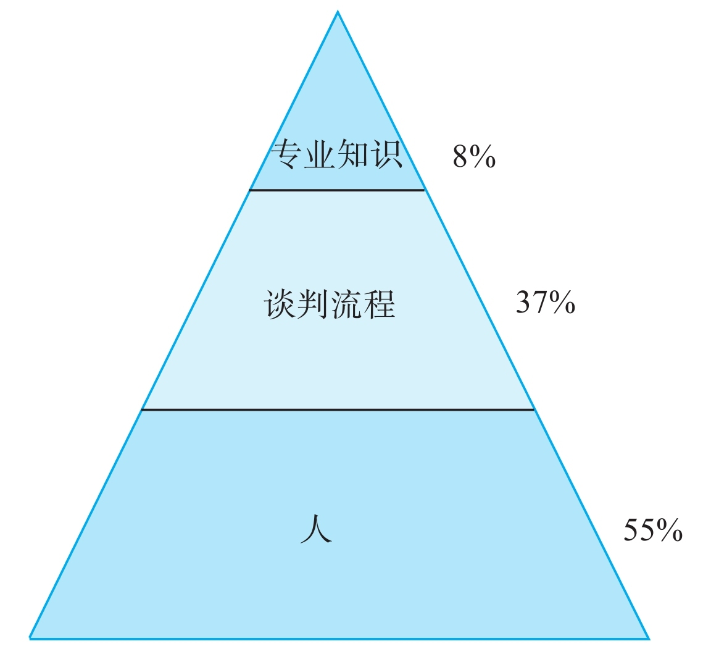

# 第二章 人几乎决定一切

2008 年年初，好莱坞剧作家协会已举行长达三个月的罢工。剧作家协会的首席谈判代表，即现任会长约翰·鲍曼（John Bowman），在一位知名好莱坞经纪人的安排下与我通了电话。“听听这家伙会说些什么，”这位名叫阿里·伊曼纽尔（Ari Emanuel）的经纪人对鲍曼说，“把他说的话都记下来。”

那是一个星期二的下午，鲍曼按例要在星期四的早餐会上和好莱坞主要制片厂的代表就争议问题进行商谈。他手头有一大堆实质性问题要解决，如稿酬、基本补偿金等，正不知道该以怎样的顺序将这些议题一一抛出。

我让鲍曼将这些议题通通放在一边，至少现在先不予理会。这些都不是问题。现在的问题是，谈判双方都是一副势不两立的架势，所有人都在遭受经济损失。“和他们随便聊聊天吧，”我建议道，“问问他们：‘你们开心吗？’”他们肯定开心不起来，对此他们肯定也不会予以否认，他们也许会指责剧作家协会。我告诉鲍曼这没关系，我说：“安慰一下他们，然后问他们：‘如果重新开始谈判，你们想怎样继续下去？’”

鲍曼对我的话半信半疑。我告诉他谈判的关键在于人，我给他举了几个例子来说明谈判是怎样始终和人紧密相关的，这些例子在本章均有收录。首先，对那些愿意倾听自己、尊重自己、积极和自己协商的人，人们总是慷慨大方。我让鲍曼将两个来自纽约时装区的谈判代表打发走，因为这二人作为剧作家协会的谈判代表一直咄咄逼人、寸步不让，只要他们往谈判桌前一坐，好莱坞电影制片厂那些原本气定神闲的高管们就会备感压力、精神紧张。

鲍曼在电话中说他会试试我的建议。此时此刻，他还有什么好怕的呢？最后的结果是：在谈判几个月以来一直无果的情况下，就在那次早餐会上，谈判双方一致同意重新开始谈判。鲍曼撤换了来自纽约时装区的那两个家伙。仅仅几天时间谈判就达成了协议，这次罢工也随之宣告结束。阿里说：“多亏了这次谈判，剧作家罢工才得以结束。”他是美国家庭影院频道热播的系列喜剧《明星伙伴》中的主人公在现实生活中的原型，也是白宫前幕僚长拉姆·伊曼纽尔（Rahm Emanuel）的兄弟。

对于这次谈判，你也可以看到另外两点：其一，它并非像火箭科学那么神秘高深；其二，除非你已对谈判方式做到心中有数，否则你根本看不到那些谈判技巧。

从古至今，人们前去谈判都会带着一大堆议题，打算一开始就先声夺人，张口闭口“这是我方议题”“那是我方提案”等。

这样做实在大错特错！如果你无法以某种方式和谈判对手进行沟通，就无法达成协议，或者即使你确已和对方达成协议，它也不会十分理想，或者不会长久维持下去。因此，纵然你对对方恨之入骨，也必须和他们进行交流沟通。

记住，在整个谈判中，你是最无足轻重的一个人。最重要的人是对方，其次是对谈判者极为重要的第三方。如果不接受这个观点，你就无法说服别人相信你所说的任何一句话。本章将向你展示应该如何关注谈判对手，以便实现你的目标。

## 关注对方会让你收获更多

首先，坐在你对面的人的性格和情感几乎左右着谈判的每一步进程。在谈判当天，如果你不清楚对方的想法，那么考虑种族、宗教、性别、文化、信仰以及其他任何问题都没有意义。如果你和谈判对手在星期一各自带了 3 个人参加谈判，到了星期二，你却带来了 4 个人，那么星期二的这场谈判与星期一的谈判就会完全不同。即使参与谈判的人不变，还是原来那 6 个人，但是情况也会有所不同。也许某人那天早上上班路上不太顺利，也许某人正好身体不适，也许某人的孩子正在生病，也许某人因为其他事情而心不在焉。

因此，对你而言，当务之急是要摸清你对面的人此时此刻的情绪和处境，即使他与你是老相识，即使他是你的配偶。

这是一种完全不同的看待谈判过程的思路。过去，人们最关注的是谈判议题，比如，“这是我方提案”“那是我方议程”。后来，人们开始考虑利益问题：“你方为何想要达成这笔交易？让我们双方理性地讨论一下这个问题。”这种做法将谈判议题先搁在一边，专注于双方的利益问题，效果要更好一些。然而，无论是专注于谈判议题还是聚焦于利益问题都不够理想。要想使谈判真正获得成功，你必须退回到谈判起点重新开始。对方现在的感受如何？他们对当前形势的看法如何？他们脑海中的想法是什么？

如果你不从这些问题开始，又怎么能知道从哪里入手呢？每个人都是与众不同的，即便是同一个人，今天和明天，或在同一天的不同时间也是不同的。在和对方谈判的时候，你必须关注他们当时的感受、想法和观点，否则你就如同在黑暗中摸索前行。

大部分人认为谈判的关键是具备专业知识：本人是金融专家，本人是医生，本人是环保律师，本人是能源专家，本人是机械师等。但是，研究表明，在促使谈判双方达成协议的关键要素当中，专业知识所起的作用仅占 8%，人在其中所起的作用超过 50%，即双方是否互有好感、是否互相信任、是否愿意倾听彼此的要求。谈判流程所起的作用大约占 37%（见图 1）。也就是说，谈判双方是否愿意深入了解彼此的需求（理性需求和感性需求），双方对谈判日程的安排是否意见一致，双方是否有诚意对彼此做出承诺。

图 1

如果你认为谈判的关键是实质性问题，那么很遗憾，我不能说你的看法有错，但你缺少了作为谈判者的说服力。也就是说，在谈判中，真理和事实只是一项论据，人和谈判过程要重要得多。对于那些强调专业知识的人（医生、工程师、金融专家）而言，这一点令他们很难接受。但是，研究表明，事实的确如此，单靠专业知识很难说服他人，除非对方愿意听你讲这些东西。

O. J.辛普森（O. J.Simpson）涉嫌杀害前妻妮克·布朗·辛普森（Nicole Brown Simpson）和前妻男友罗纳德·戈德曼（Ronald Goldman），尽管一辆手推车的多处留下了辛普森的 DNA（脱氧核糖核酸）证据，凶案现场所发现的血迹也与他的血型相同，但洛杉矶刑事陪审团仍然判他无罪，为什么呢？在我所认识的律师当中，凡是看到关键证据的，几乎没人敢相信这样的判决结果。下面的问题给出了简单的解释：这个陪审团的成员主要来自平民区，而且绝大多数是黑人，他们对这起案件的感受是什么？他们对证人马克·富尔曼（Mark Fuhrman）（一位狂热的种族主义者）又是什么感受呢？

首先，该陪审团对检察官没有好感，而且他们不信任检察官。如果对方不喜欢你，也不相信你，他们就听不进你说的话。对方之所以在听，只是因为你一直在对他们滔滔不绝，“嗯”并不代表他们听进了你所说的每一个字。当人们感到愤怒、疑惑或不确定的时候，从生理学的角度而言，他们就更听不进对方所说的话了。盛怒之下，即使你在记笔记，也很有可能写出这样的句子——“我恨死这个人了”。仔细观察一下裁判和棒球教练面对面冲对方大吼大叫的情况，你认为他们彼此能听到对方所说的话吗？要想说服对方，首先要让对方听你说话。你必须另想办法，集中精力，对其始终予以足够的重视。

因此，在辛普森杀妻案中，检方所提出的多项指控以及搜集到的各种证据事实上根本未被陪审团听取。检方的律师可谓精明强干、经验丰富，却在这起案件中经历惨败。这是因为一旦涉及理解他人的问题——谈判中的头条要求，他们便显得一无所知、愚蠢透顶。

辩护律师在辩护的时候把陪审团成员当成了普通人。“如果这只手套试戴不合适，你们必须判他无罪。”当辛普森试戴血手套的时候，约翰尼·科克伦（Johnnie Cochran）这样对陪审团说。这句简单的话对陪审团的判决起了重要作用。也许你不喜欢这样，但现实社会就是这样运作的。

在 2004 年的美国总统大选中，乔治·W. 布什（George W. Bush）为什么会获胜？我认为是因为他所说的一句话：“即使我们意见不一致，至少你们知道了我的信念和立场。”这句话可信度很高。可信度是最重要的。这句话和他的竞选对手民主党总统候选人约翰·克里（John Kerry）所说的话形成了鲜明的对比，约翰·克里的话总让人感觉他极其渴望登上总统宝座。

2008 年美国总统大选，贝拉克·奥巴马（Barack Obama）为什么会获胜？我认为原因在于第二轮总统选举辩论。每当共和党候选人约翰·麦凯恩（John McCain）要对奥巴马施以猛烈抨击的时候，奥巴马总是面带笑容，表现得非常合作，沉着冷静，显现出总统风范。当时由《纽约时报》和哥伦比亚广播公司联合开展的一项民意调查显示，麦凯恩怒气冲冲的语气和对奥巴马进行人身攻击的行为给 60%的选民留下了负面印象。

就谈判而言，这意味着什么呢？如果你和对方在讨论议题的过程中不顺利，那么就立刻停下来！回过头去谈一谈人的问题，然后将所有问题搞定。不要失去理智地一味继续下去，否则你将无法达成协议。或者即使你达成了协议，这项协议也不会长久维持下去。

一位女士在洛杉矶进行了一场非常敏感的职位收购谈判。第一天一切进展顺利，第二天却出现了问题，因此她停止讨论谈判议题，对对方说：“马克，我们昨天谈得很愉快，但今天不太顺利。如果这是因为我说了什么或做了什么造成的，我感到万分抱歉。我希望我们能重回正轨。你现在感觉如何？”

马克为自己的分心表示歉意。大家发现导致谈判不顺利的原因竟然完全与谈判无关。他们双方重新检查了谈判流程，最后成功地达成了协议。

· · ·

关注对方会让你获得更多。如果你将对方当作独立的个体来对待，即使在交易型情境中，他们向你提供帮助的可能性也会增加约 6 倍。愿意提供帮助的人所占比例差距惊人：最高可达 90%，最低只有 16%。

即使你不认识对方或者讨厌对方，但只要和对方沟通，对方通常会帮助你实现目标，无论谈判对象是政府部门少言寡语的官员、素以服务态度生硬而著称的电信公司，还是政见不合的他国领导人。

你不应该责怪这些人脾气糟糕、面目可憎，责怪他们只会使你偏离自己的目标。对他们以礼相待，才会让你离目标更近。

阿莉扎·扎伊迪（Aliza Zaidi）要乘坐全美航空公司从旧金山飞往费城的夜间航班，航程长达 5 个小时，她的座位在中间，而且飞机上剩下的全是中间的座位，乘客们正在向值机柜台的票务员发牢骚。阿莉扎注意到票务员一边处理乘客们的问题一边咳嗽，看上去似乎身体不舒服。

阿莉扎带有两瓶水，她把其中一瓶递给那位票务员，又给了她几片止咳药并关切地问候了几句。那位票务员充满感激地接受了她的好意。阿莉扎此举并非收买人心，她本来就是一个乐于助人的人。现在，阿莉扎在匹兹堡担任顾问，她说：“我当时那样做并没有多想。”

阿莉扎很客气地问那位票务员，如果靠过道的座位开放的话，能否为她安排一个。没有给对方施加任何压力，也没有任何牢骚和抱怨。阿莉扎将自己的票交给票务员，然后坐下来。过了几分钟，票务员叫到她的名字。“她给我安排了一个紧急出口处靠过道的座位，那儿的空间更大一些。”阿莉扎说，“她还给我提供了免费的一餐，她不想让我饿着肚子睡觉。我再次向她表示感谢，她又给了我一副耳机，方便我看电影。与人为善，必得福报啊。”

你也许会说，如果每个人都这样做，谈判技巧就是无效的，或者这样做似乎有收买人心之嫌。你说得不无道理，但是，并非人人都会这样做。大多数人只会抱怨、发牢骚，事事只想着自己，不考虑对方。再说，与人为善并非一件坏事。我很乐意生活在那样的世界里，你难道不是吗？

关注他人还有一层含义，即当你和一个团队的代表进行谈判的时候，你的注意力应该放在这个团队的个体成员身上，而不是他们所代表的公司或文化，也不是他们的性别、种族或宗教。每个个体都是与众不同、独一无二的，当你与他们交谈的时候一定要将他们当成个体看待。

许多谈判类图书和文章经常被冠以诸如“如何与俄罗斯人谈判”这样的标题。它有什么问题吗？这样的标题包含一个假设，即同一国家的所有人都一样，没有任何差别，他在你眼里只是俄罗斯人、日本人、中国人、法国人或美国人……对这样的标题，我的反应是：“怎么，你是要和 1.3 亿日本人谈判吗？”

事实上，你的谈判对象是一个人或两三个人，这几个人也许或多或少地和你所代表的文化有相同之处。在谈判中对你说“不”或“行”的并不是整个文化或团队，而是有着自己观点和独特个人经历的个体。可以肯定的是，不同文化之间的各种规范存在很大差异，而规范这个概念过于笼统、不够精确，它无法告诉你怎样才能说服坐在你对面的那个人。

的确，与你身旁的公司同伴相比，你也许会和来自蒙古的某个人有更多的共同之处，即使此人和你语言不通。

“所有的美国佬都特立独行、好胜心极强，所有的日本人都善于团队协作，这种看法显然是错误的。”王炜炜说。她是我们在第一章提到的在南加利福尼亚大学取得巨大进步的谈判者。

有一次，我感觉一位客户不太高兴，于是我问他：“你怎么了？”对方回答说：“我们不喜欢律师。”我就是一名律师。我说：“能告诉我是怎么回事吗？”对方提起了他们曾经和辛辛那提的几位律师有过不愉快的经历。

我告诉他们：“我有个好消息要告诉你们。我不认识那些律师，和他们没有任何关系，也不对他们负责……我就是我。”

凭什么你要为你的公司在过去 10 年所做的一切负责呢？或者，在你的职业领域或文化中，有人为未来 100 年或 1000 年做过什么吗？你的同胞或同事在 10 年前、20 年前或 50 年前做了错事，有人愿意为他们背黑锅吗？这不公平，更重要的是，这与谈判毫无关系。

关注你面前的这个人，看看你和他目前能做什么。你力所能及的事情是什么？用这种方式考虑谈判会让你对自己的能力充满信心。将所有你无法驾驭、会让你产生挫折感的东西通通抛开，专心处理自己力所能及的事情。这有助于你分清事情的轻重缓急，也有助于你将事情做好。如果有人说企业文化会影响谈判，你可以回答说：“也许吧。不过，你相信吗，即使没有企业文化，我也有可能做出满足你需求的决策，并做出言而有信的承诺。”

即使最极端的人也并非铁板一块。假设在 1944 年，你是波兰的一名犹太人，你认为所有的纳粹都是恶魔。如果你遇到奥斯卡·辛德勒（Oskar Schindler），按理说你就应该没命了，因为辛德勒也是一名纳粹。但是，这名纳粹愿意拯救你的生命。不过你永远都不会向他开口，因为在你心中所有的纳粹都憎恨犹太人。

无论在事业上还是个人生活当中，如果知道哪些人真正相同、哪些人真正不同，这将带来多么有利的竞争优势啊！仅靠一些外部特征或表面上的社会交际关系是无法获得这种竞争优势的。而一旦拥有了这种竞争优势，你就能和任何团队的成员建立关系，成功达成交易。对那些识人不明、技巧不足的谈判者而言，这正是容易令他们失手的地方。

杰克·德乔亚（Jack DeGioia）是乔治城大学的校长，有一年，他在沃顿商学院参加了我们举办的执行谈判力讲习班。当我们就上述观点展开讨论的时候，他说在 2001 年 9 月 11 日的恐怖袭击事件之后，他做过一些有关阿拉伯裔美国人文化的研究。他注意到大约 63%的阿拉伯裔美国人都信仰基督教。

换句话说，根据这次研究以及随后我们自己所做的研究发现，超过一半的阿拉伯裔美国人并不信仰阿拉伯文化中最重要的宗教——伊斯兰教，相反，他们信仰的是西方文化中最重要的宗教——基督教。

那么，“9·11”事件之后出现了什么情况呢？“9·11”事件后，无数阿拉伯裔美国人遭到了持续猛烈的舆论炮轰，发动炮轰的有美国政府各级官员，包括一些地位非常显赫的高级官员，还有航空公司、教育机构以及许许多多普通的美国人。针对阿拉伯裔美国人的各类事件层出不穷，从谋杀到殴打，从非法逮捕和拘禁到被赶下飞机，这些均有案可查。一些评论将攻击基督徒的罪责推给所有的阿拉伯人（很可能也包括一些信仰基督教的阿拉伯人）。你可能会说这样的人只占少数。但是，为什么会出现这样一些少数分子呢，尤其是在美国这样的国家？

在和宗教极端分子做斗争的过程中，更多的美国人原本有可能与许许多多热爱西方文化的阿拉伯裔美国人携手合作，团结更多人，搜集更多信息，获取更多援助。在这个例子中，致使他们错失良机的原因是他们没能将人当作个体来对待。这并非要批评那些伊斯兰教信仰者。关键在于没有区别对待个体，对人缺乏精确有效的判断。

随着时间的推移，令人不安的各类事件持续上演。2009 年年底，一名尼日利亚男子企图在一架飞往美国的飞机上引爆炸弹，美国官员因此将尼日利亚人列入恐怖分子监视名单。尼日利亚则以将石油卖给其他国家为威胁对此做出回应。两国官员难道不是反应过激吗？尼日利亚不会因为一名本国的恐怖分子而成为一个恐怖主义国家，人们也不会因为美国运输安全管理局几个官员反应过激，而对所有美国领导人持有偏见。

## 寻找关键的第三方

阿南德·伊耶（Anand Iyer）曾在一家销售货币兑换技术的公司工作。一位客户说他的“公司”认为阿南德收费偏高。“我对他说，我们是和人谈判，而不是和‘公司’谈判。”阿南德说，他现在在旧金山当货币和股票交易员。阿南德告诉这位客户，自己很乐意和那些认为费用过高的人谈一谈。原来，那些认为费用过高的人只是想让阿南德“改进”货币兑换柜台的服务质量。于是双方达成了一个涉及公共关系和一些额外工作在内的协议，费用依然保持不变。

几乎在任何一场谈判中都至少会有三个人——即使有时只有两个人在场。第三个人或第三方通常指的就是这样的人，无论是真实存在的或想象中的，即谈判者认为自己必须以某种方式遵从的人。这些人也许是鬼魂和过去的精灵，也许是谈判者告之以谈判结果的对象——配偶、同事、朋友，在这些人面前，谈判者需要保持面子。他也有可能是老板。问题的关键是，要想实现你的目标并获得更多，你必须对这些人负责。

例如，就谈判对方个人而言，他也许会同意你的意见，但他有一个不讲道理的顶头上司。在这种情况下，你可以和对方联手找出理由去说服对方的顶头上司。

斯科特·布罗德曼（Scott Brodman）是一家大型化学公司的销售经理。有一件事令他十分费解，一个新客户的采购代表不停地提要求，尽管那笔交易条件已经十分诱人。于是斯科特提了一些问题，想看看幕后是否存在第三方。“我发现，原来他的老板正在监视他，而且经常在事后批评他。”斯科特说。

在斯科特的帮助下，这位采购代表让其老板看到了行业标准以及他们的需求得到满足的过程。“他告诉他的老板，这是他所能达成的最有利的交易。”斯科特说。最后对方同意了协议。

很少有人会忽视对自己很重要的第三方意见。当你需要对某人施加影响，而又自认为没有足够的影响力的时候，想一想对对方而言很重要的人是谁，以及更容易受你影响的人又是谁。

20 世纪 70 年代，纽约的一名律师伯纳德·伯顿（Bernard Burton），在一起诉讼案中代表一个承包商状告在长岛修建赛道的一名建筑商。由于这条名为萨福克草甸的赛道出现了资金周转问题，建筑商罗纳德·帕尔（Ronald Parr）停止向部分债权人偿还债务。伯顿担心帕尔在被告席上就债务问题不说实情，因为帕尔并非坦荡直率之人，所以伯顿将跟随帕尔 30 多年的秘书传唤到庭，她不是来作证的，而只是坐在旁听席上。伯顿认为，帕尔绝不会在自己的秘书（一位亲切慈祥、诚实正直的老太太）面前说谎。果然，帕尔讲出了实情，伯顿帮客户要回了工程款。“一分都不少。”他说。这就是第三方的重要性。

## 尊重对方

一名学生走进当时费城一家主要的百货公司“斯特劳布里奇和克洛西尔”，想为面试买一套衣服。他看到一套标价为 500 美元的衣服打折后为 350 美元，于是将这套衣服拿到柜台处。在柜台处，一名售货员正在处理其他顾客提出的要求和投诉，忙得不可开交。

这名学生就在那里等，直到其他顾客都走了，那名售货员终于闲下来了时，他首先为其他顾客的行为向售货员表示歉意。接着他说，忙了一整天，她一定非常疲惫，其他顾客拿自己的问题向她出气，这不公平。一天下来，这名学生也许是第一个对这名售货员态度如此友善的人。

这名学生强调了这套衣服的现有折扣，接着询问是否还能通过其他任何方式获得更多折扣——商店专用信用卡持有者专享的额外折扣、现金支付的折扣等。售货员说这些方式都未施行。这名学生又说：“我能否提个建议？在今天这段时间，我也许是第一个至少试着理解你辛苦工作的人，所以，能给我一个好人奖励折扣吗？”售货员笑了，她说：“再优惠 50 美元怎么样？”

这是一件小事。这名学生额外得到了 14%的折扣，只是因为他让自己在那名售货员面前显得富有人情味。他所做的是一次人际沟通。这并不是一种多高超的技巧，但大多数人往往注意不到。有些谈判所达成的交易其利益极其可观，这样的机会有很多。如果你每年的可支配收入能增加 10%，你觉得怎样？

要让对方将你想要的东西给你，关键是要尊重对方。大多数电影和书籍都是这样描述谈判的：要狠狠打压对方，让对方感到羞耻或使其陷于不利处境，这样才能争取更多。这种方式实在大错特错！想想你自己的反应。如果对方尊重你，你就会愿意给予他们更多。在家庭中，人们之所以难过是因为他们觉得自己不被重视。在工作中，人们之所以会抱怨也是因为他们觉得自己没有受到尊重。

如果在谈判一开始你发现自己错了，要立刻调整方法。在沃顿商学院的时候，有一次我上课迟到了。在一条双向车道上，一个方向的车道被一辆大卡车堵住了。在另一个方向的车道上，一辆小汽车和一辆出租车相向驶入空车道，各自后面跟着大概 5 辆汽车，都在不停地按喇叭，但两辆车互不相让。我决定通过谈判来解决这个问题。我从车上下来，走到那辆出租车跟前。我认为，和看上去显然是本地人的这名司机谈判应该更容易。

“你非要表现得这么英勇吗？”我说。这句话说错了！因为这句话对他是种侮辱和不尊重。他挥手让我走开，还“呸”了一声。我意识到自己犯了一个错误，于是试着采取一种更设身处地的方法。

“你可以做个好人。”我试着说道。当然，他可能会因为在过去一直是一个大好人而有种压迫感。尽管如此，他还是听进去了这句话，说了声“嗯”，但还是没有任何行动。

于是我认真考虑了一下他头脑中的图景，想了想他每天的工作。最后，我突然想到了一种对他表达尊重的方式。“你看，”我按设想的方式说道，“这两辆车中，只有你是专业司机。”

他开始倒车。

了解对方的想法是谈判中的一个重要主题，我会反复谈及这个问题。要想说服对方，了解对方的想法是你所能做的最重要的事。只有努力去了解对方的想法，才有可能转变对方的思想。

如果下一次你因为交通违规而被交警拦住，首先应表示歉意，再感谢交警对工作尽职尽责。这样做说明你尊重他们拦住你的做法，尊重他们为自己的事业所花费的时间。当你尊重对方的时候，对方就会回报你。如果你担心自己要负责任，告诉他们你对“已经发生的事”或“自己在该事件中有可能造成的任何问题”感到非常抱歉。我常常以恭敬的态度对警察说：“都听您的。”

几年前，在纽约市第 37 大道上，我因没系安全带而被警察拦住。路边有三辆汽车正在接受处罚，看起来显然也是同样的原因。警察刚刚开始在此执行任务。我决定向那位警官表达一下尊重，我说：“警官，您拦住了我，您对工作尽职尽责，对此我非常感谢。要不是您，刚才我也许就没命了。”最后他对我开罚单了吗？当然没有。

当然，你一定要表现得真诚。如果你说这话的时候不是发自肺腑，那就会被开罚单。如果你厌恶所有的警察，这种情绪就会表现出来。你要把日常生活中的所有遭遇都当成谈判加以思考，并不断实践，直到你能迅速将注意力集中到对方身上。换句话说，必须让对方真正觉得这个谈判关注的是他们以及他们的需求和看法，而不是你的需求和看法。警察想要确定的是你已经吸取了教训，主要问题在于这个教训对你而言代价有多大。

在我还是一名记者的时候，常常要在几秒内赢得他人的信任。我的第一个目标就是让对方面对我滔滔不绝。我会尽力去了解对方的想法。他在想什么？他的感受是什么？怎样才能让他一直与我交谈呢？怎样才能让他主动联系我呢？只有做到真诚坦率、求知好问，才能发现对方的想法，否则你就毫无头绪。

丹尼斯·扎维雅洛夫（Denis Zaviyalov）5 岁的女儿雷吉娜想成为公主。“她爱看有关公主的卡通片，房间的墙上贴满了公主的海报。”丹尼斯说。但有个问题：“她的房间乱得一塌糊涂。”丹尼斯仔细想了想女儿以及她的想法和眼中的世界，他让雷吉娜展示一下如何用纸板做向日葵。雷吉娜照做了。“谢谢你，公主！”丹尼斯接着又说，“不过，看看这里被我们弄得多乱啊。”他环顾了房间四周，“这看上去像是公主的房间吗？”

雷吉娜想了想。“公主的房间不应该这么乱。”她说。“那我们应该怎么办呢？”丹尼斯问道。雷吉娜说：“我可以把房间收拾干净，扔掉所有干掉的‘培乐多’彩泥，让这里看起来像个公主的房间。”谈判成功！

一天清晨，在费城斯库基尔河沿岸的一个船库里，16 个人正在等候埃弗雷特·赫特（Everett Hutt）给他们做船员训练。埃弗雷特的专用车位被一辆汽车堵住了。当时是早上 6 点。经过一番努力，值夜班的工作人员打通了车主的电话，车主告诉了他该车（一辆阿库拉轿车）钥匙的位置。但这位工作人员取来了一把本田车的钥匙，他一直试图用这把钥匙发动汽车，还说钥匙肯定没错，因为这是从钥匙盒里车主所说的位置找到的。

埃弗雷特并没有嘟囔说：“你这白痴，难道你没看见这是本田车的钥匙吗？”相反，他赞扬了这位工作人员所做的努力。接着，他对这位工作人员说：“并非人人做事都像你这么严谨有序，也许钥匙一不小心被放在别的地方了。”这位工作人员同意回楼上看看，他在那里找到了正确的钥匙。

现在，你会说：“我永远也不会做这样的事。”但是，埃弗雷特的言行帮他准时开始了训练。如果你采取的行动无法帮助你实现自己的目标，你就要花很多时间和停车场的工作人员或其他人争论不休。

通常，尊重对方会带给你意想不到的、获利丰厚的回报。珍妮弗·普罗塞克（Jennifer Prosek）在哥伦比亚商学院学习时，她决定和吉米·陆（Jimmy Lu）聊一聊，吉米是一名非常安静的中国学生，几乎没有人和他说过话。只用了 5 分钟，满怀感激的吉米就把自己在中国做的公共关系研究资料送给了詹尼弗。对他人充满好奇本身就会带来各种机遇。

后来，詹尼弗成了纽约和伦敦一家公关公司的创始人兼首席执行官。“我们认为商业发展靠的就是人们与生俱来的好奇心。”她说。她补充道，一次简单的对话，无论其内容如何，都有可能成为销售谈判过程的一部分。

那么，怎样才能了解对方呢？随便聊聊吧。这不仅仅是因为某本书上说聊天乃明智之举。之所以和对方聊天是因为你对他们感兴趣，因为你想努力和对方建立一种关系。这是一种贴近生活的方法。

这也是一种接近他人的方法。在费城一家名为尚普的餐厅，一名新来的女服务员正忙着为络绎不绝的顾客安排座位。我的一名学员和她的朋友们正在等待他们点的食物，还要等很长时间才能端上来。于是，我的学员将那名女服务员叫过来，首先对她的辛苦工作表达感谢和尊重之意，接着又说，看出来她是一位新手，现在非常忙，不过在等候用餐的这段时间，能否先给她们上一盘开胃菜？

那名女服务员端来了一盘免费的开胃菜，接着又将主菜的价格从账单上划掉：除了酒水饮料，其他全部免费。“由于我态度友善，善解人意，那名女服务员自然而然地给了我回报。”我的学员说。

“找出一条能将双方联系起来的共同纽带会给你带来巨大的收获。”鲁宾·穆诺茨（Ruben Munoz）说，他是费城的一名律师。在互联网上查找能翻译出生证明和结婚证书的译者的时候，鲁宾遇到了一位女译者，他们谈到了对西班牙和旅行的共同兴趣，鲁宾的翻译费用因此减少了一半。难道你不想这样做吗？好吧，不过你也别想有任何收获。

公众往往傲慢无礼地对待服务人员。如果你能给予这些人尊严，他们将会不胜感激。

戈拉夫·蒂瓦里（Gaurav Tewari）有一些箱子已经存放在一个公共物品仓库一个夏天了，他需要支付 100 美元。戈拉夫找到了仓库经理并和他聊起天来，这位经理说他希望有一天能拿到工商管理硕士学位。戈拉夫正好在攻读工商管理硕士学位，于是他向这位经理提出了一些申请商学院的建议。结果呢？戈拉夫需要交纳的费用被免掉了。

从我的学员们的个人账户上来看，通过运用类似不起眼的方法，他们节约下来的金额已经超过 10 亿美元，这可是一笔不小的数字。

进行人际沟通意味着你必须将注意力放在对方身上，而不仅放在自己身上，你要让他们主动与你交谈。有一天，曾在沃顿商学院上过我的课的一名学员开车前往费城房价比较昂贵的郊区，他正在寻找住处，打算毕业后和妻子以及尚在襁褓中的儿子住在一起。这名学员一不留神闯过了停车标志。停在便道上的一辆警车上的警察立刻命令他靠边停车。

这名学员一个劲儿地道歉，说自己的做法确实太危险了。“问题是，”他说，“刚才我光顾着看这些漂亮的房子了，因为我正在找一个住的地方，打算毕业后和妻子、刚出生不久的儿子住在一起，所以没有看到停车标志。”

“您现在怎么处理我都行，”这名学员继续说道，“不过，您能给我点儿建议吗？在这个社区，哪里的房子稍微便宜点儿呢？我很愿意住在您所管辖的这个社区，不过我希望能找一个住得起的地方。”那名警官掏出了自己的钱包，给这名学员看他自己宝宝的照片。毫不奇怪，这名警官没有开罚单。

这种情况会一直发生吗？当然不会。不过，再强调一次，你要寻找的是每 9 局比赛中那额外的一记安打。

# 读累了记得休息一会哦~

 

**公众号：古德猫宁李**

*   电子书搜索下载
*   书单分享
*   书友学习交流

 

**网站：**[沉金书屋 https://www.chenjin5.com](https://www.chenjin5.com)

*   电子书搜索下载
*   电子书打包资源分享
*   学习资源分享

## 摸清对方的实力并予以肯定

尊重对方，也就意味着你承认对方的能力。这不仅指首席执行官，还包括高档餐厅的领班、对文件所在位置一清二楚的行政助理、机动车辆管理部门服务窗口忙得不可开交的政府官员、儿童、任何有可能节约或浪费你的时间的人。尊重对方的行为意味着你肯定对方的地位、能力或观点，这样对方就会愿意给你一些回报。即使对方能力有限，也要对他们在其他方面所表现出来的能力给予肯定，通过这种方式让他们获得力量，这样他们就会回馈于你。与将自己的权力强加于他人身上相反，这种方式产生的效果也就与之相反：人们愿意为你提供帮助。

因此，下次当酒店职员或客户服务代表在打电话、加油站的工作人员或其他服务人员犯了错误或没有准确满足你的要求时，不要责骂他们或对他们态度恶劣。这样做无助于你实现自己的目标。相反，要尊重他们，肯定他们有能力做得更好。这与人们的典型反应相反，却很有效——非常非常有效。

道恩·麦克拉伦（Dawn MacLaren）是一位管理顾问，他正和一位朋友在一家拥挤的餐厅用餐。尽管他们已经催促了 4 次，但服务员依然没将饮料送来。道恩的朋友冲那名服务员大嚷大叫，还辱骂他，那名服务员转身就走了。道恩跟随这名服务员来到餐厅的另一边，为自己朋友的行为道歉，同时也为其他顾客的无礼向他表示歉意。“如果您能把我们的饮料端上来，并把账单拿来，下次您来我们桌子的时候就可以拿到小费了。”道恩说。

不到两分钟，饮料就端上来了。“我没有让他显得不称职，而是努力站在他的角度看问题。”道恩说。

关键在于反应不要过于激烈，即使对方心情不好。通常，人们之所以抨击你，只是因为他们在别处受挫。不要怀疑自己。告诉他们，你很抱歉他们这一天过得不愉快。这样做会令你收获颇丰。这样做需要很强的自律能力，但获得的回报是值得的。

在生活中你会面对大量类似的情况。你选择的解决问题的方式将极大地影响你的生活质量。

找到并承认对方的能力还意味着要找到那个决策者 ，或者对决策者有直接影响的人。你们当中有多少人浪费了生命中大把的时间与人谈判，结果却所谈非人？每个人都曾有过这样的经历。当你打电话给某人的时候，你应该确定此人能否帮上忙。“您好，您能做某事吗？”生命是短暂的。

一家法国公司与一家韩国公司的谈判持续了三年。每一次法国公司认为双方已经达成协议的时候，韩国公司就将价格抬高到一个新的水平。历时三年，花费了 50 万美元——差旅费和其他费用，这还不算机会成本。最后法国公司放弃了，他们失败的原因是：他们没有问清楚原本在第一周就应该问的问题，即这个谈判流程采取的是什么形式？谁才是最后的决策者？

与此密切相关的另一个问题是，谁才是真正的谈判者？ 这个人未必最擅长谈判或资历最老。事实上，研究表明，人越有权力，就越少注意到对方的需求。也就是说，人们只有在不那么成功的情况下才会愿意将利益蛋糕做大。在谈判团队中，最出色的谈判者最终也许是一些资历最浅的成员，这的确是个讽刺。所以，你要问的问题应该是：“在我的团队中，谁最有可能让对方实现我的目标？”

授权给他们的一个重要方式是把问题交给他们，这种方法很少被使用。要运用同理心或直接请他们帮忙。如果你让他人参与解决你的问题，他们会觉得自己被授权了，就会全心投入，就更有可能帮助你。所以，直接请他们帮忙吧。

在我的谈判生涯中，我曾为中央情报局举办过一个咨询会。中情局监察长办公室有人打电话给我，似乎是行政机构被员工们大量的投诉压得喘不过气来，而管理者却束手无策。

于是，我来到了弗吉尼亚州的兰利。我告诉他们，减少员工投诉量的一个好办法就是把问题交给员工。组建一个员工投诉委员会，让各部门的员工轮流担任委员，比如，每 6 个月一任。为这项工作提供一笔小额奖金，或写一封对其工作予以肯定的信函，将其放入员工档案，或其他一些诸如此类的举动。这样一来，所有员工的投诉都要首先接受投诉委员会的审查，只有获得委员会的批准，投诉才能被转递至管理者手中。

在这种情况下，员工们的投诉量大幅减少。人们觉得，让同事们看到自己那些琐碎无聊或心存报复的投诉实在令人尴尬。所以，最后剩下的全是正当合理的投诉。让你的同事、上司以及员工给你提供解决问题的建议，并让他们知道你也许不会采纳所有的建议。无论如何你会因此获得更多。

## 信任和缺乏信任的谈判

一位同事是我近 20 年的老朋友。一天，他看到一个机会，就将我们两人共同研究了十几年的一个项目据为己有。夫妻结婚多年，一方突然欺骗了另一方，对方恍然大悟！一段婚姻就此破裂。

显然，信任是一个涉及人的重大问题。信任的好处是巨大的：更快的交易速度、更多的交易数量、更丰厚的回报。信任缺失会让人付出高昂的代价。法国一项研究表明：在法国，人们之间由于缺乏信任，以至于就业率和国民生产总值比其所能达到的水平分别降低了 8%和 5%。与之形成鲜明对比的国家是瑞典，两者之间的差距达数十亿美元。一般而言，在斯堪的纳维亚国家和美国，人们彼此之间的信任度最高。

在许多发展中国家，部分经济问题是交易成本高昂，原因是彼此缺乏信任。美国的部分经济问题是，自“9·11”事件之后，存在于民众和社会体制之间的信任度急剧下降。比如机场安检或贷款的各类事务，耗时更多，成本也更高昂。原本可用于发展更富有成效的事业的资金就这样被浪费了。2009 年丹麦的一项研究发现，社会信任与国外投资直接相关，在信任度较低的发展中国家尤其如此。

让我们来给信任下个定义：信任是一种因对方会保护你而产生的安全感。如果对方对你有一定程度的信任，他就会帮助你，除非风险太大或他遇到了更好的机会。如果对方非常信任你，哪怕自己因此受到伤害，他也会帮助你。了解信任动态非常重要。

信任的主要组成部分是诚实——对人要坦率。信任并不意味着双方意见一致或总是一团和气。不过，信任意味着彼此相信对方。正如我在前面提到的，你的可信度是你所拥有的最有力的谈判工具。

信任的对立面当然是欺骗或撒谎。它包括欺骗他人的任何行为，还包括以忽略某些事实给他人造成一种错误印象。比如巧妙地控制情绪、歪曲信息、吓唬愚弄（虚张声势或空口承诺）、选择性地选取信息破坏他人的可信度。只要无法通过“直觉测试”的都属于这种情况。说谎会破坏信任感，最终毁掉谈判。

信任必须建立在某个基础上。如果在生意场合刚刚认识的某个人对你说：“你难道不信任我吗？”你一定要这样回答：“我为什么要信任你？我们才刚认识。如果你就此而信任我的话，你简直是疯了！”信任要经历一段时间的缓慢发展，它是双方彼此间的一种情感承诺，以相互尊重、某些道德准则和好感为基础。它包括这样一个观点，即关心他人，不会千方百计地为自己攫取一切利益。

如果你对双方关系还不确定，就不要轻信对方。不要将自己的弱点暴露给对方。对待靠不住的人，正确的回应不是让自己也变得不值得信赖。为什么要因他人丧失信誉而毁掉自己的信誉呢？

1974—1986 年，我的同事米歇尔·马克斯（Michel Marks）一直担任纽约商业交易所董事长。他创造了能源期货，一个价值亿万美元的产业。有一次我问他成功的秘诀，米歇尔说：“我总是主动让出一部分利益，从来不会让对方一无所获。”他补充说，人们信任他，所以会找他交易，他所做的交易也就越来越多。米歇尔还说，他做每一笔交易的速度都比别人快，所以交易量也就比别人多出许多。

米歇尔并非傻瓜，当他对双方的信任程度没有把握的时候，他就不会暴露自己的意图。不过，他把自己的可信度看作竞争力的一个重要组成部分。米歇尔所处的纽约商品交易所是一个典型的短期性交易场所，正如埃迪·墨菲（Eddie Murphy）主演的电影《交易所》（Trading ）中所描述的那样。

不过，律师们也许会说：“我的职责是为客户积极争取利益，怎样才能与主动让出一部分利益不相矛盾呢？”我的回答是：“那要看是什么时间范围了，如果你今天将一切利益尽数揽入自己囊中，对方就不会再与你打交道了，在所有相关时间范围内，你是否为客户争取到最大利益了？”

有些人也许会说，信任在不同的文化中是有差异的，这的确没错。但是，在任何一种文化中，人际沟通越频繁，信任度就越高。信任缺失始终要付出代价。几年前，我在莫斯科为俄罗斯一些成功的商人举办了一次谈判研讨会。第一天早上过后，讲习班的三名学员带我共进午餐，想纠正我的观点。

“你所讲的有关合作的这些东西对你们西方学员很适用，”其中一个人说，“但和我们一点儿关系也没有。无论何时我们想得到什么，只要偷偷夺过来就行了。”他们三人哈哈一笑，但并非在开玩笑。我问有关贿赂的问题，他们说他们也会贿赂他人。

我对他们说：“在俄罗斯，你今天这样做可能管用，但国际商业社会不会容忍这种行为，从长远来看，这种做法会让你付出高昂的代价。”当然，他们并不相信我说的话。

1998 年，俄罗斯银行违约事件被曝光，其欺诈行为令美国银行损失了数十亿美元。美国在俄罗斯的投资额从占世界总投资额的 28%锐减到 2.9%。如果你问许多国际金融家有关俄罗斯的问题，他们首先联想到的就是“欺诈”。即使有欺诈行为的人只是少数，但其代价十分高昂。本书前面引用过的法国的一项研究显示，在俄罗斯，大约 90%的人“完全不信任”司法制度，而在美国和挪威，这个数字分别为 23%和 12%左右，这两个国家具备的信任度被认为是最高的。

在谈判中撒谎和欺诈会招致风险。骗局终会被对方揭穿。如果在一个组织当中，不同的人讲不同的谎言，迟早会有人站出来揭穿它。在组织内部那些道德标准更高的人群中，撒谎或欺诈很可能引起纠纷和猜疑。有人也许会从中找出矛盾的地方，并利用这些矛盾来对付你。

这并不意味着你必须将一切毫无保留地告知对方。正如第一章提到的，要告诉他们，在“此时此刻”有些情况暂时还不方便透露。如果双方关系有了进一步的发展，你就可以透露更多信息了。

这样做也有助于弄清楚对方的真正要求。一位女士从以前居住的曼哈顿社区搬走了，但不久之后，她又回到该社区的商店想购买一些音乐唱片。她想买的东西价值约为 150 美元。在收银台，经理问她是否住在附近，附近居民可享有折扣优惠。后来，这位女士在谈判课上提了这么一个问题，她当时应该撒谎吗？事实上，她并没有撒谎，而是支付了全价。

那位经理真正想问的是什么呢？他真的介意这位女士住在哪里吗？不。他想知道这位女士是否是老顾客。那这位女士为何不能这样回答：“我过去住在附近，最近刚搬走。我回来只是想在我喜欢的商店里买点儿东西。你们这家商店就是我中意的一家。”

这样说难道不比撒谎更强有力吗？这种说法回答了那位经理真正想问的问题。如果这位女士撒谎了，并将自己写有旧住宅地址的驾驶证拿给经理看，而这位经理碰巧认识刚刚搬进那栋住宅的人，那该怎么办？商店现在都有资料库。如果这位女士这样做了，她可能永远被这家商店拒之门外。

为了证明这一点，这名女士又回到了那家商店，她将谈判课上学到的话对经理说了一遍，结果结账时享受到了折扣。这种方式也许需要更多地考虑到对方以及当时的情况，但从长远来看，其风险更小，收益更大。

· · ·

正如我们所知道的，这个世界往往是靠不住的。怎样在缺乏信任的情况下进行谈判呢？毕竟，那些靠不住的人也是付了钱的。

事实上，尽管信任是最佳谈判工具，但对成功的谈判而言，你并不需要信任。这是大多数人都容易忽视的重要一点：信任并非一场成功谈判的关键要求。成功的谈判需要一些更基本的要素。

我们需要的是一个承诺。信任只是用来获得承诺的一种方式，获得承诺的其他方式还有合同、第三方、各种动机，等等。

重要的一点是，你要按对方的而不是自己的方式做出承诺。你说的话就相当于你的承诺吗？谁在意呢？他们说的话相当于他们的承诺吗？不要只是想当然地认为，如果自己以某种方式做出了承诺，对方就会以同样的方式做出承诺。你在确定自己的目标时花费了多少精力，在获得对方承诺的问题上就应该花费同等的精力。

在中国做生意的美国公司抱怨说，许多传统的中国公司不在合同中对价格做出承诺，他们的承诺具有很大的随意性。中国公司首先会在合同中将交易形式确定下来——供货方式、交付时间等。然后，他们通过观察市场，根据市场行情提出报价。合同中的价格被他们视为参考价格。事实的确如此，《中国经济评论》在 2010 年 4 月表示，西方人要是不打算开展第二轮合同谈判的话，他们就需要“为失败做打算”。

不过，在中国，如果当地有一位德高望重、受到公司人员敬重的长者，由此人通过媒体宣布包含价格标准在内的合同，为中美合作做出表率——那么，这就是一个响当当的承诺。这是因为，在中国，无论是商业行为还是个人行为，顾全面子十分重要。

一家美国咨询公司遭遇巨额债务拖欠，这笔债务拖欠已达 700 天——将近两年的时间。这家美国公司请过律师，可是没有奏效。他们又试着使用外交手段，这次，对方的门被敲开了一条缝：开会商谈。

我给这家美国公司提出的建议是，让公司主管亲自去见这家传统公司的头头们，对他们说：“贵方拖欠债务已令我方颜面尽失，让我们在同事面前抬不起头来，在朋友面前矮人一截，在家人面前直不起腰，面对员工、咨询顾问、客户、政府官员、街坊邻里以及各个社区，我们实在下不了台。”

同时，向这家公司建言说，拖欠债务同样令他们在自己的政府面前颜面无光。因为该国正努力在国际贸易领域赢得声誉。对已完成的工作拒不偿付合法的商业债务也有违国际准则。结果不到三个星期，这家公司就清偿了所有债务。

在中东的许多市场中，一次握手就是一个具有约束力的承诺。一个交易者伸出手，手臂伸直，说道：“这个价格怎么样？把你的手伸给我吧。”对方将手臂缩到身后，说明这个报价没被接受。谈判仍在继续。如果双方达成协议，他们就会在证人面前握手。这就是一个具有约束力的承诺。

我的一家公司在过去几年内曾将玻利维亚丛林的香蕉出口到阿根廷。在我们和阿根廷人做生意的特殊市场中，我发现以下说法都不算承诺：①“我发誓。”②“我以我母亲的生命发誓。”③“我保证。”④“我已经在合同上签字了。”⑤“我绝对保证。”

但是，如果我们欠阿根廷人的钱，他们就会遵守协议，至少直到我们向他们付清欠款为止。因此，我们形成了一种模式，在这个模式中，香蕉的成熟、运输、销售等环节所需成本由阿根廷人预付。我们从终端消费者，即超市那里收取付款。然后，再向我们的合作伙伴支付成本费用和利润分成。

在我们和阿根廷人做生意的 6 年时间里，他们从未违反过协议里的任何条款。是我信任他们吗？我甚至都不认识他们！因此，这里就有一个关键点。在缺乏信任的情况下，你需要用一个强制性替代物来刺激对方，让对方不会去欺骗作弊。这个强制性替代物可以是一个根据协议由第三方暂为保管资金的货币体系，也可以是第三方有可能给出的负面意见，还可以是交易中未来利润的净现值。

歌手蒂娜·特纳（Tina Turner）曾经说过：“这和爱情有什么关系？”在谈判当中，信任是很好的工具，但并非必不可少的条件。

还有许多其他方式可以保护你不受到对方谎言或欺骗的伤害。第一种就是渐进式。只向对方提供很少的一点信息，这样即使上当受骗，也不会付出很大代价。看看对方是否以同样的方式对待你。如果是，那就再深入一点点。切记，不要掉入这样的陷阱：你已让对方满载而归，可对方却在你所看重的方面寸步不让。要确保自己在每一步都能获得足够的利益回报。

一位名叫亚历克斯·多戈特（Alex Dogot）的乌克兰商人说，当他在生意场合认识了某个人的时候，在最初几个月里，他总拿自己已经知道答案的问题来问对方。“如果对方撒谎，我就不再和他们打交道了。如果他们说实话，我就继续往下走一步。”亚历克斯说。

还有其他一些方法可以用来检验对方。比如，让对方向第三方证明他们的报价是真实的。告诉对方，你会在自己力所能及的范围内给出更理想的价格，这个价格只有第三方才知道。这样一来，第三方就会对其他任何不利于你的报价进行检查。如果你的报价确实更理想，对方可以拿到你交由第三方保管的钱。如果对方犹豫畏缩，你就应该质疑他们话语的真实性。

我喜欢美国前总统罗纳德·里根（Ronald Reagan）对苏联的评论：“信任，但也要核实。”这是一句古老的俄罗斯谚语。

下面这个清单中的内容一定要牢记于心：

• 如果对方获得的信息比你多很多，你就会处于劣势。不要轻易做出承诺，要采取渐进的方式，直到获得更多信息或更多信任。

• 收集大量有关对方的信息（“请正当调查”）。问他们有关细节的问题，看看是否所有的信息都相互匹配。对每一件事进行检查和测试。请可靠的第三方提供帮助。

• 对方是否逃避你的问题或转移话题？对方越躲躲闪闪，他们掩盖真相的可能性就越大。

• 如果与诚实相比，欺骗能让对方更有利可图，那就改变刺激物。例如，就对方在一段时期内的表现（价值）给予对方一定报酬。

• 除非有明确的保护措施，否则不要向对方提供自己的资产（发明创造、时间、房屋建筑）。

• 确保任何协议的真实性。告诉对方：“只要你所说的是真话，我就会放心，你也不用付出任何代价。”如果对方犹豫退缩，一定要警惕！

• 在协议中将违反协议的后果予以说明。

• 亲自与对方会面，这样有些事情就很难隐藏了。在某些文化中，除非谈判各方可以亲自交谈，观察彼此，否则不会进行谈判。

• 如果对方对某些内容有所保留，你对此感到不满，那就问对方：“还有什么我应该知道的吗？”

相信自己的直觉。对方紧张吗？看上去内疚吗？殷勤过度了吗？目光看向别处吗（除非是文化上的原因）？长时间沉默吗？在拒绝做出承诺吗？这些并非对方不诚实的真凭实据。但直觉提出的这些问题能让你慢下来，思考得更多，步子迈得更稳。

争取更多还意味着不要紧盯着一些蝇头小利。一定要努力按照以上准则去做，否则悔之晚矣。

## 失去和重获信任

当一千年后，有人从报纸刊登的文章中查阅 21 世纪的情况，看到一则有关广受尊敬的时尚大师玛莎·斯图尔特（Martha Stewart）的讣告时，讣告的开头可能会这样写：“玛莎·斯图尔特已于昨日逝世。玛莎·斯图尔特曾改变了世界对时尚的看法，也曾因对大陪审团撒谎而遭到起诉并被判定有罪。”因为，欺骗乃至对欺骗的看法一直以来都是一个永恒的话题。

比方说，你在一家律师事务所工作。在你的职业生涯中有一次你多收取了一位客户 1000 美元，有人揭发了你。那么在你今后的岁月里，人们就会把你看成是滥收费的律师，而你所在的律师事务所也会背负滥收费的骂名。仅仅一次欺骗就换来了这样的结果。

欺骗的代价是失去信任。失去信任的代价是实实在在的损失：大把的钞票、极高的声望、良好的信誉以及作为谈判者不容小觑的影响力。迈克尔·菲尔普斯曾在 2008 年的夏季奥运会游泳比赛中创下了连夺 8 枚金牌的纪录，但他失去了数百万美元的赞助合同，因为有一次他被人发现在吸食大麻。虽然他现在依然有赞助合同，但其机会已经远不如从前了。还有众所周知的，职业高尔夫球手老虎·伍兹被发现对妻子不忠以后，他的广告代言事业一落千丈。

在谈判课上，一方有很多机会欺骗另一方。有一次，一名律师和一名法律系学生在一场谈判中达成了一项协议。该学生所在的团队违反了协议，彻底战胜了律师所在的团队。律师被激怒了，他在众多学生面前站起来对那名学生说：“我手里掌握着我所需要的有关你的所有情况，足以让你此后的人生身败名裂。”

这名学生回答道：“嘿，别这样，这只是一场比赛而已。”律师说道：“如果出于比赛目的你都能做出这样的事，想一想为了钱你又会做出怎样的事来。”

人们对欺骗的看法也会毁掉谈判以及在谈判中所建立起来的合作关系。一位经理曾在哥伦比亚大学进修我所开设的行政人员工商管理硕士课程，他说，他受雇于一家工业设备制造商，10 年前，该制造商与一个重要客户在年度采购合同上出现了一个问题。

该客户每年要购买价值 8000 万美元的设备。在合同谈判阶段，该客户对一项特殊的价格标准提出了反对意见。厂商同意将该价格标准从合同中取消。该价格标准对本次交易的影响不是很大，而且条款一直位于合同的最后。但是，双方曾郑重地就该价格标准进行过协商。

合同修改完毕，厂商签字后将其交给了客户。客户方的采购经理在审阅合同的时候发现，那项价格标准还在合同里！该客户十分生气，说自己上当了。厂商一再道歉，但全然没用。该客户根本不相信厂商，因为双方曾那样郑重地就那项价格标准进行过协商。

此后 10 年，该客户再也未向那家厂商购买过任何设备。如果将通货膨胀计算在内，那家厂商为此损失了达 1 亿美元的销售额。10 年之后，厂商一方曾参与过那次交易的高管们大多已离开，客户一方也仅剩一人。此人就是该公司的首席执行官，正是 10 年前的那位采购经理。

在因失去信任而造成的影响最戏剧化的例子中，有一个例子与一家大型化工产品生产商的一位客户有关。

这位客户是新泽西州中部的一家大型印刷厂。印刷厂的采购经理告诉我，他当时从那家生产商处购买的化工产品还不到总需求量的 10%，每年大约为 10 万美元。他说他们公司每年的购买额至少可以达到 50 万美元，甚至更多。然而，那家生产商并没有得到这笔生意，早在 1990 年，那家生产商就已经失去了印刷厂这个大客户。事实上，直到 2001 年印刷厂才再次开始从那家生产商处购买产品。

“出了什么事？”我问。

“哦，”采购经理说，“1990 年，那家生产商企图将一个新产品强行销售给我们，说老产品已经没货了。这个新产品不好用，导致我们在生产过程中白白浪费了很多时间。”接着，他发现所谓的“新产品”实际上是“实验品”。因此，他说：“我们丧失了对他们的信任。”他说对方从印刷厂所遭受的损失超过了 100 万美元。

“那么，你们为什么又重新开始和他们合作了呢？”我问道。

“嗯，”采购经理说，“那家公司的销售代表一直很棒。他一直坚持到我们公司来，给我们提供信息，他确实是个很不错的小伙子。所以我们认为可以在业务上再给他一次机会。这也是我们在 2001 年所下订单相对较小的原因。”采购经理说。

“巴斯夫公司的那个销售代表一直坚持来你们公司想重续业务合作关系，他坚持了多久？”我问。“6 年来每个月都如此。”采购经理说。

即使已经失去对方的信任，也有可能重新赢回来。当然，这并非易事，也不能保证一定成功。如果从“第二次机会”这个角度来重建信任，你的要求就有可能得到对方的回应。这个过程是循序渐进的。“你必须礼貌客气、向对方表示歉意并承诺会做得更好，”维拉·纳科娃（Vera Nakova）说，她是赛诺菲–安万特药品公司的一名高级营销经理，她曾给了一家业绩表现不佳的市场调查公司第二次机会。“你必须用开放的心态去接受改变，你需要就过去在沟通方面出现的问题进行讨论。”维拉说，重建信任的一个关键是要展示你在合作和解决已有问题方面的能力。

## 改变一切

通过本章所介绍的谈判工具和策略深入了解对方，能获得令人惊叹的效果。这个例子来自克里斯·希布塔尼（Chris Shibutani）博士——我之前在哥伦比亚商学院的一名学生——讲述的是一个 27 岁名叫吉恩的自闭症患者的故事。

克里斯现在是瑞士联合银行的一名投资组合经理，20 世纪 90 年代，他在曼哈顿斯隆–凯特林癌症中心担任一名儿科麻醉师。吉恩，这名成人患者，既不与人交流也不与人配合。每当需要打针的时候，他就会变得狂躁不安。

“我考虑了一下他的需求，还有他究竟是怎样一个人，”克里斯说，“他只是需要更多的具体的安慰，他的应对机制比别人更加有限。”

克里斯发现，吉恩害怕疼痛以及会引起疼痛的各种象征物，因此他当着吉恩的面把针全都收了起来。克里斯还发现，吉恩讨厌别人居高临下地对他说话，于是他就坐在吉恩身旁、能与吉恩的眼睛平视的地方，并让护士安静地躺在旁边的担架床上。这种举动肯定了吉恩的权力，也是对他的一种尊重。

克里斯认为吉恩不喜欢受到惊吓，所以医生在做检查和治疗的时候动作都非常轻柔。克里斯首先在自己身上演示了监控器的用法，然后又在吉恩的妈妈身上演示了一遍，演示的时候两个人都面带微笑。这就是人性化的沟通方式。

克里斯知道，吉恩在接受检查之前肚子是空的，所以他在麻醉罩上添加了香甜的草莓味，让吉恩能闻到这种香味。因为吉恩有时候会来回摇晃，嘴里发出哼哼声，所以克里斯也学着吉恩的样子，嘴里哼着“谁害怕那只大坏狼？”这样的曲子。

吉恩表现得安心、平静，就这样静静地睡着了。即使是最难对付的人，你也可以推动他走得更远，只要你知道他是怎样的人，尊重他，甚至让他有更多的控制力。