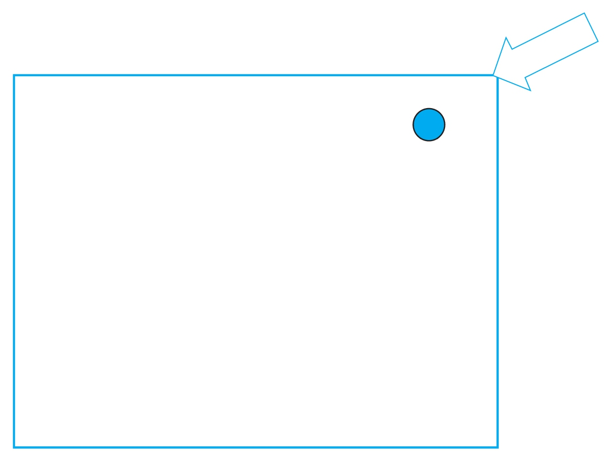
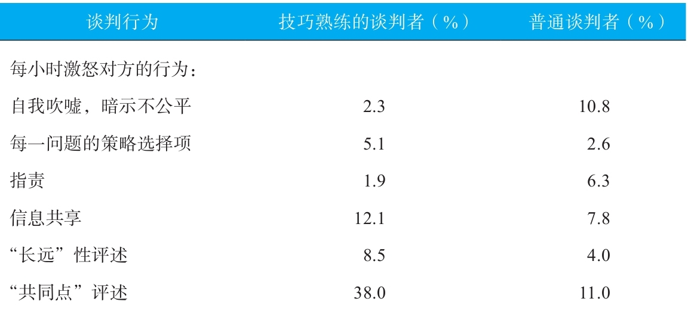

# 第三章 观念和沟通

看看下面这张图（把那个圆圈涂成红色）。请用一个或两个词把你所看到的东西写下来。那个箭头忽略不计，它只是一个指示标记。

你写下的是什么呢？最常见的答案是：一个红点，但是，在看过这张图的人当中，只有 33%的人写的是这个答案；其次常见的答案是：一个红色的圆圈，写下这个答案的人占 18%。人们对这个问题所给出的答案五花八门、千奇百怪。有一位来自医学院的人，他写的答案是“链球菌”。大约 7%的人写的是“空白”。40%以上的人都没有写“红色”。下面列出了部分答案：

红点　日本国旗　鲁道夫

右上角　目标　眼球

链球菌　黑点　血滴

靶子　交通信号灯　空白

对同一个问题，人们的答案怎么会有如此巨大的差异呢？换句话说，人们对自己所看到的有着广泛的分歧。将其乘以 1000，就会产生诉讼纷争；将其乘以 100 万，就会出现武装冲突。这一切都是一个连续体。

此外，几乎所有人都对那个问题本身所包含的一些信息进行了小小的加工。我的手指向红色的圆点，但嘴里说的是：“把你看到的写下来。”显然，空白所占面积比红色的圆点大得多。如果你争辩说，是这个问法让你将注意力放在了红色的圆点上，可是为什么还有 7%的人看到了空白呢？

也许导致谈判失败的最主要原因是沟通失败，全世界范围内都是如此。而导致沟通失败的最主要一个原因是误解。两个人看同一幅画，每个人看到的内容是不一样的。正如在全世界经常会发生的，当彼此为了同一幅画的不同内容而争斗不已的时候，他们就会互相“残杀”。

是什么原因导致人们的观点不同呢？首先，我们每个人都有别于他人，我们的兴趣点、价值观和情感构成不一样，所以对我们产生的影响也不同。其次，我们体验和观察到的信息也不相同，我们常常会忽视或剔除那些不符合自己要求的信息。在辩论或谈判中，我们会有选择地收集那些能用来支持我们观点的证据。最后，我们的记忆也是有选择的，而我们的记忆会影响我们的观点。

自人类诞生之日起，这些几乎就是造成所有人类冲突的主要原因，其重要性无论如何强调都不为过。

在下面这幅著名的图画中有两个女人，一个老妇人和一个年轻女子。老妇人是个侧面像，她的嘴是一条横线，略高于裘皮大衣，她的大鼻子在嘴的左上方，她的眼睛被她的黑头发遮住了一点点。退后一点来看，是个年轻的女子正扭头望向别处，她脖子上的项链是老妇人的嘴，她的下巴是老妇人的鼻子，她的耳朵是老妇人的眼睛。

在我的班级上，当我第一次展示这幅画的时候，学生们知道画中有两个女人。接下来我将这幅画拆分成两张人物形象的图片——老妇人和年轻女子，分别传给班上的学生。

接着，我从教室前面的屏幕上将完整的画取下来，让学生们盯着各自的图片看 5 分钟。然后，我将完整的画重新挂在教室前面的屏幕上。你认为会出现什么情况呢？

几乎没人能看出另外的一张图片。如果说，人们在看了一个相反的形象 5 分钟之后，就已经很难看清摆放在自己面前的画。那么，一种文化的人在看了同一幅画一千多年之后，再以另一种文化的观点来看，难度又有多大呢？

## 缩小认知差距

很多人在一些问题上完全视对方的观点如无物。对于许多人而言，如果对方不理解自己的观点，他们就会认为对方愚笨顽固或不可理喻。事实并非如此，这个问题往往比这深刻得多。通常，你自己深信的东西对方未必看得到，在对方眼里，那些东西是不存在的。

因此，要想说服与你持不同观点的人，必须先从观念入手，即你所谓的“各种事实”——你的思想、想法、观点——对方是看不到的。你认为一清二楚的东西，对方也许完全不知道。

如果中东的小学生在整个少年时代看到自己所在地区的地图上都没有以色列，你认为会出现什么情况呢？当终于有人告诉他们还有一个国家叫以色列的时候，他们根本就不相信。

甚至使用的日常语言也有可能导致观念上的巨大差异。一个客户曾在纽约市宝丽金唱片公司的营销部门工作。有一天，他和其他同事在工作时发生了争论，这时他们才意识到，他们每个人对所使用的“营销”一词的理解都不相同。有一个人认为营销和销售的联系更加密切，而另一个人认为营销和策略的关系更加密切。事实上，好多年来，他们都在同一个部门工作，彼此座位离得很近。他们的不同观点影响了他们处理工作、利用资源以及对待客户的方式——甚至，利用时间的方式。

在进行复杂合同的谈判时，聪明的律师知道，他们需要专门列出一项，对协议中所使用的术语进行界定。他们明白，即使是最普通的字眼也很容易有不同的理解。如果双方对同一语句的意思有不同的理解，整个协议就会带来风险，因为双方的观点没有达成一致。

这一点在日常语言中甚至更加重要，因为它产生误解的可能性非常高。但人们很少为了自己的言谈而对专门词语进行界定，对那些看起来含糊其词的东西提出质疑的就更加少见了。

有关误解的例子比比皆是。“就所提供的建筑服务包而言，那位客户说我们 43 万美元的收费报价太高，”阿努普·米斯拉（Anup Misra）说，他是一家房地产开发公司的创始人，“而客户不愿告诉我们他能接受的费用。”最后，他们让那位客户对“建筑服务包”一词进行了界定。原来那位客户想要的服务比首次费用当中所涵盖的服务要少很多。由于工作范围缩小了一半，最终确定的费用为 23 万美元。双方分歧得以消除。

鲍勃·布朗（Bob Brown）对儿子的高中成绩不满意。在详细询问了儿子亚历克斯之后，鲍勃发现，亚历克斯认为自己的成绩已经“够好”，足以考入自己所选择的大学。鲍勃将 14 岁的儿子引见给一位大学招生顾问，这位顾问告诉亚历克斯他的成绩还不足以考入自己心目中的大学。鲍勃没有和儿子争论谁对谁错，他借助于一位受人尊敬的第三方，使儿子知道了考入大学的真正要求是什么。“这十分奏效。”鲍勃说，他是默克公司的一名健康科学顾问。如今，亚历克斯考入了威斯康星大学电气工程专业，平均成绩始终保持在 3.8 分以上（“优”）。

几年前，我在沙特阿拉伯首都利雅得为一些高管开授为期三天的谈判讲习班。一位曾在美国生活过的高管说：“你看，当你在美国一家餐厅想再来点咖啡的时候，你只要举起咖啡杯，轻轻晃动一下，服务生就会走过来为你续杯。但在沙特阿拉伯，如果你也这样做的话，服务生就会拿走你的杯子。他们认为自己完全明白你的意思。”想象一下，当一天全部充斥着类似这样的不同观念，那会是怎样一番情景。

人们总是以不同的方式陷入个人冲突，因为他们还没有学会问这个问题：“对方的意思和我对他们所说的内容一样吗？”在心理学上，这种错误称为“基本归因错误”。你以为其他所有人对待事物的反应方式都和你一样。

当你很肯定地对一个人说：“这个地方真热！”对方回答道：“我觉得很冷。”这时你就不应该再接着说：“你说错了！”人们对待事物的反应都不尽相同。如果你对这一点的认识越深刻，你遇到的冲突就会越少，能够解决的问题就越多。也就是说，如果你想说服他们，对方的观点比你的观点更重要。

在公司里无法实现有效沟通会付出高昂的代价：成本更高、失败更多、效率更低、服务更差、客户流失、反应时间更慢（包括对竞争性威胁的反应）、集体智慧无法得到利用、坐失良机、组建机构团队的时间更少。一家大公司对这些损失进行了计算，这些损失相当于每周每名工人损失 3.5 小时。按此计算，即使对一家 500 人的公司而言，每年的经济损失都高达数百万美元。

· · ·

我们如何解决沟通失败和观点差异这些问题呢？你首先必须明白的一件事是，这些问题无时不在、无处不在。首先，检查你们双方所说的话，看看双方意思是否一致。

乔斯琳·多纳特（Jocelyn Donat）是摩根大通集团的执行董事。睡觉前，她对两岁的小侄女安娜丽莎说：“现在是乔斯林姑姑讲故事的时间。”她的小侄女立刻就说：“讲两个故事。”几个回合之后，乔斯林最后问小侄女为什么要讲两个故事，小侄女的回答是：“因为我不累。”她们商定好讲一个比较长的故事，但两个人对故事的长短有着不同的看法。

从现在起，当你与某人发生冲突的时候，问问自己下列问题：①我的看法是什么？②对方的看法是什么？③是否存在观点不一致的情况？④如果是，原因是什么？

在生活中，你有时候也许已经以一种特定的、随意的方式问过自己上述问题。现在，你应该让这样的问题成为你众多谈判技巧中一个特殊的、重要的技巧。这意味着你要理解双方所持有的偏见，努力让对方明确表达出他们的观点，然后再来解释你的观点。

这里有两句话，其所用词语完全相同。第一句：“我要去纽约市。你要去哪儿？”第二句：“你要去哪儿？我要去纽约市。”经验表明，与第一句相比，第二句更容易为对方所接受。如果你首先询问对方的观点是什么，这表明你很重视他们，对方会因此更有兴趣倾听你想说的话。

两句话，词语相同，语序不同。对于那些还不知道这些技巧的人来说，他们是看不到这些技巧的，我这样说是有原因的。

这也是为什么打断别人说话通常是毫无意义的。即使对方的话被打断了，其脑海中的思想却并未中断。大多数情况下，对方并不想听你说话。如果对方因为话被打断而恼怒，那听你说话的可能性就更小了。在谈判中，你必须首先让对方愿意听你说话。

大多数人在谈判一开始就摆出各项事实。“我的建议是，根据市场行情，我方出价 20 万美元向你方购买这栋房子。”但是，正如我们已经看到的，在促使人们达成协议的原因之中，事实在其中所起的作用还不到 10%。还有一些人在谈判一开始就先解释合理“利益”。“房屋价格持续下跌，所以最好趁现在赶紧卖掉。”

然而，在这个世界上，大多数人对事实和理性都不感兴趣。在谈判中，我们应该这样开始：对方准备好要听我说话了吗？要想知道答案，你必须了解对方脑海中的画面：他们的观点和感受、对你的看法以及对世界的看法。如果不这样做，你就无从下手，就如同在黑暗中摸索前行。

在上面的例子中，试试这种说法：“嗨，你的这栋房子实在太漂亮了，你在这儿住多久了？”

解释你的观点是你应该做的最后一件事。首先，要了解对方的观点。

蒂姆·麦克勒格（Tim McClurg）是一家大型寿险公司的客户经理。一位经纪人告诉他，蒂姆所在寿险公司的产品价格过高，高出比例达 15%。蒂姆详细询问了这位经纪人的看法。他为什么对价格不满意呢？“这位经纪人认为我们会令他在他的客户面前显得无能。”蒂姆意识到。于是，他们为这位经纪人提供了一套附加服务，各项服务价格分别计算。

了解对方观点的一个好办法是提问。在谈判中，提问要远比陈述更有力量。

陈述会让你受制于自己所说的话，无法帮你获取任何信息，而且还会授人以柄，让你成为众矢之的。换句话说，提问不会让你受到限制，通常还会帮你获取信息，如果你愿意还能授你以柄。提问可以让对方将注意力放在他们自己身上。

在谈判中，几乎你所说的一切都应该以提问的方式表现出来，这有助于你搞清楚对方是否真的打算把自己的意图告诉你。

达米安·奥利芙（Damian Olive）是华盛顿特区国际金融公司（世界银行）的一名高级投资主管。他所在的公司向一家墨西哥公司投资之后，这家墨西哥公司没有向达米安发送任何财务信息，甚至连电话都没有回。

达米安没有威胁墨西哥公司，而是认真思考墨西哥公司有可能面临的各种问题。他发了一条信息询问对方是否一切顺利。“我们发现该客户既没有时间和资金，也没有人手去即时收集财务信息。”达米安说。这家墨西哥公司非常尴尬。最后，该公司每次都主动提供一点信息。一次毫无必要的争执就这样得以避免。

试着将你的陈述变成一个个问句。不要说：“这不公平！”试着说：“你觉得这公平吗？”不要对你的儿子说：“把你的房间收拾干净！”试着说：“你能告诉我为什么你的房间这么乱吗？”你也许不喜欢对方的回答，但请记住，谈判并不以对方回答你的问题而结束。谈判结束与否由你说了算。

提问还能给对方提供一个更好的参与交流的机会。你也许能从中了解到一些有价值的情况。至少，通过首先询问对方的观点，你已经表现出了对他们的尊重。

杰克·道格拉斯（Jack Douglass）曾努力说服一名客户从他们公司的新网站订购产品，但没有成功。如果使用现有系统，这名客户必须每天亲自去商店好几趟来挑选化学产品，但如果使用新的互联网系统，该客户每周只需通过电脑订购一次。

“他非常生气，”杰克说，“他说，如果非要使用互联网的话，他就再也不从我们这里订购了。”于是，杰克很巧妙地向这位客户询问了一些有关购买习惯的问题。

“我找出了他的真正问题，”杰克说，“这个问题主要和人有关。这名客户喜欢人际交往，他想保护我们当地人的工作。”杰克向这名客户解释说，新的互联网系统不会将他所喜欢的人们的工作夺走。他仍然可以去看他们，向他们征求意见。新的互联网系统可以提高公司的库存分配效率，大大减少发票单据，减少他的朋友们的额外工作。这名客户终于开始在互联网上订购了。

很多人说自己没有这个耐心。事实上，从长远来看，以这种方式处理人际关系可以节约大量时间。双方对话可以因此变得更加友好、更加理智并最终更有说服力。

乔丹·鲁宾逊（Jordan Robinson）接到了一个意外电话，打电话的是住在附近的“一个漂亮女人”，想邀请乔丹共进午餐。这个漂亮女人出现的时候还带了两个女性朋友，她们三人对乔丹赞不绝口，并不断提问。乔丹受宠若惊，一一回答了她们的问题。当他最后有些怀疑并开始向她们发问的时候，才发现她们企图向他出售一门有关改善生活的价值 450 美元的研讨班课程。当他拒绝的时候，对方紧接着就使用了高压销售策略。“因为没有及时向对方提问，我浪费了两个小时。”乔丹说。

提问的时候，你不必一脸不快的样子。许多人想当然地认为，提问往往会充满敌意。事实上，提问的方式可以多种多样。我最喜欢的一种是有些过时的电视人物神探可伦坡所使用的策略：“帮帮我吧，我有些迷惑……”这是一种强有力的提问方式——向对方寻求帮助。

还有一种合作性的、强有力的提问方式：“请告诉我，我错在哪里？”如果对方告诉你，你就获得了有助于你下一次谈判的信息。再说一遍，谈判结束与否由你说了算。如果对方无法说出你错在哪里，那你就会变得更有说服力。

我总是让别人指出我错在哪里，无论是同事还是首席执行官。这是一件小事，但请记住，谈判中双方对所使用的确切词语非常敏感。

精确是十分重要的。上帝还是魔鬼，体现在细节上。在传达想法、希望、梦想、感情以及一般信息的时候，表达越精确，信息传达错误的可能性越小，谈判失败的可能性也越小。

## 交流隔阂及其消除之道

在哥伦比亚大学商学院，我在上课一开始会问：“我要如何才能从这里到百老汇呢？”有人回答说：“沿着第 118 大街一直走就能到。”

我接着问：“那如何才能到第 118 大街呢？”他们回答说：“往北穿过校园。”我又问：“我怎么才能到校园，哪边是北呢？”他们说：“嗯，从这栋大楼出去就行了。”我问：“那怎么从这栋大楼出去，又该走哪个门呢？”他们说：“直接乘电梯到一楼。”我问：“电梯在哪儿？”他们说：“从这个教室出去就到了。”我问：“教室的这两个门应该走哪一个呢？”

当我们既麻烦又费劲地完成了这个练习之后，我们才明白为什么在交流中会如此频繁地产生误解，从而导致冲突和交易失败。我们以为有一些信息和观点就存在于对方的脑海中。但事实上，对方脑海中往往并没有这些信息和观点。你必须从起点开始，一步一步前进——跟随对方的节奏，而不是你自己的——如果你想说服对方的话。

下面是有效沟通的基本原则：①始终保持沟通；②倾听并提问；③尊重而不是责怪对方；④经常总结；⑤进行角色互换；⑥平心静气；⑦明确目标；⑧在不损害双方关系的前提下坚持自己的立场；⑨寻找不起眼的小信号；⑩就知觉差异进行讨论；⑾了解对方做出承诺的方式；⑿做决定之前进行协商；⒀专注于自己力所能及之事；⒁避免争论谁是谁非。

## 第一要务：必须与对方沟通

不与对方沟通与传统智慧背道而驰，但是它被忽视了。除极端情况外，例如，对方曾伤害过你心爱的人，你都应该尽量与对方交谈——即使你对他们痛恨不已。

这是因为，不与对方交谈意味着你对他们不够尊重，不愿倾听他们的意见。这会令首选方案变成诉讼或战争，而不是协议。如果你与对方交谈，你就能获得对你有用的信息，这既可以帮助你达成交易，也可让你利用有力证据当着第三方的面驳斥对方。

无论你对对方（包括你的敌人）的看法如何，在决定采取行动之前都应先去了解对方的想法，这难道不是更明智的做法吗？即使你的目的是攻击对方。

讲话是实力的象征，不讲话是示弱的表现，这与传统智慧恰好相反。有一种现象让我感到很诧异，很多谈判者，例如劳资谈判代表、体育领域谈判代表、律师、外交官以及形形色色的领导者，当事情进展不顺利的时候，他们就会中途退场。这必然会使谈判无法顺利进行下去。这种做法有何意义呢？

然而在世界各地，无数谈判都是因为人们的中途退场而破裂，这些人还理直气壮地认为自己的做法完全正确。如果你害怕被对方小看，为何不说：“嗨，如果贵方有意做出任何让步，我都在此洗耳恭听。”一切皆取决于你对局势的掌控。

2002 年，以色列前总理阿里尔·沙龙（Ariel Sharon）说，他本应该在 20 年前就除掉亚西尔·阿拉法特（Yassir Arafat），阿拉法特当时是巴勒斯坦解放组织的首脑。这个声明本身并不能说明沙龙是一个蹩脚的谈判者。在这个事件中真正让他沦为蹩脚谈判者的是，沙龙没有说出他应该说的话。沙龙本应该说：“阿拉法特，我恨你，我本应在 20 年前就除掉你……我们得谈谈！”

如果沙龙想达成一项关于结束暴力的协议，那么他就需要和阿拉法特进行交谈，无论双方对彼此的看法如何。这也意味着，只要能从对方那里获取有助于改善局势的信息，就要和各种各样的人进行交谈，包括也许在其他方面支持恐怖分子的人。如果你担心和这样的人交谈会使他们显得合法，那就在确定谈判者和谈判形式的问题上采取渐进式的步骤。

美国联邦调查局、国家安全局以及其他一些与人质和恐怖分子打交道的联邦政府机构，曾经派人到沃顿商学院我们所开设的谈判讲习班来学习这些沟通技巧。现在，驻阿富汗的一些部队正在使用这些沟通技巧来建立打击塔利班的联盟。在第十五章中，我将谈到更多有关这方面的内容。

还有一种与我们直觉相悖的沟通技巧：许多谈判者要求对方做出让步，以此开启谈判或重启谈判。在电视节目中，这种做法看起来很棒，谈判者在其委托人面前表现出一副精明强悍的形象。事实上，这种做法通常并不奏效。更糟糕的是，这样做会招来敌意，有时甚至是报复。

除非我与你有某种形式的关系，否则我不会心甘情愿地给你任何东西。你想让我通过让步的方式获得和你谈话的资格吗？我的第一反应是，滚一边去吧！如果我们在谈判期间建立起了某种关系，那么，让步也许还在情理之中，哪怕是在自己昨天受伤害的问题上也可能做出让步。但是，在谈判一开始——当双方尚未建立起信任或某种关系的时候，让步想都别想。

这种“你们做出让步之后我们再谈”的观点完全是本末倒置。应该先交谈，再提建议。

## 对方的言论和观点比你的更重要

这个标题引出了前面所论及的有效沟通基本原则中的第二条：倾听对方意见并向对方提问。首先要确认对方的观点。对方的言论比你的言论更重要。对方主观上所听到的比你所说的更重要。要想说服对方，你必须先倾听他们在说什么，无论是语言上还是动作上。你越想责怪对方，对方就越不愿意倾听。你越尊重对方，对方就越愿意倾听。事实上每一个人都是如此，包括儿童、政府官员、销售代表以及客户。

我的一个叔叔是一名非常成功的保险推销员，他会主动约见潜在客户，问他们一些问题，也会花大半个小时和潜在客户交谈，在谈话结束之际，那些潜在客户通常都会买下保险。“小伙子，你可真是个健谈的家伙。”他们会这样对我叔叔说。

大多数人都是通过谈话说服对方。如果对方侮辱并威胁你，正确的反应是：“请告诉我为什么。”你对一个人了解越多，就越能明白他的想法，也越能看清他脑海中的画面，你在谈判中的表现也越出色。

如果不这样做有可能导致灾难性的结果。要多了解情况，看看那些因“专家们”失误而犯下的明显的、代价高昂的错误，这样做大有裨益。

1972 年奥运会期间，东道主联邦德国（西德）在营救以色列运动员时犯下严重错误，这一事件的相关报道很多。慕尼黑警方态度强硬激化了矛盾，而且对恐怖分子心存轻视。当人质还处于枪口威胁下的时候，警方的狙击手就朝恐怖分子开枪射击，导致 11 名人质被恐怖分子杀害。

几年前，沃顿商学院来了一名人质谈判代表，他来自阳光地带一个主要城市的警察局，向我讲述了一起失败的人质谈判案例。这起谈判的结果是一个高度情绪化的男子杀害了自己的女友。这名女子刚刚和该男子分手，就被他挟持在枪口之下。

人质谈判代表们采取的是从僵化的常规训练中所学到的强硬策略，例如向公寓施放毒气。

如上所述，这种策略往往会使对方动摇，使他们更加情绪化，更加丧失理智，而且通常更极端。

反过来，人质谈判代表们为什么不认真想一想对方的感受？此人显然是因为自己的女友提出分手而狂躁不安。他需要的是冷静以及作为一个人所应该享有的尊重。

那名人质谈判代表讲完这个案例之后，我们进行了讨论。我的看法是，人质谈判代表们原本可以对那名男子说他的女友仍然爱他，问题就可以得到解决。如果那名女子聪明的话，她就会配合警方的这番说辞。那名男子当时正狂躁不安，非常希望听到安慰的话语。这样形势也许就会转危为安。听了我的建议，那名人质谈判代表脸色苍白，他意识到那次谈判原来可以是另一种结果。

近年来，许多人质谈判代表已经放弃采取极端策略。但是，现在许多谈判者在各种情况下都用虚情假意的方式让对方放弃于他们不利的东西。一旦对方识穿这种虚情假意，认为受到了愚弄，就会情绪激动、犹豫动摇，最后导致危险的结果。这和过去那种强硬策略所产生的效果毫无二致，但与前面我给那位人质谈判代表所建议的策略不同，因为那个策略的目的是要帮助对方，而不是伤害对方。

## 尊重而不要责怪对方

过去 50 年来针对儿童和成年人所进行的各项研究表明，责怪对方会使对方表现变差，积极性降低。换句话说，赞扬对方会让对方表现更佳，积极性更高。我在第二章中曾提到尊重对方的问题，这里要谈沟通的问题。

下面的一项研究结果显示出，消极因素在缺乏技巧的（也可能是不太成功的）谈判者的全部技能中所占的比例。

与技巧熟练的谈判者相比，普通谈判者怪罪对方的频率是前者的 3 倍多，能想到的具有创造性的策略数量是前者的一半，用于寻找双方共同点的时间不到前者的 1/3，与对方共享的信息量远远少于前者，对长远利益所做的评述次数是前者的一半，做出无端评价从而激怒对方的次数是前者的 4 倍。

消极因素所占比例越大，谈判成功的可能性就越小。事实就是如此。

## 总结所听到的内容

要经常对你所听到的内容进行总结，然后用自己的话再给对方说一遍。这样做是尊重对方，还可确保你们双方的意见仍然保持一致。如果对方能看到你正在倾听他们的意见，那他们倾听你的意见的可能性就更大。即使你说得不太正确，对方也不会对你产生误解。

需要强调的一点是，你认为自己对情况一清二楚，并不意味着对方会以同样的方式理解你所说的话，无论他是你的客户、朋友、配偶还是竞争对手。

对所听到的内容经常进行总结也为你提供了一个机会，让你能够以正确看待问题的方式收集整理信息：“据我了解，与别家产品相比，你更喜欢我们的产品，可是你却仍然购买他们的产品。”或者，“我的考评成绩在本部门是最高的，可我没有拿到奖金，而其他人却拿到了。我的理解对吗？”或者，“儿子，你是说即使你的成绩单上都是 B 和 C，你仍然相信你能考入常春藤盟校吗？为什么呢？”

洛丽·克里斯托弗（Lori Christopher）是洛杉矶的一名顾问，花旗银行正在向她收取 17.9%的信用卡年利率，另一家银行给她报出的信用卡年利率为 11.6%。花旗银行的客户服务代表不愿做出让步。“那么，”洛丽说，“你是在告诉我，我应该将我的账户余额从你们银行年利率为 17.9%的信用卡中，转到只收取 11.6%的年利率的另外一家银行吗？”这一说法让花旗银行的客户服务代表清楚地看到了问题所在。洛丽最后只需支付 8.9%的年利率。总结信息能为对方呈现出一幅清晰的图像。

# 读累了记得休息一会哦~

 

**公众号：古德猫宁李**

*   电子书搜索下载
*   书单分享
*   书友学习交流

 

**网站：**[沉金书屋 https://www.chenjin5.com](https://www.chenjin5.com)

*   电子书搜索下载
*   电子书打包资源分享
*   学习资源分享

## 角色互换

角色互换是指把自己置于对方的位置。这是本书所介绍的最重要的谈判技巧之一。这一技巧能让你更清楚地了解对方的观点、也许正在面临的压力以及他们的梦想和恐惧。换句话说，要想理解对方，就必须尽量去感受他们的痛苦、快乐以及疑惑，并将其纳入你的谈判策略中。而且你还必须让对方知道你正在努力理解他们。

在数千名求职者中，一名学生被花旗集团录用，和他同时被录用的还有大约 50 名工商管理硕士毕业生。就像我的大多数工商管理硕士学生一样，这名学生也不满足于自己的薪酬，希望薪酬能更高些。这名学生来找我寻求帮助。

“你的目标是什么？”我问。这名学生说他想在众多的工商管理硕士毕业生当中脱颖而出，这样他在公司就能晋升得更快。他还说他想让曾录用他的副总裁当他的导师。

我说，我们应该一步一步地实现目标。“首先，如果你的目标是从众人中脱颖而出，而大部分工商管理硕士毕业生的目标都是加薪，那么，怎么能让你从要求加薪中脱颖而出呢？”我说。

“说得好。”他说。看看自己的行动是否与自己的目标一致，这始终是个不错的主意。“好，”我说，“让我们来看第二点。你想接受其指导的那个家伙是谁？”

那名学生说是副总裁，去年夏天他曾在这位副总裁手下工作过。他说，这位副总裁刚刚制订了一项新计划，目的是让 50 名新录用的员工从 9 月份开始轮流进入各个部门。对人员这样部署尚属首次，因此副总裁有些紧张。

听完之后，我说：“现在把你放在副总裁的位置上，想想他有什么希望，又害怕什么？你怎样才能帮到他？”

这名学生进行了角色互换，在心理上将自己置于副总裁的位置，他明白了自己要做什么。他打电话给副总裁，诚恳地感谢副总裁对他的录用，然后说他希望副总裁能够做自己的导师。作为回报，他愿意在未来 10 个月里竭尽所能地帮助副总裁。他主动要求承担采访和调研工作以及其他任何必要的行政工作。

“很好，”副总裁说，“别挂电话，稍等片刻，我马上回来。”

副总裁重新接起电话后说：“我要告诉你两件事。第一，我要立刻发给你 15000 美元奖金。第二，我想让你下个月参加花旗集团全球董事会议，见一下花旗集团的董事长和首席执行官。”

这名学生成功了。在甚至还没有正式加入这家有着数千名员工、资产将近 5000 亿美元的公司之前，他就得到了面见该公司两位最高决策者的机会。这名学生的成功是因为他运用了本书所介绍的谈判技巧，利用一件普通的小事制造了一个机会。角色互换会让你对对方的观点极其敏感。

人们往往无法表达自己的感情。你的任务就是找出隐藏在人们言论背后的真正想法。如何才能做到这一点呢？可通过如下方式：努力找出有关对方的更多信息、将自己置于对方的位置、努力看清对方脑海中的画面。

我曾给蒙特利尔一家名为“科马克”（Comark）的服装供应商提出过建议。客户凯瑟琳·克拉卡基斯（Katherine Korakakis）和其中国制造商在交货方面出现了问题。在课堂上，凯瑟琳基于双方上次见面的情况，在其中扮演了工厂主的角色。突然，她停了下来。

“我只记得，”她说，“我们沿着一排衬衫走着，他正领着我们一群人参观工厂。他从架子上拿起一件衬衫展示给我们看。‘这是凯瑟琳的衬衫。’他说。”就在此刻，凯瑟琳意识到，那位工厂主现在不是在为科马克生产衬衫，尽管他为科马克生产了数以万计的衬衫。他现在正在为凯瑟琳生产衬衫。她意识到，工厂主不是她需要解决的问题，而是为她解决问题的人。

她给工厂主送了一份礼物，感谢他“为凯瑟琳”生产了这些精良的衬衫。她打电话给工厂主，工厂主终于向她吐露了实情，衬衫交货延迟是因为他和他的布料供应商之间出现了矛盾。原来，这是一个需要凯瑟琳和工厂主共同解决的问题。凯瑟琳的整个谈判方式因此发生了改变。

从对方的角度进行思考往往会带来意想不到的结果。芭芭拉·特鲁宾（Barbara Troupin）是一名正在攻读工商管理硕士学位的医学系学生，她曾在费城一个贫困地区的一家诊所工作。一天，诊所里来了一个看上去饱受虐待的女人，要求做怀孕测试。

经过进一步询问，芭芭拉发现这个女人：①是一名妓女；②吸食可卡因上瘾；③发生性行为时未采取任何保护措施；④经常遭受老鸨的毒打；⑤如果怀孕就无法接客；⑥不知道孩子父亲是谁；⑦如果怀孕就会遭到老鸨更加狠毒的殴打；⑧如果怀孕，她想做流产手术；⑨生活贫困；⑩没有接受过良好的教育；以前从未去过诊所。

我让全班同学对这一情况进行分析。只有个别学生想到要问一个问题，即这个女人为什么会到诊所里要求做怀孕测试。显然，要想检测是否怀孕，使用家用检测试剂即可。因此，这个女人出现在诊所这一简单事实充分说明她是来求救的，并非为了做怀孕测试。要找出人们说话的真正意图，而不是表面意图，这一点很关键。

芭芭拉为这个女人做了怀孕测试，并对她谈了一些自己的建议，包括在另一个城市找一个过渡性落脚点，以躲开虐待她的老鸨。

即使你是错的，你为了理解对方而付出的努力也会让对方心存感激。

经常将自己置于对方的位置，让你的同事扮演你的角色，参加模拟谈判。你不需要很多花哨的理论，你所需要的只是角色互换的方法、进行角色互换的意愿以及一点点时间。你会因此而成为一名更出色的谈判者。

## 保持沉着冷静

“你是个白痴吗？”对这句话的正确反应是什么？你想的也许是“去你的吧！”，或者“你才是个白痴呢！”，或者“你去死吧！”。所有这些反应都是错误的。正确的反应是：“你为什么认为我是个白痴呢？”

这种反应为什么正确呢？首先，这能让你获得有利于本次或下次谈判的信息。最出色的谈判者都是头脑冷静的，会继续从对方那里获取信息。

正如在第一章中所提到的，如果有人对你说“我恨你”，你要问他为什么。尽量多问对方喜欢什么样的竞争对手，少询问对方对自己的看法。如果对方威胁你，要问他们为什么如此生气。既要看到对方在表达自己情感方面所做的努力——尽管这种努力往往是无效的——并对其做出回应，还要发现对方的言外之意并做出回应。即使对方只向你透露一点点信息，你也可以获取能用来说服他们的宝贵信息。

戴维·霍罗克斯（David Horrocks）是一名健康资讯高管，他正在开展一个为期 5 天的项目。“在第二天开展项目中途，一名团队成员怒气冲冲地公开说我故意误导他。”戴维说。戴维没有表现出愤怒，相反，他详细询问了这名成员所做的事情。“当我明白了他的需求之后，我让他看到我没有故意误导他的动机。”戴维说。对方的怒气顿时平息下去，团队工作又顺利地运转起来。

在你的工作或个人生活中，由于处理不当，冲动易怒引起了多少争吵和冲突，留下了多少永远抹不去的伤痕？

## 声明及重申你的目标

设立目标并非意味着在谈判一开始确定好目标就万事大吉了——你需要不断检查自己的目标。

你们双方的意见仍然保持一致吗？新的事件或新的信息使你重新思考自己的目标了吗？你的行动仍然和你的目标一致吗？开车前往目的地的时候，你会利用方向盘不断调整方向以到达目的地，包括必要的绕道行驶以避开路障。在谈判中，要想实现你的目标也需要进行类似的调整。

## 语气和电子邮件中的谈判

在谈判中，谈判者对所使用的具体词语和语气非常敏感。如果你的语气怀有敌意，如果你侮辱对方，如果你脾气暴躁，那么你所说的话就会没有分量。你可以在不引起对方反感的情况下坚持自己的立场。例如，“我真的很需要这个，理由如下……”讽刺挖苦可能会在当时让你感觉过瘾，但在谈判中，它往往不会奏效。你也许看到，有些成功的谈判中也用到了讽刺挖苦。但是，那些谈判者获得成功并非因为运用了讽刺挖苦，而是因为他们对讽刺挖苦充耳不闻。

现在，全世界很多人在生活中都离不开电子邮件，无数公司完全依靠电子邮件而生存。2009 年，全球每天发送电子邮件达 340 亿封，1998 年每天发送的电子邮件为 1500 万封，前者是后者的 2000 倍。2009 年全年发送的电子邮件多达 10 万亿封。如果将垃圾邮件也包括在内，这个数字还要高出 5 倍。

电子邮件作为一种通信手段有什么好处呢？“非常糟糕。”大多数人这样说。原因之一是电子邮件不包含任何语气，电子邮件的语气视收件人当时的感受而定。如果收件人当时处于自卫防护状态，他们也许会认为你在攻击他们。所以，如果可能的话，亲自和对方见面或进行电话交谈，这显然要好得多。

如果你不得不使用电子邮件进行沟通，那么，怎样做才能使问题最小化呢？下面是一些建议：

• 添加语气。开头这样写，“请把此电子邮件看作……”。然后插入这样的字眼，如“友好”、“建设性的批判”、“难过”、“失望”等。这样会使收件人更有可能以你所期望的语气阅读电子邮件。至少，负面反应会因此减弱。

• 千万不要根据你对所收到电子邮件的第一反应回复电子邮件。大多数人都知道要避免这一点，但很少有人能做到。你本想一吐为快或节约时间。事实上，与立即回复邮件，然后再花几个小时或几天时间来纠正给对方造成的错误印象相比，克制自己、半小时后再看一遍的做法会节约更多时间。

• 在发送电子邮件之前，重新阅读一遍，想象一下对方在心情最糟糕的情况下阅读这封电子邮件的情况。大多数电子邮件给对方留下的印象都比你预想的更咄咄逼人。你应该想一想在最糟糕的情况下对方脑海中的画面。这样做会大大减少风险。

• 进行角色互换。在电子邮件中首先提一些与对方有关的事情——相当于聊天。“希望你感冒已经好了。”“听说你那里下大雪了。”这样做会让你更富有人情味，也会使其更像一次有着更多人际交流的面对面的会谈。

• 心烦或生气的时候千万不要发送电子邮件。因为你会说出一些原本不想说的话。如果可以，先写好电子邮件并保存为草稿，过些时候再重新读一遍。

• 尽量使电子邮件简短些。如果你要提一些需要花很长时间进行检查的复杂建议，电子邮件并非最佳手段。如需发送报告，请以附件形式发送，标出你希望对方阅读的时间段（“在您方便的时候”或“在未来几天之内”）。这样做既考虑了对方的时间，也不至于使对方一拍脑门说：“噢，天哪，又是一封长长的邮件！”

• 如果你正在写一封特别敏感的电子邮件，在发送之前请找一位同事或朋友先检查一遍。另一双眼睛的视角通常会对你有很大帮助。

• 如果不得不在心情不好的时候发送电子邮件，应主动向对方说明。邮件开头可以这样写，“我现在的心情真的非常糟糕，所以请原谅我的语气”，或其他任何需要对方谅解的话。

• 幽默非常有效，但前提是对方看待幽默的方式与你相同。幽默风趣的语句就像聊天一般令人感到轻松。

最后，想想对方的沟通方式，尽可能与其接近。这并不是要你刻意模仿他们，而是在为对方做出转变。

如果对方是一名工作繁忙的高管，他/她也许只会看寥寥数语。关键是要确保对方看到了你想让他们看到的内容。你采用的沟通方式在此会起很大作用。

为比尔·科格里安内斯（Bill Coglianese）的婚礼设计邀请函的设计师，晚了一个多星期还没交上设计样品，而且只有通过电子邮件才能联系上他。这位设计师的助理让比尔再等一星期。比尔没有匆忙地给予对方愤怒的回应，而是发送了一封电子邮件，感谢设计师为他设计婚礼邀请函。接着，他以实事求是的态度告诉对方婚礼带给自己的各种压力，说自己和未婚妻真的需要对邀请函的样式做出决定。他想知道，设计师怎样才能帮助他们完成这个计划？

第二天，比尔拿到了连夜快递来的设计样品。“即使在一封电子邮件中，对待延误也不必态度粗鲁。”比尔说。他还补充说，那封电子邮件不带任何情绪，轻松地就让设计师采取了迅速而积极的行动。

## 留意语言和动作透露的信号

如果你仔细观察和倾听，大多数人都将会/能够给出用以说服他们的方法，但我们往往没有充分注意对方的言行。注意各种信号——语言的和动作的——可以为你提供许多有用的信息以说服对方。

如果对方说：“我不可能在这个时候为你这样做。”你就应该问：“那你什么时候能这样做呢？”或“还有谁能这样做呢？”如果对方说：“这是我们的标准合同。”你就应该问：“贵方曾有过例外情况吗？”如果对方说：“我们从来不议价。”你就应该问：“好吧，那你们议什么呢？”要注意对方的每一个用词、每一个语调的变化和每一个举动。

梅利莎·格鲁扎德（Melissa Grouzard）要求降低房租，房东拒绝了。梅利莎问房东最近是否能少收点房租。“两年前可以，今天可不行。”房东说。现在是芝加哥一名律师的梅利莎捕捉到一个信号：“今天不行”，于是她问道：“好吧，如果今天不行，那明天呢？”房东最后降低了房租。

法比奥·瓦塞尔（Fabio Vassel）想让瑞银投资银行在他未能及时取得签证的情况下保留他的工作机会。人力资源经理说：“我无能为力。”法比奥说：“好吧，那谁能做主呢？”他找到了可以为他保留工作机会的人。法比奥现在是伦敦野村国际的一名投资银行家，他当时因为认真倾听，所以得到了这样的信号：人力资源经理只是说了她自己的职权范围。

日本企业经常将很多人召集到一起会谈，目的是让大家仔细观察并倾听对方：微妙的措辞、手势或眼神、何时记笔记、眼神何时向下看等，这里面包含了大量的信息。会谈结束后，小组成员们就聚集在一起比较各自的笔记。

对你而言，这意味着什么呢？这意味着，当你去参加任何一个重要会谈时，要带他人和你一起去。当你的伙伴在认真交谈、倾听并观察的时候，你就能捕捉到注意力不够集中的人们所注意不到的信号。

几年前，沃顿商学院一个非营利性的医疗保健俱乐部要举办一个 500 人的会议，需要购买活页夹。史泰博办公用品商店要价 1300 美元，学生团体没有那么多钱。因此，他们打电话给加利福尼亚的制造商，想通过从厂家直接购买的方式获得价格优惠。

制造商的销售代表说，她不能将活页夹直接出售给终端客户。“我就是不能把这些活页夹卖给你们。”她说。

在和学生们的目标相关的这句话里包含了 3 个主要信号，即 3 个词。是哪 3 个词呢？是“我”、“卖”和“你们”。“我”这个词：如果该销售代表不能卖给学生活页夹，那公司的其他部门可以卖给学生活页夹吗？“你们”这个词语：如果学生团体不能从销售代表处购买活页夹，也许大学的其他部门可以购买然后再提供给学生团体？最后，这也是学生们问的问题：如果不能将活页夹“卖”给我们，那能送给我们吗？回答是什么呢？是“可以”！学生团体答应为该公司在医疗保健会议上做广告，该公司将免费提供去年库存中不合规格的活页夹——没问题！

只要认真倾听、仔细观察，对方就会以无数种不同的方式，明显或不明显地给出能够说服他们的办法。

1998 年，美国政府指控微软公司以不正当手段引导用户使用它的网页浏览器。这是一起重大的反垄断诉讼案。在这起案子里，美国政府错过了微软公司发出的和解信号，这个信号明眼人一眼就能看到。

在 1999 年至 2000 年法院下令的调解谈判中，美国政府要求微软公司为其视窗产品添加代码，让用户可以访问其他与微软公司有竞争关系的浏览器，如网景浏览器（Netscape）。微软公司拒绝了这一要求。“比尔·盖茨说任何人都无权告诉他应该如何设计自己的产品。”史蒂芬·霍利说，他是苏利文和克伦威尔律师事务所的合伙人，也是微软公司的谈判代表。于是，双方重回法庭，打起了长达 19 个月的官司。这场官司历时长久，耗资巨大，令双方都精疲力竭。

当微软公司表示不会为其产品添加代码的时候，美国政府原本应该怎样回应呢？如果问“那你们会给什么添加代码呢？”或者“你们会给产品添加点什么呢？”，会怎么样呢？微软公司给美国政府发送了一个极其明显的信号，说它不会给自己的产品添加代码，但它并没有对其网站、广告或任何置于视窗上的东西发表任何言论。

这一信号所包含的信息与微软公司和美国政府在 2001 年达成的协议非常相似：微软公司将在其视窗菜单中添加一个访问网景浏览器的链接，条件是除微软公司以外还有其他人——例如，客户或计算机制造商——在电脑上添加网景浏览器代码。霍利说，这一信息原本极有可能让双方不必再等 19 个月就能达成那项协议，但是，在调解初期美国政府没有真正想解决问题，因此没有注意到那些最终能使问题得以解决的信号。

这一案例再次表明，即使你是一位了不起的谈判者，那些通常十分微妙的谈判技巧仍然需要加以学习。

## 弄清楚对方做出承诺的方式

这一点曾在第二章中讨论过，因为有效的承诺既与对方脑海中的画面有关，还与对这些画面的理解有关。在前面列举的主要沟通技巧中，这一点被再次强调。当然，这一点与其他内容有重叠之处。就沟通这一部分而言，我想说的是，你必须就对方做出承诺和信守承诺的方式与对方进行明确的交谈，否则你可能会面临像瑞士一家大型公司一样的遭遇。

那家瑞士公司得到一份由其在中东的业务合作伙伴公司所签署的协议。瑞士公司自以为这是一份“具有约束力的协议”，便要求对方执行协议中的规定，结果被对方拒绝了。瑞士公司亮出了对方公司的签字，中东公司说这份协议对他们不具有约束力，之所以在上面签字只是为了“不失礼”。中东公司的代表说，只有自己和瑞士公司的代表亲自会晤并相互握手“达成口头协议”，协议才会生效并对他们产生约束力。

对瑞士公司而言，书面协议就是一份具有约束力的承诺；而对中东公司而言，只有握手才能使协议对他们起到约束作用。

## 做决策前先征询意见

假设你正在做一个决定，而这个决定会影响到其他人。这个决定可能是去看电影，或去饭馆吃饭，也可能是开一家新店或一个新工厂。你并没有向每一个会受到这个决定影响的人征询意见，而是完全自己做主，这样做的结果是什么呢？

最有可能发生的第一件事是，人们会反对你，只是因为你轻视了他们。你没有充分考虑并询问他们的意见，即使这个决定会对他们产生影响。无论他们要说的是否有价值，或者无论你是否已经知道他们要说什么，这都不重要。不去征询他们的意见说明你在疏远他们。这不仅不会节约时间，反而会让你花费更多时间。他们会想方设法为你制造障碍。这是因为你发送了一个非语言信号：他们的意见不值得一听。

最有可能发生的第二件事是，你得不到他人的一些点子，这些点子往往还是好点子。

如果时间紧迫，那就发送一条信息，上面这样写：“我要在明天某时间之前对此做出决定。如果届时没有收到你的信息，我就认为我可以据此开始实施计划。”这样一来，人们就会觉得你已经问过他们的意见了，而且很多人也不会产生非要与你联系的压力。如果他们在截止日期之后与你联系，你可以合情合理地向他们解释制定截止日期的必要性。如果他们不喜欢截止日期，你可以和他们一起为下一次制订出一个更好的计划。

不一定非要采用他们的意见，你可以解释你做出这样决定的原因。如果他们表示反对，至少你已征询过他们的意见。他们的不满情绪会因此减弱，因为你对他们表现出了尊重。

一家国际银行对其客户提高了银行服务收费。银行一名经理说：“客户真的非常生气。”令客户生气的并不是收费问题，而是银行方面没有就收费实施时间和收费方式告知客户。客户拒绝按新规定支付服务费，直到银行方面就此问题与他们进行了商谈，双方的关系才得以修复。

格雷格·格维尔茨（Greg Gewirtz）想去以色列观光旅游。他的家人担心以色列太危险。他向家里每一个表示担心的人征询了意见，了解每一个人担心的原因，并向每一个担心他的人进行了解释。“我不会去那些冲突最激烈的地区，”格雷格说，“我让我的家人知道，我在出发之前要征求他们的意见，我让他们将自己的担心充分地表达出来。”

其结果是，格雷格的母亲“平静了下来”，他的父亲“认为这趟旅行是安全的，所以对他的旅行计划表示赞成”。

在世界舞台上，做决定之前不征求他人的意见，也有可能造成极其重大的不良后果。2002 年 9 月 12 日，美国前总统乔治·W. 布什在对联合国发表讲话之前，拒绝就一个对全世界都至关重要的议题向其他国家征询意见，这个议题是：是否进入伊拉克这个主权国家。在接下来的几周里，布什制定了一项新政策，即如果美国认为自己受到威胁，美国就可以在世界任何地区单方面采取军事行动。

就这样，布什视联合国两百多个国家和地区领导人的意见如无物，他的行为激怒了世界上其余大部分国家和地区。美国在实施这项新政策的过程中，许多国家没有向伊拉克派兵支援美国。而其他一些国家所派军队少得可怜，有的不久就撤军了。布什所获得的支持远远不够。

布什原本可以发表同样的讲话，美国也可以享受到同等程度的自由，而且还不会造成如此不良的反应。他需要做的就是运用更有效的说服技巧：做决定之前先征求意见，尊重其他国家。他也许可以这样说：

“我知道这对你们很多国家来说是一个十分艰难的时刻。你们之中的阿拉伯代表国家会产生矛盾心理。其他一些发展中国家和美国关系紧张。但我仅想指出我们有一个共同的敌人，那就是国际恐怖主义。”

“在今天结束后，这里的每一个主权国家包括美国在内，都需要对采取什么样的行动做出自己的决定，无论是使用外交手段、采取军事行动或是介于两者之间的行动。但是，在我们做出自己的决定之前，我们要努力向尽可能多的国家征求意见。”

同样的讲话，美国依旧可以享受同等程度的自由，大约只需要一分钟的时间，听上去却截然不同，难道不是吗？这样说也许会赢得更多国家和更多军队的支持，也许会带来更理想的结果，而不是多年来无数生命的丧失。

## 昨日已逝

我们无法控制昨天发生的事情，就像我们无法改变昨天一样。在谈判中，为昨天发生的事情而争斗永远不会让你取得任何进展。

为昨天而争斗会带来 3 个主要后果：①战争；②诉讼；③无法达成交易。为昨天而争斗既要付出高昂的代价，又会浪费时间，令人痛苦不堪，还往往不能使冲突结束，而且会让人们失去目标。

中东地区要想和平，除非阿拉伯人和以色列人不再为过去的恩怨而相互争斗。无论双方制定了多少条约，派出了多少使节，如果一方总是有人企图为过去的恩怨对另一方的人采取报复行动，那么这些措施都无济于事。

在达成协议的情况下，这并不意味着我们不能为昨天负责。但首先我们需要将彼此当成普通人来交谈，并运用本书所讨论的那些谈判技巧。我们必须找到一种前进的方法，然后才有可能做一些与昨天有关的事情。但是，这个问题总是非常棘手。如果仅仅在对方为昨天负责的情况下你才与其达成交易，那么，这笔交易永远都不值得你做。

各方的时间取向——无论对昨天或是明天——是谈判和诉讼之间的主要区别之一。诉讼让人们更关注昨天和指责；谈判让人们更关注价值和明天，或者确切地说，更关注今天。

马克·胡德（Mark Hood）是石油行业一名供应链经理，他正在努力接待一位过去受了委屈尚未得到“补偿”的供应商。这位供应商对马克的前任对待他的方式耿耿于怀，在一个与此事完全无关的项目的条款制定和支付问题上，他态度强硬。“这是一个信任问题，”马克说，“首先，我们不得不安排一系列的午餐和晚餐，提供彼此交谈的机会。”马克听供应商把牢骚发完，然后为他人的不当行为向对方致歉，并承诺以后会做得更好。

在谈判中，不为昨天而争斗大有好处。鼓励对方只谈论那些他们力所能及的事情，这有助于区分主次，让双方更自信。你可以说：“为什么要为了昨天而指责我，我并没有参与其中，我也不会支持那些参与其中的人。”

## 争论对错于谈判毫无意义

指责怪怨和施以惩罚是人类的自然反应。然而，从心理学的角度而言，人们很难愿意接受惩罚。即使承认自己有错也很难，因为这会让人们在自己和他人面前显得有些丢脸。指责怪怨的时候几乎总是需要一个第三方：一名法官、一个陪审团或一名裁判。如果想争论谁是谁非，你会发现，让对方帮助你实现自己的目标就会变得难上加难。相反，你将被迫做出代价更高昂的选择——诉讼、第三方仲裁或战争。

在谈判中，最好能问一些这样的问题：我们现在该怎么办？我们怎样才能阻止这种情况再次发生呢？

1993 年，抓绒面料（一种受欢迎的合成摇粒绒）制造商莫尔登·米尔斯公司遭遇一场大火，大火烧毁了公司在马萨诸塞州波士顿市郊的厂房，损失达 400 万美元。在工厂重建的两年时间里，公司首席执行官艾伦·福伊尔施泰因（Aaron Feuerstein）让工会工人们一直值班，并发放全额工资。

在这样一个失业率居高不下的时期，此举令福伊尔施泰因成了一位民族英雄，也成了《时代》周刊的封面人物。

不过，莫尔登·米尔斯公司可能违反了联邦消防安全法准则，因此联邦调查人员打算对两支当地消防队进行审查：莫尔登·米尔斯公司的工厂消防队和城市消防队。

事情的经过是，工厂消防队在起火后立即赶到现场，但未能将火扑灭。城市消防队晚了 20 分钟才赶到，这时火势已经失去控制。最后，大火被城市消防队扑灭，但工厂已被烧毁。

“工厂消防队被‘激怒’了，想把责任归咎于城市消防队。”杰夫·鲍曼（Jeff Bowman）说，他是莫尔登·米尔斯公司的危机协调员和市场总监。“在那段时期，我是公司的一名顾问，职责是协助鲍曼。我们两人言辞强硬地要求福伊尔施泰因不要让其工厂消防队指责城市消防队。我们说，指责城市消防队员无助于实现公司的目标，即得到由联邦政府颁发的消防安全合格证明。”

正确有理并不是公司追求的目标。公司的目标是：不要被监管部门处以罚款，并且要维护公司的声誉。福伊尔施泰因尤为担心自己声誉受损。怪怨城市消防队只会令两个消防队互相疏远。

“不要说谎，”我说，“您的消防队员一定也承认，虽然城市消防队晚了 20 分钟才赶到起火现场，但是他们住的地方离起火地点更远。也许将来他们可以住得更近一些。此外，他们为工厂消防队提供了经验，而且最终是他们将大火扑灭的。”

尽管这番话合情合理，但你可以想象到，要让工厂消防队不怪怨城市消防队很难。工厂消防队想在公众面前显示自己是有理的，不过，首席执行官最终说服了他们。他们在公众面前对此做了一个委婉巧妙的解释，城市消防队表示支持。

由于当地城市消防队的支持，工厂消防队获得了联邦政府颁发的消防安全合格证明。“如果没有城市消防队，我们公司就无法生存下来。”鲍曼说。鲍曼在此之后就退休了，他现在是俄勒冈州阿什兰一家军用服装生产商的首席运营官。莫尔登·米尔斯公司之所以生存下来，是因为他们将注意力放在了自己的目标上，而不是谁是谁非上。

本章中的每一种技巧都很细微，只需在谈判中将你所说的话稍加改变而已。不必一次使用所有技巧，试试其中一种或两种，对其加以实践。树立起信心，实现目标后，再去试试其他技巧。

但是，请记住本章的口号，这个口号因戴维·利恩（David Lean）导演的电影《印度之行》（A Passage to India ）中的人物戈德博尔教授而永垂于世：

你无法告诉任何人任何事，

除非对方愿意聆听。