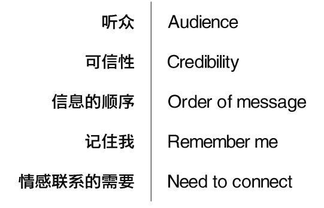

# 引  言 

 Introduction  

  
  

将信息传达给听众，今天比以往任何时候都要困难。

> > 更多的信息、更多的干扰因素和较短的注意力集中时限使每条创建的信息都面临着竞争。

更多的信息、更多的干扰因素和较短的注意力集中时限使每条创建的信息都面临着竞争。我们很难专注于聆听某个信息，非常容易从一个思路跳到另一个思路。这种跳跃和分散的倾听行为让我想起曾经在院子里看到的松鼠。它们不停地移动，似乎烦躁不安，眼中没有任何关注的重点，唯一能够吸引它们并保持长期兴趣的只有橡果。

通过多年来的研究和教学，我发现今天的听众的专注度就像松鼠一样。有一个方法能够吸引并保持他们的注意力。本书所讨论的橡果策略（ACORN）是一个有效的沟通工具，能够让听众的注意力集中在你所传递的信息上。要记住：无论你多么聪明，如果你不能将信息传达出去，你就不能领导企业，不能进行销售、教育、说服、倡议、帮助。

但是，今天听众的注意力时限是否真的和松鼠类似呢？  
  

关于松鼠的注意力：

● 一般事物的注意力为 1 秒钟，但在橡果上的注意力可以达到 4 分钟。

关于人类的注意力：

● 浏览网页时，我们的注意力和金鱼的注意力一样，时间为 9 秒钟。

● 在最近几年里，专栏文章的数量减少了 25%。毫无疑问，几代人对新媒体做出的让步，尤其是在专注时间不断持续缩短的时代，读者更倾向于读到一半就放弃了，而不会持续关注你的下一个话题。

● 99%的商业人士称他们今天的注意力持续时间要少于三年前。

当今的听众——像松鼠一样的人类 

今天我们被更多的数据所包围，数据量远远多于以前。 2010 年，世界人口每年产生的数据量已经达到 9880 亿千兆字节，并且仍在持续增长。不幸的是，注意力的持续时间并没有呈现明显增长，不能满足新信息量的增长需要。注意力持续时间随着时间的推移而不断变化。

> > 注意力持续时间随着时间的推移而不断变化。

在 19 世纪，林肯和道格拉斯的辩论通过报纸传达给听众。 1854 年 10 月，道格拉斯发表了长达 3 小时的演讲。林肯紧接着进行了 3 小时的反击。道格拉斯反过来又进行了长达 1 小时反驳。很明显，他演讲的时候没有任何图片或者图像（或者 PPT）来辅助。  
  

今天究竟是什么样的美国听众愿意聆听七个小时的唇枪舌战，尤其是考虑到这些绅士甚至都不是总统候选人？

今天，美国的听众甚至不愿意听到总统的美国国情咨文演说。现在面对非常重要的信息，通常我们也不是一个好的听众。

当有谣言称巴拉克·奥巴马要做的美国国情咨文演说的计划时间与电视剧《迷失》的最后一季播放的时间相冲突时，该电视剧的粉丝一片哗然。这一时间冲突事件被推上了风口浪尖，甚至还被《华盛顿邮报》报道出来。美国广播公司（ABC）播音员安·坎普顿（Ann Compton）在白宫新闻发布会上提到了这一时间冲突问题。新闻发言人罗伯特·吉布斯（Robert Gibbs）是这样回答的：“我并没有预见到总统的讲演会占用数百万想要看《迷失》结局的观众的时间。”

显然我们更喜欢娱乐消遣，而不是获取知识和信息。你的信息正在和较短的注意力持续时间、大量信息及盲目的分心进行着竞争。

> > 如何使你的信息变得与众不同，就像橡果对松鼠那样特别？

如何使你的信息变得与众不同，就像橡果对松鼠那样特别？是否有某种方式会使你的信息不仅能够被听到，而且还要被记住，具有说服力，从而影响到听者？

这正如尔玛·邦贝克（Erma Bombeck）所说的：“在超级复杂的信息社会里，我们经常遭遇没有听众的困境，这似乎是相当不协调的情况。”

花点时间，思考一下生活中的那些松鼠。老板？配偶？儿童？朋友？客户？高管？还是学生？  
  

你的橡果 

  
  

> > 本书将提供给读者一个简单实用的说服策略，使信息传递更为高效。

本书将提供给读者一个简单实用的说服策略，使信息传递更为高效。它将帮助你创建自己的橡果。当松鼠有了自己的橡果之后，它们开始集中注意力，并且注意力持续的时间增加了 23900%。如果你为听众创造了类似橡果的东西，那么你的信息将会更容易传递出去。

通过严谨的学术研究和对成百上千的公司经理、销售代表和工商管理硕士（MBA）学生的授课，我发现要使你的信息变成松鼠眼中的橡果，有五个关键的因素。分别为：

听众——信息传递并不是你想要说什么，而是听众想要听到什么。听众能从你提供的信息中得到什么？记住我们有“远程控制”长度的注意力持续时间。如果你讲话的内容不能引起听众的兴趣，或者与听众毫无关系，那么听众将不再聆听。如果对于听众来说，你所讲的话题不是他们眼中的“橡果”，他们就会前往下一条信息。

可信性——为什么你是最适合传达这一信息的人？在今天这个社会，人人都有发言的权利，同样都有表达自已观点的方式，那么你将如何从众多信息脱颖而出呢？什么能够使听众相信你是最富有见识且是唯一一个我们应该去聆听的人？

信息的顺序——通过调研，我们知道不能通过带有模糊的方式来得到我们的重点或者主要信息。除非这是一个精彩的故事，通常在随意场景中，我们宁愿讲重点。在商业环境或者销售过程中尤其重要，我们需要重新思考信息的结构，以便听众能够给我们一个机会，使我们的重点信息能够传递出去。

记住我——由于我们身边会有一些差劲的聆听者，现在出于讲演者的责任，我们需要简单地了解各种信息。听众要能够毫无困难地了解你所说的信息。我们不应该强迫听众去做不可能做到的事情。即使当你有很多话要说时，讲演者也需要确保信息简单明确，便于“咀嚼和消化”，这样我们才能将信息内化并被记住。

情感联系的需要——我们曾经声称，在商业世界里，信息的情感联系无容身之处，但这样的日子已经离我们远去。研究表明，人类需要感觉到某些事情，进而采取行动。事实的逻辑顺序可能会在这一辩论中获胜，但当我们想要听众改变观念或者让他们做特定行为时，这是远远不够的。词语选择和视觉语言等工具可以帮助我们建立联系，而无须在面对严肃的谈话时显得过于“软弱”。

  
  

说服的必要性 

  
  

在最近的一次研讨会上，我需要帮助一群高管提高讲演的说服力，使他们在讲台表现得更好。他们都是有能力且充满自信的讲演者，知道姿态端正并直视听众，不断变换语调，以及使用不同的手势。对于听众来说，他们的话很容易理解，但即便拥有这些讲演优势，听众仍然很难全神贯注地聆听。

一些高管的工作是将非常专业的技术信息展示给听众。他们看到了工作与信息相关的重要性。事实上那并不重要，听众不能理解这些信息，不愿意去聆听，并非常容易对这些信息失去兴趣，而他们却认为这些信息是极其重要的。

随着研讨会的进行，我不得不从根本上改变他们对实现目的的思考方式。每当他们传递出一个信息时，它并不仅仅是简单的“信息转储”，甚至是错失了一次说服听众的机会。

> > 每次就某一话题进行讲演时，你应该试图说服你的听众。

每次就某一话题进行讲演时，你应该试图说服你的听众。即使这一话题并不具有争议性，你也应尽量尝试说服你的听众。想要他们同意你的观点，或者认同你是这一领域的专家，抑或使听众看到你的视角及后期的解决方案。

在这些高管发言时，往往是回顾公司的数据和业绩成果，一页一页翻动的数据，没有任何东西能让听众去做点什么或者感受到什么。简单而言，对于这些听众来说，没有找到能够吸引和维持他们兴趣的“橡果”。他们在向听众传递信息，而不是让听众接受信息。

开始我们的说服过程很重要的一点是，要把每条信息看作是与听众分享信息内在含义的机会。不仅是信息、事实或者故事，还有含义。说服听众不是简单的“赢得辩论”。“说服”一词的定义是：“通过辩论、恳求或者劝告的方式，使之转移到某一信仰、观点或者行动。”

通过说服工作，我们并不是想要赢得辩论，而是希望某些人能够接受新的思想或行为。为你的听众创造一个“橡果”，是实现这一目标的重要工具。

花几分钟时间将简单的沟通策略汇总起来，这样做是否值得？你首先传达的信息是否是最重要的？你讲演的结构顺序是否正确？作为一个讲演者，确保信息能够被听众听到、理解和记住，这是否是你的责任？

建立一个橡果策略并非难事，这只是常识而已。做到这点不需要花很长时间。但是，这一简单的策略却会对你的信息以及听众的反应造成根本的影响。

本书中将探讨橡果策略的各各因素，使你的信息成为听众眼中的橡果。在最后，将给出一些有关如何成为强有力讲演者和领导者的具体建议及工具，使你的信息能够成功地传递给听众。

题外话 

在此需要向远在澳大利亚的同事致歉，因为澳大利亚是地球上为数不多的没有松鼠的地方。松鼠生长在美洲、欧洲、亚洲和非洲。

有趣的是，在美国，松鼠的最大的集聚区域是白宫对面的拉斐特公园（Layfette Park）。